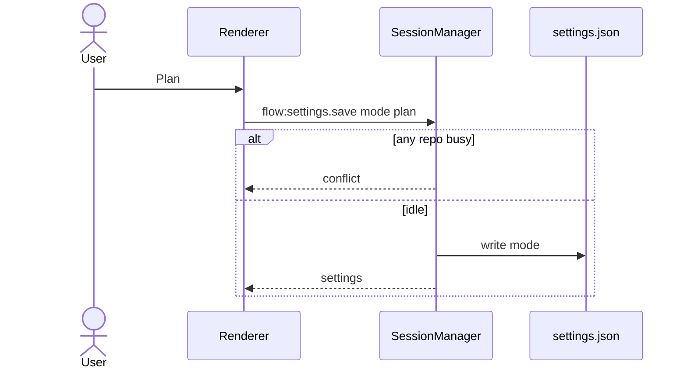

# Agent mode and plan card

## Overview

Mango gains one workspace setting, `mode`, whose values are `agent` and `plan`. The default is `agent`. Every send passes that value to the Cursor SDK as the conversation mode. When a run in Plan mode finishes a `createPlan` tool call, the chat shows the plan markdown as a document card instead of a one-line tool log.

**Out of scope:** Ask mode and any read-only tool lock (D-12 stays). A per-repo mode. A Build button that switches back to Agent and implements the plan. Editing the plan in the card. Rendering Mermaid diagrams inside the plan. A new markdown library. Restyling the rules, skills, and `AGENTS.md` tabs.

**Implements / relates to:** D-13 (this plan records it). SDK 1.2.0 `AgentModeOption` is `"agent" | "plan"` on `AgentOptions.mode` ("Initial conversation mode") and `SendOptions.mode` ("Conversation mode for this send"). `CreatePlanArgs` is `{ plan: string }` and `CreatePlanSuccess` is `{}` in `@cursor/sdk` `tool-call-types.d.ts`. `SDKToolUseMessage.truncated` is `{ args?: boolean; result?: boolean }`.

**Assumption:** one mode for the whole workspace, stored next to the model. Switching it does not create a new agent. The next send passes the new mode. Changing it is refused while any repo is streaming, stopping, or waiting for an answer, the same as changing the model.

**Assumption:** the control's CSS class is `agent-mode`. `mode-switch` is already the tab bar in `Instructions.tsx` (rules, skills, `AGENTS.md`). Reusing it would restyle those tabs.

**Assumption:** on Setup the control is its own field, labeled Mode, after the model field. The model section's label is "Model", so the control does not sit inside that section. The chat header has no extra label; the buttons read Agent and Plan.

## Pros / Cons

**Pros**
- The SDK already has the mode. The app only stores it and passes it on create and on send.
- The plan text is kept on the tool message, so reopening the chat shows the same card.
- The card is React elements. The plan text is never inserted as HTML.

**Cons**
- The markdown renderer covers headings, paragraphs, lists, fenced code, inline code, and bold. Nested lists and Mermaid stay plain.
- Mode is shared by every repo. One busy repo blocks a mode change for the workspace.
- A settings file whose `mode` is not `agent` or `plan` is quarantined by the existing unreadable-file path.

## How It Works

The user picks Agent or Plan. Main stores that on `settings.json`. The next message in any repo is sent to the SDK with that mode. In Plan mode the agent can call `createPlan`. While that call is running the thread shows "Writing a plan…". When it finishes with plan text, that row becomes a Plan card. Other tools stay one line. To have the agent implement the plan, the user switches back to Agent and sends another message.

### Flow: change mode

1. The user clicks Plan in the chat header or on Setup.
2. The renderer calls `flow:settings.save` with `{ mode: "plan" }`.
3. Main refuses with `conflict` and "Wait for every running agent to finish" if any repo is busy. Otherwise it writes `mode` and returns the settings.
4. The picker shows Plan. The open agent is not disposed.



**Example:** settings file `{ "folder": "/tmp/ws", "model": "composer", "theme": "system" }` reads as mode `agent`. Saving `{ mode: "plan" }` while idle makes the next `agent.send` use `mode: "plan"`.

### Flow: a plan appears in the chat

1. The user sends a message while mode is `plan`.
2. `chat-session` reads `mode` from settings and passes it to `ensure` and `beginSend`.
3. `agent-service` calls `Agent.create({ mode })` for a new agent and `agent.send(prompt, { mode })` for every send. An agent already open for that repo is not recreated; that send still passes `mode`.
4. A `tool_call` whose name normalizes to `createplan` becomes a tool event. While `running`, the summary is "Writing a plan" and there is no plan text. When `completed`, the event carries `args.plan` (capped at 200000 characters) and summary "Plan".
5. Main stores `plan` and, when the text was cut, `truncated` on the tool message, and emits `chat.tool`.
6. The renderer draws a Plan card for a finished tool that has plan text. Reloading the chat reads the same message.

**Before:** `createPlan · done · {"plan":"# Title…` clipped at 160 characters.

**After:** a card labeled Plan, with the heading, paragraphs, lists, and code rendered. A cut-off plan has the line "This plan was cut off." under the card.

**Example:** args `{ plan: "# Ship it\n\n- one" }` and status `completed` render a heading "Ship it" and a list item "one".

## Current State Analysis

**✅ Exists**
- `AgentOptions.mode` and `SendOptions.mode` on `@cursor/sdk` 1.2.0, type `"agent" | "plan"`. `agent-service.ts` passes `mode` on create and send (Step 4). `ensure` still returns the in-memory agent when `fresh` is false and the cwd matches.
- Settings live in `settings.json` through `createSettingsStore`. `flow:settings.save` accepts `folder`, `model`, `mode`, and `theme`. A missing `mode` reads as `agent` (Step 1). Folder, model, and mode saves are refused while any repo is busy (`session-manager.ts` `save`, Step 2). Zod 4.6.7 `.default("agent")` fills a missing key. Any other value fails the object parse, and `readJson` quarantines the file.
- Tool messages and `chat.tool` carry `plan` and `truncated` when a finished `createPlan` has plan text (Steps 1 and 4). `SDKToolUseMessage` has `args`, `result`, and `truncated`.
- The chat header and Setup have an Agent / Plan control, class `agent-mode` (Step 6). A finished tool with plan text renders `PlanCard`. A running `createPlan` shows "Writing a plan…". Setup's `locked` prop is `anyBusy(state)`.
- `.mode-switch` in `styles.css` and `Instructions.tsx` is the rules, skills, and `AGENTS.md` tab bar. It uses `aria-current`.
- `src/shared/plan-markdown.ts` parses plan markdown, and `npm run check:plan` covers it (Step 3). `pushText` joins adjacent text so an unclosed `**` is one text run.
- Checks are Node scripts: `scripts/repos-check.ts` (`npm run check:repos`), `scripts/plan-check.ts`, and `scripts/mention-check.ts`. `tsconfig.json` sets `exactOptionalPropertyTypes` and `verbatimModuleSyntax`.

**❌ Missing Components**
- None. The Agent / Plan control and `PlanCard` are in the renderer (Step 6). D-13 and the doc edits are applied (Step 7).

## Implementation Steps

### ✅ Step 1: Add mode and plan fields to the contracts and the settings file
- **Files:** `src/shared/ipc.ts`, `src/main/settings-store.ts`, `src/renderer/App.tsx`, `scripts/repos-check.ts`
- **Change:** `Settings` gains `mode`. A missing `mode` in an old `settings.json` parses as `agent`, so the file is not quarantined. Tool messages and `chat.tool` may carry `plan` and `truncated`. The boot-failed settings object includes `mode` so the project type-checks. The check proves a file without `mode` reads as `agent`, and a later theme save keeps `plan`.

**Code**

`src/shared/ipc.ts` (after `ThemeSchema`)
```ts
export const AgentModeSchema = z.enum(["agent", "plan"]);
export type AgentMode = z.infer<typeof AgentModeSchema>;

export const PLAN_TEXT_MAX = 200_000;
```

`src/shared/ipc.ts` (modify `SettingsSchema`)
```ts
export const SettingsSchema = z.object({
  /** Workspace folder. Repos are its child git directories, or this folder when it is the only repo. */
  folder: z.string().nullable(),
  model: z.string().nullable(),
  mode: AgentModeSchema,
  theme: ThemeSchema,
  keySet: z.boolean(),
  /** The stored folder path is set, and that path is not a directory now. */
  folderMissing: z.boolean(),
  setupComplete: z.boolean(),
});
```

`src/shared/ipc.ts` (modify the `role: "tool"` arm of `MessageSchema`)
```ts
  z.object({
    id: z.string().min(1),
    role: z.literal("tool"),
    name: z.string().min(1),
    summary: z.string(),
    status: z.enum(["ok", "error"]),
    at: z.string().min(1),
    plan: z.string().max(PLAN_TEXT_MAX).optional(),
    truncated: z.boolean().optional(),
  }),
```

`src/shared/ipc.ts` (modify `flow:settings.save` input)
```ts
  "flow:settings.save": {
    input: z
      .object({
        folder: z.string().min(1).optional(),
        model: z.string().min(1).optional(),
        mode: AgentModeSchema.optional(),
        theme: ThemeSchema.optional(),
      })
      .strict(),
    output: SettingsSchema,
  },
```

`src/shared/ipc.ts` (modify the `chat.tool` arm of `EventSchema`)
```ts
  z.object({
    type: z.literal("chat.tool"),
    repo: RepoNameSchema,
    runId: RunId,
    toolCallId: z.string().min(1),
    name: z.string().min(1),
    status: z.enum(["running", "ok", "error"]),
    summary: z.string(),
    plan: z.string().max(PLAN_TEXT_MAX).optional(),
    truncated: z.boolean().optional(),
  }),
```

`src/main/settings-store.ts` (modify the import, `SettingsFile`, the schema, the empty file, `view`, and `save`)
```ts
import { MessageSchema, type AgentMode, type Message, type Settings, type Theme } from "../shared/ipc.js";
```

```ts
type SettingsFile = {
  folder: string | null;
  model: string | null;
  mode: AgentMode;
  theme: Theme;
};

const SettingsFileSchema = z.object({
  folder: z.string().nullable(),
  model: z.string().nullable(),
  mode: z.enum(["agent", "plan"]).default("agent"),
  theme: z.enum(["system", "light", "dark"]),
});

const EMPTY_SETTINGS: SettingsFile = { folder: null, model: null, mode: "agent", theme: "system" };
```

```ts
  save(partial: { folder?: string; model?: string; mode?: AgentMode; theme?: Theme }): Settings;
```

```ts
    return {
      folder: file.folder,
      model: file.model,
      mode: file.mode,
      theme: file.theme,
      keySet,
      folderMissing: file.folder !== null && !folderOk,
      setupComplete: keySet && folderOk && file.model !== null,
    };
```

```ts
  function save(partial: { folder?: string; model?: string; mode?: AgentMode; theme?: Theme }): Settings {
    const current = readSettings();
    const next: SettingsFile = {
      folder: partial.folder === undefined ? current.folder : resolveFolder(partial.folder),
      model: partial.model === undefined ? current.model : partial.model,
      mode: partial.mode === undefined ? current.mode : partial.mode,
      theme: partial.theme === undefined ? current.theme : partial.theme,
    };
    writeJson(settingsPath, next);
    return view();
  }
```

The `SettingsStore` type's `save` signature is the same partial as the inner `save` function. Update both.

`src/renderer/App.tsx` (modify the `boot-failed` settings object)
```ts
          settings: {
            folder: null,
            model: null,
            mode: "agent",
            theme: "system",
            keySet: false,
            folderMissing: false,
            setupComplete: false,
          },
```

`scripts/repos-check.ts` (add `writeFileSync` to the `node:fs` import, then this test after the symlink test)
```ts
import { mkdtempSync, mkdirSync, realpathSync, rmSync, symlinkSync, writeFileSync } from "node:fs";
```

```ts
test("a settings file without mode reads as agent, and a theme save keeps plan", () => {
  const root = workspace();
  try {
    const dir = path.join(root, "data");
    mkdirSync(dir);
    writeFileSync(path.join(dir, "settings.json"), JSON.stringify({ folder: null, model: null, theme: "system" }));
    const store = createSettingsStore({ userDataDir: dir, secrets });
    assert.equal(store.view().mode, "agent");
    store.save({ mode: "plan" });
    assert.equal(store.view().mode, "plan");
    store.save({ theme: "dark" });
    assert.equal(store.view().mode, "plan");
    assert.equal(store.view().theme, "dark");
  } finally {
    rmSync(root, { recursive: true, force: true });
  }
});
```

### ✅ Step 2: Refuse a mode change while a repo is busy
- **Files:** `src/main/ipc.ts`, `src/main/session-manager.ts`, `scripts/repos-check.ts`
- **Change:** `save` accepts `mode` and treats it like `model`: any busy repo returns `conflict`. Theme saves stay allowed. The check mirrors the existing model test.

**Code**

`src/main/ipc.ts` (modify `saveInput`)
```ts
function saveInput(input: InputOf<"flow:settings.save">): { folder?: string; model?: string; mode?: "agent" | "plan"; theme?: "system" | "light" | "dark" } {
  const partial: { folder?: string; model?: string; mode?: "agent" | "plan"; theme?: "system" | "light" | "dark" } = {};
  if (input.folder !== undefined) partial.folder = input.folder;
  if (input.model !== undefined) partial.model = input.model;
  if (input.mode !== undefined) partial.mode = input.mode;
  if (input.theme !== undefined) partial.theme = input.theme;
  return partial;
}
```

`src/main/session-manager.ts` (modify the type import and both `save` signatures: the `SessionManager` type and the inner function)
```ts
import { BUSY_CAP_MESSAGE, MAX_BUSY_REPOS, type AgentMode, type ChatStateName, type FlowEvent, type Message, type PendingQuestion, type RepoListItem, type Settings, type Theme } from "../shared/ipc.js";
```

```ts
  save(partial: { folder?: string; model?: string; mode?: AgentMode; theme?: Theme }): Promise<Settings>;
```

```ts
  async function save(partial: { folder?: string; model?: string; mode?: AgentMode; theme?: Theme }): Promise<Settings> {
    if ((partial.folder !== undefined || partial.model !== undefined || partial.mode !== undefined) && anyBusy()) {
      throw new SessionError("conflict", "Wait for every running agent to finish", false);
    }
    const previous = store.view().folder;
    let next: Settings;
    try {
      next = store.save(partial);
    } catch (error) {
      throw new SessionError("io_error", errorText(error), false);
    }
    if (next.folder !== previous) await disposeAll();
    return next;
  }
```

`scripts/repos-check.ts` (after the test "saving the model is refused while a repo is busy")
```ts
test("saving the mode is refused while a repo is busy", async () => {
  const root = workspace();
  try {
    gitRepo(path.join(root, "api"));
    const manager = hangingManager(root);
    void manager.send("api", "hello");
    await waitFor(() => (manager.state("api").state === "streaming" ? true : null));
    await assert.rejects(manager.save({ mode: "plan" }), (error: unknown) => error instanceof SessionError && error.code === "conflict");
  } finally {
    rmSync(root, { recursive: true, force: true });
  }
});
```

### ✅ Step 3: Parse plan markdown
- **Files:** `src/shared/plan-markdown.ts`, `scripts/plan-check.ts`, `package.json`
- **Change:** A pure parser turns the plan string into blocks. `isCreatePlan` recognizes the tool name. The check script covers headings, lists, fences, inline code, bold, and the tool name. An unclosed fence drops the empty string that `split("\n")` adds after a final newline, so the text matches a closed fence. `pushText` joins a following text piece onto the previous text piece, so an unclosed `**` stays one text run. No React and no new dependency.

**Code**

`src/shared/plan-markdown.ts` (new file)
```ts
export type PlanInline =
  | { type: "text"; text: string }
  | { type: "code"; text: string }
  | { type: "strong"; text: string };

export type PlanBlock =
  | { type: "heading"; level: 1 | 2 | 3; inlines: PlanInline[] }
  | { type: "paragraph"; inlines: PlanInline[] }
  | { type: "list"; ordered: boolean; items: PlanInline[][] }
  | { type: "code"; text: string };

export function isCreatePlan(name: string): boolean {
  return name.toLowerCase().replaceAll("_", "").replaceAll("-", "") === "createplan";
}

export function parsePlan(markdown: string): PlanBlock[] {
  const lines = markdown.replaceAll("\r\n", "\n").split("\n");
  const blocks: PlanBlock[] = [];
  let index = 0;
  while (index < lines.length) {
    const line = lines[index] ?? "";
    if (line.trim() === "") {
      index += 1;
      continue;
    }
    if (line.startsWith("```")) {
      const body: string[] = [];
      index += 1;
      while (index < lines.length && !(lines[index] ?? "").startsWith("```")) {
        body.push(lines[index] ?? "");
        index += 1;
      }
      if (index < lines.length) index += 1;
      else if (body[body.length - 1] === "") body.pop();
      blocks.push({ type: "code", text: body.join("\n") });
      continue;
    }
    const heading = /^(#{1,3})[ \t]+(.+)$/.exec(line);
    if (heading) {
      const marks = heading[1] ?? "#";
      const level = marks.length === 1 ? 1 : marks.length === 2 ? 2 : 3;
      blocks.push({ type: "heading", level, inlines: parseInlines(heading[2] ?? "") });
      index += 1;
      continue;
    }
    if (/^[-*][ \t]+/.test(line) || /^\d+\.[ \t]+/.test(line)) {
      const ordered = /^\d+\./.test(line);
      const items: PlanInline[][] = [];
      while (index < lines.length) {
        const current = lines[index] ?? "";
        const bullet = ordered ? /^\d+\.[ \t]+(.*)$/.exec(current) : /^[-*][ \t]+(.*)$/.exec(current);
        if (!bullet) break;
        items.push(parseInlines(bullet[1] ?? ""));
        index += 1;
      }
      blocks.push({ type: "list", ordered, items });
      continue;
    }
    const paragraph: string[] = [line.trim()];
    index += 1;
    while (index < lines.length) {
      const current = lines[index] ?? "";
      if (
        current.trim() === "" ||
        current.startsWith("```") ||
        /^(#{1,3})[ \t]+/.test(current) ||
        /^[-*][ \t]+/.test(current) ||
        /^\d+\.[ \t]+/.test(current)
      ) {
        break;
      }
      paragraph.push(current.trim());
      index += 1;
    }
    blocks.push({ type: "paragraph", inlines: parseInlines(paragraph.join(" ")) });
  }
  return blocks;
}

function parseInlines(source: string): PlanInline[] {
  const inlines: PlanInline[] = [];
  let rest = source;
  while (rest !== "") {
    const codeAt = rest.indexOf("`");
    const strongAt = rest.indexOf("**");
    const next = earliest(codeAt, strongAt);
    if (next === null) {
      pushText(inlines, rest);
      break;
    }
    if (next.index > 0) pushText(inlines, rest.slice(0, next.index));
    if (next.kind === "code") {
      const end = rest.indexOf("`", next.index + 1);
      if (end === -1) {
        pushText(inlines, rest.slice(next.index));
        break;
      }
      inlines.push({ type: "code", text: rest.slice(next.index + 1, end) });
      rest = rest.slice(end + 1);
      continue;
    }
    const end = rest.indexOf("**", next.index + 2);
    if (end === -1) {
      pushText(inlines, rest.slice(next.index));
      break;
    }
    inlines.push({ type: "strong", text: rest.slice(next.index + 2, end) });
    rest = rest.slice(end + 2);
  }
  return inlines.filter((item) => item.type !== "text" || item.text !== "");
}

function earliest(codeAt: number, strongAt: number): { kind: "code" | "strong"; index: number } | null {
  if (codeAt === -1 && strongAt === -1) return null;
  if (codeAt === -1) return { kind: "strong", index: strongAt };
  if (strongAt === -1) return { kind: "code", index: codeAt };
  return codeAt <= strongAt ? { kind: "code", index: codeAt } : { kind: "strong", index: strongAt };
}

function pushText(inlines: PlanInline[], text: string): void {
  if (text === "") return;
  const last = inlines[inlines.length - 1];
  if (last?.type === "text") {
    last.text += text;
    return;
  }
  inlines.push({ type: "text", text });
}
```

`scripts/plan-check.ts` (new file)
```ts
// Checks plan markdown parsing. No network and no Electron.
//   node --experimental-strip-types scripts/plan-check.ts
import assert from "node:assert/strict";
import test from "node:test";
import { isCreatePlan, parsePlan } from "../src/shared/plan-markdown.ts";

test("createPlan names match after case and separators", () => {
  assert.equal(isCreatePlan("createPlan"), true);
  assert.equal(isCreatePlan("CreatePlan"), true);
  assert.equal(isCreatePlan("create_plan"), true);
  assert.equal(isCreatePlan("create-plan"), true);
  assert.equal(isCreatePlan("plan"), false);
});

test("a plan becomes headings, a list, a paragraph, and a fence", () => {
  const blocks = parsePlan("# Ship it\n\nDo **this** with `code`.\n\n- one\n- two\n\n```\nconst n = 1;\n```\n");
  assert.equal(blocks[0]?.type, "heading");
  if (blocks[0]?.type === "heading") {
    assert.equal(blocks[0].level, 1);
    assert.deepEqual(blocks[0].inlines, [{ type: "text", text: "Ship it" }]);
  }
  assert.equal(blocks[1]?.type, "paragraph");
  if (blocks[1]?.type === "paragraph") {
    assert.deepEqual(blocks[1].inlines, [
      { type: "text", text: "Do " },
      { type: "strong", text: "this" },
      { type: "text", text: " with " },
      { type: "code", text: "code" },
      { type: "text", text: "." },
    ]);
  }
  assert.equal(blocks[2]?.type, "list");
  if (blocks[2]?.type === "list") {
    assert.equal(blocks[2].ordered, false);
    assert.equal(blocks[2].items.length, 2);
  }
  assert.deepEqual(blocks[3], { type: "code", text: "const n = 1;" });
});

test("an ordered list stays ordered and an unclosed fence keeps the rest", () => {
  const listed = parsePlan("1. first\n2. second\n");
  assert.equal(listed[0]?.type, "list");
  if (listed[0]?.type === "list") assert.equal(listed[0].ordered, true);
  const open = parsePlan("```\nline\n");
  assert.deepEqual(open, [{ type: "code", text: "line" }]);
});

test("an unclosed bold mark stays text", () => {
  const blocks = parsePlan("keep **open");
  assert.equal(blocks[0]?.type, "paragraph");
  if (blocks[0]?.type === "paragraph") {
    assert.deepEqual(blocks[0].inlines, [{ type: "text", text: "keep **open" }]);
  }
});

test("a fourth-level heading and an indented bullet stay paragraphs", () => {
  const blocks = parsePlan("#### Later\n\n  - nested");
  assert.equal(blocks[0]?.type, "paragraph");
  assert.equal(blocks[1]?.type, "paragraph");
});
```

`package.json` (add this script after `check:repos`)
```json
    "check:repos": "node --disable-warning=ExperimentalWarning --experimental-strip-types --import ./scripts/repos-check-resolve.mjs scripts/repos-check.ts",
    "check:plan": "node --disable-warning=ExperimentalWarning --experimental-strip-types scripts/plan-check.ts",
```

### ✅ Step 4: Pass the mode and keep the plan text
- **Files:** `src/main/agent-service.ts`, `src/main/chat-session.ts`
- **Change:** Create and every send receive the mode from settings. Leave the early return in `ensure` as it is: an agent already open for that cwd is not recreated, and `beginSend` passes `mode` on `agent.send`. A `createPlan` call keeps `args.plan` on the tool event instead of the 160-character summary. The plan is stored on the tool message only when the call has completed. A running call does not persist, which is already how other tools work. `persistTool` writes the event's plan fields and does not copy a plan from the previous message.

**Code**

`src/main/agent-service.ts` (add these imports next to the existing `../shared/questions.js` import)
```ts
import { PLAN_TEXT_MAX, type AgentMode } from "../shared/ipc.js";
import { isCreatePlan } from "../shared/plan-markdown.js";
```

`src/main/agent-service.ts` (modify `AgentStreamEvent`, `EnsureInput`, and `SendInput`)
```ts
export type AgentStreamEvent =
  | { type: "delta"; text: string }
  | {
      type: "tool";
      toolCallId: string;
      name: string;
      status: "running" | "ok" | "error";
      summary: string;
      plan?: string;
      truncated?: boolean;
    }
  | { type: "done"; stopReason: "end" | "stopped" }
  | { type: "error"; code: "auth" | "agent_error"; message: string; retryable: boolean };

type EnsureInput = {
  apiKey: string;
  modelId: string;
  cwd: string;
  agentId: string | null;
  /** Skip the in-memory agent and Agent.resume so the next create reads the project files again. */
  fresh: boolean;
  mode: AgentMode;
};

type SendInput = {
  apiKey: string;
  modelId: string;
  prompt: string;
  mode: AgentMode;
  onEvent: (event: AgentStreamEvent) => void;
};
```

`src/main/agent-service.ts` (modify the `agent.send` call inside `beginSend`)
```ts
      run = await current.agent.send(input.prompt, {
        model: { id: input.modelId },
        mode: input.mode,
        local: { customTools: questionTools(hooks.ask) },
      });
```

`src/main/agent-service.ts` (modify `agentOptions`)
```ts
function agentOptions(input: EnsureInput, ask: AskUser): AgentOptions {
  const settingSources: Array<"project"> = ["project"];
  return {
    apiKey: input.apiKey,
    model: { id: input.modelId },
    mode: input.mode,
    local: { cwd: input.cwd, settingSources, customTools: questionTools(ask) },
  };
}
```

`src/main/agent-service.ts` (replace the tool branch of `emitMessage`, and add the helpers after `isQuestionTool`)
```ts
  if (message.type !== "tool_call") return;
  const name = message.name.trim() === "" ? "tool" : message.name;
  const toolCallId = message.call_id.trim() === "" ? `${name}-call` : message.call_id;
  const status = message.status === "completed" ? "ok" : message.status === "error" ? "error" : "running";
  const raw = message.status === "running" ? message.args : (message.result ?? message.args);
  const summary = isCreatePlan(name) ? planSummary(status) : (questionLine(name, status, raw) ?? summarize(raw));
  emit(accumulated, {
    type: "tool",
    toolCallId,
    name,
    status,
    summary,
    ...planFields(name, message),
  });
```

```ts
function planSummary(status: "running" | "ok" | "error"): string {
  if (status === "running") return "Writing a plan";
  if (status === "error") return "The plan failed";
  return "Plan";
}

function planFields(name: string, message: Extract<SDKMessage, { type: "tool_call" }>): { plan?: string; truncated?: boolean } {
  if (!isCreatePlan(name) || message.status !== "completed") return {};
  const text = readPlan(message.args);
  if (text === null) return {};
  const over = text.length > PLAN_TEXT_MAX;
  const plan = over ? text.slice(0, PLAN_TEXT_MAX) : text;
  if (over || message.truncated?.args === true) return { plan, truncated: true };
  return { plan };
}

function readPlan(value: unknown): string | null {
  if (!value || typeof value !== "object") return null;
  const plan = (value as { plan?: unknown }).plan;
  if (typeof plan !== "string") return null;
  return plan === "" ? null : plan;
}
```

`SDKMessage` is already imported in this file. With `exactOptionalPropertyTypes`, `planFields` must return `{}` or an object whose `plan` is a string. Do not set `plan: undefined`.

`src/main/chat-session.ts` (modify `ensure` and `beginSend` inside `send`)
```ts
      const ensured = await agents.ensure({
        apiKey: key,
        modelId: current.model,
        cwd: repoPath,
        agentId: fresh ? null : prior.agentId,
        fresh,
        mode: current.mode,
      });
```

```ts
      await agents.beginSend({
        apiKey: key,
        modelId: current.model,
        mode: current.mode,
        prompt,
        onEvent: (event) => handleStream(nextGeneration, event),
      });
```

`src/main/chat-session.ts` (modify the `chat.tool` emit inside `handleStream`)
```ts
    if (event.type === "tool") {
      emit({
        type: "chat.tool",
        runId: run.id,
        toolCallId: event.toolCallId,
        name: event.name,
        status: event.status,
        summary: event.summary,
        ...(event.plan !== undefined ? { plan: event.plan } : {}),
        ...(event.truncated === true ? { truncated: true } : {}),
      });
      if (event.status !== "running") persistTool(current, event);
      return;
    }
```

`src/main/chat-session.ts` (modify both tool message objects inside `persistTool`)
```ts
          return {
            id: message.id,
            role: "tool",
            name: event.name,
            summary: event.summary,
            status,
            at: message.at,
            ...(event.plan !== undefined ? { plan: event.plan } : {}),
            ...(event.truncated === true ? { truncated: true } : {}),
          };
```

```ts
        {
          id: event.toolCallId,
          role: "tool",
          name: event.name,
          summary: event.summary,
          status,
          at: new Date().toISOString(),
          ...(event.plan !== undefined ? { plan: event.plan } : {}),
          ...(event.truncated === true ? { truncated: true } : {}),
        },
```

There is no separate test in this step. The SDK is not called from the check scripts. `npm run typecheck` is the check. The plan text shape is covered by Step 3. The `hangingManager` fake in `scripts/repos-check.ts` can keep `async ensure()` with no parameters; a function with fewer parameters is still assignable to `AgentService`.

### ✅ Step 5: Keep the plan on the chat item
- **Files:** `src/renderer/state.ts`
- **Change:** A tool item can hold `plan` and `truncated`. History and live `chat.tool` events copy them. A later event that has no plan does not erase a plan already on the item. Do not assign `plan: undefined` (`exactOptionalPropertyTypes`).

**Code**

`src/renderer/state.ts` (modify the tool arm of `Item`)
```ts
  | { id: string; role: "tool"; name: string; summary: string; status: "running" | "ok" | "error"; at: string; plan?: string; truncated?: boolean }
```

`src/renderer/state.ts` (modify the tool arm of `toItems`)
```ts
      case "tool":
        return {
          id: message.id,
          role: "tool",
          name: message.name,
          summary: message.summary,
          status: message.status,
          at: message.at,
          ...(message.plan !== undefined ? { plan: message.plan } : {}),
          ...(message.truncated === true ? { truncated: true } : {}),
        };
```

`src/renderer/state.ts` (modify the tool object in `applyEvent`)
```ts
  if (event.type === "chat.tool") {
    const tool = {
      id: event.toolCallId,
      role: "tool" as const,
      name: event.name,
      summary: event.summary,
      status: event.status,
      at: new Date().toISOString(),
      ...(event.plan !== undefined ? { plan: event.plan } : {}),
      ...(event.truncated === true ? { truncated: true } : {}),
    };
```

`src/renderer/state.ts` (modify the existing-item branch of `upsertTool`)
```ts
    if (current?.role === "tool") {
      next[index] = {
        ...current,
        name: tool.name,
        summary: tool.summary,
        status: tool.status,
        ...(tool.plan !== undefined ? { plan: tool.plan } : {}),
        ...(tool.truncated === true ? { truncated: true } : {}),
      };
    }
```

There is no renderer check script. `npm run typecheck` is the check for this step.

### ✅ Step 6: Mode control and the plan card
- **Files:** `src/renderer/PlanCard.tsx`, `src/renderer/Setup.tsx`, `src/renderer/Chat.tsx`, `src/renderer/App.tsx`, `src/renderer/styles.css`
- **Change:** Agent and Plan are a control on the chat header and on Setup. The class is `agent-mode`. Do not change `.mode-switch` or `Instructions.tsx`. A finished tool with plan text renders as a document. A running `createPlan` is the line "Writing a plan…". The control is disabled while a save is pending or any repo is busy.

**Code**

`src/renderer/PlanCard.tsx` (new file)
```tsx
import type { ReactNode } from "react";
import { parsePlan, type PlanInline } from "../shared/plan-markdown.js";

export function PlanCard({ markdown, truncated }: { markdown: string; truncated: boolean }) {
  const blocks = parsePlan(markdown);
  return (
    <article className="plan-card">
      <p className="plan-label">Plan</p>
      <div className="plan-body">
        {blocks.map((block, index) => {
          if (block.type === "heading") {
            const content = renderInlines(block.inlines);
            if (block.level === 1) return <h2 key={index}>{content}</h2>;
            if (block.level === 2) return <h3 key={index}>{content}</h3>;
            return <h4 key={index}>{content}</h4>;
          }
          if (block.type === "list") {
            const items = block.items.map((item, itemIndex) => <li key={itemIndex}>{renderInlines(item)}</li>);
            if (block.ordered) return <ol key={index}>{items}</ol>;
            return <ul key={index}>{items}</ul>;
          }
          if (block.type === "code") {
            return (
              <pre key={index}>
                <code>{block.text}</code>
              </pre>
            );
          }
          return <p key={index}>{renderInlines(block.inlines)}</p>;
        })}
      </div>
      {truncated ? <p className="plan-note">This plan was cut off.</p> : null}
    </article>
  );
}

function renderInlines(inlines: PlanInline[]): ReactNode[] {
  return inlines.map((inline, index) => {
    if (inline.type === "code") return <code key={index}>{inline.text}</code>;
    if (inline.type === "strong") return <strong key={index}>{inline.text}</strong>;
    return <span key={index}>{inline.text}</span>;
  });
}
```

`src/renderer/Setup.tsx` (add `AgentMode` to the ipc import, add `onMode`, render a Mode section after the model section, and export `ModeSwitch` after `modelChoices`)
```ts
import type { AgentMode, Settings, Theme } from "../shared/ipc.js";
```

```ts
  onTheme: (theme: Theme) => void;
  onMode: (mode: AgentMode) => void;
  onBack: (() => void) | null;
```

```ts
export function Setup({ settings, models, modelsError, pending, repos, locked, onSaveKey, onClearKey, onPickFolder, onModel, onTheme, onMode, onBack }: SetupProps) {
```

After the model `</section>` and before `{onBack ? (`:
```tsx
        <section className="setup-field">
          <label>Mode</label>
          <ModeSwitch mode={settings.mode} disabled={pending || locked} onMode={onMode} />
        </section>
```

```tsx
const MODE_CHOICES = [
  { id: "agent", label: "Agent" },
  { id: "plan", label: "Plan" },
] as const;

export function ModeSwitch({ mode, disabled, onMode }: { mode: AgentMode; disabled: boolean; onMode: (mode: AgentMode) => void }) {
  return (
    <span className="agent-mode" role="group" aria-label="Mode">
      {MODE_CHOICES.map((choice) => (
        <button
          key={choice.id}
          type="button"
          disabled={disabled}
          aria-pressed={mode === choice.id}
          onClick={() => {
            if (choice.id !== mode) onMode(choice.id);
          }}
        >
          {choice.label}
        </button>
      ))}
    </span>
  );
}
```

`src/renderer/Chat.tsx` (imports, props, header control, and the tool branch of `Row`)
```ts
import type { AgentMode, Answers, ChatStateName, Theme } from "../shared/ipc.js";
import { isCreatePlan } from "../shared/plan-markdown.js";
import { Bot } from "./Bot.js";
import { PlanCard } from "./PlanCard.js";
import { QuestionForm } from "./QuestionForm.js";
import { ModeSwitch, modelChoices, ThemeSwitch } from "./Setup.js";
```

```ts
  model: string;
  mode: AgentMode;
  models: ModelChoice[];
```

```ts
  onTheme: (theme: Theme) => void;
  onMode: (mode: AgentMode) => void;
  onModel: (model: string) => Promise<boolean>;
```

Inside `.spacer`, before the model `<label>`:
```tsx
          <ModeSwitch mode={props.mode} disabled={busy || props.workspaceBusy || props.pending} onMode={props.onMode} />
          <label className="sr" htmlFor="header-model">
            Model
          </label>
```

Replace the `item.role === "tool"` branch of `Row`:
```tsx
  if (item.role === "tool") {
    if (item.status === "ok" && item.plan !== undefined && item.plan !== "") {
      return <PlanCard markdown={item.plan} truncated={item.truncated === true} />;
    }
    if (isCreatePlan(item.name) && item.status === "running") {
      return (
        <div className="tool-row">
          <div className="tool" data-phase="running">
            Writing a plan…
          </div>
        </div>
      );
    }
    const phase = item.status === "ok" ? "finished" : item.status === "error" ? "failed" : "running";
    const label = item.status === "ok" ? "done" : item.status === "error" ? "failed" : "running";
    const text = [item.name, label, item.summary].filter((part) => part !== "").join(" · ");
    return (
      <div className="tool-row">
        <div className="tool" data-phase={phase}>
          {text}
        </div>
      </div>
    );
  }
```

`src/renderer/App.tsx` (add `AgentMode` to the existing ipc import, extend `saveSettings`, pass mode into `Chat` and `Setup`)
```ts
import { BUSY_CAP_MESSAGE, MAX_BUSY_REPOS, busyRepoMessage, type AgentMode, type Answers, type ChatStateName, type FlowEvent, type Settings, type Theme } from "../shared/ipc.js";
```

```ts
  async function saveSettings(partial: { folder?: string; model?: string; mode?: AgentMode; theme?: Theme }): Promise<boolean> {
```

In `chatPane`, next to `model={current.model ?? ""}`:
```tsx
        model={current.model ?? ""}
        mode={current.mode}
        models={state.models}
```

```tsx
        onTheme={(theme) => void saveSettings({ theme })}
        onMode={(mode) => void saveSettings({ mode })}
        onModel={(model) => saveSettings({ model })}
```

On `<Setup>`, next to the existing `onTheme`:
```tsx
            onModel={(model) => saveSettings({ model })}
            onTheme={(theme) => void saveSettings({ theme })}
            onMode={(mode) => void saveSettings({ mode })}
```

`src/renderer/styles.css` (after the `.theme-switch button[aria-current="true"]` rule, before `.banners`). Leave the later `.mode-switch` rules unchanged.
```css
.agent-mode { display: inline-flex; gap: 4px; }
.agent-mode button {
  height: 30px;
  padding: 0 10px;
  border: 1px solid var(--line);
  background: var(--panel);
  border-radius: 8px;
  color: var(--ink);
}
.agent-mode button[aria-pressed="true"] {
  border-color: var(--accent);
  color: var(--accent);
  background: color-mix(in srgb, var(--accent) 14%, var(--panel));
}
.plan-card {
  max-width: 720px;
  margin: 8px 0 8px 42px;
  padding: 12px 14px;
  background: var(--panel);
  border: 1px solid var(--line);
  border-radius: 12px;
}
.plan-label {
  margin: 0 0 8px;
  font-size: 12px;
  color: var(--muted);
}
.plan-body h2 { margin: 0 0 8px; font-size: 18px; }
.plan-body h3, .plan-body h4 { margin: 12px 0 6px; font-size: 15px; }
.plan-body p, .plan-body li { margin: 0 0 8px; white-space: pre-wrap; overflow-wrap: anywhere; }
.plan-body ul, .plan-body ol { margin: 0 0 8px; padding-left: 1.2em; }
.plan-body pre {
  margin: 0 0 8px;
  padding: 8px 10px;
  overflow-x: auto;
  background: var(--soft);
  border-radius: 8px;
}
.plan-body code {
  font-family: ui-monospace, "SF Mono", Menlo, monospace;
  font-size: 13px;
}
.plan-note { margin: 0; font-size: 12px; color: var(--muted); }
```

There is no component test. `npm run typecheck` is the check. The Electron window is not driven in this step.

### ✅ Step 7: Update Documentation
- **Files:** `docs/decisions.md`, `docs/ipc-contract.md`, `docs/architecture.md`, `docs/session-and-questions.md`, `docs/README.md`, `README.md`
- **Change:** Record D-13 and update the settings, event, and chat descriptions so they match the mode switch and the plan card. The replacement text is in the Documentation Update section. Apply that section once. Do not apply it again from here.

**Code**

```markdown
Apply the fenced replacements in the Documentation Update section below. They are the only documentation edits.
```

## Edge Cases
- A `settings.json` with no `mode` reads as `agent`. Saving the theme afterward keeps the current mode.
- A `mode` other than `agent` or `plan` fails the file schema. `readJson` quarantines the file and the app uses the empty settings. That is the existing behavior for a bad `theme`.
- Changing mode while any repo is `streaming`, `awaitingAnswer`, or `stopping` returns `conflict`. The stored mode stays. Theme can still be saved.
- Switching mode does not dispose the agent. The send that starts after the save passes the new mode on `agent.send`. A run already in flight keeps the mode it started with. `ensure` still returns the in-memory agent when the cwd matches and `fresh` is false.
- A running `createPlan` shows "Writing a plan…" and does not render partial markdown. The plan text is taken from `args.plan` only when status is `completed`. The tool result is ignored for the card, because `CreatePlanSuccess` is an empty object.
- A completed `createPlan` with no string `plan` stays a one-line tool row: `createPlan · done · Plan`. An error stays a one-line row: `createPlan · failed · The plan failed`. The name is whatever the SDK sent.
- Plan text longer than 200000 characters is stored cut to that length with `truncated: true`. The card shows "This plan was cut off." The same note is shown when the SDK sets `truncated.args`.
- An old tool message without `plan` still parses. The chat shows the one-line tool row.
- A later `chat.tool` for the same id that omits `plan` does not clear a plan already on the renderer item. `persistTool` does not do that merge: a finished event that omits `plan` writes a tool message without `plan`. Running events are not persisted.
- Nested list items and `####` headings are paragraphs. A fenced `mermaid` block renders as code, not a diagram.
- An unclosed code fence keeps the remaining lines as code and drops one trailing empty line from `split` when the string ends with a newline. An unclosed `**` stays text.
- Home has no mode control. The first message from home uses the saved mode, because `chat-session` `send` reads `store.view().mode`.
- `.mode-switch` stays the instruction tabs. The Agent / Plan control uses `agent-mode` and `aria-pressed`.

## Testing Checklist
- [x] `npm run typecheck` passes
- [x] `npm run check:repos` passes, including the missing-mode test and the busy mode save
- [x] `npm run check:plan` passes
- [x] `npm run check:questions` and `npm run check:mentions` still pass
- [ ] With the app open: the header shows Agent selected. Switching to Plan, then sending, then receiving a `createPlan` result shows a Plan card rather than a one-line tool log. Switching back to Agent is refused while that run is in flight. The rules, skills, and `AGENTS.md` tabs still look as they did before. The Electron window was not driven.

## Files to Modify
- [x] `src/shared/ipc.ts`
- [x] `src/shared/plan-markdown.ts`
- [x] `src/main/settings-store.ts`
- [x] `src/main/ipc.ts`
- [x] `src/main/session-manager.ts`
- [x] `src/main/agent-service.ts`
- [x] `src/main/chat-session.ts`
- [x] `src/renderer/state.ts`
- [x] `src/renderer/PlanCard.tsx`
- [x] `src/renderer/Setup.tsx`
- [x] `src/renderer/Chat.tsx`
- [x] `src/renderer/App.tsx`
- [x] `src/renderer/styles.css`
- [x] `scripts/repos-check.ts`
- [x] `scripts/plan-check.ts`
- [x] `package.json`
- [x] `docs/decisions.md`
- [x] `docs/ipc-contract.md`
- [x] `docs/architecture.md`
- [x] `docs/session-and-questions.md`
- [x] `docs/README.md`
- [x] `README.md`

## Implementation Order
1. Step 1
2. Step 2
3. Step 3
4. Step 4
5. Step 5
6. Step 6
7. Step 7 (Update Documentation, always last)

## Documentation Update

### ✅ Step 7: Update Documentation (always the last step)

**Affected documents**

| Document | What changes | Status |
|----------|--------------|--------|
| `docs/decisions.md` | Add D-13. D-12 and Q-4 stay as they are. | done |
| `docs/ipc-contract.md` | Settings include `mode`. `chat.tool` and the tool message may include `plan` and `truncated`. Save notes the busy refusal. | done |
| `docs/architecture.md` | Settings row, snapshot sentence, security sentence, renderer screens, folder layout. | done |
| `docs/session-and-questions.md` | Mode saves are refused while a run is busy, same as the model. | done |
| `docs/README.md` | Status line mentions the mode control, the plan card, and `check:plan`. | done |
| `README.md` | One sentence on the mode control, and `check:plan` in the checks list. | done |

**Edits**

`docs/decisions.md` (insert after the D-12 section, before `## Open questions`)
```markdown
### D-13: Conversation mode is Agent or Plan (accepted)

The workspace has one mode, `agent` or `plan`, stored in `settings.json`. A missing field reads as `agent`. Each send passes that mode to the SDK on `Agent.create` and on `agent.send`. Changing it does not create a new agent, and it is refused while any repo is busy, the same as changing the model. A finished `createPlan` tool is shown as a rendered plan card. The user switches back to Agent and sends another message to have the work implemented.

**Reason:** Valentin, 2026-11-06. `@cursor/sdk` 1.2.0 `AgentModeOption` is `"agent" | "plan"`.
**Rejected:** Ask mode or a read-only tool lock (still D-12); a separate mode per repo; a Build button.
```

`docs/ipc-contract.md` (replace the two settings rows)
```markdown
| `flow:settings.get` | none | `{ folder, model, mode, theme, keySet, folderMissing, setupComplete }` | `mode` is `agent` or `plan`. `theme` is `system`, `light`, or `dark`. `keySet` is a boolean. `folderMissing` is true when a folder path is saved and that path is no longer a directory |
| `flow:settings.save` | `{ folder?, model?, mode?, theme? }` | settings | Changing `folder` switches to that folder's chat. Changing `folder`, `model`, or `mode` is refused with `conflict` while any repo is busy |
```

`docs/ipc-contract.md` (replace the `chat.tool` row)
```markdown
| `chat.tool` | `{ toolCallId, name, status: "running" \| "ok" \| "error", summary, plan?, truncated? }` | A tool line; the same id updates its status. `plan` is the `createPlan` markdown, at most 200000 characters. `truncated` is true when that text was cut |
```

`docs/ipc-contract.md` (replace the tool arm of the `Message` type)
```typescript
  | { id: string; role: "tool"; name: string; summary: string; status: "ok" | "error"; at: string; plan?: string; truncated?: boolean }
```

`docs/architecture.md` (replace the settings row in the data table)
```markdown
| Settings (folder, model, mode, theme) | `settings-store` | `userData/settings.json` | Yes. `mode` is `agent` (the default when the field is missing) or `plan`. Theme is `system` (the default), `light`, or `dark` |
```

`docs/architecture.md` (replace this sentence in pattern 8: "Changing the model does not create a new agent: the next send passes the new model id. Changing the folder or the key disposes the current agent.")
```markdown
Changing the model or the mode does not create a new agent: the next send passes the new model id and the current mode. Changing the folder or the key disposes the current agent.
```

`docs/architecture.md` (add this sentence at the end of the D-12 sentence in Security boundaries, after "There is no read-only toggle in v1 (D-12).")
```markdown
Plan mode is a conversation mode (D-13), not a tool lock.
```

`docs/architecture.md` (replace the Setup and Chat bullets)
```markdown
- **Setup**: key, folder, model, mode, and theme, until all of key, folder, and model exist. Chat can open it again; once setup is complete it has Back to chat.
- **Chat**: the reducer fed by `chat.history` plus the event stream. It renders text, tool lines, a plan card for a finished `createPlan`, the question card, the banner, a mode control, a model picker, the theme switch, Reset chat, and a Rules button. Reset chat asks for confirmation, then calls `chat.reset`.
```

`docs/architecture.md` (replace the folder layout block)
````markdown
```text
src/
  main/       index.ts, window.ts, ipc.ts, session-manager.ts, chat-session.ts,
              agent-service.ts, prompt.ts, rules-skills-service.ts, settings-store.ts
  preload/    index.ts, bridge.ts
  shared/     ipc.ts, questions.ts, mention.ts, plan-markdown.ts
  renderer/   main.tsx, App.tsx, state.ts, Setup.tsx, Chat.tsx, NewChat.tsx,
              MentionComposer.tsx, RepoSidebar.tsx, QuestionForm.tsx, PlanCard.tsx,
              Instructions.tsx, RulesEditor.tsx, SkillsEditor.tsx, Bot.tsx,
              global.d.ts, styles.css
docs/         this folder
scripts/      phase0-spike.ts, phase2-files-check.mjs, phase3-questions-check.ts,
              mention-check.ts, repos-check.ts, plan-check.ts, packaged-sdk-check.mjs, after-pack.cjs
```
````

`docs/session-and-questions.md` (replace the two sentences that list what is refused while busy)
```markdown
A command sent in the wrong state returns `not_ready` or `conflict`. Changing the folder, the model, the mode, or the key, and resetting the chat, return `conflict` while the state is `streaming`, `awaitingAnswer`, or `stopping`. `folder.pick` only opens the dialog; saving the chosen folder is what checks the state.
```

```markdown
Saving a different workspace folder, saving a new key, or clearing the key disposes every repo agent and cancels every pending question, and is refused with `conflict` while any repo is `streaming`, `awaitingAnswer`, or `stopping`. Saving the model or the mode is refused the same way. Theme can still be saved. The mode on a send is the mode stored at the start of that send.
```

`docs/README.md` (replace the status sentence that lists what the app has)
```markdown
The app in the repo has system, light, and dark themes, an Agent or Plan mode (Agent by default), a rendered plan card when Plan mode writes a plan, error banners, New chat, a model picker, rules and skills editing, question forms, and an unsigned local `.app`. `npm start` builds and opens the window. `npm run dist` writes `release/mac-arm64/Mango.app` and checks the unpacked SDK package. `npm run typecheck`, `npm run check:questions`, `npm run check:mentions`, `npm run check:repos`, and `npm run check:plan` pass. Question parsing is checked by `npm run check:questions` (`scripts/phase3-questions-check.ts`). Plan markdown parsing is checked by `npm run check:plan` (`scripts/plan-check.ts`). A wait of several minutes inside a question tool is still unmeasured. The file-service checks live in `scripts/phase2-files-check.mjs`.
```

`README.md` (add this sentence after the first paragraph)
```markdown
The chat has an Agent or Plan control. Agent is the default. In Plan mode, a plan the agent writes is shown as a document in the thread.
```

`README.md` (replace the checks block)
```markdown
```bash
npm run typecheck
npm run check:questions
npm run check:mentions
npm run check:repos
npm run check:plan
```
```

```markdown
Question-argument parsing is covered by `npm run check:questions`. File-path checks live in `scripts/phase2-files-check.mjs`.

`check:mentions` covers `@repo` parsing. `check:repos` covers repo discovery and two sessions at once. `check:plan` covers plan markdown parsing. `check:repos` uses `scripts/repos-check-resolve.mjs` so Node can load the app's `.js` specifiers. File-path checks stay in `scripts/phase2-files-check.mjs`.
```

**Not affected**
- `docs/phase0-spike.md`: no change, because this plan does not rerun the spike and does not change what Phase 0 measured.
- `docs/architecture.md` pattern 2: no change, because that sentence already omits `check:mentions` and `check:repos`. `check:plan` is listed in the folder layout, `docs/README.md`, and `README.md`.

**Open questions**
- None.
