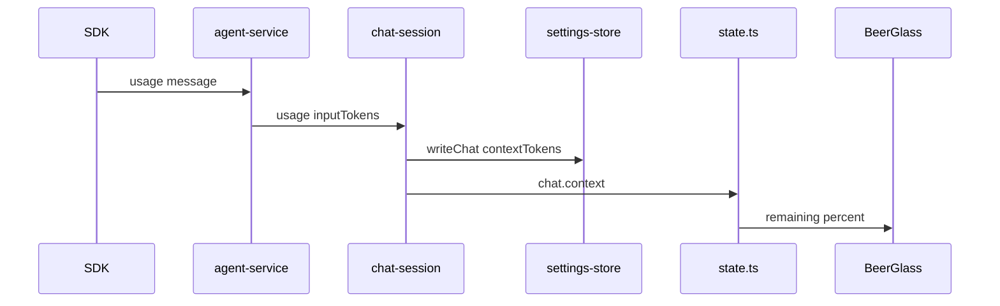

# Beer glass context indicator

## Overview

The chat header shows a pint glass and a percent. The glass starts full. The liquid is how much of the context window is still free, and the percent is that same remaining amount. A new chat, a reset chat, and any chat that has never reported usage read 100%. Each finished turn lowers the glass from that turn's prompt tokens. A completed conversation summary fills the glass again until the next turn reports a size.

**Out of scope:** draining the glass while a reply is still streaming, a different window size per model, dividing a multi-step turn's summed tokens back into one prompt, subagent context, dollar cost, and any change to how prompts are built.

**Implements / relates to:** the chat header in `docs/architecture.md`, `flow:chat.history` and `flow:event` in `docs/ipc-contract.md`, and the per-repo chat file in `docs/session-and-questions.md`. No decision in `docs/decisions.md` changes.

**Assumption:** the window is 200 000 tokens (`CONTEXT_WINDOW_TOKENS`). `@cursor/sdk` 1.2.0 does not report a model's window size. `inputTokens` on a turn is the sum of every model call in that turn, so a tool-heavy turn can empty the glass before the real window is full. The tooltip says the level is an estimate.

## Pros / Cons

**Pros**
- The number is the percent still free, which is what the glass picture shows: full means unused, empty means used up.
- The count is the SDK's own prompt tokens, saved on the chat file, so a reload shows the same level.
- A completed summary clears the count, so compaction fills the glass instead of leaving it empty.
- A bad or missing `contextTokens` value becomes `null` and does not quarantine the transcript.

**Cons**
- The glass does not move until the turn's `usage` message arrives. Streaming text does not lower it.
- A turn that calls tools several times sums those prompts, so the glass can hit 0% too early. It is clamped there.
- Every model uses the same 200 000 token window.

## How It Works

The header of the open chat shows a small pint glass and a percent such as `75%`. That percent is context still free. `null` tokens means the window is untouched, so the glass is full. After a turn, main stores that turn's `inputTokens` and the glass drops to `1 - inputTokens / 200000`, clamped between 0 and 1. Reset, or a completed SDK `summary`, stores `null` and the glass fills.

Before: the header has the fruit, the title, the mode switch, the model picker, theme, Reset, and the other buttons. Nothing shows context use.

After: the first control in the header's right-hand group is the glass and the remaining percent. The rest of the header is unchanged.

### Flow: a turn reports usage

1. The SDK emits one `usage` message at the end of the turn, with `usage.inputTokens`.
2. `emitMessage` in `agent-service.ts` turns that into `{ type: "usage", inputTokens }` after flooring the count. A negative or non-finite count emits nothing.
3. `handleStream` in `chat-session.ts` writes `contextTokens` on that repo's chat file, keeping `agentId` and `messages`, and emits `chat.context`.
4. The reducer stores `contextTokens` on that repo's slice even if the run is already sealed, so the update is not mistaken for `chat.error`.
5. `BeerGlass` reads the slice and draws the liquid at the remaining fraction.



**Example:** `inputTokens` 50000. `remainingFraction` is 0.75. The label is `75%` and the liquid fills three quarters of the glass, from the bottom.

### Flow: compaction

1. The SDK emits `summary` with `status: "completed"`.
2. `emitMessage` emits `{ type: "contextReset" }`. `running` and `error` emit nothing.
3. The session writes `contextTokens: null` and emits `chat.context` with `inputTokens: null`.
4. The glass returns to full until a later turn reports a new size.

**Example:** the glass is at 10%. A completed summary arrives. `contextTokens` becomes `null`. The label is `100%` and the glass is full.

### Flow: open a chat

1. The window calls `flow:chat.history`.
2. The output is `{ messages, contextTokens }`. Old files with no field load as `null`.
3. `boot`, `repo-loaded`, and `history` copy `contextTokens` onto the slice.
4. The glass renders from that value. Reset dispatches `reset-chat`, which sets the slice back to `null` after main has written `null` on disk.

**Example:** a saved chat with `contextTokens: 200000` opens at `0%`. A chat file from before this change opens at `100%`.

## Current State Analysis

**✅ Exists**
- `SDKUsageMessage` (`type: "usage"`, `usage.inputTokens`) and `SDKSummaryMessage` (`type: "summary"`, `status`) on `@cursor/sdk` 1.2.0. `emitMessage` in `src/main/agent-service.ts` currently returns without an event for every message that is not `assistant` or `tool_call`.
- Per-repo chat files in `src/main/settings-store.ts` (`ChatFile`: `agentId`, `messages`). `readJson` quarantines a file whose schema fails. `isAgentIdOnly` treats a two-key `{ agentId, messages: [] }` file as not history.
- `flow:chat.history` returns `{ messages }` (`src/shared/ipc.ts`). Events are `chat.state`, `chat.delta`, `chat.tool`, `chat.done`, `chat.error`, `question.asked`, `question.closed`. The preload already parses `EventSchema` and needs no new channel.
- `applyEvent` in `src/renderer/state.ts` handles those events. Anything left over is rendered as `chat.error` (`event.code`). A new event type has to be handled or `npm run typecheck` fails.
- The chat header is the `thread-head` block in `src/renderer/Chat.tsx`. Styles live in `src/renderer/styles.css`.
- Check scripts use `node:test` and, when they import app files with `.js` specifiers, `scripts/repos-check-resolve.mjs`.

**❌ Missing Components**
- `remainingFraction` / `remainingPercent` and `CONTEXT_WINDOW_TOKENS` (Step 1).
- `contextTokens` on the chat file, on `flow:chat.history`, and the `chat.context` event (Step 2).
- Preserving `contextTokens` on every `writeChat`, and returning it from history (Step 3).
- Mapping SDK `usage` and completed `summary` onto stream events (Step 4).
- Saving those events and emitting `chat.context` (Step 5).
- `BeerGlass` in the header (Step 6).

## Implementation Steps

### Step 1: Remaining fraction
- **Files:** `src/shared/context.ts`, `scripts/context-check.ts`, `package.json`
- **Change:** Add the pure window math the glass and the checks share. 200 000 tokens is the whole window. `null`, `0`, and any non-finite or negative count mean the window is still full. A count at or past the window means nothing remains.

**Code**

`src/shared/context.ts` (new file)
```ts
/** Fixed context window. The SDK does not report a per-model limit. */
export const CONTEXT_WINDOW_TOKENS = 200_000;

/** Share of the window still free, from 0 to 1. `null` means no usage has been reported. */
export function remainingFraction(inputTokens: number | null): number {
  if (inputTokens === null) return 1;
  if (!Number.isFinite(inputTokens) || inputTokens <= 0) return 1;
  const used = inputTokens / CONTEXT_WINDOW_TOKENS;
  if (used >= 1) return 0;
  return 1 - used;
}

/** `remainingFraction` as a whole percent from 0 to 100. */
export function remainingPercent(inputTokens: number | null): number {
  return Math.round(remainingFraction(inputTokens) * 100);
}
```

`scripts/context-check.ts` (new file)
```ts
// Remaining context fraction. Later steps add reducer and stream checks to this file.
//   node --disable-warning=ExperimentalWarning --experimental-strip-types --import ./scripts/repos-check-resolve.mjs scripts/context-check.ts
import assert from "node:assert/strict";
import test from "node:test";
import { CONTEXT_WINDOW_TOKENS, remainingFraction, remainingPercent } from "../src/shared/context.ts";

test("no usage means the window is still full", () => {
  assert.equal(remainingFraction(null), 1);
  assert.equal(remainingPercent(null), 100);
});

test("half the window used leaves half", () => {
  assert.equal(CONTEXT_WINDOW_TOKENS, 200_000);
  assert.equal(remainingFraction(100_000), 0.5);
  assert.equal(remainingPercent(100_000), 50);
});

test("zero tokens stays full", () => {
  assert.equal(remainingFraction(0), 1);
  assert.equal(remainingPercent(0), 100);
});

test("a full or over-full window is empty", () => {
  assert.equal(remainingFraction(200_000), 0);
  assert.equal(remainingPercent(200_000), 0);
  assert.equal(remainingFraction(400_000), 0);
  assert.equal(remainingPercent(400_000), 0);
});

test("a negative or non-finite count stays full", () => {
  assert.equal(remainingFraction(-5), 1);
  assert.equal(remainingFraction(Number.NaN), 1);
  assert.equal(remainingFraction(Number.POSITIVE_INFINITY), 1);
});
```

`package.json` (add this script after `check:github`)
```json
"check:context": "node --disable-warning=ExperimentalWarning --experimental-strip-types --import ./scripts/repos-check-resolve.mjs scripts/context-check.ts"
```

The resolver is unused in this step. Step 2 imports app files that use `.js` specifiers, and this script line is already ready for that.

### Step 2: Contract, chat file, and reducer
- **Files:** `src/shared/ipc.ts`, `src/main/settings-store.ts`, `src/renderer/state.ts`, `src/renderer/App.tsx`, `scripts/context-check.ts`
- **Change:** `flow:chat.history` returns `contextTokens`. A new `chat.context` event carries the same number or `null`. The chat file stores it. A missing, negative, fractional, or non-number value becomes `null` without failing the whole file, so `readJson` does not quarantine the transcript. The reducer keeps the number on the slice. `chat.context` is handled before the sealed-run check. If it fell through, `applyEvent` would read `event.code` and draw an error banner. `App` copies the history field into `boot`, `repo-loaded`, and `history`. `reset-chat` sets the slice back to `null`.

**Code**

`src/shared/ipc.ts` (modify `flow:chat.history` output)
```ts
  "flow:chat.history": {
    input: z.object({ repo: RepoNameSchema }).strict(),
    output: z.object({
      messages: z.array(MessageSchema),
      contextTokens: z.number().int().nonnegative().nullable(),
    }),
  },
```

`src/shared/ipc.ts` (add this object to `EventSchema` after the `question.closed` object, still inside the `z.discriminatedUnion` array)
```ts
  z.object({
    type: z.literal("chat.context"),
    repo: RepoNameSchema,
    runId: RunId,
    inputTokens: z.number().int().nonnegative().nullable(),
  }),
```

`src/main/settings-store.ts` (replace the private `ChatFile` type, `ChatFileSchema`, and `EMPTY_CHAT`)
```ts
export type ChatFile = {
  agentId: string | null;
  messages: Message[];
  contextTokens: number | null;
};

const ChatFileSchema = z.object({
  agentId: z.string().nullable(),
  messages: z.array(MessageSchema),
  contextTokens: z.preprocess(
    (value) => (typeof value === "number" && Number.isInteger(value) && value >= 0 ? value : null),
    z.number().int().nonnegative().nullable(),
  ),
});

const EMPTY_CHAT: ChatFile = { agentId: null, messages: [], contextTokens: null };
```

`src/main/settings-store.ts` (replace `isAgentIdOnly` and export it). A resumed agent with no messages must stay off the left menu. `contextTokens: null` is allowed on that file. A real token count is not, because that file is no longer "only an agent id".
```ts
export function isAgentIdOnly(value: unknown): boolean {
  if (typeof value !== "object" || value === null) return false;
  const record = value as { agentId?: unknown; messages?: unknown; contextTokens?: unknown };
  if (typeof record.agentId !== "string") return false;
  if (!Array.isArray(record.messages) || record.messages.length !== 0) return false;
  if (record.contextTokens !== undefined && record.contextTokens !== null) return false;
  const keys = Object.keys(record).filter((key) => key !== "contextTokens");
  return keys.length === 2 && keys.includes("agentId") && keys.includes("messages");
}
```

`src/renderer/state.ts` (add the field to `ChatSlice`, after `unseen`)
```ts
  unseen: boolean;
  /** Latest turn prompt size. `null` means full: no report yet, a reset, or a summary. */
  contextTokens: number | null;
```

`src/renderer/state.ts` (add the field inside `emptySlice`)
```ts
    pendingQuestionId: null,
    unseen: false,
    contextTokens: null,
```

`src/renderer/state.ts` (modify the `boot` action: add an optional field)
```ts
      pendingQuestion?: PendingQuestion;
      contextTokens?: number | null;
```

`src/renderer/state.ts` (modify the `repo-loaded` action: add a required field)
```ts
      pendingQuestion?: PendingQuestion;
      contextTokens: number | null;
```

`src/renderer/state.ts` (replace the `history` action)
```ts
  | { type: "history"; repo: string; messages: Message[]; contextTokens: number | null }
```

`src/renderer/state.ts` (pass the count into `loadedSlice` from `boot`)
```ts
        chats[action.repo] = loadedSlice(
          emptySlice(),
          action.messages ?? [],
          action.chatState ?? "needsSetup",
          action.runId,
          action.instructionsPending ?? false,
          action.pendingQuestion,
          action.settings.folderMissing,
          action.contextTokens ?? null,
        );
```

`src/renderer/state.ts` (pass the count into `loadedSlice` from `repo-loaded`)
```ts
          [action.repo]: loadedSlice(
            state.chats[action.repo] ?? emptySlice(),
            action.messages,
            action.chatState,
            action.runId,
            action.instructionsPending,
            action.pendingQuestion,
            state.settings?.folderMissing === true,
            action.contextTokens,
          ),
```

`src/renderer/state.ts` (add `contextTokens: null` on the slice built in `case "reset-chat"`)
```ts
        pendingQuestionId: null,
        unseen: false,
        contextTokens: null,
```

`src/renderer/state.ts` (replace `case "history"`)
```ts
    case "history": {
      const slice = state.chats[action.repo] ?? emptySlice();
      if (slice.activeRunId !== null && slice.sealedRunId !== slice.activeRunId) return state;
      const items = toItems(action.messages, slice.pendingQuestionId);
      return withSlice(state, action.repo, () => ({
        ...slice,
        items,
        lastUserText: lastUserText(items) ?? slice.lastUserText,
        contextTokens: action.contextTokens,
      }));
    }
```

`src/renderer/state.ts` (insert this block in `applyEvent` immediately after the `chat.state` block, before `question.asked`). It must not sit after the sealed-run returns, and it must not fall through to the `event.code` banner.
```ts
  if (event.type === "chat.context") {
    if (state.contextTokens === event.inputTokens) return state;
    return { ...state, contextTokens: event.inputTokens };
  }
```

`src/renderer/state.ts` (add the last parameter to `loadedSlice` and set it on the returned slice)
```ts
function loadedSlice(
  base: ChatSlice,
  messages: readonly Message[],
  chatState: ChatStateName,
  runId: string | undefined,
  instructionsPending: boolean,
  pendingQuestion: PendingQuestion | undefined,
  folderMissing: boolean,
  contextTokens: number | null,
): ChatSlice {
  const pendingQuestionId = pendingQuestion?.questionId ?? null;
  const live = isBusyState(chatState);
  const stored = toItems(messages, pendingQuestionId);
  const items = withPending(stored, pendingQuestion, lastAgentId(stored));
  return {
    ...base,
    loaded: true,
    items,
    chatState,
    activeRunId: live && runId ? runId : null,
    liveAgentId: live ? lastAgentId(items) : null,
    lastUserText: lastUserText(items),
    instructionsPending,
    pendingQuestionId,
    banner: folderMissing ? folderBanner() : null,
    contextTokens,
  };
}
```

`src/renderer/App.tsx` (the single-repo `boot` dispatch: add the field next to `messages`)
```ts
          messages: history.ok ? history.value.messages : [],
          contextTokens: history.ok ? history.value.contextTokens : null,
```

`src/renderer/App.tsx` (replace the `reloadHistory` dispatch)
```ts
    if (history.ok) {
      dispatch({
        type: "history",
        repo,
        messages: history.value.messages,
        contextTokens: history.value.contextTokens,
      });
    }
```

`src/renderer/App.tsx` (the `repo-loaded` dispatch: add the field)
```ts
      messages: history.value.messages,
      contextTokens: history.value.contextTokens,
```

`scripts/context-check.ts` (add these imports under the existing import, then add the tests at the end of the file)
```ts
import { isAgentIdOnly } from "../src/main/settings-store.ts";
import { emptySlice, initialState, reducer, type AppState, type ChatSlice } from "../src/renderer/state.ts";
import type { ChatStateName, RepoListItem } from "../src/shared/ipc.ts";

function repoRow(name: string, hasHistory: boolean, state: ChatStateName = "ready"): RepoListItem {
  return { name, state, pendingQuestion: state === "awaitingAnswer", hasHistory };
}

function chatSlice(patch: Partial<ChatSlice> = {}): ChatSlice {
  return { ...emptySlice(), loaded: true, chatState: "ready", ...patch };
}

function appState(chats: AppState["chats"]): AppState {
  return {
    ...initialState,
    booted: true,
    repos: [repoRow("web", true)],
    view: { kind: "repo", repo: "web" },
    chats,
  };
}

test("an agent id with no messages is not history, with or without a null token count", () => {
  assert.equal(isAgentIdOnly({ agentId: "agent-1", messages: [] }), true);
  assert.equal(isAgentIdOnly({ agentId: "agent-1", messages: [], contextTokens: null }), true);
  assert.equal(isAgentIdOnly({ agentId: "agent-1", messages: [], contextTokens: 10 }), false);
  assert.equal(isAgentIdOnly({ agentId: null, messages: [], contextTokens: null }), false);
});

test("chat.context stores the count and does not open an error banner", () => {
  const start = appState({ web: chatSlice({ activeRunId: "run-1", contextTokens: null }) });
  const used = reducer(start, {
    type: "event",
    event: { type: "chat.context", repo: "web", runId: "run-1", inputTokens: 50_000 },
  });
  assert.equal(used.chats.web?.contextTokens, 50_000);
  assert.equal(used.chats.web?.banner, null);
});

test("chat.context still applies after the run is sealed", () => {
  const start = appState({
    web: chatSlice({ activeRunId: "run-1", sealedRunId: "run-1", contextTokens: 50_000 }),
  });
  const next = reducer(start, {
    type: "event",
    event: { type: "chat.context", repo: "web", runId: "run-1", inputTokens: null },
  });
  assert.equal(next.chats.web?.contextTokens, null);
});

test("the same count does not replace the slice", () => {
  const start = appState({ web: chatSlice({ contextTokens: 50_000 }) });
  const next = reducer(start, {
    type: "event",
    event: { type: "chat.context", repo: "web", runId: "run-1", inputTokens: 50_000 },
  });
  assert.equal(next, start);
});

test("reset-chat fills the glass", () => {
  const start = appState({ web: chatSlice({ contextTokens: 80_000 }) });
  const next = reducer(start, { type: "reset-chat", repo: "web" });
  assert.equal(next.chats.web?.contextTokens, null);
});

test("history copies the saved count", () => {
  const start = appState({ web: chatSlice({ contextTokens: null }) });
  const next = reducer(start, { type: "history", repo: "web", messages: [], contextTokens: 25_000 });
  assert.equal(next.chats.web?.contextTokens, 25_000);
});
```

`scripts/tool-summary-check.ts` is unchanged. It only feeds `tool_call` messages to `emitMessage`.

### Step 3: Keep the count on every chat write
- **Files:** `src/main/chat-session.ts`, `src/main/session-manager.ts`
- **Change:** Every `writeChat` must include `contextTokens`, or the next save drops it and the glass jumps back to full. `keepChat` copies the fields a caller does not set. Reset writes `null`. History returns the stored count. This step does not emit events yet. Until Step 5 the stored value stays `null` except on files that already have one.

**Code**

`src/main/chat-session.ts` (change the settings-store import)
```ts
import type { ChatFile, SettingsStore } from "./settings-store.js";
```

`src/main/chat-session.ts` (add `keepChat` next to the other helpers at the bottom of the file)
```ts
function keepChat(
  chat: ChatFile,
  patch: { agentId?: string | null; messages?: Message[]; contextTokens?: number | null },
): ChatFile {
  return {
    agentId: patch.agentId !== undefined ? patch.agentId : chat.agentId,
    messages: patch.messages !== undefined ? patch.messages : chat.messages,
    contextTokens: patch.contextTokens !== undefined ? patch.contextTokens : chat.contextTokens,
  };
}
```

`src/main/chat-session.ts` (replace the `RepoSession.history` return type)
```ts
  history(): { messages: Message[]; contextTokens: number | null };
```

`src/main/chat-session.ts` (replace `history`)
```ts
  function history(): { messages: Message[]; contextTokens: number | null } {
    const chat = store.readChat(repoPath);
    return { messages: chat.messages, contextTokens: chat.contextTokens };
  }
```

`src/main/chat-session.ts` (reset write)
```ts
      store.writeChat(repoPath, { agentId: null, messages: [], contextTokens: null });
```

`src/main/chat-session.ts` (the write at the start of `send`)
```ts
    store.writeChat(repoPath, keepChat(prior, { messages: [...prior.messages, userMessage, agentMessage] }));
```

`src/main/chat-session.ts` (the write after `ensure` changes the agent id)
```ts
        store.writeChat(repoPath, keepChat(latest, { agentId: ensured.agentId }));
```

`src/main/chat-session.ts` (the write in `ask`)
```ts
      store.writeChat(repoPath, keepChat(chat, { messages: insertBefore(chat.messages, currentRun.agentMessageId, message) }));
```

`src/main/chat-session.ts` (the write in `finish`, the write at the end of `persistTool`, and the write in `settle`: same replacement at each of the three call sites)
```ts
        store.writeChat(repoPath, keepChat(chat, { messages }));
```

`src/main/session-manager.ts` (replace the `history` line on `SessionManager`)
```ts
  history(repo: string): { messages: Message[]; contextTokens: number | null };
```

`src/main/session-manager.ts` (replace `history`)
```ts
  function history(name: string): { messages: Message[]; contextTokens: number | null } {
    const session = existing(name);
    if (session) return session.history();
    const chat = store.readChat(resolve(name).path);
    return { messages: chat.messages, contextTokens: chat.contextTokens };
  }
```

`src/main/session-manager.ts` (the `reset` write used when no session is open)
```ts
      store.writeChat(repo.path, { agentId: null, messages: [], contextTokens: null });
```

No new check in this step. The disk writes are the same shape `isAgentIdOnly` already covers, and `flow:chat.history` is parsed by the existing IPC output check once `history()` returns `contextTokens`. A live round trip needs the Electron app (Testing Checklist).

### Step 4: Map SDK usage and summary
- **Files:** `src/main/agent-service.ts`, `scripts/context-check.ts`
- **Change:** `emitMessage` understands `usage` and `summary`. A usable count is floored so the IPC integer schema accepts it. A completed summary, including `fallback: true`, emits `contextReset`. A summary that is still running or that failed emits nothing, so the glass stays where it was. `handleStream` ignores the new events until Step 5, which typechecks because those branches are not exhaustive.

**Code**

`src/main/agent-service.ts` (add these two members to `AgentStreamEvent`)
```ts
  | { type: "usage"; inputTokens: number }
  | { type: "contextReset" };
```

`src/main/agent-service.ts` (insert in `emitMessage` after the `assistant` branch returns, and before `if (message.type !== "tool_call") return`)
```ts
  if (message.type === "usage") {
    const inputTokens = message.usage.inputTokens;
    if (!Number.isFinite(inputTokens) || inputTokens < 0) {
      emit(accumulated, null);
      return;
    }
    emit(accumulated, { type: "usage", inputTokens: Math.floor(inputTokens) });
    return;
  }
  if (message.type === "summary") {
    if (message.status !== "completed") {
      emit(accumulated, null);
      return;
    }
    emit(accumulated, { type: "contextReset" });
    return;
  }
  if (message.type !== "tool_call") return;
```

`scripts/context-check.ts` (add the import and these tests)
```ts
import { emitMessage, type AgentStreamEvent } from "../src/main/agent-service.ts";

function taken(message: Parameters<typeof emitMessage>[0]): AgentStreamEvent[] {
  const seen: AgentStreamEvent[] = [];
  emitMessage(message, "", "/tmp/repo", (_text, event) => {
    if (event) seen.push(event);
  });
  return seen;
}

test("a usage message becomes a floored usage event", () => {
  assert.deepEqual(
    taken({
      type: "usage",
      agent_id: "agent",
      run_id: "run",
      usage: {
        inputTokens: 100.9,
        outputTokens: 1,
        cacheReadTokens: 0,
        cacheWriteTokens: 0,
        totalTokens: 101,
      },
    }),
    [{ type: "usage", inputTokens: 100 }],
  );
});

test("a negative usage count is ignored", () => {
  assert.deepEqual(
    taken({
      type: "usage",
      agent_id: "agent",
      run_id: "run",
      usage: {
        inputTokens: -1,
        outputTokens: 0,
        cacheReadTokens: 0,
        cacheWriteTokens: 0,
        totalTokens: 0,
      },
    }),
    [],
  );
});

test("a completed summary clears context, and a failed one does not", () => {
  assert.deepEqual(
    taken({ type: "summary", agent_id: "agent", run_id: "run", status: "completed", fallback: true }),
    [{ type: "contextReset" }],
  );
  assert.deepEqual(taken({ type: "summary", agent_id: "agent", run_id: "run", status: "error" }), []);
  assert.deepEqual(taken({ type: "summary", agent_id: "agent", run_id: "run", status: "running" }), []);
});
```

### Step 5: Save the count and emit chat.context
- **Files:** `src/main/chat-session.ts`
- **Change:** On `usage` or `contextReset`, write the count and emit `chat.context` for the open run. This runs inside `handleStream` before `done`, while that run is still the active one. A sealed or stale generation does not write. A missing repo does not write and does not emit.

**Code**

`src/main/chat-session.ts` (insert in `handleStream` after the `tool` branch returns, before the `error` / `done` branch)
```ts
    if (event.type === "usage") {
      saveContext(current, event.inputTokens);
      return;
    }
    if (event.type === "contextReset") {
      saveContext(current, null);
      return;
    }
```

`src/main/chat-session.ts` (add `saveContext` next to `persistTool`)
```ts
  function saveContext(current: number, inputTokens: number | null): void {
    if (run === null || run.generation !== current || run.settled) return;
    if (repoGone()) return;
    const chat = store.readChat(repoPath);
    store.writeChat(repoPath, keepChat(chat, { contextTokens: inputTokens }));
    emit({ type: "chat.context", runId: run.id, inputTokens });
  }
```

No separate check. The event shape is the reducer test from Step 2, and the SDK mapping is the `emitMessage` test from Step 4. Seeing a live glass move needs a real turn (Testing Checklist).

### Step 6: Beer glass in the header
- **Files:** `src/renderer/BeerGlass.tsx`, `src/renderer/styles.css`, `src/renderer/Chat.tsx`, `src/renderer/App.tsx`
- **Change:** Draw a pint glass whose liquid height is `remainingFraction`, labeled with `remainingPercent`. The percent is what remains. The liquid sits on the bottom and transitions when the count changes. Foam is a light fill in both themes, because `--panel` is dark in dark mode and would not read as foam. The glass is the first control in the header's right-hand group.

**Code**

`src/renderer/BeerGlass.tsx` (new file)
```tsx
import { remainingFraction, remainingPercent } from "../shared/context.js";

type BeerGlassProps = {
  inputTokens: number | null;
};

const INNER_TOP = 8;
const INNER_BOTTOM = 44;
const INNER_HEIGHT = INNER_BOTTOM - INNER_TOP;

export function BeerGlass(props: BeerGlassProps) {
  const remaining = remainingFraction(props.inputTokens);
  const percent = remainingPercent(props.inputTokens);
  const label = `${percent}% of context remaining`;
  const liquidHeight = INNER_HEIGHT * remaining;
  const liquidY = INNER_BOTTOM - liquidHeight;
  const showFoam = remaining > 0.04;

  return (
    <div className="beer" title={`${label}. Estimated from the last turn.`}>
      <svg className="beer-glass" viewBox="0 0 36 48" role="img" aria-label={label}>
        <defs>
          <clipPath id="beer-glass-clip">
            <path d="M10 8 H26 L24 44 H12 Z" />
          </clipPath>
        </defs>
        <path className="beer-outline" d="M8 4 H28 L25.5 46 H10.5 Z" />
        <g clipPath="url(#beer-glass-clip)">
          <rect className="beer-liquid" x="8" y={liquidY} width="20" height={liquidHeight} />
          {showFoam ? <ellipse className="beer-foam" cx="18" cy={liquidY + 1.4} rx="7" ry="2.2" /> : null}
        </g>
      </svg>
      <span className="beer-percent" aria-hidden="true">
        {percent}%
      </span>
    </div>
  );
}
```

`src/renderer/styles.css` (add after the `.model-picker` rule)
```css
.beer {
  display: flex;
  align-items: center;
  gap: 4px;
  flex: none;
}
.beer-glass {
  width: 22px;
  height: 30px;
  overflow: visible;
}
.beer-outline {
  fill: none;
  stroke: var(--ink);
  stroke-width: 1.4;
  stroke-linejoin: round;
}
.beer-liquid {
  fill: var(--mango);
  transition: y 0.45s ease, height 0.45s ease;
}
.beer-foam {
  fill: #fff6e8;
  stroke: var(--ink);
  stroke-width: 0.6;
  transition: cy 0.45s ease;
}
.beer-percent {
  font-size: 12px;
  color: var(--muted);
  font-variant-numeric: tabular-nums;
  min-width: 2.6rem;
}
```

`src/renderer/Chat.tsx` (add the import with the other renderer imports)
```tsx
import { BeerGlass } from "./BeerGlass.js";
```

`src/renderer/Chat.tsx` (add the prop to `ChatProps`, after `fruit`)
```tsx
  fruit: ChatFruit;
  contextTokens: number | null;
```

`src/renderer/Chat.tsx`

Before
```tsx
        <div className="spacer">
          <ModeSwitch mode={props.mode} disabled={busy || props.workspaceBusy || props.pending} onMode={props.onMode} />
```

After
```tsx
        <div className="spacer">
          <BeerGlass inputTokens={props.contextTokens} />
          <ModeSwitch mode={props.mode} disabled={busy || props.workspaceBusy || props.pending} onMode={props.onMode} />
```

`src/renderer/App.tsx` (pass the slice field on the `Chat` element, next to `fruit`)
```tsx
        fruit={fruitFor(repoName)}
        contextTokens={slice.contextTokens}
```

The glass has no extra check script. `remainingFraction` is already checked, and the SVG is a direct mapping of that number. Look at it in the running app (Testing Checklist).

### Step 7: Update Documentation (always the last step)

- **Files:** `README.md`, `docs/README.md`, `docs/architecture.md`, `docs/ipc-contract.md`, `docs/session-and-questions.md`
- **Change:** Record the glass, the `chat.context` event, the history field, and `check:context`. The replacement text is in [Documentation Update](#documentation-update). Apply that section after Steps 1–6, then run `npm run typecheck` and `npm run check:context`.

**Code**

The fenced replacements for this step are the blocks under [Documentation Update](#documentation-update). Apply each one in the file and section named on the line above the fence.

## Edge Cases
- A chat file from before this change has no `contextTokens`. The preprocess turns the missing value into `null`. The glass opens full.
- `contextTokens` that is negative, fractional, or not a number becomes `null`. The rest of the file still loads. `readJson` does not quarantine it.
- `inputTokens` of `0` stays full. A count of `200000` or more is `0%`.
- Several `usage` messages in one run: each write replaces the stored count. The last one is what the glass shows.
- A summary with `status: "running"` or `"error"` does not change the count. `status: "completed"` does, even when `fallback` is true.
- Usage that arrives after `chat.done` still updates the slice, because `applyEvent` handles `chat.context` before the sealed-run return.
- The same count twice returns the same state object, so the reducer does not redraw the repo row.
- Reset writes `null` on disk and `reset-chat` sets the slice to `null`. Both the header Reset and left-menu Remove use that path.
- A write that happens after a usage report (tool line, question, settle) goes through `keepChat`, so it keeps the count.
- `isAgentIdOnly` still returns true for `{ agentId, messages: [], contextTokens: null }`, so an empty resumed chat stays off the left menu. A non-null count on an empty message list counts as history.
- `EMPTY_CHAT` gains `contextTokens: null`, so `EMPTY_CHAT_BYTES` grows. Older empty files are smaller than that and still fail the `size <= EMPTY_CHAT_BYTES` check, so they are not history.
- One glass is on screen. The clip path id is `beer-glass-clip`. A second glass in the same document would share that id. This header renders one.
- The glass does not move during streaming. It moves when the turn's usage is saved.
- A tool-heavy turn can report `inputTokens` above 200 000 because the SDK sums each model call. The glass shows `0%` and the tooltip says it is an estimate.

## Testing Checklist
- [ ] `npm run typecheck` passes
- [ ] `npm run check:context` passes
- [ ] `npm run check:tools` still passes (`emitMessage` tool calls are unchanged)
- [ ] A new chat shows a full glass and `100%`
- [ ] After one short reply, the percent drops below 100 and the liquid is lower than full
- [ ] Reload the window: the same chat shows the same percent
- [ ] Reset chat returns the glass to `100%`
- [ ] Switch between two repos: each glass shows that repo's own count
- [ ] Light and dark theme: the beer stays amber and the foam stays light

## Files to Modify
- [ ] `src/shared/context.ts`
- [ ] `src/shared/ipc.ts`
- [ ] `src/main/settings-store.ts`
- [ ] `src/main/agent-service.ts`
- [ ] `src/main/chat-session.ts`
- [ ] `src/main/session-manager.ts`
- [ ] `src/renderer/state.ts`
- [ ] `src/renderer/App.tsx`
- [ ] `src/renderer/Chat.tsx`
- [ ] `src/renderer/BeerGlass.tsx`
- [ ] `src/renderer/styles.css`
- [ ] `scripts/context-check.ts`
- [ ] `package.json`
- [ ] `README.md`
- [ ] `docs/README.md`
- [ ] `docs/architecture.md`
- [ ] `docs/ipc-contract.md`
- [ ] `docs/session-and-questions.md`

## Implementation Order
1. Step 1
2. Step 2
3. Step 3
4. Step 4
5. Step 5
6. Step 6
7. Step 7 (Update Documentation, always last)

## Documentation Update

### Step 7: Update Documentation (always the last step)

**Affected documents**

| Document | What changes | Status |
|----------|--------------|--------|
| `docs/architecture.md` | Name the glass in the Chat bullet, and add `context.ts`, `BeerGlass.tsx`, and `context-check.ts` to the folder layout | todo |
| `docs/ipc-contract.md` | `flow:chat.history` returns `contextTokens`. Document `chat.context`, including that it is applied after the run is sealed | todo |
| `docs/session-and-questions.md` | Reset clears `contextTokens`. The stream diagram gains the usage event. The persistence paragraph says where the count is written | todo |
| `README.md` | Add `npm run check:context` and one sentence on what it covers | todo |
| `docs/README.md` | Add the glass to the status sentence and `check:context` to the check list | todo |

**Edits**

`docs/architecture.md` (section "Renderer structure", Chat bullet: replace the sentence that starts "A question card, the banner")
```markdown
The header shows a beer glass (`BeerGlass.tsx`) of context still free. It starts full, at 100% remaining, and the liquid drops as the last turn's prompt tokens grow, against a fixed 200 000 token window. A completed summary fills it again. The level is an estimate. A question card, the banner, a mode control, a model picker, the theme switch, Reset chat, and a Rules button are also in the screen.
```

`docs/architecture.md` (section "Folder layout", the `shared/` line and the `renderer/` line and the `scripts/` line)
```markdown
  shared/     ipc.ts, jira.ts, github.ts, questions.ts, mention.ts, plan-markdown.ts (exports isCreatePlan only),
              task.ts (exports isTask and mergeSubagent), context.ts (remainingFraction, remainingPercent)
```

```markdown
  renderer/   main.tsx, App.tsx, state.ts, segments.ts, Setup.tsx, Chat.tsx, NewChat.tsx,
              MentionComposer.tsx, RepoSidebar.tsx, QuestionForm.tsx, PlanCard.tsx,
              SubagentCard.tsx, ToolStrip.tsx, Markdown.tsx, markdown-config.ts, MermaidBlock.tsx,
              mermaid-config.ts, mermaid-render.ts, dark-mode.ts, BeerGlass.tsx,
              Instructions.tsx, RulesEditor.tsx, SkillsEditor.tsx, JiraTickets.tsx,
              JiraSetup.tsx, GitHubPrs.tsx, GitHubProjects.tsx, GitHubSetup.tsx, Bot.tsx,
              global.d.ts, styles.css
```

```markdown
scripts/      phase0-spike.ts, phase2-files-check.mjs, phase3-questions-check.ts,
              mention-check.ts, repos-check.ts, sidebar-check.ts, plan-check.ts,
              segments-check.ts, tool-summary-check.ts, jira-check.ts, github-check.ts,
              context-check.ts, packaged-sdk-check.mjs, after-pack.cjs
```

`docs/ipc-contract.md` (command table, replace the `flow:chat.history` row)
```markdown
| `flow:chat.history` | `{ repo }` | `{ messages: Message[], contextTokens: number \| null }` | `contextTokens` is the last turn's prompt size, or `null` when none has been reported, the chat was reset, or a summary completed. A missing or unusable value in an older file is `null` |
```

`docs/ipc-contract.md` (section "Events", replace the sentence under the heading)
```markdown
All events arrive on `flow:event` with a `type` discriminator and a `runId`. Every event includes `repo` as well as `runId`. The preload drops a payload that does not match `EventSchema`. The renderer applies an event to that repo's slice, and still drops a non-`chat.state` event whose `runId` is not that slice's active run, except `chat.context`, which is applied even when that run is already sealed.
```

`docs/ipc-contract.md` (events table, add this row after `chat.error`)
```markdown
| `chat.context` | `{ inputTokens: number \| null }` | The context still in use for this repo. `inputTokens` is the last turn's prompt tokens. `null` means the glass is full: no report yet, a reset, or a completed summary. The window shows the percent still free against a fixed 200 000 token window |
```

`docs/session-and-questions.md` (section "States", replace the Reset chat sentence that starts "then disposes")
```markdown
**Reset chat** (`chat.reset` with `repo`) asks for confirmation, then disposes that repo's agent and writes `agentId: null`, an empty message list, and `contextTokens: null` for that repo.
```

`docs/session-and-questions.md` (the send sequence diagram, replace the two lines inside `loop stream` and the persist line)
```markdown
        S-->>A: SDK message
        A-->>M: delta, tool, usage, or contextReset
        M-->>R: chat.delta / chat.tool / chat.context
```

```markdown
    M->>M: persist agent message and contextTokens, state = ready
```

`docs/session-and-questions.md` (the persistence paragraph, add this sentence after the sentence that ends "Tool lines are written when they finish.")
```markdown
The chat file also stores `contextTokens`, the last turn's prompt size, or `null`. It is written when a turn reports usage and cleared when a summary completes or the chat is reset. Writes of messages keep the current value.
```

`README.md` (section "Checks", add the command to the fenced list after `npm run check:github`)
```bash
npm run check:context
```

`README.md` (the paragraph that starts with `` `check:mentions` covers ``, add this sentence at the end)
```markdown
`check:context` covers the remaining-context fraction, which chat files count as an agent id with no messages, the reducer that stores `chat.context`, and the mapping from an SDK usage or summary message onto that event.
```

`docs/README.md` (section "Status", add `npm run check:context` to the sentence that lists the checks, and add this sentence after the GitHub sentence)
```markdown
The chat header's context glass is checked by `npm run check:context` (`scripts/context-check.ts`): the remaining fraction, the agent-id file shape, the reducer, and the usage and summary mapping. The glass itself is checked by looking at a chat.
```

**Not affected**
- `docs/decisions.md`: this does not accept, change, or contradict a decision. The 200 000 token window is an assumption in this plan.
- `docs/phase0-spike.md`: the spike record is historical and does not describe the header.
- `src/preload/index.ts`: it already parses every event with `EventSchema`, so `chat.context` is covered without a preload change.

**Open questions**
- Open question: none that block this plan. A later per-model window waits until the SDK reports one (owner: user).
