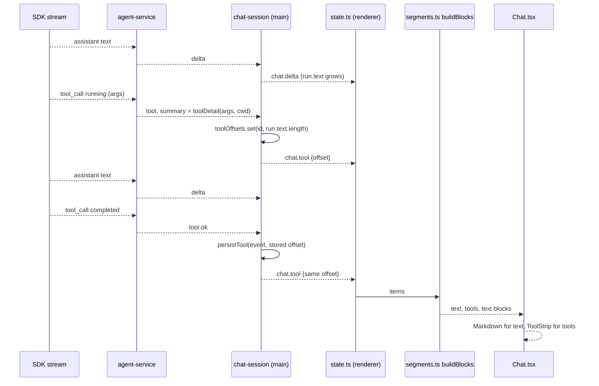
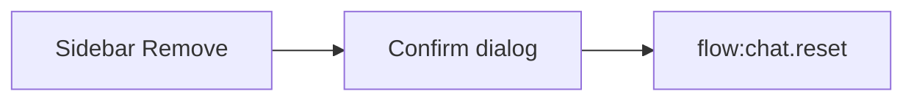

# Chat segments, compact tool rows, markdown

## Overview

A run today shows every tool call first and then one large text block, tool rows print raw JSON, and agent text is plain text, so tables and bold show as raw characters. This plan makes five changes to the chat. (1) Each text part the agent writes between tool calls becomes its own message, in the order it happened. (2) Tool calls become compact rows (name, file path or command, status) in a strip that shows four rows and scrolls for the rest. (3) Questions and plans are shown as cards under the text that introduced them, in the same order, and the `ask_user_question` call gets no tool row because its card is how it is shown. (4) Agent text and plan cards render as markdown with `react-markdown` and `remark-gfm`, which replaces the hand-written parser. (5) Fenced `mermaid` blocks (flowcharts, sequence diagrams, pie charts, and the other Mermaid types) are drawn as diagrams, in plans and in messages.

**Out of scope:** clickable links (the window refuses navigation and there is no open-external command, so links render as styled text). Syntax highlighting, copy buttons, tool output or diffs. Gluing between two assistant messages that have no tool call between them. Migrating old chats (they keep one text block, with cleaned tool rows). Zoom, pan, or export of a diagram. Other chart formats than Mermaid. Changing how plans, questions, or modes work.

**Implements / relates to:** D-14 (new, recorded in the last step: markdown library). D-15 (new, recorded in the last step: `mermaid` for diagrams). D-2 (the SDK stays behind `agent-service.ts`; only the summary text it builds changes, and question tool calls are not forwarded as tool lines). D-13 (the plan card now uses the same renderer). `docs/ipc-contract.md` (`chat.tool`, `question.asked`, and the stored tool and question messages gain `offset`).

**Assumption (interpretation of "under the agent message"):** a question card or a plan card is placed under the agent text written before it and above the text written after it, the same way tool strips are. It is not pinned to the end of the run. If you want every card at the very end of the run instead, say so; it is a small change in `segments.ts`.

**Assumption:** later text segments of a run have no avatar. Only the first text segment carries the avatar, the "Mango" label, and the status pill. Later segments are indented to line up with it.

**Assumption:** the four-row limit and the scroll apply to each group of consecutive tool calls, not to the whole chat.

**Assumption:** the SDK sends `args` with the usual keys (`path` for read and edit, `command` for shell, `pattern` for grep, `globPattern` for glob). Step 3 reads a wide list of key names. A tool with no known key shows only its name and status. Check one real run after Step 9 and add keys to `KEYS` in `tool-summary.ts` if a tool shows no detail.

## Pros / Cons

**Pros**
- The order the user sees is the order things happened: text, tools, text.
- No change to message ids, `chat.done`, `liveAgentId`, or the stored message order. The only stored change is one optional number on a tool message, so old chat files still load.
- Tool rows lose the JSON dump and keep what matters: name, target, status.
- A real markdown library handles tables, nesting, escapes, and half-written text while streaming. It builds React elements and ignores raw HTML, so agent text is never inserted as HTML.
- Diagrams use Mermaid in `strict` security mode and are shown as an image (`` with a data URL), so a diagram cannot run script or reach the page. The existing CSP (`img-src 'self' data:`) already allows it and is not loosened.
- Mermaid is loaded only when the first diagram is drawn, so the window opens as fast as before.

**Cons**
- Three new build-time dependencies (`react-markdown`, `remark-gfm`, `mermaid`) and their transitive packages. They are bundled by Vite, so they go in `devDependencies` and do not enlarge the packaged `node_modules`. `mermaid` itself is large (it adds several megabytes of lazily loaded chunks to `dist/renderer`).
- A diagram that is still streaming is shown as code, and turns into the drawing when its message finishes.
- A diagram is an image: its text cannot be selected, and it has no zoom.
- Links are not clickable until a small IPC command is added.
- The order is rebuilt at render time from an offset. A tool message without an offset (old chats) falls back to "tools first, then text".
- The first text segment may be below a tool strip, so the avatar is not always the first thing in a run.

## How It Works

Main records, for each tool call and each question, how many characters of the agent's text existed when it first appeared (`offset`). The renderer keeps the data model as is (one agent message per run, with its tool calls and questions stored before it) and, when drawing, cuts that text at the offsets: text up to the first offset, the tool strip, question card, or plan card, the next piece of text, and so on. Each tool group is drawn as a short strip with four visible rows. Text is drawn as markdown, and a `mermaid` fence in it is drawn as a diagram once its message has finished.

### Flow: one run with text, tools, text

1. The user sends a message. Main creates the agent message (empty) and the run, with `toolOffsets = new Map()`.
2. The SDK streams `delta` text. Main appends it to `run.text` and emits `chat.delta`. The renderer appends to the agent item.
3. A tool call starts. `agent-service.ts` emits a `tool` event whose `summary` is built from the call's `args` (for example `src/main/chat-session.ts`, relative to the repo). `chat-session.ts` stores `run.text.length` as the offset for that call id and emits `chat.tool` with `offset`.
4. More text arrives. Then the tool finishes. The `ok` event reuses the stored offset, so the call stays where it started even though text arrived while it ran. Main saves the finished tool message with `offset`.
5. The renderer applies `chat.tool` (keeps the first offset for that id) and calls `buildBlocks(items)`. The thread shows: text, one tool strip, text.
6. On failure or stop the agent message keeps its text. Offsets larger than the text length are clamped, so nothing is lost.

### Flow: a question or a plan in the middle of a run

1. The agent writes "I need one decision." (`run.text.length` is now 22), then calls `ask_user_question`.
2. `agent-service.ts` sees that the call is the question tool and forwards no tool line for it. The session's `ask()` saves the question message and emits `question.asked`, both with `offset: 22`.
3. `buildBlocks` cuts the text at 22: the text comes first, then the question card, then whatever the agent writes after the answer. The same happens for a `createPlan` call: its tool message has an offset and a `plan`, so it becomes a plan card under the text before it.
4. When the question is answered, the card stays where it was, now read-only.

### Flow: a diagram in a plan or a message

1. The text contains a fenced block marked `mermaid`.
2. `Markdown` finds it in its `pre` override (`mermaidSource`). If the message is still streaming, it shows the source as code, because a half-written diagram does not parse.
3. When the message is finished (always so for a plan card), `MermaidBlock` asks `renderDiagram(code, dark)` for an SVG. The first call loads `mermaid` with a dynamic import. `mermaid.parse` runs first, then `mermaid.render` in `strict` mode with the light or dark theme.
4. The SVG is shown as an `` with a data URL, so it is inert. A parse error shows the source as code with "This diagram could not be drawn." A theme change redraws it.



**Before and after (the thread for one run)**

Before: `user`, `read` row, `edit` row with a JSON dump, `shell` row, then one agent message with all text.

After: `user`, agent text ("I'll read the file first."), a strip with `read src/a.ts  done`, agent text ("Now the edit."), a strip with `edit src/a.ts  done` and `shell npm run typecheck  running`, agent text with a rendered table.

**Example:** run text `Before tools. After tools.` with one tool whose offset is `13` becomes the blocks `text "Before tools."`, `tools [t1]`, `text "After tools."`.

**Example (diagram):** this reply text, once finished, shows the sentence and then a drawn flowchart:

````markdown
The flow is:


````

## Current State Analysis

**✅ Exists**
- `src/renderer/state.ts`: reducer; `appendDelta`, `upsertTool` (inserts a tool before the live agent item and keeps the first `offset`), `toItems`. Tool and question `Item`s carry optional `offset`. ✅ COMPLETED in Step 4
- `src/main/chat-session.ts`: `RunRecord`, `handleStream`, `persistTool` (inserts a tool message before the agent message).
- `src/main/agent-service.ts`: `emitMessage` maps SDK `tool_call` to a `tool` event. The question tool gets no tool line. Other summaries come from `toolDetail`. `isQuestionTool` still detects the question tool. ✅ COMPLETED in Step 3
- `src/main/tool-summary.ts`: `toolDetail` builds the one-line detail from the call's `args` only, with paths relative to the repo. ✅ COMPLETED in Step 3
- `scripts/tool-summary-check.ts` and `npm run check:tools`. ✅ COMPLETED in Step 3
- `src/main/chat-session.ts`: `ask()` saves a question message before the agent message and emits `question.asked`.
- `src/shared/ipc.ts`: `MessageSchema` tool and question variants, the `chat.tool` and `question.asked` event schemas, each with an optional `offset`. ✅ COMPLETED in Step 1
- `src/main/chat-session.ts`: `RunRecord.toolOffsets`; the first `chat.tool` for a call stores `run.text.length` and later events reuse it; `persistTool` and `ask()` save that offset. ✅ COMPLETED in Step 2
- Offset tests in `scripts/repos-check.ts`: "a tool line records where in the text it started" and "a question records where in the text it was asked". ✅ COMPLETED in Step 2
- `src/renderer/segments.ts`: `buildBlocks` and `cleanSummary`. ✅ COMPLETED in Step 5
- `scripts/segments-check.ts` and `npm run check:segments`. ✅ COMPLETED in Step 5
- `src/renderer/ToolStrip.tsx` and its styles in `styles.css`. ✅ COMPLETED in Step 6
- `src/renderer/Chat.tsx`: `BlockView` renders blocks from `buildBlocks`. Text uses `Markdown`, tool groups use `ToolStrip`, and plans and questions keep their cards. ✅ COMPLETED in Step 9
- `src/renderer/PlanCard.tsx` renders through `Markdown`. `src/shared/plan-markdown.ts` exports only `isCreatePlan`; `parsePlan` is gone. ✅ COMPLETED in Step 7
- `react-markdown` 10.1.0, `remark-gfm` 4.0.1, `src/renderer/markdown-config.ts`, `src/renderer/Markdown.tsx`, and the markdown styles in `styles.css`. ✅ COMPLETED in Step 7
- `mermaid` 12.3.0, `src/renderer/mermaid-config.ts`, `src/renderer/mermaid-render.ts`, `src/renderer/dark-mode.ts`, `src/renderer/MermaidBlock.tsx`, and the diagram styles in `styles.css`. ✅ COMPLETED in Step 8
- `scripts/plan-check.ts` checks markdown rendering and the diagram helpers. ✅ COMPLETED in Step 8
- Decisions D-14 (`react-markdown` and `remark-gfm`) and D-15 (`mermaid` diagrams) in `docs/decisions.md`. ✅ COMPLETED in Step 10
- `scripts/repos-check.ts`: check script run with `node --experimental-strip-types`.
- The window already refuses navigation and `window.open` (`src/main/window.ts`), and the page CSP is `img-src 'self' data:`.

**❌ Missing Components**
- Decisions D-14 and D-15 in `docs/decisions.md`. ✅ COMPLETED in Step 10

## Implementation Steps

### ✅ Step 1: Add `offset` to the contract

Optional `offset` is on the stored tool message, the stored question message, the `chat.tool` event, and the `question.asked` event.

- **Files:** `src/shared/ipc.ts`
- **Change:** Add an optional `offset` (characters of agent text before the tool call or question) to the stored tool message, the stored question message, the `chat.tool` event, and the `question.asked` event. Optional, so old chat files and old events still parse.

**Code**

`src/shared/ipc.ts` (modify the tool variant of `MessageSchema`)

Before
```ts
    status: z.enum(["ok", "error"]),
    at: z.string().min(1),
    plan: z.string().max(PLAN_TEXT_MAX).optional(),
    truncated: z.boolean().optional(),
  }),
```

After
```ts
    status: z.enum(["ok", "error"]),
    at: z.string().min(1),
    plan: z.string().max(PLAN_TEXT_MAX).optional(),
    truncated: z.boolean().optional(),
    /** Characters of agent text that existed when this call first appeared. Absent in old chats. */
    offset: z.number().int().min(0).optional(),
  }),
```

`src/shared/ipc.ts` (modify the `chat.tool` event in `EventSchema`)

Before
```ts
    status: z.enum(["running", "ok", "error"]),
    summary: z.string(),
    plan: z.string().max(PLAN_TEXT_MAX).optional(),
    truncated: z.boolean().optional(),
  }),
```

After
```ts
    status: z.enum(["running", "ok", "error"]),
    summary: z.string(),
    plan: z.string().max(PLAN_TEXT_MAX).optional(),
    truncated: z.boolean().optional(),
    offset: z.number().int().min(0).optional(),
  }),
```

`src/shared/ipc.ts` (modify the question variant of `MessageSchema`, the last variant of the union)

Before
```ts
    answers: AnswersSchema.nullable(),
    skipped: z.boolean(),
    at: z.string().min(1),
  }),
]);
```

After
```ts
    answers: AnswersSchema.nullable(),
    skipped: z.boolean(),
    at: z.string().min(1),
    /** Characters of agent text that existed when the question was asked. Absent in old chats. */
    offset: z.number().int().min(0).optional(),
  }),
]);
```

`src/shared/ipc.ts` (modify the `question.asked` event in `EventSchema`)

Before
```ts
    title: z.string().min(1).max(200).optional(),
    questions: z.array(QuestionSchema).min(1).max(8),
  }),
  z.object({
    type: z.literal("question.closed"),
```

After
```ts
    title: z.string().min(1).max(200).optional(),
    questions: z.array(QuestionSchema).min(1).max(8),
    offset: z.number().int().min(0).optional(),
  }),
  z.object({
    type: z.literal("question.closed"),
```

Verify: `npm run typecheck` passes. Nothing reads the fields yet.

### ✅ Step 2: Record the offset in `chat-session.ts`

`toolOffsets` keeps the first text length per tool call id; `chat.tool` and `persistTool` send it, and `ask()` saves it on the question message and on `question.asked`. Two tests were added to `scripts/repos-check.ts`.

- **Files:** `src/main/chat-session.ts`, `scripts/repos-check.ts`
- **Change:** Keep `toolOffsets` on the run. The first event for a `toolCallId` stores `run.text.length`; later events for that id reuse it. Send it on `chat.tool` and save it in `persistTool`. A question stores the text length at the moment `ask()` runs, in the saved message and on `question.asked`.

**Code**

`src/main/chat-session.ts` (modify type `RunRecord`)

Before
```ts
type RunRecord = {
  id: string;
  agentMessageId: string;
  generation: number;
  settled: boolean;
  abandoned: boolean;
  text: string;
};
```

After
```ts
type RunRecord = {
  id: string;
  agentMessageId: string;
  generation: number;
  settled: boolean;
  abandoned: boolean;
  text: string;
  /** Length of `text` when each tool call first appeared, keyed by tool call id. */
  toolOffsets: Map<string, number>;
};
```

`src/main/chat-session.ts` (modify `send`, where `run` is assigned)

Before
```ts
    run = {
      id: randomUUID(),
      agentMessageId: agentMessage.id,
      generation: nextGeneration,
      settled: false,
      abandoned: false,
      text: "",
    };
```

After
```ts
    run = {
      id: randomUUID(),
      agentMessageId: agentMessage.id,
      generation: nextGeneration,
      settled: false,
      abandoned: false,
      text: "",
      toolOffsets: new Map(),
    };
```

`src/main/chat-session.ts` (modify `handleStream`, the `tool` branch)

Before
```ts
    if (event.type === "tool") {
      emit({
        type: "chat.tool",
        runId: run.id,
        toolCallId: event.toolCallId,
        name: event.name,
        status: event.status,
        summary: event.summary,
        ...(event.plan !== undefined ? { plan: event.plan } : {}),
        ...(event.truncated === true ? { truncated: true } : {}),
      });
      if (event.status !== "running") persistTool(current, event);
      return;
    }
```

After
```ts
    if (event.type === "tool") {
      let offset = run.toolOffsets.get(event.toolCallId);
      if (offset === undefined) {
        offset = run.text.length;
        run.toolOffsets.set(event.toolCallId, offset);
      }
      emit({
        type: "chat.tool",
        runId: run.id,
        toolCallId: event.toolCallId,
        name: event.name,
        status: event.status,
        summary: event.summary,
        offset,
        ...(event.plan !== undefined ? { plan: event.plan } : {}),
        ...(event.truncated === true ? { truncated: true } : {}),
      });
      if (event.status !== "running") persistTool(current, event, offset);
      return;
    }
```

`src/main/chat-session.ts` (modify `persistTool`: signature and both message literals)

Before
```ts
  function persistTool(current: number, event: Extract<AgentStreamEvent, { type: "tool" }>): void {
```

After
```ts
  function persistTool(current: number, event: Extract<AgentStreamEvent, { type: "tool" }>, offset: number): void {
```

Before (the update branch inside `persistTool`)
```ts
          return {
            id: message.id,
            role: "tool",
            name: event.name,
            summary: event.summary,
            status,
            at: message.at,
            ...(event.plan !== undefined ? { plan: event.plan } : {}),
            ...(event.truncated === true ? { truncated: true } : {}),
          };
```

After
```ts
          return {
            id: message.id,
            role: "tool",
            name: event.name,
            summary: event.summary,
            status,
            at: message.at,
            offset,
            ...(event.plan !== undefined ? { plan: event.plan } : {}),
            ...(event.truncated === true ? { truncated: true } : {}),
          };
```

Before (the insert branch inside `persistTool`)
```ts
      : insertTool(chat.messages, agentMessageId,         {
          id: event.toolCallId,
          role: "tool",
          name: event.name,
          summary: event.summary,
          status,
          at: new Date().toISOString(),
          ...(event.plan !== undefined ? { plan: event.plan } : {}),
          ...(event.truncated === true ? { truncated: true } : {}),
        });
```

After
```ts
      : insertTool(chat.messages, agentMessageId, {
          id: event.toolCallId,
          role: "tool",
          name: event.name,
          summary: event.summary,
          status,
          at: new Date().toISOString(),
          offset,
          ...(event.plan !== undefined ? { plan: event.plan } : {}),
          ...(event.truncated === true ? { truncated: true } : {}),
        });
```

`src/main/chat-session.ts` (modify `ask`: the saved message)

Before
```ts
    const currentRun = run;
    const questionId = randomUUID();
    const message: Message = {
      id: questionId,
      role: "question",
      questionId,
      ...(request.title ? { title: request.title } : {}),
      questions: request.questions,
      answers: null,
      skipped: false,
      at: new Date().toISOString(),
    };
```

After
```ts
    const currentRun = run;
    const questionId = randomUUID();
    const offset = currentRun.text.length;
    const message: Message = {
      id: questionId,
      role: "question",
      questionId,
      ...(request.title ? { title: request.title } : {}),
      questions: request.questions,
      answers: null,
      skipped: false,
      at: new Date().toISOString(),
      offset,
    };
```

`src/main/chat-session.ts` (modify `ask`: the `question.asked` event)

Before
```ts
      emit({
        type: "question.asked",
        runId: currentRun.id,
        questionId,
        questions: request.questions,
        ...(request.title ? { title: request.title } : {}),
      });
```

After
```ts
      emit({
        type: "question.asked",
        runId: currentRun.id,
        questionId,
        questions: request.questions,
        offset,
        ...(request.title ? { title: request.title } : {}),
      });
```

`scripts/repos-check.ts` (append after the test "an eighth busy repo is refused", before `test("an unknown repo name is refused"`; uses existing imports and helpers)
```ts
test("a tool line records where in the text it started", async () => {
  const root = workspace();
  try {
    gitRepo(path.join(root, "api"));
    const store = createSettingsStore({ userDataDir: path.join(root, "data"), secrets });
    store.save({ folder: root, model: "composer" });
    store.setKey("test-key");
    const events: FlowEvent[] = [];
    const manager = createSessionManager({
      store,
      files: { seenDirty: () => 0, clearDirty: () => undefined },
      emit: (event) => events.push(event),
      listModels: async () => [],
      createAgents(): AgentService {
        return {
          prepare() {},
          async listModels() {
            return [];
          },
          async ensure() {
            return { agentId: "agent-1", restored: false };
          },
          async beginSend(input) {
            input.onEvent({ type: "delta", text: "Hello" });
            input.onEvent({ type: "tool", toolCallId: "t1", name: "read", status: "running", summary: "a.ts" });
            // Text arrives while the tool runs. The finished event must keep the first offset.
            input.onEvent({ type: "delta", text: " world" });
            input.onEvent({ type: "tool", toolCallId: "t1", name: "read", status: "ok", summary: "a.ts" });
            input.onEvent({ type: "done", stopReason: "end" });
          },
          async cancel() {},
          async dispose() {},
        };
      },
    });
    await manager.send("api", "hi");
    const offsets = events.flatMap((event) => (event.type === "chat.tool" ? [event.offset] : []));
    assert.deepEqual(offsets, [5, 5]);
    const messages = store.readChat(path.join(root, "api")).messages;
    const stored = messages.find((message) => message.role === "tool");
    assert.equal(stored?.role === "tool" ? stored.offset : undefined, 5);
    const agent = messages.find((message) => message.role === "agent");
    assert.equal(agent?.role === "agent" ? agent.text : undefined, "Hello world");
  } finally {
    rmSync(root, { recursive: true, force: true });
  }
});
```

`scripts/repos-check.ts` (append right after the test above)
```ts
test("a question records where in the text it was asked", async () => {
  const root = workspace();
  try {
    gitRepo(path.join(root, "api"));
    const store = createSettingsStore({ userDataDir: path.join(root, "data"), secrets });
    store.save({ folder: root, model: "composer" });
    store.setKey("test-key");
    const events: FlowEvent[] = [];
    const manager = createSessionManager({
      store,
      files: { seenDirty: () => 0, clearDirty: () => undefined },
      emit: (event) => events.push(event),
      listModels: async () => [],
      createAgents(ask: AskUser): AgentService {
        return {
          prepare() {},
          async listModels() {
            return [];
          },
          async ensure() {
            return { agentId: "agent-1", restored: false };
          },
          async beginSend(input) {
            input.onEvent({ type: "delta", text: "Hi" });
            await ask({ questions: [{ id: "q", prompt: "Pick", options: [{ id: "yes", label: "Yes" }] }] });
            input.onEvent({ type: "done", stopReason: "end" });
          },
          async cancel() {},
          async dispose() {},
        };
      },
    });
    const sent = manager.send("api", "hello");
    const pending = await waitFor(() => manager.state("api").pendingQuestion);
    manager.answer("api", pending.questionId, { q: { selected: ["yes"] } });
    await sent;
    const asked = events.flatMap((event) => (event.type === "question.asked" ? [event.offset] : []));
    assert.deepEqual(asked, [2]);
    const question = store.readChat(path.join(root, "api")).messages.find((message) => message.role === "question");
    assert.equal(question?.role === "question" ? question.offset : undefined, 2);
  } finally {
    rmSync(root, { recursive: true, force: true });
  }
});
```

Verify: `npm run typecheck`, then `npm run check:repos` (the two new tests and the old ones pass).

### ✅ Step 3: Tool rows from arguments only

`toolDetail` builds the row from call args only; the question tool emits no tool line; `scripts/tool-summary-check.ts` and `npm run check:tools` were added.

- **Files:** `src/main/tool-summary.ts` (new), `src/main/agent-service.ts`, `scripts/tool-summary-check.ts` (new), `package.json`
- **Change:** Build the one-line detail from the call's `args`, never from `result`, and show paths relative to the repo. Remove `summarize`, `brief`, and `clip` from `agent-service.ts`. Forward no tool line for the `ask_user_question` call, because its question card is shown instead (this removes `questionLine`). The helper has no SDK import, so a check script can load it.

**Code**

`src/main/tool-summary.ts` (new file)
```ts
// Turns the arguments of an SDK tool call into the one short line the chat shows.
// No SDK import, no I/O. agent-service.ts calls it.

/** First key found wins. Shell commands come first, then searches, then paths. */
const KEYS = [
  "command",
  "cmd",
  "query",
  "searchTerm",
  "pattern",
  "globPattern",
  "glob_pattern",
  "glob",
  "url",
  "path",
  "file_path",
  "filePath",
  "target_file",
  "targetFile",
  "relative_workspace_path",
  "relativeWorkspacePath",
  "file",
  "targetDirectory",
  "target_directory",
] as const;

const MAX_DETAIL = 160;

export function toolDetail(args: unknown, cwd: string): string {
  const text = firstText(args).replace(/\s+/g, " ").trim();
  if (text === "") return "";
  return clip(relativeTo(text, cwd), MAX_DETAIL);
}

function firstText(value: unknown): string {
  if (typeof value === "string") return value;
  if (value === null || typeof value !== "object") return "";
  const record = value as Record<string, unknown>;
  for (const key of KEYS) {
    const item = record[key];
    if (typeof item === "string" && item.trim() !== "") return item;
  }
  const paths = record["paths"];
  if (Array.isArray(paths)) {
    const names = paths.filter((entry): entry is string => typeof entry === "string" && entry.trim() !== "");
    const first = names[0];
    if (first !== undefined) return names.length > 1 ? `${first} +${names.length - 1}` : first;
  }
  return "";
}

function relativeTo(text: string, cwd: string): string {
  if (cwd === "") return text;
  if (text === cwd) return ".";
  const prefix = cwd.endsWith("/") ? cwd : `${cwd}/`;
  return text.startsWith(prefix) ? text.slice(prefix.length) : text;
}

function clip(text: string, max: number): string {
  if (text.length <= max) return text;
  return `${text.slice(0, max - 1)}…`;
}
```

`src/main/agent-service.ts` (modify imports, add after the `../shared/questions.js` import)

Before
```ts
import { parseToolQuestion, QuestionRejected, type AskUser } from "../shared/questions.js";
```

After
```ts
import { parseToolQuestion, QuestionRejected, type AskUser } from "../shared/questions.js";
import { toolDetail } from "./tool-summary.js";
```

`src/main/agent-service.ts` (modify `beginSend`: pass the repo path to `consume`)

Before
```ts
    void consume(run, input.apiKey, input.onEvent).finally(() => {
```

After
```ts
    void consume(run, input.apiKey, current.cwd, input.onEvent).finally(() => {
```

`src/main/agent-service.ts` (modify `consume`: signature and the `emitMessage` call)

Before
```ts
async function consume(run: Run, secret: string, onEvent: (event: AgentStreamEvent) => void): Promise<void> {
  let accumulated = "";
  try {
    for await (const message of run.stream()) {
      emitMessage(message, accumulated, (next, event) => {
```

After
```ts
async function consume(run: Run, secret: string, cwd: string, onEvent: (event: AgentStreamEvent) => void): Promise<void> {
  let accumulated = "";
  try {
    for await (const message of run.stream()) {
      emitMessage(message, accumulated, cwd, (next, event) => {
```

`src/main/agent-service.ts` (modify `emitMessage`: signature)

Before
```ts
function emitMessage(
  message: SDKMessage,
  accumulated: string,
  emit: (accumulated: string, event: AgentStreamEvent | null) => void,
): void {
```

After
```ts
function emitMessage(
  message: SDKMessage,
  accumulated: string,
  cwd: string,
  emit: (accumulated: string, event: AgentStreamEvent | null) => void,
): void {
```

`src/main/agent-service.ts` (modify `emitMessage`: the question tool gets no tool line, and the summary comes from args)

Before
```ts
  if (message.type !== "tool_call") return;
  const name = message.name.trim() === "" ? "tool" : message.name;
  const toolCallId = message.call_id.trim() === "" ? `${name}-call` : message.call_id;
  const status = message.status === "completed" ? "ok" : message.status === "error" ? "error" : "running";
  const raw = message.status === "running" ? message.args : (message.result ?? message.args);
  const summary = isCreatePlan(name) ? planSummary(status) : (questionLine(name, status, raw) ?? summarize(raw));
```

After
```ts
  if (message.type !== "tool_call") return;
  const name = message.name.trim() === "" ? "tool" : message.name;
  // The question card is how this call is shown, so it gets no tool line.
  if (isQuestionTool(name, message.args) || isQuestionTool(name, message.result)) return;
  const toolCallId = message.call_id.trim() === "" ? `${name}-call` : message.call_id;
  const status = message.status === "completed" ? "ok" : message.status === "error" ? "error" : "running";
  const summary = isCreatePlan(name) ? planSummary(status) : toolDetail(message.args, cwd);
```

`src/main/agent-service.ts` (delete `questionLine`, between `emitMessage` and `planSummary`; its text "Waiting for an answer", "Answered", and "The question closed" is no longer produced, because the question call has no tool line)

Delete
```ts
function questionLine(name: string, status: "running" | "ok" | "error", value: unknown): string | null {
  if (!isQuestionTool(name, value)) return null;
  if (status === "running") return "Waiting for an answer";
  if (status === "error") return "The question closed";
  return "Answered";
}
```

`src/main/agent-service.ts` (delete these three functions, between `isQuestionTool` and `translate`; nothing replaces them, because `tool-summary.ts` builds the line from args only)

Delete
```ts
function summarize(value: unknown): string {
  return clip(brief(value), 160);
}

function brief(value: unknown): string {
  if (typeof value === "string") return value.replace(/\s+/g, " ").trim();
  if (value && typeof value === "object") {
    const record = value as Record<string, unknown>;
    for (const key of ["command", "cmd", "path", "file_path", "target_file", "query", "pattern", "glob"]) {
      const item = record[key];
      if (typeof item === "string" && item.trim() !== "") return item.replace(/\s+/g, " ").trim();
    }
  }
  if (value == null) return "";
  try {
    return JSON.stringify(value);
  } catch {
    return "";
  }
}

function clip(text: string, max: number): string {
  if (text.length <= max) return text;
  return `${text.slice(0, max - 1)}…`;
}
```

`scripts/tool-summary-check.ts` (new file)
```ts
// Checks the one-line tool summary. No network, no SDK, no Electron.
//   node --disable-warning=ExperimentalWarning --experimental-strip-types scripts/tool-summary-check.ts
import assert from "node:assert/strict";
import test from "node:test";
import { toolDetail } from "../src/main/tool-summary.ts";

const cwd = "/w/repo";

test("a path inside the repo is shown relative to it", () => {
  assert.equal(toolDetail({ path: "/w/repo/src/a.ts" }, cwd), "src/a.ts");
  assert.equal(toolDetail({ path: "/w/repo" }, cwd), ".");
});

test("a path outside the repo stays absolute", () => {
  assert.equal(toolDetail({ path: "/etc/hosts" }, cwd), "/etc/hosts");
});

test("a shell command is one line", () => {
  assert.equal(toolDetail({ command: "npm run typecheck\n" }, cwd), "npm run typecheck");
  assert.equal(toolDetail({ command: "echo   a\n  b" }, cwd), "echo a b");
});

test("a search shows the pattern, not the folder", () => {
  assert.equal(toolDetail({ pattern: "foo", path: "/w/repo" }, cwd), "foo");
  assert.equal(toolDetail({ globPattern: "**/*.ts", targetDirectory: "/w/repo" }, cwd), "**/*.ts");
});

test("several paths show the first and a count", () => {
  assert.equal(toolDetail({ paths: ["/w/repo/a.ts", "/w/repo/b.ts", "/w/repo/c.ts"] }, cwd), "a.ts +2");
});

test("unknown arguments and a result-shaped object give an empty detail", () => {
  assert.equal(toolDetail({ status: "success", value: { linesAdded: 6 } }, cwd), "");
  assert.equal(toolDetail(undefined, cwd), "");
  assert.equal(toolDetail(null, cwd), "");
  assert.equal(toolDetail(42, cwd), "");
});

test("a long command is cut at 160 characters", () => {
  const detail = toolDetail({ command: "x".repeat(500) }, cwd);
  assert.equal(detail.length, 160);
  assert.equal(detail.endsWith("…"), true);
});
```

`package.json` (modify `scripts`, add after `check:plan`)
```json
    "check:plan": "node --disable-warning=ExperimentalWarning --experimental-strip-types scripts/plan-check.ts",
    "check:tools": "node --disable-warning=ExperimentalWarning --experimental-strip-types scripts/tool-summary-check.ts",
```

Verify: `npm run typecheck`, `npm run check:tools`.

### ✅ Step 4: Carry the offset in the renderer state

Tool and question items now carry optional `offset`, copied from stored messages and events, and `upsertTool` keeps the first offset.

- **Files:** `src/renderer/state.ts`
- **Change:** Add `offset?: number` to the tool item and to the question item, copy it from stored messages and from events, and keep the first value when the same tool call updates.

**Code**

`src/renderer/state.ts` (modify the `Item` union, the tool variant)

Before
```ts
  | { id: string; role: "tool"; name: string; summary: string; status: "running" | "ok" | "error"; at: string; plan?: string; truncated?: boolean }
```

After
```ts
  | { id: string; role: "tool"; name: string; summary: string; status: "running" | "ok" | "error"; at: string; plan?: string; truncated?: boolean; offset?: number }
```

`src/renderer/state.ts` (modify `toItems`, the `tool` case)

Before
```ts
          ...(message.plan !== undefined ? { plan: message.plan } : {}),
          ...(message.truncated === true ? { truncated: true } : {}),
        };
      case "question":
```

After
```ts
          ...(message.plan !== undefined ? { plan: message.plan } : {}),
          ...(message.truncated === true ? { truncated: true } : {}),
          ...(message.offset !== undefined ? { offset: message.offset } : {}),
        };
      case "question":
```

`src/renderer/state.ts` (modify `applyEvent`, the `chat.tool` branch)

Before
```ts
      at: new Date().toISOString(),
      ...(event.plan !== undefined ? { plan: event.plan } : {}),
      ...(event.truncated === true ? { truncated: true } : {}),
    };
    return {
      ...state,
      activeRunId: state.activeRunId ?? event.runId,
      items: upsertTool(state.items, state.liveAgentId, tool),
```

After
```ts
      at: new Date().toISOString(),
      ...(event.plan !== undefined ? { plan: event.plan } : {}),
      ...(event.truncated === true ? { truncated: true } : {}),
      ...(event.offset !== undefined ? { offset: event.offset } : {}),
    };
    return {
      ...state,
      activeRunId: state.activeRunId ?? event.runId,
      items: upsertTool(state.items, state.liveAgentId, tool),
```

`src/renderer/state.ts` (modify `upsertTool`, the update branch: the first offset wins)

Before
```ts
        ...(tool.plan !== undefined ? { plan: tool.plan } : {}),
        ...(tool.truncated === true ? { truncated: true } : {}),
      };
    }
    return next;
```

After
```ts
        ...(tool.plan !== undefined ? { plan: tool.plan } : {}),
        ...(tool.truncated === true ? { truncated: true } : {}),
        ...(current.offset === undefined && tool.offset !== undefined ? { offset: tool.offset } : {}),
      };
    }
    return next;
```
The object above starts with `...current`, so an offset already on the item is kept.

`src/renderer/state.ts` (modify the `Item` union, the question variant)

Before
```ts
      cancelled: boolean;
      open: boolean;
      at: string;
    };
```

After
```ts
      cancelled: boolean;
      open: boolean;
      at: string;
      offset?: number;
    };
```

`src/renderer/state.ts` (modify `questionItem`, which builds a question from a stored message)

Before
```ts
    questionId: message.questionId,
    ...(message.title !== undefined ? { title: message.title } : {}),
    questions: message.questions,
```

After
```ts
    questionId: message.questionId,
    ...(message.title !== undefined ? { title: message.title } : {}),
    ...(message.offset !== undefined ? { offset: message.offset } : {}),
    questions: message.questions,
```

`src/renderer/state.ts` (modify `askedItem`, which builds a question from the `question.asked` event)

Before
```ts
    questionId: event.questionId,
    ...(event.title !== undefined ? { title: event.title } : {}),
    questions: event.questions,
    answers: null,
```

After
```ts
    questionId: event.questionId,
    ...(event.title !== undefined ? { title: event.title } : {}),
    ...(event.offset !== undefined ? { offset: event.offset } : {}),
    questions: event.questions,
    answers: null,
```
`withPending` (a question restored from `chat.state` with no stored message) builds an item without an offset. That case only happens when the stored message is missing, and the item then uses the offset of the item before it.

Verify: `npm run typecheck`.

### ✅ Step 5: Put text and tools in order

`buildBlocks` and `cleanSummary` are in `src/renderer/segments.ts`. `scripts/segments-check.ts` and `npm run check:segments` were added.

- **Files:** `src/renderer/segments.ts` (new), `scripts/segments-check.ts` (new), `package.json`
- **Change:** A pure function turns the item list into render blocks. For each agent item it takes the tool and question items right before it, cuts the agent text at their offsets, and groups consecutive tool calls. The file imports only a type, so a check script can run it.

**Code**

`src/renderer/segments.ts` (new file)
```ts
// Rebuilds the order of one run for display: text, tool calls, text, and so on.
// Pure. It reads the items the reducer holds and never changes them.
import type { Item } from "./state.js";

export type UserItem = Extract<Item, { role: "user" }>;
export type AgentItem = Extract<Item, { role: "agent" }>;
export type ToolItem = Extract<Item, { role: "tool" }>;
export type QuestionItem = Extract<Item, { role: "question" }>;

export type Block =
  | { kind: "user"; key: string; item: UserItem }
  | { kind: "question"; key: string; item: QuestionItem }
  | { kind: "plan"; key: string; item: ToolItem; plan: string }
  | { kind: "tools"; key: string; tools: ToolItem[]; agentId: string | null }
  | { kind: "text"; key: string; agent: AgentItem; text: string; header: boolean; last: boolean };

type Part = ToolItem | QuestionItem;

/**
 * Tool calls and questions are stored just before the agent message of their run, in the order they
 * happened. Each one knows how much agent text existed when it appeared (`offset`). An item without
 * an offset (an old chat) uses the offset of the item before it, or 0 for the first one, so all the
 * text comes after it. Plans and questions are cards placed at their offset, under the text before them.
 */
export function buildBlocks(items: readonly Item[]): Block[] {
  const blocks: Block[] = [];
  let parts: Part[] = [];
  for (const item of items) {
    if (item.role === "tool" || item.role === "question") {
      parts.push(item);
      continue;
    }
    if (item.role === "agent") {
      expandRun(blocks, parts, item);
      parts = [];
      continue;
    }
    expandRun(blocks, parts, null);
    parts = [];
    blocks.push({ kind: "user", key: item.id, item });
  }
  expandRun(blocks, parts, null);
  return blocks;
}

/** A stored tool summary from before this change can be a JSON dump. Show nothing for it. */
export function cleanSummary(summary: string): string {
  const text = summary.trim();
  return text.startsWith("{") || text.startsWith("[") ? "" : text;
}

function expandRun(blocks: Block[], parts: readonly Part[], agent: AgentItem | null): void {
  const text = agent === null ? "" : agent.text;
  const agentId = agent === null ? null : agent.id;
  let cut = 0;
  let offset = 0;
  let wroteText = false;
  for (const part of parts) {
    if (part.offset !== undefined) offset = part.offset;
    const at = Math.min(Math.max(offset, cut), text.length);
    if (agent !== null && at > cut) {
      const piece = text.slice(cut, at).trim();
      if (piece !== "") {
        blocks.push({ kind: "text", key: `${agent.id}:${cut}`, agent, text: piece, header: !wroteText, last: false });
        wroteText = true;
      }
      cut = at;
    }
    pushPart(blocks, part, agentId);
  }
  if (agent !== null) {
    blocks.push({ kind: "text", key: `${agent.id}:${cut}`, agent, text: text.slice(cut).trim(), header: !wroteText, last: true });
  }
}

function pushPart(blocks: Block[], part: Part, agentId: string | null): void {
  if (part.role === "question") {
    blocks.push({ kind: "question", key: part.questionId, item: part });
    return;
  }
  if (part.status === "ok" && part.plan !== undefined && part.plan !== "") {
    blocks.push({ kind: "plan", key: part.id, item: part, plan: part.plan });
    return;
  }
  const previous = blocks[blocks.length - 1];
  if (previous !== undefined && previous.kind === "tools" && previous.agentId === agentId) {
    previous.tools.push(part);
    return;
  }
  blocks.push({ kind: "tools", key: `tools:${part.id}`, tools: [part], agentId });
}
```

`scripts/segments-check.ts` (new file)
```ts
// Checks how one run's text and tool calls are put in order. No network, no Electron, no React.
//   node --disable-warning=ExperimentalWarning --experimental-strip-types scripts/segments-check.ts
import assert from "node:assert/strict";
import test from "node:test";
import { buildBlocks, cleanSummary, type Block } from "../src/renderer/segments.ts";
import type { Item } from "../src/renderer/state.ts";

const at = "2026-11-06T00:00:00.000Z";

function user(id: string): Item {
  return { id, role: "user", text: "go", at };
}

function agent(id: string, text: string, status: "done" | "stopped" | "interrupted" | "error" = "done"): Item {
  return { id, role: "agent", text, at, status };
}

function tool(id: string, offset?: number, extra: { plan?: string } = {}): Item {
  return {
    id,
    role: "tool",
    name: "read",
    summary: "a.ts",
    status: "ok",
    at,
    ...(offset === undefined ? {} : { offset }),
    ...(extra.plan === undefined ? {} : { plan: extra.plan }),
  };
}

function question(id: string, offset?: number): Item {
  return {
    id,
    role: "question",
    questionId: id,
    questions: [],
    answers: null,
    skipped: false,
    cancelled: false,
    open: true,
    at,
    ...(offset === undefined ? {} : { offset }),
  };
}

function shape(blocks: Block[]): string[] {
  return blocks.map((block) => {
    if (block.kind === "text") return `text:${block.text}${block.header ? ":h" : ""}${block.last ? ":l" : ""}`;
    if (block.kind === "tools") return `tools:${block.tools.map((item) => item.id).join(",")}`;
    if (block.kind === "plan") return `plan:${block.item.id}`;
    return `${block.kind}:${block.key}`;
  });
}

test("text is cut at the offset of a tool call", () => {
  const items = [user("u1"), tool("t1", 13), agent("a1", "Before tools. After tools.")];
  assert.deepEqual(shape(buildBlocks(items)), ["user:u1", "text:Before tools.:h", "tools:t1", "text:After tools.:l"]);
});

test("tools without an offset (an old chat) come first, then all the text", () => {
  const items = [user("u1"), tool("t1"), tool("t2"), agent("a1", "Hi")];
  assert.deepEqual(shape(buildBlocks(items)), ["user:u1", "tools:t1,t2", "text:Hi:h:l"]);
});

test("neighbouring calls form one group and text splits groups", () => {
  const items = [user("u1"), tool("t1", 0), tool("t2", 0), tool("t3", 5), agent("a1", "HelloWorld")];
  assert.deepEqual(shape(buildBlocks(items)), ["user:u1", "tools:t1,t2", "text:Hello:h", "tools:t3", "text:World:l"]);
});

test("a question card sits under the text written before it", () => {
  const items = [user("u1"), question("q1", 4), agent("a1", "AAAABBBB")];
  assert.deepEqual(shape(buildBlocks(items)), ["user:u1", "text:AAAA:h", "question:q1", "text:BBBB:l"]);
});

test("a question with no offset (an old chat) uses the offset of the item before it", () => {
  const items = [user("u1"), tool("t1", 4), question("q1"), agent("a1", "AAAABBBB")];
  assert.deepEqual(shape(buildBlocks(items)), ["user:u1", "text:AAAA:h", "tools:t1", "question:q1", "text:BBBB:l"]);
});

test("a plan card sits under the text before it and the text after it follows", () => {
  const items = [user("u1"), tool("t1", 11, { plan: "# P" }), agent("a1", "Here it is.Anything else?")];
  assert.deepEqual(shape(buildBlocks(items)), ["user:u1", "text:Here it is.:h", "plan:t1", "text:Anything else?:l"]);
});

test("a question and then a tool call keep their order and offsets", () => {
  const items = [user("u1"), question("q1", 3), tool("t1", 6), agent("a1", "OneTwoThree")];
  assert.deepEqual(shape(buildBlocks(items)), ["user:u1", "text:One:h", "question:q1", "text:Two", "tools:t1", "text:Three:l"]);
});

test("a run with only tools keeps an empty last text block for the working note", () => {
  const items = [user("u1"), tool("t1", 0), agent("a1", "")];
  assert.deepEqual(shape(buildBlocks(items)), ["user:u1", "tools:t1", "text::h:l"]);
});

test("an offset past the end of the text is clamped", () => {
  const items = [user("u1"), tool("t1", 99), agent("a1", "Hi")];
  assert.deepEqual(shape(buildBlocks(items)), ["user:u1", "text:Hi:h", "tools:t1", "text::l"]);
});

test("a finished plan is its own block and the next call starts a new group", () => {
  const items = [user("u1"), tool("t1", 0, { plan: "# P" }), tool("t2", 0), agent("a1", "")];
  assert.deepEqual(shape(buildBlocks(items)), ["user:u1", "plan:t1", "tools:t2", "text::h:l"]);
});

test("calls with no agent message before the next user message are still shown", () => {
  const items = [user("u1"), tool("t1", 0), user("u2")];
  assert.deepEqual(shape(buildBlocks(items)), ["user:u1", "tools:t1", "user:u2"]);
});

test("the same input gives the same keys, so React keeps the segments mounted", () => {
  const first = buildBlocks([user("u1"), agent("a1", "Hello")]);
  const second = buildBlocks([user("u1"), agent("a1", "Hello world")]);
  assert.deepEqual(first.map((block) => block.key), second.map((block) => block.key));
});

test("a JSON summary from an old chat is hidden", () => {
  assert.equal(cleanSummary('{"status":"success"}'), "");
  assert.equal(cleanSummary("[1,2]"), "");
  assert.equal(cleanSummary("  src/a.ts "), "src/a.ts");
});
```

`package.json` (modify `scripts`, add after `check:tools`)
```json
    "check:segments": "node --disable-warning=ExperimentalWarning --experimental-strip-types scripts/segments-check.ts",
```

Verify: `npm run typecheck`, `npm run check:segments`.

### ✅ Step 6: The tool strip

`ToolStrip` is in `src/renderer/ToolStrip.tsx`. `.tool-strip` styles were added after the old `.tool` rules. The component is not wired in yet.

- **Files:** `src/renderer/ToolStrip.tsx` (new), `src/renderer/styles.css`
- **Change:** One row per call: status dot, name, detail, status word. The strip is as tall as four rows and scrolls for more. While its run is live it follows the newest row unless the user scrolls up. The old `.tool` rules stay until Step 9.

**Code**

`src/renderer/ToolStrip.tsx` (new file)
```tsx
import { useEffect, useRef } from "react";
import { cleanSummary, type ToolItem } from "./segments.js";

const LABELS = { running: "running", ok: "done", error: "failed" } as const;
const PHASES = { running: "running", ok: "finished", error: "failed" } as const;

export function ToolStrip({ tools, live }: { tools: readonly ToolItem[]; live: boolean }) {
  const stripRef = useRef<HTMLDivElement>(null);
  const stickRef = useRef(true);

  useEffect(() => {
    const strip = stripRef.current;
    if (strip === null || !live || !stickRef.current) return;
    strip.scrollTop = strip.scrollHeight;
  }, [tools, live]);

  return (
    <div
      className="tool-strip"
      ref={stripRef}
      role="list"
      aria-label="Tool calls"
      onScroll={() => {
        const strip = stripRef.current;
        if (strip === null) return;
        stickRef.current = strip.scrollHeight - strip.scrollTop - strip.clientHeight < 8;
      }}
    >
      {tools.map((tool) => {
        const detail = cleanSummary(tool.summary);
        return (
          <div className="tool-line" role="listitem" data-phase={PHASES[tool.status]} key={tool.id}>
            <span className="tool-dot" aria-hidden="true" />
            <span className="tool-name">{tool.name}</span>
            <span className="tool-detail" title={detail}>
              {detail}
            </span>
            <span className="tool-status">{LABELS[tool.status]}</span>
          </div>
        );
      })}
    </div>
  );
}
```

`src/renderer/styles.css` (add after the line `.tool[data-phase="failed"] { border-color: var(--danger); }`)
```css
.tool-strip {
  --tool-row: 26px;
  box-sizing: border-box;
  max-width: 720px;
  max-height: calc(var(--tool-row) * 4 + 2px);
  overflow-y: auto;
  overscroll-behavior: contain;
  background: var(--panel);
  border: 1px solid var(--line);
  border-radius: 10px;
}
.tool-line {
  box-sizing: border-box;
  height: var(--tool-row);
  display: grid;
  grid-template-columns: 8px auto minmax(0, 1fr) auto;
  align-items: center;
  column-gap: 8px;
  padding: 0 10px;
  font-size: 12px;
}
.tool-line + .tool-line { border-top: 1px solid var(--line); }
.tool-dot { width: 8px; height: 8px; border-radius: 50%; background: var(--info); }
.tool-line[data-phase="finished"] .tool-dot { background: var(--ok); }
.tool-line[data-phase="failed"] .tool-dot { background: var(--danger); }
.tool-line[data-phase="running"] .tool-dot { animation: tool-pulse 1s ease-in-out infinite; }
@keyframes tool-pulse { 50% { opacity: .35; } }
@media (prefers-reduced-motion: reduce) { .tool-line[data-phase="running"] .tool-dot { animation: none; } }
.tool-name { font-family: ui-monospace, "SF Mono", Menlo, monospace; font-weight: 600; color: var(--ink); }
.tool-detail {
  min-width: 0;
  overflow: hidden;
  text-overflow: ellipsis;
  white-space: nowrap;
  font-family: ui-monospace, "SF Mono", Menlo, monospace;
  color: var(--muted);
}
.tool-status { color: var(--muted); }
.tool-line[data-phase="running"] .tool-status { color: var(--info); }
.tool-line[data-phase="failed"] .tool-status { color: var(--danger); }
```

Verify: `npm run typecheck`. The component is not wired in yet.

### ✅ Step 7: Markdown with a library

`react-markdown` 10.1.0 and `remark-gfm` 4.0.1 are devDependencies. `Markdown` renders GFM; the plan card uses it; `parsePlan` is gone.

- **Files:** `package.json`, `package-lock.json`, `src/renderer/markdown-config.ts` (new), `src/renderer/Markdown.tsx` (new), `src/renderer/PlanCard.tsx`, `src/shared/plan-markdown.ts`, `src/renderer/styles.css`, `scripts/plan-check.ts`
- **Change:** Add `react-markdown` and `remark-gfm` at exact versions. One options object (shared by the window and the check script) turns on GFM, drops images, and unwraps them to their alt text. `Markdown` renders it with a wrapped table and non-clickable links. The plan card uses it. `parsePlan` and its types are deleted; `isCreatePlan` stays.

**Code**

Command (run once from the repo root; the lockfile is `package-lock.json`). These are `devDependencies` on purpose: Vite bundles them into `dist/renderer`, and `electron-builder` copies only production dependencies into the app, so this keeps them out of the packaged `node_modules`.
```bash
npm install --save-dev --save-exact react-markdown@10.1.0 remark-gfm@4.0.1
```

`package.json` (result, `devDependencies`; npm keeps the keys sorted, the other entries stay as they are)
```json
    "@types/react-dom": "19.3.0",
    "electron": "45.2.1",
    "electron-builder": "26.18.0",
    "react-markdown": "10.1.0",
    "remark-gfm": "4.0.1",
    "typescript": "5.9.3",
    "vite": "8.3.5"
```

`src/renderer/markdown-config.ts` (new file; no JSX, so the check script can load it)
```ts
// Options for react-markdown. The window and scripts/plan-check.ts share them.
// GFM gives tables, strikethrough, task lists, and autolinks.
// Images are dropped (the page CSP blocks remote images anyway) and show their alt text.
// Raw HTML is not enabled, so it is shown as text.
import type { Options } from "react-markdown";
import remarkGfm from "remark-gfm";

export const markdownOptions = {
  remarkPlugins: [remarkGfm],
  disallowedElements: ["img"],
  unwrapDisallowed: true,
} satisfies Options;
```

`src/renderer/Markdown.tsx` (new file)
```tsx
import { memo } from "react";
import ReactMarkdown, { type Components } from "react-markdown";
import { markdownOptions } from "./markdown-config.js";

// The window refuses navigation and has no open-external command, so a link is styled text.
const components: Components = {
  a({ href, children }) {
    return (
      <span className="md-link" title={href}>
        {children}
      </span>
    );
  },
  table({ children }) {
    return (
      <div className="md-table">
        <table>{children}</table>
      </div>
    );
  },
};

export const Markdown = memo(function Markdown({ text, live = false }: { text: string; live?: boolean }) {
  return (
    <div className={live ? "md md-live" : "md"}>
      <ReactMarkdown {...markdownOptions} components={components}>
        {text}
      </ReactMarkdown>
    </div>
  );
});
```

`src/renderer/PlanCard.tsx` (replace the whole file)
```tsx
import { Markdown } from "./Markdown.js";

export function PlanCard({ markdown, truncated }: { markdown: string; truncated: boolean }) {
  return (
    <article className="plan-card">
      <p className="plan-label">Plan</p>
      <div className="plan-body">
        <Markdown text={markdown} />
      </div>
      {truncated ? <p className="plan-note">This plan was cut off.</p> : null}
    </article>
  );
}
```

`src/shared/plan-markdown.ts` (replace the whole file)
```ts
export function isCreatePlan(name: string): boolean {
  return name.toLowerCase().replaceAll("_", "").replaceAll("-", "") === "createplan";
}
```

`src/renderer/styles.css` (replace the `.plan-body` rules, from `.plan-body h2` through the `.plan-body code` block)

Before
```css
.plan-body h2 { margin: 0 0 8px; font-size: 18px; }
.plan-body h3, .plan-body h4 { margin: 12px 0 6px; font-size: 15px; }
.plan-body p, .plan-body li { margin: 0 0 8px; white-space: pre-wrap; overflow-wrap: anywhere; }
.plan-body ul, .plan-body ol { margin: 0 0 8px; padding-left: 1.2em; }
.plan-body pre {
  margin: 0 0 8px;
  padding: 8px 10px;
  overflow-x: auto;
  background: var(--soft);
  border-radius: 8px;
}
.plan-body code {
  font-family: ui-monospace, "SF Mono", Menlo, monospace;
  font-size: 13px;
}
```

After
```css
.md { overflow-wrap: anywhere; }
.md > :first-child { margin-top: 0; }
.md > :last-child { margin-bottom: 0; }
.md h1, .md h2, .md h3, .md h4, .md h5, .md h6 { margin: 14px 0 6px; line-height: 1.3; }
.md h1 { font-size: 18px; }
.md h2 { font-size: 16px; }
.md h3, .md h4, .md h5, .md h6 { font-size: 14px; }
.md p { margin: 0 0 8px; white-space: pre-line; }
.md ul, .md ol { margin: 0 0 8px; padding-left: 1.4em; }
.md li { margin: 0 0 4px; }
.md li > p { margin: 0; }
.md blockquote { margin: 0 0 8px; padding: 2px 12px; border-left: 3px solid var(--line); color: var(--muted); }
.md hr { border: 0; border-top: 1px solid var(--line); margin: 12px 0; }
.md pre {
  margin: 0 0 8px;
  padding: 8px 10px;
  overflow-x: auto;
  background: var(--soft);
  border-radius: 8px;
}
.md code {
  font-family: ui-monospace, "SF Mono", Menlo, monospace;
  font-size: 13px;
}
.md :not(pre) > code { background: var(--soft); border-radius: 4px; padding: 1px 5px; }
.md-link { color: var(--info); text-decoration: underline dotted; }
.md-table { overflow-x: auto; margin: 0 0 10px; }
.md table { border-collapse: collapse; font-size: 13px; min-width: 100%; }
.md th, .md td { border: 1px solid var(--line); padding: 5px 10px; text-align: left; vertical-align: top; }
.md th { background: var(--soft); font-weight: 600; }
.md tbody tr:nth-child(even) { background: color-mix(in srgb, var(--soft) 45%, transparent); }
.md-live > p:last-child::after,
.md-live > :is(ul, ol):last-child > li:last-child::after { content: "▍"; color: var(--accent); margin-left: 2px; }
.bubble .md p { margin: 0 0 8px; white-space: pre-line; }
.bubble .md > p:last-child { margin-bottom: 0; }
```

`scripts/plan-check.ts` (replace the whole file)
```ts
// Checks the createPlan name match and the markdown options. No network and no Electron.
//   node --disable-warning=ExperimentalWarning --experimental-strip-types scripts/plan-check.ts
import assert from "node:assert/strict";
import test from "node:test";
import { createElement } from "react";
import { renderToStaticMarkup } from "react-dom/server";
import ReactMarkdown from "react-markdown";
import { markdownOptions } from "../src/renderer/markdown-config.ts";
import { isCreatePlan } from "../src/shared/plan-markdown.ts";

function render(text: string): string {
  return renderToStaticMarkup(createElement(ReactMarkdown, { ...markdownOptions, children: text }));
}

test("createPlan names match after case and separators", () => {
  assert.equal(isCreatePlan("createPlan"), true);
  assert.equal(isCreatePlan("CreatePlan"), true);
  assert.equal(isCreatePlan("create_plan"), true);
  assert.equal(isCreatePlan("create-plan"), true);
  assert.equal(isCreatePlan("plan"), false);
});

test("a table becomes table markup", () => {
  const html = render("| Plan | Status |\n|---|---|\n| one | done |\n");
  assert.match(html, /<table>/);
  assert.match(html, /<th>Plan<\/th>/);
  assert.match(html, /<td>done<\/td>/);
});

test("bold, italics, inline code, and a list render", () => {
  const html = render("**bold** and *it* and `code`\n\n- one\n- two\n");
  assert.match(html, /<strong>bold<\/strong>/);
  assert.match(html, /<em>it<\/em>/);
  assert.match(html, /<code>code<\/code>/);
  assert.match(html, /<ul>/);
});

test("a header row with no separator row stays a paragraph while the table streams", () => {
  const html = render("| a | b |\n");
  assert.doesNotMatch(html, /<table/);
  assert.match(html, /a/);
});

test("an unclosed fence keeps the rest as code", () => {
  const html = render("```\nline\n");
  assert.match(html, /<pre>/);
  assert.match(html, /line/);
});

test("raw HTML is not rendered as markup", () => {
  const html = render("<script>alert(1)</script>\n\nhi");
  assert.doesNotMatch(html, /<script/);
});

test("images are dropped and a script link is not kept", () => {
  assert.doesNotMatch(render(""), /` with a data URL, so it is inert and the CSP (`img-src 'self' data:`) stays as it is. A block whose message is still streaming shows as code, and a block that fails to parse shows as code with a note. Mermaid covers flowcharts, sequence, state, ER, class, gantt, pie, and `xychart` charts.

**Code**

Command (run once)
```bash
npm install --save-dev --save-exact mermaid@12.3.0
```

`package.json` (result, `devDependencies`; add the entry, npm keeps the keys sorted)
```json
    "electron-builder": "26.18.0",
    "mermaid": "12.3.0",
    "react-markdown": "10.1.0",
```

`src/renderer/markdown-config.ts` (append to the file from Step 7)
```ts
/** The diagram source when a fenced block is marked `mermaid`, otherwise null. */
export function mermaidSource(className: string | undefined, text: string): string | null {
  if (className === undefined || !/(^|\s)language-mermaid(\s|$)/.test(className)) return null;
  const source = text.replace(/\n$/, "");
  return source.trim() === "" ? null : source;
}
```

`src/renderer/mermaid-config.ts` (new file; pure, so a check script can load it)
```ts
// Settings for mermaid and two small helpers for showing its SVG. No DOM, no mermaid import at run time.
import type { MermaidConfig } from "mermaid";

/**
 * `strict` makes mermaid sanitize labels and turn off click handlers. Labels are plain SVG text
 * (no HTML labels), so the SVG can be shown through an , where it cannot run script.
 */
export function mermaidConfig(dark: boolean): MermaidConfig {
  return {
    startOnLoad: false,
    securityLevel: "strict",
    theme: dark ? "dark" : "default",
    htmlLabels: false,
    flowchart: { htmlLabels: false },
    fontFamily: "ui-sans-serif, system-ui, sans-serif",
  };
}

export function svgDataUrl(svg: string): string {
  return `data:image/svg+xml;charset=utf-8,${encodeURIComponent(svg)}`;
}

/** Width from the SVG's viewBox, so a small diagram is not stretched to the full width. */
export function svgWidth(svg: string): number | null {
  const match = /viewBox="\s*[-\d.]+[\s,]+[-\d.]+[\s,]+([\d.]+)[\s,]+[\d.]+\s*"/.exec(svg);
  if (match === null) return null;
  const width = Number(match[1]);
  return Number.isFinite(width) && width > 0 ? Math.ceil(width) : null;
}
```

`src/renderer/mermaid-render.ts` (new file)
```ts
// Draws one mermaid diagram to an SVG string. The library is loaded on the first call.
import type MermaidApi from "mermaid";
import { mermaidConfig } from "./mermaid-config.js";

type Mermaid = typeof MermaidApi;

const CACHE_LIMIT = 50;
const cache = new Map<string, string>();
let loading: Promise<Mermaid> | null = null;
let queue: Promise<unknown> = Promise.resolve();
let counter = 0;

function load(): Promise<Mermaid> {
  loading ??= import("mermaid").then((module) => module.default);
  return loading;
}

/** Draws are queued one at a time, because mermaid keeps global state while it renders. */
export function renderDiagram(code: string, dark: boolean): Promise<string> {
  const key = `${dark ? "dark" : "light"}:${code}`;
  const hit = cache.get(key);
  if (hit !== undefined) return Promise.resolve(hit);
  const job = queue.then(async () => {
    const mermaid = await load();
    mermaid.initialize(mermaidConfig(dark));
    // parse throws on bad input and, unlike render, leaves nothing in the page.
    await mermaid.parse(code);
    counter += 1;
    const id = `mermaid-${counter}`;
    try {
      const { svg } = await mermaid.render(id, code);
      cache.set(key, svg);
      if (cache.size > CACHE_LIMIT) {
        const oldest = cache.keys().next().value;
        if (oldest !== undefined) cache.delete(oldest);
      }
      return svg;
    } catch (error) {
      document.getElementById(`d${id}`)?.remove();
      throw error;
    }
  });
  queue = job.catch(() => undefined);
  return job;
}
```

`src/renderer/dark-mode.ts` (new file)
```ts
import { useSyncExternalStore } from "react";

// App.tsx sets <html data-theme> to system, light, or dark. For system, follow the OS.
function subscribe(callback: () => void): () => void {
  const media = window.matchMedia("(prefers-color-scheme: dark)");
  media.addEventListener("change", callback);
  const observer = new MutationObserver(callback);
  observer.observe(document.documentElement, { attributes: true, attributeFilter: ["data-theme"] });
  return () => {
    media.removeEventListener("change", callback);
    observer.disconnect();
  };
}

function snapshot(): boolean {
  const theme = document.documentElement.dataset["theme"];
  if (theme === "dark") return true;
  if (theme === "light") return false;
  return window.matchMedia("(prefers-color-scheme: dark)").matches;
}

export function useDarkMode(): boolean {
  return useSyncExternalStore(subscribe, snapshot);
}
```

`src/renderer/MermaidBlock.tsx` (new file)
```tsx
import { useEffect, useState } from "react";
import { useDarkMode } from "./dark-mode.js";
import { svgDataUrl, svgWidth } from "./mermaid-config.js";
import { renderDiagram } from "./mermaid-render.js";

type Drawn = { kind: "loading" } | { kind: "ready"; url: string; width: number | null } | { kind: "failed" };

/** `live` is true while the message is still streaming: the source may be half written, so show it as code. */
export function MermaidBlock({ code, live }: { code: string; live: boolean }) {
  const dark = useDarkMode();
  const [drawn, setDrawn] = useState<Drawn>({ kind: "loading" });

  useEffect(() => {
    if (live) return;
    let cancelled = false;
    setDrawn({ kind: "loading" });
    renderDiagram(code, dark).then(
      (svg) => {
        if (!cancelled) setDrawn({ kind: "ready", url: svgDataUrl(svg), width: svgWidth(svg) });
      },
      () => {
        if (!cancelled) setDrawn({ kind: "failed" });
      },
    );
    return () => {
      cancelled = true;
    };
  }, [code, dark, live]);

  if (live || drawn.kind === "failed") {
    return (
      <div className="md-diagram">
        <pre>
          <code>{code}</code>
        </pre>
        {live ? null : <p className="md-diagram-note">This diagram could not be drawn.</p>}
      </div>
    );
  }
  if (drawn.kind === "loading") {
    return <div className="md-diagram md-diagram-note">Drawing diagram…</div>;
  }
  return (
    <div className="md-diagram">
      
    </div>
  );
}
```

`src/renderer/Markdown.tsx` (replace the whole file from Step 7)
```tsx
import { Children, isValidElement, memo, useMemo, type ReactNode } from "react";
import ReactMarkdown, { type Components } from "react-markdown";
import { markdownOptions, mermaidSource } from "./markdown-config.js";
import { MermaidBlock } from "./MermaidBlock.js";

function textOf(node: ReactNode): string {
  if (typeof node === "string") return node;
  if (Array.isArray(node)) return node.map(textOf).join("");
  return "";
}

// The window refuses navigation and has no open-external command, so a link is styled text.
function makeComponents(live: boolean): Components {
  return {
    a({ href, children }) {
      return (
        <span className="md-link" title={href}>
          {children}
        </span>
      );
    },
    table({ children }) {
      return (
        <div className="md-table">
          <table>{children}</table>
        </div>
      );
    },
    pre({ children }) {
      const child = Children.toArray(children)[0];
      if (isValidElement<{ className?: string; children?: ReactNode }>(child)) {
        const source = mermaidSource(child.props.className, textOf(child.props.children));
        if (source !== null) return <MermaidBlock code={source} live={live} />;
      }
      return <pre>{children}</pre>;
    },
  };
}

export const Markdown = memo(function Markdown({ text, live = false }: { text: string; live?: boolean }) {
  const components = useMemo(() => makeComponents(live), [live]);
  return (
    <div className={live ? "md md-live" : "md"}>
      <ReactMarkdown {...markdownOptions} components={components}>
        {text}
      </ReactMarkdown>
    </div>
  );
});
```

`src/renderer/styles.css` (add after the `.md-live` rules from Step 7)
```css
.md-diagram { margin: 0 0 10px; overflow-x: auto; }
.md-diagram img {
  display: block;
  max-width: 100%;
  height: auto;
  background: var(--panel);
  border: 1px solid var(--line);
  border-radius: 8px;
}
.md-diagram pre { margin: 0 0 6px; }
.md-diagram-note { margin: 0; font-size: 12px; color: var(--muted); }
```

`scripts/plan-check.ts` (modify the imports from Step 7)

Before
```ts
import { markdownOptions } from "../src/renderer/markdown-config.ts";
import { isCreatePlan } from "../src/shared/plan-markdown.ts";
```

After
```ts
import { markdownOptions, mermaidSource } from "../src/renderer/markdown-config.ts";
import { mermaidConfig, svgDataUrl, svgWidth } from "../src/renderer/mermaid-config.ts";
import { isCreatePlan } from "../src/shared/plan-markdown.ts";
```

`scripts/plan-check.ts` (append at the end of the file)
```ts
test("a mermaid fence reaches the renderer as code with the mermaid language class", () => {
  const html = render("```mermaid\nflowchart LR\n  a --> b\n```\n");
  assert.match(html, /<code class="language-mermaid">/);
});

test("only a non-empty mermaid fence is a diagram", () => {
  assert.equal(mermaidSource("language-mermaid", "flowchart LR\n  a --> b\n"), "flowchart LR\n  a --> b");
  assert.equal(mermaidSource("foo language-mermaid", "pie\n  \"a\": 1"), "pie\n  \"a\": 1");
  assert.equal(mermaidSource("language-ts", "const n = 1;"), null);
  assert.equal(mermaidSource(undefined, "flowchart LR"), null);
  assert.equal(mermaidSource("language-mermaid", "  \n"), null);
  assert.equal(mermaidSource("language-mermaidx", "flowchart LR"), null);
});

test("the diagram config is strict, draws plain SVG text, and follows the theme", () => {
  const light = mermaidConfig(false);
  assert.equal(light.securityLevel, "strict");
  assert.equal(light.startOnLoad, false);
  assert.equal(light.theme, "default");
  assert.equal(light.htmlLabels, false);
  assert.equal(light.flowchart?.htmlLabels, false);
  assert.equal(mermaidConfig(true).theme, "dark");
});

test("an SVG becomes a data URL that decodes back to the same markup", () => {
  const svg = '<svg viewBox="0 0 10 10"><text>a & b</text></svg>';
  const url = svgDataUrl(svg);
  assert.equal(url.startsWith("data:image/svg+xml;charset=utf-8,"), true);
  assert.equal(decodeURIComponent(url.slice(url.indexOf(",") + 1)), svg);
});

test("svgWidth reads the width from the viewBox", () => {
  assert.equal(svgWidth('<svg viewBox="0 0 345.5 120">'), 346);
  assert.equal(svgWidth('<svg viewBox="-8 -8 100.2 50">'), 101);
  assert.equal(svgWidth("<svg>"), null);
});
```

Verify: `npm install` finished, then `npm run typecheck` (`mermaid` types resolve for `mermaid-config.ts` and `mermaid-render.ts`) and `npm run check:plan`. The drawing itself needs the window, so it is checked in Step 9's manual run.

### ✅ Step 9: Wire the thread

`Chat.tsx` draws `buildBlocks` through `BlockView` (`Markdown`, `ToolStrip`, `PlanCard`, `QuestionForm`). The old `.tool` and `.caret` rules are gone.

- **Files:** `src/renderer/Chat.tsx`, `src/renderer/styles.css`
- **Change:** Replace the per-item `Row` with `buildBlocks` and a `BlockView`. Text blocks use `Markdown`; tool blocks use `ToolStrip`; plan and question blocks keep their components (`PlanCard`, `QuestionForm`), and `buildBlocks` now places them under the text written before them. Both cards already have a 42px left margin, so they line up with the agent text. A plan card goes through `Markdown` with `live` false, so a `mermaid` block in a plan is drawn at once. Remove the old `.tool` and `.caret` styles.

**Code**

`src/renderer/Chat.tsx` (modify the imports at the top of the file)

Before
```tsx
import { useEffect, useRef, useState } from "react";
import type { AgentMode, Answers, ChatStateName, Theme } from "../shared/ipc.js";
import { isCreatePlan } from "../shared/plan-markdown.js";
import { Bot } from "./Bot.js";
import { PlanCard } from "./PlanCard.js";
import { QuestionForm } from "./QuestionForm.js";
import { ModeSwitch, modelChoices, ThemeSwitch } from "./Setup.js";
import type { Banner, Item, ModelChoice } from "./state.js";
```

After
```tsx
import { useEffect, useMemo, useRef, useState } from "react";
import type { AgentMode, Answers, ChatStateName, Theme } from "../shared/ipc.js";
import { Bot } from "./Bot.js";
import { Markdown } from "./Markdown.js";
import { PlanCard } from "./PlanCard.js";
import { QuestionForm } from "./QuestionForm.js";
import { buildBlocks, type Block } from "./segments.js";
import { ModeSwitch, modelChoices, ThemeSwitch } from "./Setup.js";
import type { Banner, Item, ModelChoice } from "./state.js";
import { ToolStrip } from "./ToolStrip.js";
```

`src/renderer/Chat.tsx` (modify `Chat`: add after the `liveId` line)

Before
```tsx
  const liveId = busy ? lastAgent(props.items) : null;
```

After
```tsx
  const liveId = busy ? lastAgent(props.items) : null;
  const blocks = useMemo(() => buildBlocks(props.items), [props.items]);
```

`src/renderer/Chat.tsx` (modify `Chat`: the thread body)

Before
```tsx
          props.items.map((item) => (
            <Row
              key={item.role === "question" ? item.questionId : item.id}
              item={item}
              live={item.id === liveId}
              stopping={props.chatState === "stopping"}
              waiting={waiting}
              onAnswer={props.onAnswer}
              onSkip={props.onSkip}
            />
          ))
```

After
```tsx
          blocks.map((block) => (
            <BlockView
              key={block.key}
              block={block}
              liveId={liveId}
              stopping={props.chatState === "stopping"}
              waiting={waiting}
              onAnswer={props.onAnswer}
              onSkip={props.onSkip}
            />
          ))
```

`src/renderer/Chat.tsx` (replace the whole `Row` function, from `function Row({` to its closing brace, with this; keep `lastAgent` and `folderName` as they are)
```tsx
function BlockView({
  block,
  liveId,
  stopping,
  waiting,
  onAnswer,
  onSkip,
}: {
  block: Block;
  liveId: string | null;
  stopping: boolean;
  waiting: boolean;
  onAnswer: (questionId: string, answers: Answers) => Promise<string | null>;
  onSkip: (questionId: string) => Promise<string | null>;
}) {
  if (block.kind === "question") {
    const item = block.item;
    return (
      <QuestionForm
        {...(item.title !== undefined ? { title: item.title } : {})}
        questions={item.questions}
        answers={item.answers}
        open={item.open}
        skipped={item.skipped}
        cancelled={item.cancelled}
        onAnswer={(answers) => onAnswer(item.questionId, answers)}
        onSkip={() => onSkip(item.questionId)}
      />
    );
  }
  if (block.kind === "plan") {
    return <PlanCard markdown={block.plan} truncated={block.item.truncated === true} />;
  }
  if (block.kind === "tools") {
    return (
      <div className="tool-row">
        <ToolStrip tools={block.tools} live={block.agentId !== null && block.agentId === liveId} />
      </div>
    );
  }
  if (block.kind === "user") {
    return (
      <div className="bubble from-user">
        <Bot kind="user" />
        <div>
          <div className="who">You</div>
          <p>{block.item.text}</p>
        </div>
      </div>
    );
  }
  const agent = block.agent;
  const live = agent.id === liveId;
  const running = live && !stopping && !waiting;
  const status = live ? (stopping ? "stopping" : waiting ? "waiting" : "streaming") : agent.status;
  const empty = block.text === "";
  const note = block.last && !live ? endNote(agent.status, empty) : null;
  if (empty && !(block.last && live) && note === null) return null;
  return (
    <div className={block.header ? "bubble from-agent" : "bubble from-agent cont"}>
      {block.header ? <Bot kind="agent" running={running} /> : <span aria-hidden="true" />}
      <div>
        {block.header ? (
          <div className="who">
            Mango
            {status === "done" ? null : (
              <span className="pill" data-status={live ? "running" : status}>
                {status}
              </span>
            )}
          </div>
        ) : null}
        {empty ? (
          live ? (
            <p className="meta">{waiting ? "Waiting for an answer" : "Working…"}</p>
          ) : null
        ) : (
          <Markdown text={block.text} live={running && block.last} />
        )}
        {note !== null ? <p className="meta">{note}</p> : null}
      </div>
    </div>
  );
}

function endNote(status: "done" | "stopped" | "interrupted" | "error", empty: boolean): string | null {
  if (status === "interrupted") return "Interrupted when the app closed";
  if (!empty) return null;
  if (status === "stopped") return "Stopped";
  if (status === "error") return "The run failed";
  return null;
}
```

`src/renderer/styles.css` (delete the old tool rules; nothing replaces them, and `.tool-row { margin-left: 42px; }` stays; the `.tool-strip` rules from Step 6 already follow them)

Delete
```css
.tool {
  font-size: 13px;
  font-family: ui-monospace, "SF Mono", Menlo, monospace;
  color: var(--muted);
  border-left: 3px solid var(--info);
  padding-left: 8px;
  margin: 4px 0;
  overflow-wrap: anywhere;
}
.tool[data-phase="finished"] { border-color: var(--ok); }
.tool[data-phase="failed"] { border-color: var(--danger); }
```

`src/renderer/styles.css` (delete the old caret rule; `.md-live` from Step 7 replaced it)

Delete
```css
.caret::after { content: "▍"; color: var(--accent); margin-left: 2px; }
```

Verify: `npm run typecheck`, then `npm run check:segments`, `npm run check:plan`, `npm run check:tools`, `npm run check:repos`, `npm run check:questions`, `npm run check:mentions`. Then `npm start` and run the manual checks in the Testing Checklist.

Fix pass: code fixes for the review findings (diagram `onError`, strip focus, image alt text, mermaid import cache, settled tool rows, `persistTool` fields, question-tool check).

Second fix pass: the strip is a tab stop only when it has more than four rows; `toolPhase` shows a stored `running` tool as stopped (muted dot) when the run is not live; the drawn diagram alt is "Diagram"; the unused `cont` class and the duplicate `.bubble .md p` margin and white-space are gone; overlapping tool calls can show a different order after reload.

Third fix pass: deleted the dead `.bubble .md > p:last-child` rule.

### ✅ Step 10: Update Documentation (always the last step)

D-14, D-15, the `offset` field, and the architecture, status, and checks text are in the docs.

See "Documentation Update" below. Run it after Step 9 passes.

## Edge Cases

- **Old chats (no `offset`).** Tool and question messages load without an offset, so `buildBlocks` gives each item the offset of the item before it (0 for the first). All tools and cards come first and then all text, as before. Old JSON tool summaries are hidden by `cleanSummary`.
- **Text arrives while a tool runs.** The offset is taken from the first event for that call and kept in `toolOffsets` and in `upsertTool`, so the `ok` event does not move the call.
- **A tool event arrives already finished (no `running` event).** `toolOffsets` has no entry, so the current text length is used.
- **Offset longer than the text** (an interrupted run saved with empty text, tools saved with offsets). Clamped to the text length: the text stays above, the tools follow, the tail is empty.
- **Offsets that go backwards.** `Math.max(offset, cut)` keeps the cut moving forward only.
- **Overlapping tool calls.** Overlapping calls are ordered by the offset of their first event while the run is live, and after reload by the order the finished messages were saved, so a rare overlap can show a different order.
- **Questions.** `ask()` saves the text length with the question, so the card sits under the text written before it. The `ask_user_question` call itself gets no tool line (`agent-service.ts` returns early for it). If the model passes bad arguments, the tool returns an error to the agent and the user sees nothing for it, because no card was shown either. If the SDK reports the question tool under a name that `isQuestionTool` does not recognise, its row still shows, as it does today.
- **Plans.** A `createPlan` tool message carries an offset and the plan text, so the plan card sits under the text before it. While `createPlan` is running, its row ("Writing a plan") is in the strip and disappears when the card appears. A failed `createPlan` stays as a row.
- **Live run.** The last text block is the one that grows. If it is empty while the run is live (a tool is running), a "Working…" note shows under the strip. While waiting on a question the note reads "Waiting for an answer".
- **Strip scrolling.** The strip follows the newest row only while its run is live and the user is within 8px of the bottom. Scrolling up stops the following.
- **Tool with no known argument key.** The row shows only the name and status. Add keys to `KEYS` in `src/main/tool-summary.ts` if a real tool needs one (see the Assumption above).
- **Absolute paths.** A path under the repo is shown relative to it. A path outside stays absolute and is cut with an ellipsis; the full text is in the row's `title`.
- **Markdown safety.** `react-markdown` does not enable raw HTML, so `<script>` is shown as text. Images are removed (and the page CSP blocks remote images). `javascript:` URLs are dropped by the default URL transform. Links are plain styled text.
- **Half-written markdown while streaming.** A table needs its separator row before it becomes a table; until then it is a paragraph. An open code fence keeps the rest as code. Both correct themselves on the next delta.
- **Diagram still streaming.** While a message is live, its `mermaid` block is shown as code (a half-written diagram does not parse). It becomes a drawing when the message ends. Segments before the last one are already complete, so their diagrams draw during the run.
- **Diagram that does not parse.** `mermaid.parse` throws, `MermaidBlock` shows the source as code with "This diagram could not be drawn." Nothing is left in the page, because `parse` runs before `render`, and a failed `render` removes its leftover `#d<id>` element.
- **Diagram safety.** `securityLevel: "strict"`, plain SVG labels, and the SVG shown through `` with a data URL. An image cannot run script or load other resources, so the CSP stays `img-src 'self' data:` and is not loosened. If Mermaid needs `unsafe-eval` or a looser CSP in the running window, stop and report; do not relax the CSP in this change.
- **Theme change.** `useDarkMode` follows `<html data-theme>` and the OS setting. A change redraws the diagram with the other theme. Drawn SVGs are cached per theme and code (50 entries).
- **Diagram size.** `svgWidth` reads the viewBox so a small diagram is not stretched; a wide one is capped at the column width and scrolls inside `.md-diagram` if needed.
- **Mermaid is large.** It is loaded by `import("mermaid")` on the first diagram, so Vite emits it as separate chunks and the window starts as before. Check the size of `dist/renderer` after `npm run build` and report it.
- **Types for `mermaid`.** `mermaidConfig` returns `MermaidConfig`. If `tsc` rejects the top-level `htmlLabels` key, remove that one line and keep `flowchart.htmlLabels: false`, then update the test line that reads it.
- **Large plans.** A plan can be up to 200 000 characters. `Markdown` is memoized on `text`, so a finished plan parses once. Diagrams in it draw one at a time.
- **Text from two assistant messages with no tool between them** can still run together (for example "now.The plan"). That comes from how `agent-service.ts` joins SDK text blocks, and it is out of scope.
- **Install tool.** The repo's lockfile is `package-lock.json`, so use `npm install`, not `pnpm`. The three new packages are `devDependencies` (Vite bundles them), so the packaged app does not carry their `node_modules`.
- **`scripts/*.ts` and renderer files.** `tsconfig.json` excludes `src/renderer/**` from its own file list, but the check scripts import `segments.ts`, `markdown-config.ts`, and `mermaid-config.ts`, so `tsc` still checks them under the Node config. They import only types from `state.js` and `mermaid`, so Node does not need the `.js` resolver that `check:repos` uses.
- **Unconfirmed:** the exact `args` key names the SDK sends for `edit`, `read`, and `grep`, and the name the SDK uses for the question tool. They are listed in `KEYS` and `isQuestionTool`; confirm with one real run.

## Testing Checklist
- [x] `npm run typecheck` passes
- [x] `npm run check:repos` passes, including "a tool line records where in the text it started" and "a question records where in the text it was asked"
- [x] `npm run check:tools` passes
- [x] `npm run check:segments` passes
- [x] `npm run check:plan` passes (table, bold, list, half table, open fence, raw HTML, image, script link, mermaid fence, diagram config, data URL, viewBox width)
- [x] `npm run check:questions` and `npm run check:mentions` still pass
- [ ] `npm start`: send a prompt that reads a file, edits it, runs a shell command, and ends with a table. Text before each tool call is its own message, in order
- [ ] Tool rows show `name`, a repo-relative path or the command, and `running` or `done` or `failed`. No JSON appears
- [ ] A run with more than four tool calls shows four rows and scrolls. It follows the newest row while running, and stops following after you scroll up
- [ ] The table in the final message renders with borders. Bold, lists, and inline code render
- [ ] Plan mode: a `createPlan` result shows as a plan card under the text that introduced it, with the same markdown rendering
- [ ] A plan that contains a `mermaid` block shows the drawn diagram in the card (flowchart, and one sequence diagram or pie chart)
- [ ] The same block in a normal agent message shows as code while the message streams and as a drawing when it ends
- [ ] A broken `mermaid` block shows the source and "This diagram could not be drawn."
- [ ] Switching the theme (system, light, dark) redraws diagrams with matching colors
- [ ] No CSP error appears in the window's DevTools console while a diagram loads
- [ ] A question form appears under the text written before it, above the text written after it, and can be answered. No `ask_user_question` row appears in a tool strip
- [ ] Stop mid-run: the last text keeps its content and the header pill reads `stopped`
- [ ] Quit and reopen: the saved chat shows the same text, tools, cards, text order (new chats) and the old chat still opens (tools and cards first, then text)
- [ ] Dark and light themes both look right for the strip and the table
- [ ] `npm run dist` still builds, and the size of `dist/renderer` and `release/mac-arm64/Mango.app` is noted

Live window checks are still open (CSP, SDK argument keys, question tool name).

Fix pass: ticked typecheck, check:repos (including the two offset tests), check:tools, check:segments, check:plan, check:questions, and check:mentions.

## Files to Modify
- ✅ `src/shared/ipc.ts`
- ✅ `src/main/chat-session.ts`
- ✅ `src/main/tool-summary.ts` (new)
- ✅ `src/main/agent-service.ts`
- ✅ `src/renderer/state.ts`
- ✅ `src/renderer/segments.ts` (new)
- ✅ `src/renderer/ToolStrip.tsx` (new)
- ✅ `src/renderer/markdown-config.ts` (new)
- ✅ `src/renderer/Markdown.tsx` (new)
- ✅ `src/renderer/mermaid-config.ts` (new)
- ✅ `src/renderer/mermaid-render.ts` (new)
- ✅ `src/renderer/dark-mode.ts` (new)
- ✅ `src/renderer/MermaidBlock.tsx` (new)
- ✅ `src/renderer/PlanCard.tsx`
- ✅ `src/renderer/Chat.tsx`
- ✅ `src/renderer/styles.css` (tool-strip styles added in Step 6; markdown styles in Step 7; diagram styles in Step 8; old `.tool` and `.caret` rules removed in Step 9)
- ✅ `src/shared/plan-markdown.ts`
- ✅ `scripts/repos-check.ts`
- ✅ `scripts/tool-summary-check.ts` (new)
- ✅ `scripts/segments-check.ts` (new)
- ✅ `scripts/plan-check.ts`
- ✅ `package.json` (`check:tools` added in Step 3; `check:segments` added in Step 5; `react-markdown` 10.1.0, `remark-gfm` 4.0.1, and `mermaid` 12.3.0 added in Steps 7 and 8)
- ✅ `package-lock.json`
- ✅ `README.md`
- ✅ `docs/README.md`
- ✅ `docs/architecture.md`
- ✅ `docs/ipc-contract.md`
- ✅ `docs/session-and-questions.md`
- ✅ `docs/decisions.md`

## Implementation Order
1. Step 1: contract (`offset` on tool and question)
2. Step 2: `chat-session.ts` offsets and the repos checks
3. Step 3: tool summary from args, no question tool line, `check:tools`
4. Step 4: renderer state carries `offset`
5. Step 5: `segments.ts` and `check:segments`
6. Step 6: `ToolStrip` and its styles
7. Step 7: markdown library, `Markdown`, plan card, `check:plan`
8. Step 8: diagrams from `mermaid` fences
9. Step 9: wire `Chat.tsx`, remove old styles
10. Step 10: Update Documentation (always last)

## Documentation Update

### ✅ Step 10: Update Documentation (always the last step)

D-14, D-15, the `offset` field, and the architecture, status, and checks text are in the docs.

**Affected documents**

| Document | What changes | Status |
|----------|--------------|--------|
| `docs/decisions.md` | Add D-14 (markdown library) and D-15 (`mermaid` for diagrams) | done |
| `docs/ipc-contract.md` | `chat.tool` and `question.asked` events, and the stored tool and question `Message`, gain `offset`; the question tool has no tool line | done |
| `docs/session-and-questions.md` | Tool lines and questions are saved with their text offset; the window uses it to order text, tools, and cards | done |
| `docs/architecture.md` | New module `tool-summary.ts`; renderer structure; folder layout; scripts; CSP note | done |
| `docs/README.md` | Status line: new checks and what `check:plan` covers | done |
| `README.md` | Checks list and the paragraph under it | done |

**Edits**

`docs/decisions.md` (insert after D-13, before the `## Open questions` heading)
```markdown
### D-14: Markdown in the chat uses `react-markdown` and `remark-gfm` (accepted)

Agent text and plan cards render through `react-markdown` 10.1.0 with `remark-gfm` 4.0.1, pinned exactly, as `devDependencies` (Vite bundles them into the window). The options live in `src/renderer/markdown-config.ts`. Raw HTML is not enabled, images are dropped, and a link is shown as styled text because the window refuses navigation and has no open-external command.
**Reason:** Valentin, 2026-11-06. The agent writes tables, nested lists, and half-finished text while streaming, and the hand-written parser covered only headings, paragraphs, flat lists, fences, inline code, and bold. The library builds React elements and never inserts HTML, so it fits the locked renderer.
**Rejected:** `marked` or `markdown-it` (HTML strings, so a sanitizer is also needed); `streamdown` (built for streaming, but brings code highlighting and Tailwind-oriented styling this app does not use); extending the hand-written parser (Mango would own a markdown parser).
**Still open:** clickable links need an IPC command that checks `http(s)` and calls `shell.openExternal` in main.

### D-15: Diagrams and charts use `mermaid`, shown as an image (accepted)

A fenced `mermaid` block in agent text or a plan is drawn with `mermaid` 12.3.0, pinned exactly, as a `devDependency`. The library is loaded with a dynamic import on the first diagram. It runs with `securityLevel: "strict"` and plain SVG labels. The SVG is shown through `` with a data URL. A block in a message that is still streaming is shown as code. A block that does not parse is shown as code with a note. The page CSP is not changed.
**Reason:** Valentin, 2026-11-06. Plans and replies contain flowcharts and sequence diagrams as `mermaid` fences, and they showed as code. Mermaid draws flowcharts, sequence, state, ER, class, gantt, pie, and `xychart` charts, which covers the diagrams the agent writes. An `` cannot run script or load other resources, so the locked renderer stays as it is.
**Rejected:** inserting the SVG into the page with `dangerouslySetInnerHTML` (the sanitizer would be the only guard); rendering diagrams in main or in a hidden window (a new process boundary); a charting library such as Chart.js (a second format the agent does not write); leaving diagrams as code.
**Still open:** zoom, pan, and export of a diagram; text inside a diagram image cannot be selected.
```

`docs/ipc-contract.md` (replace the `chat.tool` and `question.asked` rows in the Events table)
```markdown
| `chat.tool` | `{ toolCallId, name, status: "running" \| "ok" \| "error", summary, offset?, plan?, truncated? }` | A tool line; the same id updates its status. `summary` is one short line built from the call's arguments (a path relative to the repo, a command, or a search pattern); it is empty when the arguments have no known key. The `ask_user_question` call has no tool line, because its question card is shown instead. `offset` is the number of characters of the agent message that existed when this call first appeared; later events for the same id repeat it. The window uses it to show text, tool calls, and cards in the order they happened. `plan` is the `createPlan` markdown, at most 200000 characters. `truncated` is true when that text was cut |
| `question.asked` | `{ questionId, title?, questions: Question[], offset? }` | Show the form. `offset` is the number of characters of the agent message that existed when the question was asked, so the form sits under the text written before it |
```

`docs/ipc-contract.md` (replace the tool line and the question line in the `Message` type)
```typescript
  | { id: string; role: "tool"; name: string; summary: string; status: "ok" | "error"; at: string; offset?: number; plan?: string; truncated?: boolean }
  | { id: string; role: "question"; questionId: string; title?: string; questions: Question[]; answers: Answers | null; skipped: boolean; at: string; offset?: number };
```

`docs/session-and-questions.md` (section "One run, step by step"; replace the sentence "Tool lines are written when they finish." with this)
```markdown
Tool lines are written when they finish. Each tool line and each question carries `offset`, the length of the run's text when it first appeared, so the saved chat can show text, tool calls, questions, and plans in order. Chats saved before this have no `offset`; their tool lines and cards show first, then the text. The `ask_user_question` call has no tool line, because the question card is its display.
```

`docs/architecture.md` (Main-process modules table; add after the `agent-service.ts` row)
```markdown
| `tool-summary.ts` | The one-line detail for a tool call: a repo-relative path, a command, or a pattern, taken from the call's arguments | Import the SDK or read the result of a call |
```

`docs/architecture.md` (Renderer structure; replace the **Chat** bullet)
```markdown
- **Chat**: the reducer fed by `chat.history` plus the event stream. `segments.ts` turns the items into blocks: a run's text is cut at the `offset` of each tool call, question, and plan, so the thread reads text, a tool strip or card, text, and so on. A tool strip shows one row per call (name, path or command, status) and is four rows tall, with a scrollbar for more. Text and finished plans render as markdown through `Markdown.tsx` (D-14). A `mermaid` fence is drawn as a diagram by `MermaidBlock.tsx` once its message has finished, and shown as code while it streams (D-15). A question card, the banner, a mode control, a model picker, the theme switch, Reset chat, and a Rules button are also in the screen. Reset chat asks for confirmation, then calls `chat.reset`.
```

`docs/architecture.md` (Folder layout; replace the affected lines)
```text
  main/       index.ts, window.ts, ipc.ts, session-manager.ts, chat-session.ts,
              agent-service.ts, tool-summary.ts, prompt.ts, rules-skills-service.ts,
              settings-store.ts
  preload/    index.ts, bridge.ts
  shared/     ipc.ts, questions.ts, mention.ts, plan-markdown.ts
  renderer/   main.tsx, App.tsx, state.ts, segments.ts, Setup.tsx, Chat.tsx, NewChat.tsx,
              MentionComposer.tsx, RepoSidebar.tsx, QuestionForm.tsx, PlanCard.tsx,
              ToolStrip.tsx, Markdown.tsx, markdown-config.ts, MermaidBlock.tsx,
              mermaid-config.ts, mermaid-render.ts, dark-mode.ts,
              Instructions.tsx, RulesEditor.tsx, SkillsEditor.tsx, Bot.tsx,
              global.d.ts, styles.css
docs/         this folder
scripts/      phase0-spike.ts, phase2-files-check.mjs, phase3-questions-check.ts,
              mention-check.ts, repos-check.ts, plan-check.ts, segments-check.ts,
              tool-summary-check.ts, packaged-sdk-check.mjs, after-pack.cjs
```
`plan-markdown.ts` now holds only `isCreatePlan`.

`docs/architecture.md` (section "Security boundaries"; add this bullet after the Window bullet)
```markdown
- Diagrams: a `mermaid` block is drawn in the renderer with `securityLevel: "strict"` and shown through `` with a data URL, so it cannot run script. The page CSP (`img-src 'self' data:`) is unchanged. The `mermaid` code is loaded from the app's own files with a dynamic import.
```

`docs/README.md` (section "Status"; replace the two sentences)
```markdown
`npm run typecheck`, `npm run check:questions`, `npm run check:mentions`, `npm run check:repos`, `npm run check:plan`, `npm run check:segments`, and `npm run check:tools` pass.
```
```markdown
Markdown rendering and the diagram helpers are checked by `npm run check:plan` (`scripts/plan-check.ts`). The order of a run's text, tool calls, and cards is checked by `npm run check:segments`, and the one-line tool summary by `npm run check:tools`.
```

`README.md` (section "Checks"; the command block)
```bash
npm run typecheck
npm run check:questions
npm run check:mentions
npm run check:repos
npm run check:plan
npm run check:segments
npm run check:tools
```

`README.md` (replace the last paragraph of "Checks")
```markdown
`check:mentions` covers `@repo` parsing. `check:repos` covers repo discovery, two sessions at once, and the text offset saved on each tool line and question. `check:plan` covers markdown rendering, diagram helpers, and the `createPlan` name match. `check:segments` covers how a run's text, tool calls, and cards are put in order. `check:tools` covers the one-line tool summary. `check:repos` uses `scripts/repos-check-resolve.mjs` so Node can load the app's `.js` specifiers. File-path checks stay in `scripts/phase2-files-check.mjs`.
```

**Not affected**
- `docs/phase0-spike.md`: records the Phase 0 spike results; this change does not touch them.
- The state machine and command list in `docs/session-and-questions.md` and `docs/ipc-contract.md`: states, commands, and the question flow do not change. Only the events and stored messages gain an optional field.
- The window, preload, and CSP settings in `docs/architecture.md` (`contextIsolation`, `sandbox`, the page CSP): unchanged. The Diagrams bullet above records how diagrams stay inside them.

**Open questions**
- Open question: make links clickable with a new command that validates `http(s)` and calls `shell.openExternal` (owner: Valentin).
- Open question: confirm the SDK `args` key names for `edit`, `read`, and `grep`, and the tool name the SDK uses for `ask_user_question`, on one real run. Extend `KEYS` in `src/main/tool-summary.ts` or `isQuestionTool` if a row shows no detail or the question row still appears (owner: Valentin).
- Open question: zoom, pan, and copy of a diagram (owner: Valentin).
- Open question: text from two assistant messages with no tool call between them runs together; fixing it needs the SDK's message boundaries in `agent-service.ts` (owner: Valentin).
