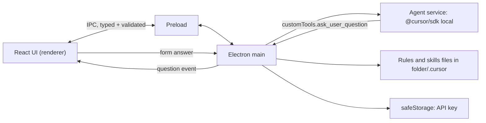

# Cursor agent Mac app (flowFE)

## Scope

- **In:** Electron Mac app; chat with one main Cursor agent; edit rules and skills in the app; agent questions rendered as forms with buttons.
- **Out:** GitHub, personas/orchestrator, SQLite, multiple agents, Windows/Linux, code signing, auto-update, cloud runtime.
- **Assumption:** "local Cursor model" means `@cursor/sdk` **local runtime** (the agent runs on this Mac against a folder; the model is still served by Cursor, so a `CURSOR_API_KEY` is needed). Not offline weights.
- **Repo:** [flowFE](/Users/valentinbarakov/Projects/flowFE) is empty and not a git repo yet. Mango's ADRs and doc rules do not apply there. I reuse mango's _choices_ (Electron, React, Vite, TypeScript, `@cursor/sdk` pinned to 1.2.0, `safeStorage` for the key) and its security window setup from `mango/src/main/window.ts` (context isolation on, Node off, sandbox on, no remote URL).

## Key design facts found

- Rules and skills are plain files the SDK loads when `local.settingSources: ["project"]`: `<folder>/.cursor/rules/*.mdc`, `<folder>/.cursor/skills/*/SKILL.md`, `<folder>/AGENTS.md`. The app edits these files directly, so Cursor IDE sees the same ones. Mango spike S3 confirmed `settingSources: ["project"]` is required, and that it also loads project skills and MCP servers.
- Questions: SDK 1.2.0 lists `askQuestion` as a tool name but has **no public callback** to answer it. `AgentOptions.local.customTools` accepts `execute(args) => Promise<result>`, which can block until the user submits a form. Default plan: register a custom tool `ask_user_question` with the same schema as Cursor's AskQuestion (`questions[{id, prompt, options[{id,label}], allow_multiple}]`), plus a rule telling the agent to use it for decisions. Phase 0 checks whether the native `askQuestion` works headless; if it does, I use it instead.

## Phases

Each phase ends with a runnable app and a manual check.

**Phase 0 - Scaffold and risk spike**

- Set up `package.json`, Vite configs (main, preload, renderer, copied from mango's three `vite.*.config.ts`), `tsconfig`, `npm start`. Dependencies: `electron`, `react`, `react-dom`, `vite`, `typescript`, `@cursor/sdk@1.2.0`, `zod`.
- Throwaway script `scripts/phase0-spike.ts` (`npm run spike`). It does not repeat Mango S1, S3, S8, or S22. Ran on 2026-11-05. The rule and the skill were followed. `ask_user_question` waited 5 s and its token came back. Native `askQuestion` did not appear (`NO_ASK_TOOL`). A clean `Agent.resume` kept the secret word and did not pick up a rule changed to `BEACON`. Results are in [docs/phase0-spike.md](/Users/valentinbarakov/Projects/flowFE/docs/phase0-spike.md).
- Exit: scaffold runs. The form mechanism is the custom tool `ask_user_question`.

**Phase 1 - Shell, setup, and chat**

- Main: window, `safeStorage` for the Cursor key, `agent-service` (create/resume agent, `send`, stream, cancel, dispose).
- IPC (zod-validated, sender-checked): `settings.get/save`, `folder.pick` (native dialog), `models.list`, `chat.send`, `chat.stop`, `chat.history`, plus an event channel for streamed deltas.
- UI (from prototype CSS variables, mango bot avatar, header, bubbles, tool lines, composer): first-run setup (API key, folder, model), chat thread with streaming text, tool-call lines (`read_file`, `shell`, ...) with status, Stop button.
- Persistence: JSON in `userData` (settings, one chat file per folder with messages and `agentId`). No database. Atomic writes.
- Restart: messages are kept by the app. `Agent.resume` is tried with a timeout; if it fails (Mango spike S8: it fails after a crash mid-run), a new agent is created with a transcript of recent messages. See `docs/session-and-questions.md`.
- Exit: type a prompt, see streamed answer and tool lines, stop works, restart keeps the conversation and can continue it.

**Phase 2 - Rules and skills editor**

- Main file service limited to `<folder>/.cursor/rules`, `<folder>/.cursor/skills`, `<folder>/AGENTS.md` (path-traversal checks, nothing outside).
- IPC: `rules.list/read/write/create/delete`, `skills.list/read/write/create/delete`.
- UI (prototype's "Settings" layout: list on the left, form on the right): rules list with name, `description`, `alwaysApply`, `globs`, body textarea; skills list with `name`, `description`, `SKILL.md` body; New / Save / Delete (confirm dialog). Plain textareas, no code editor dependency.
- A saved change applies to the **next** message (the agent is recreated or resumed with the same `settingSources`); show a small "applies to next message" note.
- Exit: add a rule "always answer in pirate speak", send a message, see it obeyed; same for a skill.

**Phase 3 - Question forms**

- Main: `ask_user_question` tool (or native hook, per Phase 0) emits `question.asked {id, title?, questions[]}` and awaits `question.answer` or `question.skip`; Stop and app quit reject pending questions.
- UI: a form card inline in the chat, like Cursor's: title, each question with radio buttons (or checkboxes when `allow_multiple`), an "Other" text field, **Submit** and **Skip** buttons; disabled and shows the chosen answers after submit. Pending question survives window reload (kept in main).
- Answer returned to the agent as JSON `{ [questionId]: { selected: [optionId], other?: string } }`.
- Exit: ask the agent to "ask me which of 3 options to use"; the form appears, answering continues the same run.

**Phase 4 - Polish and local `.app`**

- Light/dark theme, empty/error states (bad key, folder missing, agent error shown as a banner with Retry), chat reset ("New chat" drops `agentId`), model picker in header.
- Local unsigned `.app` build (adds `electron-builder` with `dir` target; macOS only). Confirm the SDK's native module (`@cursor/sdk-darwin-arm64`) is unpacked from asar and that the SDK runs inside the packaged app.
- Exit: `.app` launches, full flow works from Phases 1-3.

## Files (planned, in flowFE)

- `src/main/` : `index.ts`, `window.ts`, `agent-service.ts`, `chat-session.ts`, `rules-skills-service.ts`, `settings-store.ts`, `ipc.ts`
- `src/preload/index.ts` : exposes only the typed IPC surface
- `src/shared/ipc.ts` : zod schemas for commands/events (shared by main, preload, renderer)
- `src/renderer/` : `App.tsx`, `Setup`, `Chat`, `QuestionForm`, `RulesEditor`, `SkillsEditor`, `styles.css` (from prototype)
- `docs/` : architecture, IPC contract, session and question flow, decisions ([docs/README.md](/Users/valentinbarakov/Projects/flowFE/docs/README.md)); a run/build `README.md` is added in Phase 4

## Risks

- **SDK beta (1.2.0):** pin the version; keep all SDK calls in `agent-service.ts`.
- **Ambient settings:** with `settingSources: ["project"]` the chosen folder's own hooks, MCP servers, and skills also load; the UI states this on the folder picker.
- **Agent runs shell and edits without approval** in headless local mode; the setup screen says so, and a "read-only" toggle (tools allowlist without `shell`/`edit`) is a possible Phase 4 item, not a default.
- **Custom tool vs native AskQuestion:** the agent may not choose the custom tool unless a rule tells it to; the app writes that instruction into the agent's prompt, not into the user's files.

## Open questions

Answered by Valentin on 2026-11-05. Recorded in [docs/decisions.md](/Users/valentinbarakov/Projects/flowFE/docs/decisions.md).

- One chat per folder. "New chat" resets it (D-5).
- Do not edit `~/.cursor`. Override user-level rules for this agent by loading `settingSources: ["project"]` and by a line at the start of each send: project instructions win (D-11).
- A failed resume is seeded with the last 20 messages, text only (D-7).
- No read-only mode in v1 (D-12).
