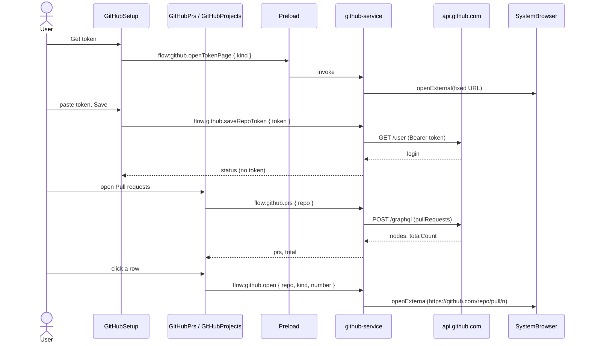

# GitHub: Pull requests section and Projects section, each behind its own token

## Overview

Add two optional, read-only GitHub sections to Mango. A **repos token** (pasted in Setup) turns on a **Pull requests** section: one tab per repository you picked, each tab listing that repo's open pull requests with Draft, review, and CI chips. A **Projects token** turns on a **Projects** section that looks exactly like the Jira board (three columns, cards, **Implement** button, Load more) and lists the open items of your personal GitHub Projects (v2). A section whose token is not saved is not shown anywhere. Main owns both tokens (encrypted with `safeStorage`) and every GitHub request; the window never sees a token and never talks to GitHub.

This plan expands the high-level plan `~/.cursor/plans/github_pr_section_e0aa4e23.plan.md` into steps with code. Each step leaves the project type-checking.

**Out of scope:**
- A "Get token" button for Jira Setup.
- Merging, reviewing, commenting, moving cards, or any other write to GitHub.
- Org-owned projects, GitHub Enterprise hosts, and project fields other than Status.
- More than 50 pull requests per repo (the tab says "50 of N"), more than 50 projects in the picker, and an "assigned to me" filter on the Projects board.
- Octokit (retry and throttling). Plain `fetch` is used.
- A live check against real GitHub. That stays manual.

**Implements / relates to:** `~/.cursor/plans/github_pr_section_e0aa4e23.plan.md`. Builds on D-1 (main owns all authority), D-9 (`Result` envelope), D-10 (reducer, no state library), D-16 (Jira token in main, same shape). Adds decision **D-17** (written in the last step). No new dependency, so no new boundary beyond "main calls `https://api.github.com`".

**Assumption:** the Projects board shows every open item of the selected project, not only items assigned to you (Jira's list is only yours). A project can have many collaborators, so this is the closest analogue.

**Assumption:** the Projects board reuses Jira's three fixed columns (`ticketColumn`), not the project's own Status options. An item with no Status goes to To Do.

**Assumption:** assignees and labels are not requested from GitHub because the cards do not show them. The high-level plan listed them; nothing renders them, so they are left out until a card needs them.

## Pros / Cons

**Pros**
- Same pattern as Jira (D-16): a factory with injected `fetch`, `safeStorage`, and `openExternal`, so one check script runs everything against a fake GitHub.
- Tokens, requests, and URLs stay in main. The CSP (`connect-src 'none'`) and the locked window are unchanged. The window can only send `{ kind }` to open a token page and `{ repo, kind, number }` to open an item; main builds every URL from a fixed host.
- Two independent tokens: a classic `repo` token for pull requests, a classic `read:project` token for Projects. A user who wants only one section pastes only one token.
- The Projects pane is a copy of the Jira board, so it needs no new styles and behaves the same.
- No dependency.

**Cons**
- A classic `repo` token can write to GitHub even though Mango never does. A fine-grained token cannot read a user-owned Project (Mango ADR-0008, spike S7), so the Projects token must be classic.
- GitHub's token page URL cannot set an expiry, so Setup only tells the user to set 30 to 90 days.
- No retry or throttling beyond the "Refresh" and "Retry" buttons.
- Project items are paged by GitHub before Mango drops closed ones, so one "page" of the board can need up to four requests (Step 3).
- The live behaviour (real token, real repos, real project) is a manual check.

## How It Works

Setup has a GitHub block with two optional token fields. Pasting a token makes main call GitHub once to check it. If GitHub accepts it, main stores it encrypted in `github.bin` and the matching button (Pull requests or Projects) appears in the left menu, or in the chat header when the workspace has one repo. Under each saved token, Setup shows a picker: a searchable list of repositories, or a list of your open personal projects. Only picked repos and projects are ever requested. Each pane replaces the main pane the same way the Jira list does, and **Back** restores what was open.

Terms: **repos token** = classic token with `repo`. **Projects token** = classic token with only `read:project`. **GraphQL** = GitHub's single `POST /graphql` endpoint. **Projects (v2)** = GitHub's project boards, whose items can be issues, pull requests, or drafts.

### Flow: save a token

1. The user clicks **Get token**. The window sends `{ kind: "repos" | "projects" }`. Main looks the URL up in a fixed table and calls `openExternal`. GitHub's "new token" page opens with the scope and a note filled in.
2. The user pastes the token and clicks Save. The window sends `flow:github.saveRepoToken` or `flow:github.saveProjectToken` with `{ token }`.
3. Main calls `GET /user` (repos) or GraphQL `viewer { login }` (projects) with the token. A 401 returns an `auth` error and **nothing is saved**.
4. On success main stores the token and the login in `github.bin` and returns the status: `{ repos: { tokenSet, login, selected }, projects: { tokenSet, login, selected } }`. No token text.
5. Remove clears that token and its selection.

### Flow: pick repos or projects

1. When a token is saved, the picker calls `flow:github.repos` (REST `GET /user/repos`, up to 10 pages of 100, following GitHub's `Link` header only on `api.github.com`) or `flow:github.projects` (GraphQL `viewer.projectsV2`).
2. The user filters, ticks boxes (at most 30 repos or 10 projects), and clicks Save. The window sends `flow:github.selectRepos` or `flow:github.selectProjects`.
3. Main validates every name or id against a strict pattern and stores the selection. The returned status carries the selection, so the panes know their tabs.

### Flow: see pull requests

1. The user opens Pull requests. The reducer sets `githubPrsOpen` and clears the other panes.
2. `GitHubPrs` shows one tab per picked repo. The active tab calls `flow:github.prs { repo }` once and caches the answer. Refresh reloads the active tab.
3. Main refuses a repo that is not picked, then makes one GraphQL call for the 50 most recently updated open pull requests plus `totalCount`.
4. A row click calls `flow:github.open { repo, kind: "pr", number }`. Main builds `https://github.com/<repo>/pull/<n>` and opens the browser.
5. Failure: a network error, rate limit, or 5xx shows the message and Retry. A 401 or a scope error shows the message and Open Setup.

### Flow: see projects

1. The user opens Projects. `GitHubProjects` loads `flow:github.projectItems { projectId }` for the first picked project (a small switcher appears when several are picked).
2. Main refuses a project that is not picked. It reads items 50 at a time, drops closed or merged issues and pull requests and items whose Status is a done name, keeps drafts, and keeps reading (up to 4 requests, until 25 items are kept) so a board full of finished work is not an empty page.
3. The pane puts each card in To Do, In Progress, or In Review with `projectColumn`. **Implement** opens New chat with `implementPrompt(url)`, like Jira. Load more sends the `nextCursor` back.



**Example:** the user pastes a classic `repo` token and ticks `octo/hello` and `octo/api`. Pull requests appears in the left menu with two tabs, `hello` and `api`. The `hello` tab shows `#5 Add cache`, `mona`, `feat/cache → main`, a Draft chip, a "Changes requested" chip, a "CI failing" chip, and `2h ago`. Clicking the row opens `https://github.com/octo/hello/pull/5`. With no Projects token, there is no Projects button.

**Before / after:** before, the left menu has New chat and Jira. After, it also has Pull requests and Projects, each only while its token is saved. `screenOf` returns `"githubPrs"` or `"githubProjects"` in addition to `"jira"`.

## Current State Analysis

**✅ Exists**
- `src/main/jira-service.ts`: the shape to copy (`JiraError`, injected `fetch` with a 20 s timeout, `SecretBox`, `writeAtomic`, HTTP-to-error mapping, cache plus `readData` and `save`).
- `src/main/atomic-write.ts`: `writeAtomic` (temp file, mode 0600, rename).
- `src/main/settings-store.ts`: exports the `SecretBox` type.
- `src/shared/jira.ts`: `ticketColumn`, `TICKET_COLUMNS`, `implementPrompt`.
- `src/shared/ipc.ts`: `COMMANDS`, `ErrorCodeSchema`, the Jira schemas as the style to follow.
- `src/main/ipc.ts`: `registerIpc`, the sender check, `input.safeParse`, `output.safeParse`, the `JiraError` catch.
- `src/preload/bridge.ts`: generic over `COMMANDS`, so no preload change.
- `src/renderer/JiraTickets.tsx`, `JiraSetup.tsx`: the board and the token pattern to copy. `styles.css` already has `.tickets-*`, `.ticket-*`.
- `src/renderer/state.ts`: `jiraOpen`, `open-jira`, `close-jira`, `screenOf`, `sidebarRows`.
- `scripts/jira-check.ts` and `scripts/repos-check-resolve.mjs`: the check pattern and loader.

**❌ Missing Components**
- `src/shared/github.ts` (Step 1)
- GitHub schemas and types in `src/shared/ipc.ts` (Step 2)
- `src/main/github-service.ts` (Step 3)
- `flow:github.*` commands, `registerIpc` wiring, `index.ts` wiring (Step 4)
- `githubPrsOpen`, `githubProjectsOpen`, and their actions and screens in `state.ts` (Step 5)
- `GitHubSetup.tsx` and its place in `Setup.tsx` and `App.tsx` (Step 6)
- `GitHubPrs.tsx` (Step 7)
- `GitHubProjects.tsx` (Step 8)
- Panes, menu buttons, header buttons, and styles (Step 9)
- `scripts/github-check.ts` and `npm run check:github` (Steps 1 to 5)
- Documentation (Step 10)

## Implementation Steps

### Step 1: Shared GitHub helpers and the check script
- **Files:** `src/shared/github.ts`, `scripts/github-check.ts`, `package.json`
- **Change:** Pure helpers used by main, the window, and the check script: name and id patterns, the item URL, the `Link` header, labels, the done filter, the board column, and a relative time. The check script is created here and extended in later steps.

**Code**

`src/shared/github.ts` (new file)
```ts
// Pure GitHub helpers shared by main, the window, and the check script. No I/O.
import { ticketColumn, type TicketColumn } from "./jira.js";

/** `owner/name`. A pull request or issue URL is built only from a name that passes isRepoFullName. */
export const REPO_FULL_NAME = /^[A-Za-z0-9-]{1,39}\/[A-Za-z0-9._-]{1,100}$/;

/** A Projects (v2) node id, such as PVT_kwHOABCD. */
export const PROJECT_ID = /^PVT_[A-Za-z0-9_-]{1,190}$/;

export const GITHUB_API_ORIGIN = "https://api.github.com";
export const MAX_SELECTED_REPOS = 30;
export const MAX_SELECTED_PROJECTS = 10;
export const PR_PAGE_SIZE = 50;
export const MAX_REPO_PAGES = 10;
export const ITEM_PAGE_SIZE = 50;
/** The Projects board keeps reading pages until it has this many items, or runs out of pages. */
export const ENOUGH_ITEMS = 25;
export const MAX_ITEM_PAGES = 4;

export type GithubTokenKind = "repos" | "projects";
export type GithubItemKind = "issue" | "pr";
export type ReviewState = "approved" | "changes" | "required";
export type CiState = "passing" | "failing" | "pending";

/** True for `owner/name`. The name part may not be `.` or `..`, so a URL cannot climb out of the repo path. */
export function isRepoFullName(value: string): boolean {
  if (!REPO_FULL_NAME.test(value)) return false;
  const name = value.slice(value.indexOf("/") + 1);
  return name !== "." && name !== "..";
}

/** The browser URL for one pull request or issue, or null when the repo or the number is not acceptable. */
export function itemUrl(repo: string, kind: GithubItemKind, number: number): string | null {
  if (!isRepoFullName(repo)) return null;
  if (!Number.isInteger(number) || number < 1 || number >= 1_000_000_000) return null;
  return `https://github.com/${repo}/${kind === "pr" ? "pull" : "issues"}/${number}`;
}

/** `hello` from `octo/hello`. */
export function shortRepoName(fullName: string): string {
  const slash = fullName.indexOf("/");
  return slash === -1 ? fullName : fullName.slice(slash + 1);
}

/** The `rel="next"` target of a GitHub `Link` header, or null. */
export function nextLink(header: string | null | undefined): string | null {
  if (header === null || header === undefined) return null;
  const match = /<([^>]+)>\s*;\s*rel="next"/.exec(header);
  return match?.[1] ?? null;
}

/** GitHub's `reviewDecision` as a short state. */
export function reviewState(raw: string | null | undefined): ReviewState | null {
  if (raw === "APPROVED") return "approved";
  if (raw === "CHANGES_REQUESTED") return "changes";
  if (raw === "REVIEW_REQUIRED") return "required";
  return null;
}

/** GitHub's `statusCheckRollup.state` as a short state. */
export function ciState(raw: string | null | undefined): CiState | null {
  if (raw === "SUCCESS") return "passing";
  if (raw === "FAILURE" || raw === "ERROR") return "failing";
  if (raw === "PENDING" || raw === "EXPECTED") return "pending";
  return null;
}

export function reviewLabel(state: ReviewState): string {
  if (state === "approved") return "Approved";
  if (state === "changes") return "Changes requested";
  return "Review required";
}

export function ciLabel(state: CiState): string {
  if (state === "passing") return "CI passing";
  if (state === "failing") return "CI failing";
  return "CI pending";
}

const DONE_NAMES = new Set(["done", "closed", "completed", "shipped"]);

/** True for a Status name that means the work is finished. Like Jira's "not Done". */
export function isDoneStatus(name: string): boolean {
  return DONE_NAMES.has(name.trim().toLowerCase());
}

/**
 * Column for one project item, using the same three columns as the Jira board.
 * An item with no Status goes to To Do. Otherwise Jira's `ticketColumn` decides, with no status category.
 */
export function projectColumn(status: string): TicketColumn {
  if (status.trim() === "") return "todo";
  return ticketColumn(status, "");
}

/** The Pull requests section is available only while the repos token is saved. */
export function prsReady(status: { repos: { tokenSet: boolean } } | null): boolean {
  return status?.repos.tokenSet === true;
}

/** The Projects section is available only while the Projects token is saved. */
export function projectsReady(status: { projects: { tokenSet: boolean } } | null): boolean {
  return status?.projects.tokenSet === true;
}

/** "just now", "5m ago", "3h ago", "2d ago", or the date (YYYY-MM-DD) after 30 days. Empty for a bad date. */
export function relativeTime(iso: string, now: number = Date.now()): string {
  const then = Date.parse(iso);
  if (Number.isNaN(then)) return "";
  const seconds = Math.max(0, Math.round((now - then) / 1000));
  if (seconds < 60) return "just now";
  const minutes = Math.floor(seconds / 60);
  if (minutes < 60) return `${minutes}m ago`;
  const hours = Math.floor(minutes / 60);
  if (hours < 24) return `${hours}h ago`;
  const days = Math.floor(hours / 24);
  if (days < 30) return `${days}d ago`;
  return iso.slice(0, 10);
}
```

`scripts/github-check.ts` (new file)
```ts
// Checks the GitHub helpers, contracts, service, and pane state. No Electron and no live GitHub call.
//   npm run check:github
import assert from "node:assert/strict";
import test from "node:test";
import {
  ciLabel,
  ciState,
  isDoneStatus,
  isRepoFullName,
  itemUrl,
  nextLink,
  PROJECT_ID,
  projectColumn,
  projectsReady,
  prsReady,
  relativeTime,
  reviewLabel,
  reviewState,
  shortRepoName,
} from "../src/shared/github.ts";

test("repo names are owner/name and cannot climb out of the path", () => {
  for (const good of ["octo/hello", "octo/hello.world", "a-b/c_d", "o/.github"]) {
    assert.equal(isRepoFullName(good), true, good);
  }
  for (const bad of [
    "octo",
    "octo/",
    "/hello",
    "octo/..",
    "octo/.",
    "octo/a/b",
    "octo/a b",
    "octo/hello\n",
    "octo/a?b=1",
    ".octo/hello",
    `${"o".repeat(40)}/hello`,
    `octo/${"x".repeat(101)}`,
  ]) {
    assert.equal(isRepoFullName(bad), false, bad);
  }
  assert.equal(shortRepoName("octo/hello"), "hello");
  assert.equal(shortRepoName("hello"), "hello");
});

test("project ids are PVT_ node ids", () => {
  assert.ok(PROJECT_ID.test("PVT_kwHOABCD-1_x"));
  for (const bad of ["PVT_", "pvt_abc", "PVT_a b", "PVT_a/../b", "PVT_a\n", "abc"]) {
    assert.equal(PROJECT_ID.test(bad), false, bad);
  }
});

test("an item URL is built from a clean repo and a positive number", () => {
  assert.equal(itemUrl("octo/hello", "pr", 12), "https://github.com/octo/hello/pull/12");
  assert.equal(itemUrl("octo/hello", "issue", 7), "https://github.com/octo/hello/issues/7");
  assert.equal(itemUrl("octo/..", "pr", 1), null);
  assert.equal(itemUrl("evil.example/x?y", "pr", 1), null);
  assert.equal(itemUrl("octo/hello", "pr", 0), null);
  assert.equal(itemUrl("octo/hello", "pr", 1.5), null);
  assert.equal(itemUrl("octo/hello", "pr", 1_000_000_000), null);
});

test("the Link header gives the next page", () => {
  assert.equal(
    nextLink(
      '<https://api.github.com/user/repos?per_page=100&page=2>; rel="next", <https://api.github.com/user/repos?per_page=100&page=9>; rel="last"',
    ),
    "https://api.github.com/user/repos?per_page=100&page=2",
  );
  assert.equal(
    nextLink('<https://api.github.com/x?page=1>; rel="prev", <https://api.github.com/x?page=3>; rel="next"'),
    "https://api.github.com/x?page=3",
  );
  assert.equal(nextLink('<https://api.github.com/x?page=1>; rel="prev"'), null);
  assert.equal(nextLink(null), null);
  assert.equal(nextLink(""), null);
});

test("review and CI states map to short labels", () => {
  assert.equal(reviewState("APPROVED"), "approved");
  assert.equal(reviewState("CHANGES_REQUESTED"), "changes");
  assert.equal(reviewState("REVIEW_REQUIRED"), "required");
  assert.equal(reviewState(null), null);
  assert.equal(reviewState("SOMETHING_NEW"), null);
  assert.equal(ciState("SUCCESS"), "passing");
  assert.equal(ciState("FAILURE"), "failing");
  assert.equal(ciState("ERROR"), "failing");
  assert.equal(ciState("PENDING"), "pending");
  assert.equal(ciState("EXPECTED"), "pending");
  assert.equal(ciState(undefined), null);
  assert.equal(reviewLabel("changes"), "Changes requested");
  assert.equal(ciLabel("passing"), "CI passing");
});

test("done statuses are dropped and cards land in the Jira columns", () => {
  for (const done of ["Done", " done ", "CLOSED", "Completed", "shipped"]) {
    assert.equal(isDoneStatus(done), true, done);
  }
  for (const open of ["Todo", "In Progress", "Done soon", ""]) {
    assert.equal(isDoneStatus(open), false, open);
  }
  assert.equal(projectColumn(""), "todo");
  assert.equal(projectColumn("Todo"), "todo");
  assert.equal(projectColumn("Backlog"), "todo");
  assert.equal(projectColumn("In Progress"), "progress");
  assert.equal(projectColumn("Blocked"), "progress");
  assert.equal(projectColumn("In Review"), "review");
  assert.equal(projectColumn("Code review"), "review");
});

test("a section is ready only while its own token is saved", () => {
  const none = {
    repos: { tokenSet: false },
    projects: { tokenSet: false },
  };
  assert.equal(prsReady(null), false);
  assert.equal(projectsReady(null), false);
  assert.equal(prsReady(none), false);
  assert.equal(projectsReady(none), false);
  assert.equal(prsReady({ ...none, repos: { tokenSet: true } }), true);
  assert.equal(projectsReady({ ...none, repos: { tokenSet: true } }), false);
  assert.equal(projectsReady({ ...none, projects: { tokenSet: true } }), true);
  assert.equal(prsReady({ ...none, projects: { tokenSet: true } }), false);
});

test("relative time", () => {
  const now = Date.parse("2026-11-06T12:00:00Z");
  assert.equal(relativeTime("2026-11-06T11:59:40Z", now), "just now");
  assert.equal(relativeTime("2026-11-06T12:30:00Z", now), "just now");
  assert.equal(relativeTime("2026-11-06T11:30:00Z", now), "30m ago");
  assert.equal(relativeTime("2026-11-06T09:00:00Z", now), "3h ago");
  assert.equal(relativeTime("2026-11-04T12:00:00Z", now), "2d ago");
  assert.equal(relativeTime("2026-09-01T12:00:00Z", now), "2026-09-01");
  assert.equal(relativeTime("garbage", now), "");
});
```

`package.json` (modify `scripts`, after `check:jira`)

Before
```json
    "check:jira": "node --disable-warning=ExperimentalWarning --experimental-strip-types --import ./scripts/repos-check-resolve.mjs scripts/jira-check.ts",
```

After
```json
    "check:jira": "node --disable-warning=ExperimentalWarning --experimental-strip-types --import ./scripts/repos-check-resolve.mjs scripts/jira-check.ts",
    "check:github": "node --disable-warning=ExperimentalWarning --experimental-strip-types --import ./scripts/repos-check-resolve.mjs scripts/github-check.ts",
```

**Verify:** `npm run typecheck && npm run check:github`.

### Step 2: Contracts (schemas and types) in `src/shared/ipc.ts`
- **Files:** `src/shared/ipc.ts`
- **Change:** Add the Zod schemas and inferred types for the GitHub status, repo list, pull requests, projects, and project items. The `COMMANDS` entries are added in Step 4 together with their handlers, because `registerIpc` ends in `assertNever` and would stop type-checking if a command had no `case`.

**Code**

`src/shared/ipc.ts` (modify the imports, after the `./jira.js` import)

Before
```ts
import { ISSUE_KEY, JIRA_EMAIL } from "./jira.js";
```

After
```ts
import { isRepoFullName, PROJECT_ID } from "./github.js";
import { ISSUE_KEY, JIRA_EMAIL } from "./jira.js";
```

`src/shared/ipc.ts` (add after `export type JiraIssuesResult = ...;` and before `const None = ...`)
```ts
export const RepoFullNameSchema = z.string().refine(isRepoFullName, "Unknown repository");
export const ProjectIdSchema = z.string().max(200).regex(PROJECT_ID, "Unknown project");
export const GithubTokenSchema = z.string().trim().min(1).max(500);
export const GithubTokenKindSchema = z.enum(["repos", "projects"]);
export const GithubItemKindSchema = z.enum(["issue", "pr"]);

export const GithubProjectRefSchema = z.object({
  id: ProjectIdSchema,
  title: z.string().max(200),
});
export type GithubProjectRef = z.infer<typeof GithubProjectRefSchema>;

/** What the window may know. It never gets a token. `selected` is what Setup saved. */
export const GithubStatusSchema = z.object({
  repos: z.object({
    tokenSet: z.boolean(),
    login: z.string().nullable(),
    selected: z.array(RepoFullNameSchema),
  }),
  projects: z.object({
    tokenSet: z.boolean(),
    login: z.string().nullable(),
    selected: z.array(GithubProjectRefSchema),
  }),
});
export type GithubStatus = z.infer<typeof GithubStatusSchema>;

export const GithubRepoSchema = z.object({
  fullName: RepoFullNameSchema,
  private: z.boolean(),
  archived: z.boolean(),
});
export type GithubRepo = z.infer<typeof GithubRepoSchema>;

export const GithubReposResultSchema = z.object({
  repos: z.array(GithubRepoSchema),
  /** True when the token can see more repos than the 10 pages Mango reads. */
  truncated: z.boolean(),
});
export type GithubReposResult = z.infer<typeof GithubReposResultSchema>;

export const GithubPrSchema = z.object({
  number: z.number().int().positive(),
  title: z.string(),
  author: z.string(),
  headRefName: z.string(),
  baseRefName: z.string(),
  isDraft: z.boolean(),
  updatedAt: z.string(),
  review: z.enum(["approved", "changes", "required"]).nullable(),
  ci: z.enum(["passing", "failing", "pending"]).nullable(),
});
export type GithubPr = z.infer<typeof GithubPrSchema>;

export const GithubPrsResultSchema = z.object({
  prs: z.array(GithubPrSchema),
  /** Open pull requests in the repo. More than `prs.length` when GitHub has more than one page. */
  total: z.number().int().min(0),
});
export type GithubPrsResult = z.infer<typeof GithubPrsResultSchema>;

export const GithubProjectsResultSchema = z.object({
  projects: z.array(GithubProjectRefSchema),
});
export type GithubProjectsResult = z.infer<typeof GithubProjectsResultSchema>;

export const GithubItemSchema = z.object({
  id: z.string().min(1).max(200),
  kind: z.enum(["issue", "pr", "draft"]),
  /** Null for a draft item. */
  repo: RepoFullNameSchema.nullable(),
  /** Null for a draft item. */
  number: z.number().int().positive().nullable(),
  title: z.string(),
  /** The project's Status value. Empty when the item has none. */
  status: z.string(),
});
export type GithubItem = z.infer<typeof GithubItemSchema>;

export const GithubItemsResultSchema = z.object({
  items: z.array(GithubItemSchema),
  nextCursor: z.string().min(1).max(2_000).optional(),
});
export type GithubItemsResult = z.infer<typeof GithubItemsResultSchema>;
```

**Verify:** `npm run typecheck`. The schemas are exported but not yet used, which does not trip `noUnusedLocals`.

### Step 3: `src/main/github-service.ts` and its service checks
- **Files:** `src/main/github-service.ts`, `scripts/github-check.ts`
- **Change:** The main-process service: two `safeStorage` tokens, the picked repos and projects, REST repo list, GraphQL pull requests, projects and items, the browser opens, and the error mapping. It copies the shape of `jira-service.ts`. Every request goes to `https://api.github.com` only.

**Code**

`src/main/github-service.ts` (new file)
```ts
// GitHub pull requests and Projects for the signed-in account. Main process only.
// github.bin holds two optional tokens, their logins, and the picked repos and projects,
// encrypted with safeStorage. Requests go to https://api.github.com and nowhere else.
// Mango only reads. The window never sees a token.
import { existsSync, readFileSync } from "node:fs";
import path from "node:path";
import { z } from "zod";
import {
  ciState,
  ENOUGH_ITEMS,
  GITHUB_API_ORIGIN,
  isDoneStatus,
  isRepoFullName,
  ITEM_PAGE_SIZE,
  itemUrl,
  MAX_ITEM_PAGES,
  MAX_REPO_PAGES,
  MAX_SELECTED_PROJECTS,
  MAX_SELECTED_REPOS,
  nextLink,
  PR_PAGE_SIZE,
  PROJECT_ID,
  reviewState,
  type GithubItemKind,
  type GithubTokenKind,
} from "../shared/github.js";
import { writeAtomic } from "./atomic-write.js";
import type {
  ErrorCode,
  GithubItem,
  GithubItemsResult,
  GithubPr,
  GithubPrsResult,
  GithubProjectRef,
  GithubProjectsResult,
  GithubRepo,
  GithubReposResult,
  GithubStatus,
} from "../shared/ipc.js";
import type { SecretBox } from "./settings-store.js";

export class GithubError extends Error {
  readonly code: ErrorCode;
  readonly retryable: boolean;

  constructor(code: ErrorCode, message: string, retryable: boolean) {
    super(message);
    this.name = "GithubError";
    this.code = code;
    this.retryable = retryable;
  }
}

const REQUEST_TIMEOUT_MS = 20_000;
const GRAPHQL_URL = `${GITHUB_API_ORIGIN}/graphql`;
const USER_URL = `${GITHUB_API_ORIGIN}/user`;
const REPOS_URL = `${GITHUB_API_ORIGIN}/user/repos?per_page=100&sort=full_name&affiliation=owner,collaborator,organization_member`;

/** The only pages the window can ask main to open besides an item. A kind that is not a key here is refused. */
const TOKEN_PAGES: Record<GithubTokenKind, string> = {
  repos: "https://github.com/settings/tokens/new?scopes=repo&description=Mango%20pull%20requests",
  projects: "https://github.com/settings/tokens/new?scopes=read:project&description=Mango%20projects",
};

const VIEWER_QUERY = "query { viewer { login } }";

const PRS_QUERY = `query($owner: String!, $name: String!, $first: Int!) {
  repository(owner: $owner, name: $name) {
    pullRequests(states: OPEN, first: $first, orderBy: { field: UPDATED_AT, direction: DESC }) {
      totalCount
      nodes {
        number
        title
        isDraft
        updatedAt
        author { login }
        headRefName
        baseRefName
        reviewDecision
        commits(last: 1) { nodes { commit { statusCheckRollup { state } } } }
      }
    }
  }
}`;

const PROJECTS_QUERY = "query { viewer { projectsV2(first: 50) { nodes { id title number closed } } } }";

const ITEMS_QUERY = `query($id: ID!, $first: Int!, $after: String) {
  node(id: $id) {
    ... on ProjectV2 {
      items(first: $first, after: $after) {
        pageInfo { hasNextPage endCursor }
        nodes {
          id
          status: fieldValueByName(name: "Status") {
            ... on ProjectV2ItemFieldSingleSelectValue { name }
          }
          content {
            __typename
            ... on Issue { number title state repository { nameWithOwner } }
            ... on PullRequest { number title state repository { nameWithOwner } }
            ... on DraftIssue { title }
          }
        }
      }
    }
  }
}`;

const ProjectRefSchema = z.object({
  id: z.string().regex(PROJECT_ID),
  title: z.string().max(200),
});

const GithubDataSchema = z.object({
  repoToken: z.string().nullable(),
  repoLogin: z.string().nullable(),
  projectToken: z.string().nullable(),
  projectLogin: z.string().nullable(),
  selectedRepos: z.array(z.string().refine(isRepoFullName)).max(MAX_SELECTED_REPOS),
  selectedProjects: z.array(ProjectRefSchema).max(MAX_SELECTED_PROJECTS),
});
type GithubData = z.infer<typeof GithubDataSchema>;

const EMPTY_DATA: GithubData = {
  repoToken: null,
  repoLogin: null,
  projectToken: null,
  projectLogin: null,
  selectedRepos: [],
  selectedProjects: [],
};

const UserSchema = z.object({ login: z.string().min(1).max(100) });
const ViewerSchema = z.object({ viewer: UserSchema });

const GraphqlEnvelopeSchema = z.object({
  data: z.unknown().nullish(),
  errors: z
    .array(z.object({ type: z.string().nullish(), message: z.string().nullish() }))
    .nullish(),
});

const ApiRepoSchema = z.object({
  full_name: z.string(),
  private: z.boolean().nullish(),
  archived: z.boolean().nullish(),
});

const PrNodeSchema = z.object({
  number: z.number().int().positive(),
  title: z.string().nullish(),
  isDraft: z.boolean().nullish(),
  updatedAt: z.string().nullish(),
  author: z.object({ login: z.string() }).nullish(),
  headRefName: z.string().nullish(),
  baseRefName: z.string().nullish(),
  reviewDecision: z.string().nullish(),
  commits: z
    .object({
      nodes: z
        .array(
          z
            .object({
              commit: z
                .object({
                  statusCheckRollup: z.object({ state: z.string() }).nullish(),
                })
                .nullish(),
            })
            .nullish(),
        )
        .nullish(),
    })
    .nullish(),
});

const PrsDataSchema = z.object({
  repository: z
    .object({
      pullRequests: z.object({
        totalCount: z.number().int().min(0),
        nodes: z.array(z.unknown()).nullish(),
      }),
    })
    .nullable(),
});

const ProjectNodeSchema = z.object({
  id: z.string(),
  title: z.string().nullish(),
  closed: z.boolean().nullish(),
});

const ProjectsDataSchema = z.object({
  viewer: z.object({
    projectsV2: z.object({ nodes: z.array(z.unknown()).nullish() }),
  }),
});

const ItemContentSchema = z.object({
  __typename: z.string(),
  number: z.number().int().positive().nullish(),
  title: z.string().nullish(),
  state: z.string().nullish(),
  repository: z.object({ nameWithOwner: z.string() }).nullish(),
});

const ItemNodeSchema = z.object({
  id: z.string(),
  status: z.object({ name: z.string().nullish() }).nullish(),
  content: ItemContentSchema.nullish(),
});

const ItemsDataSchema = z.object({
  node: z
    .object({
      items: z
        .object({
          pageInfo: z.object({
            hasNextPage: z.boolean(),
            endCursor: z.string().nullish(),
          }),
          nodes: z.array(z.unknown()).nullish(),
        })
        .optional(),
    })
    .nullable(),
});

export type GithubService = {
  status(): GithubStatus;
  /** Checks the token with GET /user. A rejected token is not saved. */
  saveRepoToken(input: { token: string }): Promise<GithubStatus>;
  /** Removes the repos token and the picked repos. */
  clearRepoToken(): GithubStatus;
  /** Checks the token with a GraphQL viewer query. A rejected token is not saved. */
  saveProjectToken(input: { token: string }): Promise<GithubStatus>;
  /** Removes the Projects token and the picked projects. */
  clearProjectToken(): GithubStatus;
  repos(): Promise<GithubReposResult>;
  selectRepos(input: { repos: string[] }): GithubStatus;
  prs(input: { repo: string }): Promise<GithubPrsResult>;
  projects(): Promise<GithubProjectsResult>;
  selectProjects(input: { projects: GithubProjectRef[] }): GithubStatus;
  projectItems(input: {
    projectId: string;
    cursor?: string | undefined;
  }): Promise<GithubItemsResult>;
  open(input: { repo: string; kind: GithubItemKind; number: number }): Promise<void>;
  openTokenPage(input: { kind: GithubTokenKind }): Promise<void>;
};

export type GithubOptions = {
  userDataDir: string;
  secrets: SecretBox;
  openExternal(url: string): Promise<void>;
  fetch?: typeof globalThis.fetch;
};

/** Rows that do not parse, or whose name is odd, are skipped. */
export function parseRepoRows(rows: readonly unknown[]): GithubRepo[] {
  const repos: GithubRepo[] = [];
  for (const raw of rows) {
    const row = ApiRepoSchema.safeParse(raw);
    if (!row.success || !isRepoFullName(row.data.full_name)) continue;
    repos.push({
      fullName: row.data.full_name,
      private: row.data.private === true,
      archived: row.data.archived === true,
    });
  }
  return repos;
}

/** `null` when the answer is not the expected shape, `"missing"` when the repo is not visible to the token. */
export function parsePrsResponse(data: unknown): GithubPrsResult | "missing" | null {
  const parsed = PrsDataSchema.safeParse(data);
  if (!parsed.success) return null;
  const repository = parsed.data.repository;
  if (repository === null) return "missing";
  const prs: GithubPr[] = [];
  for (const raw of repository.pullRequests.nodes ?? []) {
    const node = PrNodeSchema.safeParse(raw);
    if (!node.success) continue;
    const row = node.data;
    prs.push({
      number: row.number,
      title: clip(row.title ?? "", 500),
      author: clip(row.author?.login ?? "", 100),
      headRefName: clip(row.headRefName ?? "", 200),
      baseRefName: clip(row.baseRefName ?? "", 200),
      isDraft: row.isDraft === true,
      updatedAt: clip(row.updatedAt ?? "", 60),
      review: reviewState(row.reviewDecision),
      ci: ciState(row.commits?.nodes?.[0]?.commit?.statusCheckRollup?.state),
    });
  }
  return { prs, total: repository.pullRequests.totalCount };
}

/** Open personal projects only. A closed project or an odd id is skipped. */
export function parseProjectsResponse(data: unknown): GithubProjectRef[] | null {
  const parsed = ProjectsDataSchema.safeParse(data);
  if (!parsed.success) return null;
  const projects: GithubProjectRef[] = [];
  for (const raw of parsed.data.viewer.projectsV2.nodes ?? []) {
    const node = ProjectNodeSchema.safeParse(raw);
    if (!node.success || node.data.closed === true || !PROJECT_ID.test(node.data.id)) continue;
    projects.push({ id: node.data.id, title: clip(node.data.title ?? "", 200) });
  }
  return projects;
}

/**
 * One page of project items. Closed or merged issues and pull requests, and items whose Status
 * is a done name, are dropped. Drafts are kept. `"missing"` when the id is not a project.
 */
export function parseItemsPage(
  data: unknown,
): { items: GithubItem[]; hasNext: boolean; endCursor: string | null } | "missing" | null {
  const parsed = ItemsDataSchema.safeParse(data);
  if (!parsed.success) return null;
  const items = parsed.data.node?.items;
  if (items === undefined) return "missing";
  const kept: GithubItem[] = [];
  for (const raw of items.nodes ?? []) {
    const item = toItem(raw);
    if (item !== null) kept.push(item);
  }
  return {
    items: kept,
    hasNext: items.pageInfo.hasNextPage,
    endCursor: items.pageInfo.endCursor ?? null,
  };
}

function toItem(raw: unknown): GithubItem | null {
  const node = ItemNodeSchema.safeParse(raw);
  if (!node.success) return null;
  const content = node.data.content;
  if (content === null || content === undefined) return null;
  const status = clip(node.data.status?.name ?? "", 100);
  if (isDoneStatus(status)) return null;
  const id = clip(node.data.id, 200);
  const title = clip(content.title ?? "", 500);
  if (id === "") return null;
  if (content.__typename === "DraftIssue") {
    return { id, kind: "draft", repo: null, number: null, title, status };
  }
  if (content.__typename !== "Issue" && content.__typename !== "PullRequest") return null;
  if (content.state !== "OPEN") return null;
  const repo = content.repository?.nameWithOwner;
  const number = content.number;
  if (repo === undefined || repo === null || !isRepoFullName(repo)) return null;
  if (number === undefined || number === null) return null;
  return {
    id,
    kind: content.__typename === "PullRequest" ? "pr" : "issue",
    repo,
    number,
    title,
    status,
  };
}

export function createGithubService(options: GithubOptions): GithubService {
  const file = path.join(options.userDataDir, "github.bin");
  const doFetch = options.fetch ?? globalThis.fetch;
  let cache: GithubData | null = null;

  function load(): GithubData {
    if (cache === null) cache = readData();
    return cache;
  }

  function readData(): GithubData {
    if (!existsSync(file) || !options.secrets.isEncryptionAvailable()) return EMPTY_DATA;
    try {
      const parsed = GithubDataSchema.safeParse(
        JSON.parse(options.secrets.decryptString(readFileSync(file))) as unknown,
      );
      return parsed.success ? parsed.data : EMPTY_DATA;
    } catch {
      return EMPTY_DATA;
    }
  }

  function save(next: GithubData): void {
    if (!options.secrets.isEncryptionAvailable()) {
      throw new GithubError(
        "io_error",
        "This Mac cannot encrypt the GitHub tokens right now.",
        false,
      );
    }
    try {
      writeAtomic(file, options.secrets.encryptString(JSON.stringify(next)));
    } catch {
      throw new GithubError("io_error", "Could not save the GitHub settings.", false);
    }
    cache = next;
  }

  function status(): GithubStatus {
    const data = load();
    return {
      repos: {
        tokenSet: data.repoToken !== null,
        login: data.repoLogin,
        selected: [...data.selectedRepos],
      },
      projects: {
        tokenSet: data.projectToken !== null,
        login: data.projectLogin,
        selected: data.selectedProjects.map((project) => ({
          id: project.id,
          title: project.title,
        })),
      },
    };
  }

  function requireRepoToken(): string {
    const token = load().repoToken;
    if (token === null) {
      throw new GithubError(
        "not_ready",
        "Add a GitHub token for pull requests in Setup.",
        false,
      );
    }
    return token;
  }

  function requireProjectToken(): string {
    const token = load().projectToken;
    if (token === null) {
      throw new GithubError("not_ready", "Add a GitHub token for projects in Setup.", false);
    }
    return token;
  }

  /** One request to api.github.com. The token is never sent to another host. */
  async function send(token: string, url: string, body?: string): Promise<Response> {
    if (!url.startsWith(`${GITHUB_API_ORIGIN}/`)) {
      throw new GithubError("invalid_input", "Refused a request to another host.", false);
    }
    const headers: Record<string, string> = {
      Authorization: `Bearer ${token}`,
      Accept: "application/vnd.github+json",
      "X-GitHub-Api-Version": "2022-11-28",
      "User-Agent": "Mango",
    };
    if (body !== undefined) headers["Content-Type"] = "application/json";
    try {
      return await doFetch(url, {
        method: body === undefined ? "GET" : "POST",
        headers,
        ...(body !== undefined ? { body } : {}),
        signal: AbortSignal.timeout(REQUEST_TIMEOUT_MS),
      });
    } catch {
      throw new GithubError(
        "io_error",
        "Could not reach GitHub. Check the connection and try again.",
        true,
      );
    }
  }

  async function readJson(response: Response): Promise<unknown> {
    try {
      return (await response.json()) as unknown;
    } catch {
      throw unreadable();
    }
  }

  async function graphql(
    token: string,
    scope: "repo" | "read:project",
    query: string,
    variables: Record<string, unknown>,
  ): Promise<unknown> {
    const response = await send(token, GRAPHQL_URL, JSON.stringify({ query, variables }));
    if (!response.ok) throw httpFailure(response);
    const envelope = GraphqlEnvelopeSchema.safeParse(await readJson(response));
    if (!envelope.success) throw unreadable();
    const errors = envelope.data.errors ?? [];
    if (errors.length > 0) throw graphqlFailure(errors, scope);
    if (envelope.data.data === undefined || envelope.data.data === null) throw unreadable();
    return envelope.data.data;
  }

  async function saveRepoToken(input: { token: string }): Promise<GithubStatus> {
    const token = input.token.trim();
    if (token === "") throw new GithubError("invalid_input", "Paste a token.", false);
    const response = await send(token, USER_URL);
    if (!response.ok) throw httpFailure(response);
    const user = UserSchema.safeParse(await readJson(response));
    if (!user.success) throw unreadable();
    save({ ...load(), repoToken: token, repoLogin: user.data.login });
    return status();
  }

  function clearRepoToken(): GithubStatus {
    const data = load();
    if (data.repoToken === null && data.repoLogin === null && data.selectedRepos.length === 0) {
      return status();
    }
    save({ ...data, repoToken: null, repoLogin: null, selectedRepos: [] });
    return status();
  }

  async function saveProjectToken(input: { token: string }): Promise<GithubStatus> {
    const token = input.token.trim();
    if (token === "") throw new GithubError("invalid_input", "Paste a token.", false);
    const data = await graphql(token, "read:project", VIEWER_QUERY, {});
    const viewer = ViewerSchema.safeParse(data);
    if (!viewer.success) throw unreadable();
    save({ ...load(), projectToken: token, projectLogin: viewer.data.viewer.login });
    return status();
  }

  function clearProjectToken(): GithubStatus {
    const data = load();
    if (
      data.projectToken === null &&
      data.projectLogin === null &&
      data.selectedProjects.length === 0
    ) {
      return status();
    }
    save({ ...data, projectToken: null, projectLogin: null, selectedProjects: [] });
    return status();
  }

  async function repos(): Promise<GithubReposResult> {
    const token = requireRepoToken();
    const found: GithubRepo[] = [];
    let url: string | null = REPOS_URL;
    let pages = 0;
    while (url !== null && pages < MAX_REPO_PAGES) {
      const response: Response = await send(token, url);
      if (!response.ok) throw httpFailure(response);
      const body = await readJson(response);
      if (!Array.isArray(body)) throw unreadable();
      found.push(...parseRepoRows(body));
      pages += 1;
      url = nextApiLink(response.headers.get("link"));
    }
    return { repos: found, truncated: url !== null };
  }

  function selectRepos(input: { repos: string[] }): GithubStatus {
    const data = load();
    if (data.repoToken === null) throw notReadyRepos();
    const names = [...new Set(input.repos)];
    if (names.length > MAX_SELECTED_REPOS) {
      throw new GithubError(
        "invalid_input",
        `Pick at most ${MAX_SELECTED_REPOS} repositories.`,
        false,
      );
    }
    if (!names.every((name) => isRepoFullName(name))) {
      throw new GithubError("invalid_input", "Unknown repository.", false);
    }
    save({ ...data, selectedRepos: names });
    return status();
  }

  async function prs(input: { repo: string }): Promise<GithubPrsResult> {
    const token = requireRepoToken();
    if (!isRepoFullName(input.repo) || !load().selectedRepos.includes(input.repo)) {
      throw new GithubError("invalid_input", "Pick that repository in Setup first.", false);
    }
    const [owner, name] = input.repo.split("/");
    const data = await graphql(token, "repo", PRS_QUERY, {
      owner,
      name,
      first: PR_PAGE_SIZE,
    });
    const page = parsePrsResponse(data);
    if (page === null) throw unreadable();
    if (page === "missing") {
      throw new GithubError(
        "not_found",
        "GitHub could not find that repository for this token.",
        false,
      );
    }
    return page;
  }

  async function projects(): Promise<GithubProjectsResult> {
    const token = requireProjectToken();
    const data = await graphql(token, "read:project", PROJECTS_QUERY, {});
    const list = parseProjectsResponse(data);
    if (list === null) throw unreadable();
    return { projects: list };
  }

  function selectProjects(input: { projects: GithubProjectRef[] }): GithubStatus {
    const data = load();
    if (data.projectToken === null) throw notReadyProjects();
    const unique = new Map<string, GithubProjectRef>();
    for (const project of input.projects) {
      if (!PROJECT_ID.test(project.id)) {
        throw new GithubError("invalid_input", "Unknown project.", false);
      }
      unique.set(project.id, { id: project.id, title: clip(project.title, 200) });
    }
    if (unique.size > MAX_SELECTED_PROJECTS) {
      throw new GithubError(
        "invalid_input",
        `Pick at most ${MAX_SELECTED_PROJECTS} projects.`,
        false,
      );
    }
    save({ ...data, selectedProjects: [...unique.values()] });
    return status();
  }

  async function projectItems(input: {
    projectId: string;
    cursor?: string | undefined;
  }): Promise<GithubItemsResult> {
    const token = requireProjectToken();
    if (!load().selectedProjects.some((project) => project.id === input.projectId)) {
      throw new GithubError("invalid_input", "Pick that project in Setup first.", false);
    }
    const items: GithubItem[] = [];
    let cursor: string | null = input.cursor ?? null;
    let more = true;
    let pages = 0;
    while (more && pages < MAX_ITEM_PAGES && items.length < ENOUGH_ITEMS) {
      const data = await graphql(token, "read:project", ITEMS_QUERY, {
        id: input.projectId,
        first: ITEM_PAGE_SIZE,
        after: cursor,
      });
      const page = parseItemsPage(data);
      if (page === null) throw unreadable();
      if (page === "missing") {
        throw new GithubError(
          "not_found",
          "GitHub could not find that project for this token.",
          false,
        );
      }
      items.push(...page.items);
      pages += 1;
      cursor = page.endCursor;
      more = page.hasNext && page.endCursor !== null;
    }
    return {
      items,
      ...(more && cursor !== null ? { nextCursor: cursor } : {}),
    };
  }

  async function open(input: {
    repo: string;
    kind: GithubItemKind;
    number: number;
  }): Promise<void> {
    const data = load();
    if (data.repoToken === null && data.projectToken === null) {
      throw new GithubError("not_ready", "Add a GitHub token in Setup.", false);
    }
    const url = itemUrl(input.repo, input.kind, input.number);
    if (url === null) {
      throw new GithubError("invalid_input", "Unknown pull request or issue.", false);
    }
    await browse(url);
  }

  async function openTokenPage(input: { kind: GithubTokenKind }): Promise<void> {
    const url = Object.hasOwn(TOKEN_PAGES, input.kind) ? TOKEN_PAGES[input.kind] : undefined;
    if (url === undefined) {
      throw new GithubError("invalid_input", "Unknown token page.", false);
    }
    await browse(url);
  }

  async function browse(url: string): Promise<void> {
    try {
      await options.openExternal(url);
    } catch {
      throw new GithubError("io_error", "Could not open the browser.", true);
    }
  }

  return {
    status,
    saveRepoToken,
    clearRepoToken,
    saveProjectToken,
    clearProjectToken,
    repos,
    selectRepos,
    prs,
    projects,
    selectProjects,
    projectItems,
    open,
    openTokenPage,
  };
}

/** The `Link` next page, but only when it is on api.github.com. */
function nextApiLink(header: string | null): string | null {
  const next = nextLink(header);
  if (next === null) return null;
  try {
    return new URL(next).origin === GITHUB_API_ORIGIN ? next : null;
  } catch {
    return null;
  }
}

function notReadyRepos(): GithubError {
  return new GithubError("not_ready", "Add a GitHub token for pull requests in Setup.", false);
}

function notReadyProjects(): GithubError {
  return new GithubError("not_ready", "Add a GitHub token for projects in Setup.", false);
}

function unreadable(): GithubError {
  return new GithubError("io_error", "GitHub sent an answer the app could not read.", true);
}

function httpFailure(response: Response): GithubError {
  const status = response.status;
  if (status === 401) {
    return new GithubError("auth", "GitHub rejected the token. Check it in Setup.", false);
  }
  if (status === 403 || status === 429) {
    const limited =
      status === 429 ||
      response.headers.get("x-ratelimit-remaining") === "0" ||
      response.headers.get("retry-after") !== null;
    if (limited) {
      return new GithubError("io_error", "GitHub is limiting requests. Try again in a moment.", true);
    }
    return new GithubError(
      "auth",
      "GitHub refused this request for that token. Check its scope in Setup.",
      false,
    );
  }
  if (status === 404) {
    return new GithubError(
      "not_found",
      "GitHub could not find that. Check the token and the picks in Setup.",
      false,
    );
  }
  if (status >= 500) {
    return new GithubError("io_error", `GitHub had a problem (HTTP ${status}). Try again.`, true);
  }
  return new GithubError("io_error", `GitHub refused the request (HTTP ${status}).`, false);
}

function graphqlFailure(
  errors: readonly { type?: string | null | undefined }[],
  scope: "repo" | "read:project",
): GithubError {
  const types = errors.map((error) => error.type ?? "");
  if (types.includes("INSUFFICIENT_SCOPES")) {
    return new GithubError(
      "auth",
      `The token needs the ${scope} scope. Use Get token to make a new one.`,
      false,
    );
  }
  if (types.includes("FORBIDDEN")) {
    return new GithubError(
      "auth",
      "GitHub refused this request for that token. Check its scope in Setup.",
      false,
    );
  }
  if (types.includes("NOT_FOUND")) {
    return new GithubError("not_found", "GitHub could not find that for this token.", false);
  }
  if (types.includes("RATE_LIMITED")) {
    return new GithubError("io_error", "GitHub is limiting requests. Try again in a moment.", true);
  }
  return new GithubError("io_error", "GitHub could not answer that request.", false);
}

function clip(value: string, max: number): string {
  return value.length > max ? value.slice(0, max) : value;
}
```

`scripts/github-check.ts` (modify the import block at the top: add these imports after `import test from "node:test";`)
```ts
import { existsSync, mkdtempSync, readFileSync, writeFileSync } from "node:fs";
import { tmpdir } from "node:os";
import path from "node:path";
import {
  createGithubService,
  GithubError,
  parseItemsPage,
  parsePrsResponse,
  parseProjectsResponse,
  parseRepoRows,
} from "../src/main/github-service.ts";
```

`scripts/github-check.ts` (append at the end of the file)
```ts
type Call = {
  url: string;
  method: string;
  headers: Record<string, string>;
  body: string;
};
type Reply = {
  status: number;
  body: unknown;
  headers?: Record<string, string>;
};
type Handler = (call: Call) => Reply;

const API = "https://api.github.com";
const REPO_TOKEN = "ghp_repos_token_value";
const PROJECT_TOKEN = "ghp_projects_token_value";

const box = {
  isEncryptionAvailable: () => true,
  encryptString: (text: string) =>
    Buffer.from(Buffer.from(text).toString("base64").split("").reverse().join("")),
  decryptString: (data: Buffer) =>
    Buffer.from(data.toString().split("").reverse().join(""), "base64").toString(),
};

function fakeFetch(handler: Handler, calls: Call[]): typeof globalThis.fetch {
  return (async (input: string | URL | Request, init?: RequestInit) => {
    const call: Call = {
      url: String(input),
      method: init?.method ?? "GET",
      headers: (init?.headers ?? {}) as Record<string, string>,
      body: typeof init?.body === "string" ? init.body : "",
    };
    calls.push(call);
    const reply = handler(call);
    return new Response(JSON.stringify(reply.body), {
      status: reply.status,
      headers: { "Content-Type": "application/json", ...(reply.headers ?? {}) },
    });
  }) as typeof globalThis.fetch;
}

function tempDir(): string {
  return mkdtempSync(path.join(tmpdir(), "github-check-"));
}

function makeService(dir: string, handler: Handler) {
  const calls: Call[] = [];
  const opened: string[] = [];
  const service = createGithubService({
    userDataDir: dir,
    secrets: box,
    fetch: fakeFetch(handler, calls),
    openExternal: async (url) => {
      opened.push(url);
    },
  });
  return { service, calls, opened };
}

function graphqlCall(call: Call): { query: string; variables: Record<string, unknown> } {
  return JSON.parse(call.body) as { query: string; variables: Record<string, unknown> };
}

/** Answers the two token checks, then hands every other call to `next`. */
function viewerOr(call: Call, next: Handler): Reply {
  if (call.url === `${API}/user`) return { status: 200, body: { login: "mona" } };
  if (call.url === `${API}/graphql` && graphqlCall(call).query.includes("viewer { login }")) {
    return { status: 200, body: { data: { viewer: { login: "mona" } } } };
  }
  return next(call);
}

async function repoService(handler: Handler) {
  const made = makeService(tempDir(), (call) => viewerOr(call, handler));
  await made.service.saveRepoToken({ token: REPO_TOKEN });
  made.calls.splice(0);
  return made;
}

async function projectService(handler: Handler) {
  const made = makeService(tempDir(), (call) => viewerOr(call, handler));
  await made.service.saveProjectToken({ token: PROJECT_TOKEN });
  made.calls.splice(0);
  return made;
}

const notFound: Handler = () => ({ status: 404, body: {} });
const isError = (code: string, retryable?: boolean) => (error: unknown) =>
  error instanceof GithubError &&
  error.code === code &&
  (retryable === undefined || error.retryable === retryable);

test("a repos token is checked before it is kept, and never leaves main", async () => {
  const dir = tempDir();
  const rejected = makeService(dir, () => ({ status: 401, body: {} }));
  await assert.rejects(
    () => rejected.service.saveRepoToken({ token: "nope" }),
    isError("auth", false),
  );
  assert.equal(rejected.service.status().repos.tokenSet, false);
  assert.equal(existsSync(path.join(dir, "github.bin")), false);

  const good = makeService(dir, (call) => viewerOr(call, notFound));
  const saved = await good.service.saveRepoToken({ token: REPO_TOKEN });
  assert.deepEqual(saved, {
    repos: { tokenSet: true, login: "mona", selected: [] },
    projects: { tokenSet: false, login: null, selected: [] },
  });
  assert.equal(good.calls[0]?.url, `${API}/user`);
  assert.equal(good.calls[0]?.headers.Authorization, `Bearer ${REPO_TOKEN}`);
  assert.equal(JSON.stringify(saved).includes(REPO_TOKEN), false);

  const disk = readFileSync(path.join(dir, "github.bin")).toString();
  assert.equal(disk.includes(REPO_TOKEN), false);
  assert.equal(disk.includes("mona"), false);

  const again = makeService(dir, notFound);
  assert.equal(again.service.status().repos.login, "mona");
  assert.equal(again.service.status().repos.tokenSet, true);
});

test("a projects token is checked through GraphQL and kept apart from the repos token", async () => {
  const dir = tempDir();
  const first = makeService(dir, (call) => viewerOr(call, notFound));
  await first.service.saveProjectToken({ token: PROJECT_TOKEN });
  const sent = first.calls[0];
  assert.equal(sent?.url, `${API}/graphql`);
  assert.equal(sent?.method, "POST");
  assert.equal(sent?.headers.Authorization, `Bearer ${PROJECT_TOKEN}`);
  const status = first.service.status();
  assert.deepEqual(status.projects, { tokenSet: true, login: "mona", selected: [] });
  assert.equal(status.repos.tokenSet, false);
  assert.equal(JSON.stringify(status).includes(PROJECT_TOKEN), false);

  const bad = makeService(tempDir(), () => ({ status: 401, body: {} }));
  await assert.rejects(
    () => bad.service.saveProjectToken({ token: "nope" }),
    isError("auth", false),
  );
  assert.equal(bad.service.status().projects.tokenSet, false);
});

test("the repo list follows Link headers on api.github.com, stops at 10 pages, and skips odd names", async () => {
  const { service, calls } = await repoService((call) => {
    const page = Number(new URL(call.url).searchParams.get("page") ?? "1");
    return {
      status: 200,
      body: [
        { full_name: `octo/r${page}`, private: page === 2, archived: page === 3 },
        { full_name: "bad name", private: false, archived: false },
      ],
      headers:
        page < 3
          ? {
              Link: `<${API}/user/repos?per_page=100&page=${page + 1}>; rel="next", <${API}/user/repos?per_page=100&page=9>; rel="last"`,
            }
          : {},
    };
  });
  const listed = await service.repos();
  assert.equal(
    calls[0]?.url,
    `${API}/user/repos?per_page=100&sort=full_name&affiliation=owner,collaborator,organization_member`,
  );
  assert.deepEqual(
    listed.repos.map((repo) => [repo.fullName, repo.private, repo.archived]),
    [
      ["octo/r1", false, false],
      ["octo/r2", true, false],
      ["octo/r3", false, true],
    ],
  );
  assert.equal(listed.truncated, false);
  assert.equal(calls.length, 3);

  const endless = await repoService((call) => {
    const page = Number(new URL(call.url).searchParams.get("page") ?? "1");
    return {
      status: 200,
      body: [{ full_name: `octo/r${page}`, private: false, archived: false }],
      headers: { Link: `<${API}/user/repos?per_page=100&page=${page + 1}>; rel="next"` },
    };
  });
  const capped = await endless.service.repos();
  assert.equal(capped.repos.length, 10);
  assert.equal(capped.truncated, true);
  assert.equal(endless.calls.length, 10);

  const evil = await repoService(() => ({
    status: 200,
    body: [{ full_name: "octo/a", private: false, archived: false }],
    headers: { Link: '<https://evil.example/steal>; rel="next"' },
  }));
  const safe = await evil.service.repos();
  assert.equal(safe.repos.length, 1);
  assert.equal(safe.truncated, false);
  assert.equal(evil.calls.length, 1);
  assert.deepEqual(
    parseRepoRows([{ full_name: "octo/a" }, 5, { full_name: "octo/.." }]).map((repo) => repo.fullName),
    ["octo/a"],
  );
});

test("picked repos are checked, capped, kept after a restart, and cleared with the token", async () => {
  const dir = tempDir();
  const first = makeService(dir, (call) => viewerOr(call, notFound));
  assert.throws(() => first.service.selectRepos({ repos: ["octo/a"] }), isError("not_ready"));
  await first.service.saveRepoToken({ token: REPO_TOKEN });

  const picked = first.service.selectRepos({ repos: ["octo/a", "octo/b", "octo/a"] });
  assert.deepEqual(picked.repos.selected, ["octo/a", "octo/b"]);
  for (const bad of [["nope"], ["octo/.."], Array.from({ length: 31 }, (_, index) => `octo/r${index}`)]) {
    assert.throws(() => first.service.selectRepos({ repos: bad }), isError("invalid_input"));
  }
  assert.deepEqual(first.service.status().repos.selected, ["octo/a", "octo/b"]);

  const again = makeService(dir, notFound);
  assert.deepEqual(again.service.status().repos.selected, ["octo/a", "octo/b"]);

  const cleared = again.service.clearRepoToken();
  assert.deepEqual(cleared.repos, { tokenSet: false, login: null, selected: [] });
  assert.deepEqual(makeService(dir, notFound).service.status().repos.selected, []);
});

const PR_BODY = {
  data: {
    repository: {
      pullRequests: {
        totalCount: 72,
        nodes: [
          {
            number: 5,
            title: "Add cache",
            isDraft: true,
            updatedAt: "2026-11-06T09:00:00Z",
            author: { login: "mona" },
            headRefName: "feat/cache",
            baseRefName: "main",
            reviewDecision: "CHANGES_REQUESTED",
            commits: { nodes: [{ commit: { statusCheckRollup: { state: "FAILURE" } } }] },
          },
          {
            number: 6,
            title: "Plain",
            isDraft: false,
            updatedAt: "2026-11-05T09:00:00Z",
            author: null,
            headRefName: "a",
            baseRefName: "main",
            reviewDecision: null,
            commits: { nodes: [{ commit: { statusCheckRollup: null } }] },
          },
          "junk",
        ],
      },
    },
  },
};

test("pull requests: one GraphQL call for a picked repo, parsed, and refused otherwise", async () => {
  let reply: Reply = { status: 200, body: PR_BODY };
  const { service, calls } = await repoService(() => reply);
  service.selectRepos({ repos: ["octo/hello"] });

  await assert.rejects(() => service.prs({ repo: "octo/other" }), isError("invalid_input"));
  await assert.rejects(() => service.prs({ repo: "octo/.." }), isError("invalid_input"));
  assert.equal(calls.length, 0);

  const result = await service.prs({ repo: "octo/hello" });
  assert.equal(calls.length, 1);
  const sent = calls[0] as Call;
  assert.equal(sent.url, `${API}/graphql`);
  assert.equal(sent.method, "POST");
  assert.equal(sent.headers.Authorization, `Bearer ${REPO_TOKEN}`);
  const body = graphqlCall(sent);
  assert.deepEqual(body.variables, { owner: "octo", name: "hello", first: 50 });
  assert.equal(body.query.includes("states: OPEN"), true);
  assert.equal(body.query.includes("UPDATED_AT"), true);

  assert.equal(result.total, 72);
  assert.deepEqual(result.prs, [
    {
      number: 5,
      title: "Add cache",
      author: "mona",
      headRefName: "feat/cache",
      baseRefName: "main",
      isDraft: true,
      updatedAt: "2026-11-06T09:00:00Z",
      review: "changes",
      ci: "failing",
    },
    {
      number: 6,
      title: "Plain",
      author: "",
      headRefName: "a",
      baseRefName: "main",
      isDraft: false,
      updatedAt: "2026-11-05T09:00:00Z",
      review: null,
      ci: null,
    },
  ]);

  reply = { status: 200, body: { data: { repository: null } } };
  await assert.rejects(() => service.prs({ repo: "octo/hello" }), isError("not_found", false));
  reply = { status: 200, body: { data: { nope: true } } };
  await assert.rejects(() => service.prs({ repo: "octo/hello" }), isError("io_error", true));
  reply = { status: 200, body: { errors: [{ type: "INSUFFICIENT_SCOPES", message: "x" }] } };
  await assert.rejects(
    () => service.prs({ repo: "octo/hello" }),
    (error) => isError("auth", false)(error) && /repo scope/.test((error as Error).message),
  );
  assert.equal(parsePrsResponse({ repository: null }), "missing");
  assert.equal(parsePrsResponse("nope"), null);
});

const ISSUE_ROW = {
  id: "PVTI_1",
  status: { name: "In Progress" },
  content: {
    __typename: "Issue",
    number: 7,
    title: "Fix login",
    state: "OPEN",
    repository: { nameWithOwner: "octo/hello" },
  },
};
const PR_ROW = {
  id: "PVTI_2",
  status: { name: "In Review" },
  content: {
    __typename: "PullRequest",
    number: 9,
    title: "Add cache",
    state: "OPEN",
    repository: { nameWithOwner: "octo/hello" },
  },
};
const CLOSED_ROW = {
  id: "PVTI_3",
  status: { name: "Todo" },
  content: {
    __typename: "Issue",
    number: 8,
    title: "Old",
    state: "CLOSED",
    repository: { nameWithOwner: "octo/hello" },
  },
};
const MERGED_ROW = {
  id: "PVTI_4",
  status: { name: "Todo" },
  content: {
    __typename: "PullRequest",
    number: 10,
    title: "Merged",
    state: "MERGED",
    repository: { nameWithOwner: "octo/hello" },
  },
};
const DONE_ROW = { ...ISSUE_ROW, id: "PVTI_5", status: { name: "Done" } };
const DRAFT_ROW = {
  id: "PVTI_6",
  status: null,
  content: { __typename: "DraftIssue", title: "Idea" },
};
const GONE_ROW = { id: "PVTI_7", status: { name: "Todo" }, content: null };

function itemsBody(nodes: unknown[], hasNextPage: boolean, endCursor: string | null) {
  return {
    status: 200,
    body: { data: { node: { items: { pageInfo: { hasNextPage, endCursor }, nodes } } } },
  };
}

test("projects: list, pick, and read items with the done filter, drafts kept", async () => {
  const { service, calls } = await projectService((call) => {
    const { query, variables } = graphqlCall(call);
    if (query.includes("projectsV2")) {
      return {
        status: 200,
        body: {
          data: {
            viewer: {
              projectsV2: {
                nodes: [
                  { id: "PVT_a1", title: "Roadmap", number: 1, closed: false },
                  { id: "PVT_b2", title: "Old", number: 2, closed: true },
                  { id: "bad id", title: "Odd", number: 3, closed: false },
                  null,
                ],
              },
            },
          },
        },
      };
    }
    if (query.includes("items(")) {
      return (variables.after ?? null) === null
        ? itemsBody([ISSUE_ROW, CLOSED_ROW, MERGED_ROW, DONE_ROW], true, "c1")
        : itemsBody([PR_ROW, DRAFT_ROW, GONE_ROW], false, "c2");
    }
    return { status: 404, body: {} };
  });

  const listed = await service.projects();
  assert.deepEqual(listed.projects, [{ id: "PVT_a1", title: "Roadmap" }]);

  assert.throws(
    () => service.selectProjects({ projects: [{ id: "bad id", title: "x" }] }),
    isError("invalid_input"),
  );
  assert.throws(
    () =>
      service.selectProjects({
        projects: Array.from({ length: 11 }, (_, index) => ({ id: `PVT_p${index}`, title: "p" })),
      }),
    isError("invalid_input"),
  );
  const picked = service.selectProjects({
    projects: [
      { id: "PVT_a1", title: "Roadmap" },
      { id: "PVT_a1", title: "Roadmap again" },
    ],
  });
  assert.deepEqual(picked.projects.selected, [{ id: "PVT_a1", title: "Roadmap again" }]);

  await assert.rejects(
    () => service.projectItems({ projectId: "PVT_zzz" }),
    isError("invalid_input"),
  );
  assert.equal(calls.length, 1);

  const page = await service.projectItems({ projectId: "PVT_a1" });
  assert.deepEqual(
    page.items.map((item) => [item.id, item.kind, item.repo, item.number, item.status]),
    [
      ["PVTI_1", "issue", "octo/hello", 7, "In Progress"],
      ["PVTI_2", "pr", "octo/hello", 9, "In Review"],
      ["PVTI_6", "draft", null, null, ""],
    ],
  );
  assert.equal(page.nextCursor, undefined);
  assert.equal(calls.length, 3);
  const firstCall = graphqlCall(calls[1] as Call);
  assert.deepEqual(firstCall.variables, { id: "PVT_a1", first: 50, after: null });
  assert.equal(graphqlCall(calls[2] as Call).variables.after, "c1");

  const resumed = await service.projectItems({ projectId: "PVT_a1", cursor: "c1" });
  assert.equal(resumed.items.length, 2);
  assert.equal(graphqlCall(calls[3] as Call).variables.after, "c1");
});

test("project items stop after four requests and hand back the cursor", async () => {
  let n = 0;
  const { service, calls } = await projectService(() => {
    n += 1;
    return itemsBody([CLOSED_ROW], true, `c${n}`);
  });
  service.selectProjects({ projects: [{ id: "PVT_a1", title: "Roadmap" }] });
  const page = await service.projectItems({ projectId: "PVT_a1" });
  assert.equal(page.items.length, 0);
  assert.equal(page.nextCursor, "c4");
  assert.equal(calls.length, 4);
});

test("project reads fail clearly: a missing project, a missing scope, and odd shapes", async () => {
  let reply: Reply = { status: 200, body: { data: { node: null } } };
  const { service } = await projectService(() => reply);
  service.selectProjects({ projects: [{ id: "PVT_a1", title: "Roadmap" }] });
  await assert.rejects(() => service.projectItems({ projectId: "PVT_a1" }), isError("not_found", false));
  reply = { status: 200, body: { data: { node: {} } } };
  await assert.rejects(() => service.projectItems({ projectId: "PVT_a1" }), isError("not_found", false));
  reply = { status: 200, body: { errors: [{ type: "INSUFFICIENT_SCOPES" }] } };
  await assert.rejects(
    () => service.projects(),
    (error) => isError("auth", false)(error) && /read:project/.test((error as Error).message),
  );
  reply = { status: 200, body: { data: { viewer: "nope" } } };
  await assert.rejects(() => service.projects(), isError("io_error", true));
  assert.equal(parseItemsPage({ node: null }), "missing");
  assert.equal(parseProjectsResponse(5), null);
});

test("open builds a GitHub URL from a clean name, and the token pages are a fixed table", async () => {
  const { service, opened } = await repoService(notFound);
  await service.open({ repo: "octo/hello", kind: "pr", number: 12 });
  await service.open({ repo: "octo/hello", kind: "issue", number: 7 });
  assert.deepEqual(opened, [
    "https://github.com/octo/hello/pull/12",
    "https://github.com/octo/hello/issues/7",
  ]);
  await assert.rejects(() => service.open({ repo: "octo/..", kind: "pr", number: 1 }), isError("invalid_input"));
  await assert.rejects(() => service.open({ repo: "evil.example/x?y", kind: "pr", number: 1 }), isError("invalid_input"));
  await assert.rejects(() => service.open({ repo: "octo/hello", kind: "pr", number: 0 }), isError("invalid_input"));

  const fresh = makeService(tempDir(), notFound);
  await assert.rejects(
    () => fresh.service.open({ repo: "octo/hello", kind: "pr", number: 1 }),
    isError("not_ready"),
  );
  await fresh.service.openTokenPage({ kind: "repos" });
  await fresh.service.openTokenPage({ kind: "projects" });
  assert.deepEqual(fresh.opened, [
    "https://github.com/settings/tokens/new?scopes=repo&description=Mango%20pull%20requests",
    "https://github.com/settings/tokens/new?scopes=read:project&description=Mango%20projects",
  ]);
  for (const bad of ["other", "__proto__", "toString", ""]) {
    await assert.rejects(
      () => fresh.service.openTokenPage({ kind: bad as "repos" }),
      isError("invalid_input"),
      bad,
    );
  }
  assert.equal(fresh.opened.length, 2);
});

test("each section needs its own token", async () => {
  const { service } = await repoService(notFound);
  await assert.rejects(() => service.projects(), isError("not_ready"));
  await assert.rejects(() => service.projectItems({ projectId: "PVT_a1" }), isError("not_ready"));
  assert.throws(
    () => service.selectProjects({ projects: [{ id: "PVT_a1", title: "x" }] }),
    isError("not_ready"),
  );

  await service.saveProjectToken({ token: PROJECT_TOKEN });
  const both = service.status();
  assert.equal(both.repos.tokenSet, true);
  assert.equal(both.projects.tokenSet, true);
  const text = JSON.stringify(both);
  assert.equal(text.includes(REPO_TOKEN) || text.includes(PROJECT_TOKEN), false);

  const withoutProjects = service.clearProjectToken();
  assert.equal(withoutProjects.projects.tokenSet, false);
  assert.equal(withoutProjects.repos.tokenSet, true);
  await assert.rejects(() => service.projects(), isError("not_ready"));

  service.clearRepoToken();
  await assert.rejects(() => service.repos(), isError("not_ready"));
  await assert.rejects(() => service.prs({ repo: "octo/hello" }), isError("not_ready"));
});

test("a failure reports the code and whether to retry", async () => {
  const rows: {
    label: string;
    status: number;
    headers?: Record<string, string>;
    code: "auth" | "not_found" | "io_error";
    retryable: boolean;
  }[] = [
    { label: "401", status: 401, code: "auth", retryable: false },
    { label: "403 scope", status: 403, code: "auth", retryable: false },
    { label: "403 rate limit", status: 403, headers: { "x-ratelimit-remaining": "0" }, code: "io_error", retryable: true },
    { label: "403 retry-after", status: 403, headers: { "retry-after": "30" }, code: "io_error", retryable: true },
    { label: "404", status: 404, code: "not_found", retryable: false },
    { label: "429", status: 429, code: "io_error", retryable: true },
    { label: "500", status: 500, code: "io_error", retryable: true },
    { label: "503", status: 503, code: "io_error", retryable: true },
    { label: "418", status: 418, code: "io_error", retryable: false },
  ];
  for (const row of rows) {
    let reply: Reply = { status: 200, body: [] };
    const { service } = await repoService(() => reply);
    reply = {
      status: row.status,
      body: {},
      ...(row.headers !== undefined ? { headers: row.headers } : {}),
    };
    await assert.rejects(() => service.repos(), isError(row.code, row.retryable), row.label);
  }

  for (const [label, errors, code, retryable] of [
    ["rate limited", [{ type: "RATE_LIMITED" }], "io_error", true],
    ["forbidden", [{ type: "FORBIDDEN" }], "auth", false],
    ["other", [{ type: "SOMETHING" }], "io_error", false],
  ] as const) {
    const { service } = await repoService(() => ({ status: 200, body: { errors } }));
    service.selectRepos({ repos: ["octo/hello"] });
    await assert.rejects(() => service.prs({ repo: "octo/hello" }), isError(code, retryable), label);
  }

  let current: typeof globalThis.fetch = fakeFetch((call) => viewerOr(call, notFound), []);
  const service = createGithubService({
    userDataDir: tempDir(),
    secrets: box,
    fetch: ((input: string | URL | Request, init?: RequestInit) =>
      current(input, init)) as typeof globalThis.fetch,
    openExternal: async () => {},
  });
  await service.saveRepoToken({ token: REPO_TOKEN });
  current = (() => Promise.reject(new Error("offline"))) as typeof globalThis.fetch;
  await assert.rejects(() => service.repos(), isError("io_error", true));
  current = (async () => new Response("not-json", { status: 200 })) as typeof globalThis.fetch;
  await assert.rejects(() => service.repos(), isError("io_error", true));
});

test("a bad github.bin reads as empty, and save fails when encryption is off", async () => {
  const corruptDir = tempDir();
  writeFileSync(path.join(corruptDir, "github.bin"), "not a github file");
  const corrupt = makeService(corruptDir, notFound);
  assert.deepEqual(corrupt.service.status(), {
    repos: { tokenSet: false, login: null, selected: [] },
    projects: { tokenSet: false, login: null, selected: [] },
  });

  const badDir = tempDir();
  writeFileSync(
    path.join(badDir, "github.bin"),
    box.encryptString(
      JSON.stringify({
        repoToken: REPO_TOKEN,
        repoLogin: "mona",
        projectToken: null,
        projectLogin: null,
        selectedRepos: ["octo/.."],
        selectedProjects: [],
      }),
    ),
  );
  assert.equal(makeService(badDir, notFound).service.status().repos.tokenSet, false);

  const locked = createGithubService({
    userDataDir: tempDir(),
    secrets: { ...box, isEncryptionAvailable: () => false },
    fetch: fakeFetch((call) => viewerOr(call, notFound), []),
    openExternal: async () => {},
  });
  await assert.rejects(() => locked.saveRepoToken({ token: REPO_TOKEN }), isError("io_error", false));

  const missing = tempDir();
  const fresh = makeService(missing, notFound);
  assert.equal(fresh.service.clearRepoToken().repos.tokenSet, false);
  assert.equal(fresh.service.clearProjectToken().projects.tokenSet, false);
  assert.equal(existsSync(path.join(missing, "github.bin")), false);
});
```

**Verify:** `npm run typecheck && npm run check:github`.

### Step 4: IPC commands, `registerIpc`, and `index.ts` wiring
- **Files:** `src/shared/ipc.ts`, `src/main/ipc.ts`, `src/main/index.ts`, `scripts/github-check.ts`
- **Change:** Declare the 13 `flow:github.*` commands, handle them in `registerIpc`, add the `GithubError` catch, and create the service in the composition root. The preload needs no change: it is generic over `COMMANDS`.

**Code**

`src/shared/ipc.ts` (modify `COMMANDS`: add after the `"flow:jira.open"` entry, before `} as const;`)

Before
```ts
  "flow:jira.open": {
    input: z.object({ key: IssueKeySchema }).strict(),
    output: None,
  },
} as const;
```

After
```ts
  "flow:jira.open": {
    input: z.object({ key: IssueKeySchema }).strict(),
    output: None,
  },
  "flow:github.status": { input: None, output: GithubStatusSchema },
  "flow:github.saveRepoToken": {
    input: z.object({ token: GithubTokenSchema }).strict(),
    output: GithubStatusSchema,
  },
  "flow:github.clearRepoToken": { input: None, output: GithubStatusSchema },
  "flow:github.saveProjectToken": {
    input: z.object({ token: GithubTokenSchema }).strict(),
    output: GithubStatusSchema,
  },
  "flow:github.clearProjectToken": { input: None, output: GithubStatusSchema },
  "flow:github.repos": { input: None, output: GithubReposResultSchema },
  "flow:github.selectRepos": {
    input: z.object({ repos: z.array(RepoFullNameSchema).max(30) }).strict(),
    output: GithubStatusSchema,
  },
  "flow:github.prs": {
    input: z.object({ repo: RepoFullNameSchema }).strict(),
    output: GithubPrsResultSchema,
  },
  "flow:github.projects": { input: None, output: GithubProjectsResultSchema },
  "flow:github.selectProjects": {
    input: z.object({ projects: z.array(GithubProjectRefSchema).max(10) }).strict(),
    output: GithubStatusSchema,
  },
  "flow:github.projectItems": {
    input: z
      .object({
        projectId: ProjectIdSchema,
        cursor: z.string().min(1).max(2_000).optional(),
      })
      .strict(),
    output: GithubItemsResultSchema,
  },
  "flow:github.open": {
    input: z
      .object({
        repo: RepoFullNameSchema,
        kind: GithubItemKindSchema,
        number: z.number().int().min(1).max(999_999_999),
      })
      .strict(),
    output: None,
  },
  "flow:github.openTokenPage": {
    input: z.object({ kind: GithubTokenKindSchema }).strict(),
    output: None,
  },
} as const;
```

`src/main/ipc.ts` (modify the imports)

Before
```ts
import { JiraError, type JiraService } from "./jira-service.js";
```

After
```ts
import { GithubError, type GithubService } from "./github-service.js";
import { JiraError, type JiraService } from "./jira-service.js";
```

`src/main/ipc.ts` (modify `registerIpc`: signature, the `run` call, and the catch)

Before
```ts
export function registerIpc(host: IpcHost, manager: SessionManager, files: RulesSkills, jira: JiraService): void {
```
After
```ts
export function registerIpc(
  host: IpcHost,
  manager: SessionManager,
  files: RulesSkills,
  jira: JiraService,
  github: GithubService,
): void {
```

Before
```ts
        const value = await run(channel, parsed.data, host, manager, files, jira);
```
After
```ts
        const value = await run(channel, parsed.data, host, manager, files, jira, github);
```

Before
```ts
        if (error instanceof JiraError) return failure(error.code, error.message, error.retryable);
```
After
```ts
        if (error instanceof JiraError) return failure(error.code, error.message, error.retryable);
        if (error instanceof GithubError) return failure(error.code, error.message, error.retryable);
```

`src/main/ipc.ts` (modify `run`: signature)

Before
```ts
  files: RulesSkills,
  jira: JiraService,
): Promise<OutputOf<C>> {
```
After
```ts
  files: RulesSkills,
  jira: JiraService,
  github: GithubService,
): Promise<OutputOf<C>> {
```

`src/main/ipc.ts` (modify `run`: add these cases after `case "flow:jira.open"` and before `default:`)

Before
```ts
    case "flow:jira.open":
      await jira.open((input as InputOf<"flow:jira.open">).key);
      return {} as OutputOf<C>;
    default:
```
After
```ts
    case "flow:jira.open":
      await jira.open((input as InputOf<"flow:jira.open">).key);
      return {} as OutputOf<C>;
    case "flow:github.status":
      return github.status() as OutputOf<C>;
    case "flow:github.saveRepoToken":
      return (await github.saveRepoToken(input as InputOf<"flow:github.saveRepoToken">)) as OutputOf<C>;
    case "flow:github.clearRepoToken":
      return github.clearRepoToken() as OutputOf<C>;
    case "flow:github.saveProjectToken":
      return (await github.saveProjectToken(input as InputOf<"flow:github.saveProjectToken">)) as OutputOf<C>;
    case "flow:github.clearProjectToken":
      return github.clearProjectToken() as OutputOf<C>;
    case "flow:github.repos":
      return (await github.repos()) as OutputOf<C>;
    case "flow:github.selectRepos":
      return github.selectRepos(input as InputOf<"flow:github.selectRepos">) as OutputOf<C>;
    case "flow:github.prs":
      return (await github.prs(input as InputOf<"flow:github.prs">)) as OutputOf<C>;
    case "flow:github.projects":
      return (await github.projects()) as OutputOf<C>;
    case "flow:github.selectProjects":
      return github.selectProjects(input as InputOf<"flow:github.selectProjects">) as OutputOf<C>;
    case "flow:github.projectItems": {
      const body = input as InputOf<"flow:github.projectItems">;
      return (await github.projectItems({
        projectId: body.projectId,
        ...(body.cursor !== undefined ? { cursor: body.cursor } : {}),
      })) as OutputOf<C>;
    }
    case "flow:github.open":
      await github.open(input as InputOf<"flow:github.open">);
      return {} as OutputOf<C>;
    case "flow:github.openTokenPage":
      await github.openTokenPage(input as InputOf<"flow:github.openTokenPage">);
      return {} as OutputOf<C>;
    default:
```

`src/main/index.ts` (modify the imports and `start`)

Before
```ts
import { publish, registerIpc, type IpcHost } from "./ipc.js";
import { createJiraService } from "./jira-service.js";
```
After
```ts
import { createGithubService } from "./github-service.js";
import { publish, registerIpc, type IpcHost } from "./ipc.js";
import { createJiraService } from "./jira-service.js";
```

Before
```ts
  const models = createAgentService({
```
After
```ts
  const github = createGithubService({
    userDataDir: app.getPath("userData"),
    secrets: safeStorage,
    // Only https://github.com/settings/tokens/new?... (a fixed table) and
    // https://github.com/<owner>/<repo>/(pull|issues)/<n>, both built in github-service, reach this function.
    openExternal: (url) => shell.openExternal(url),
  });
  const models = createAgentService({
```

Before
```ts
  registerIpc(host, manager, files, jira);
```
After
```ts
  registerIpc(host, manager, files, jira, github);
```

`scripts/github-check.ts` (add to the imports: after the `../src/shared/github.ts` import block)
```ts
import { COMMANDS, GithubStatusSchema } from "../src/shared/ipc.ts";
```

`scripts/github-check.ts` (append)
```ts
test("the GitHub commands refuse input the window should never send", () => {
  const open = COMMANDS["flow:github.open"].input;
  assert.equal(open.safeParse({ repo: "octo/hello", kind: "pr", number: 3 }).success, true);
  for (const bad of [
    { repo: "octo/hello", kind: "branch", number: 3 },
    { repo: "octo/hello", kind: "pr", number: 0 },
    { repo: "octo/hello", kind: "pr", number: 1.5 },
    { repo: "octo/..", kind: "pr", number: 3 },
    { repo: "https://evil.example", kind: "pr", number: 3 },
    { repo: "octo/hello", kind: "pr", number: 3, url: "https://evil.example" },
  ]) {
    assert.equal(open.safeParse(bad).success, false, JSON.stringify(bad));
  }

  const tokenPage = COMMANDS["flow:github.openTokenPage"].input;
  assert.equal(tokenPage.safeParse({ kind: "repos" }).success, true);
  assert.equal(tokenPage.safeParse({ kind: "projects" }).success, true);
  assert.equal(tokenPage.safeParse({ kind: "other" }).success, false);
  assert.equal(tokenPage.safeParse({ kind: "repos", url: "https://evil.example" }).success, false);

  const selectRepos = COMMANDS["flow:github.selectRepos"].input;
  assert.equal(selectRepos.safeParse({ repos: ["octo/hello"] }).success, true);
  assert.equal(selectRepos.safeParse({ repos: ["nope"] }).success, false);
  assert.equal(
    selectRepos.safeParse({ repos: Array.from({ length: 31 }, (_, index) => `octo/r${index}`) }).success,
    false,
  );

  const items = COMMANDS["flow:github.projectItems"].input;
  assert.equal(items.safeParse({ projectId: "PVT_a1" }).success, true);
  assert.equal(items.safeParse({ projectId: "PVT_a1", cursor: "c1" }).success, true);
  assert.equal(items.safeParse({ projectId: "a1" }).success, false);

  const token = COMMANDS["flow:github.saveRepoToken"].input;
  const trimmed = token.safeParse({ token: "  ghp_x  " });
  assert.equal(trimmed.success && trimmed.data.token, "ghp_x");
  assert.equal(token.safeParse({ token: "   " }).success, false);
  assert.equal(token.safeParse({ token: "x".repeat(501) }).success, false);

  const status = {
    repos: { tokenSet: true, login: "mona", selected: ["octo/hello"] },
    projects: { tokenSet: false, login: null, selected: [] },
  };
  assert.deepEqual(GithubStatusSchema.parse(status), status);
});
```

**Verify:** `npm run typecheck && npm run check:github`. `assertNever` in `run` now covers every channel.

### Step 5: Pane state in the reducer
- **Files:** `src/renderer/state.ts`, `scripts/github-check.ts`
- **Change:** Add `githubPrsOpen` and `githubProjectsOpen`, mutually exclusive with each other and with `jiraOpen`. Opening one clears the others; `open-home`, `implement-ticket`, and `open-repo` clear all three; `screenOf` gets `"githubPrs"` and `"githubProjects"`. Two helpers (`paneOpen`, `closePane`) replace the repeated "jira is open" tests.

**Code**

`src/renderer/state.ts` (modify `AppState`, after `jiraOpen`)

Before
```ts
  /** The Jira ticket list replaces the main pane. `view` and `instructionsOpen` stay as they were. */
  jiraOpen: boolean;
```
After
```ts
  /** The Jira ticket list replaces the main pane. `view` and `instructionsOpen` stay as they were. */
  jiraOpen: boolean;
  /** The GitHub Pull requests pane replaces the main pane like jiraOpen. At most one of the three panes is open. */
  githubPrsOpen: boolean;
  /** The GitHub Projects pane replaces the main pane like jiraOpen. At most one of the three panes is open. */
  githubProjectsOpen: boolean;
```

`src/renderer/state.ts` (add after `isBusyState`)
```ts
export type PaneKey = "jiraOpen" | "githubPrsOpen" | "githubProjectsOpen";

const NO_PANE = { jiraOpen: false, githubPrsOpen: false, githubProjectsOpen: false } as const;

/** True while the Jira list or a GitHub pane covers the chat, New chat, or Rules. */
export function paneOpen(state: AppState): boolean {
  return state.jiraOpen || state.githubPrsOpen || state.githubProjectsOpen;
}

/** Closes one pane. The chat underneath, if any, is no longer unseen. */
function closePane(state: AppState, key: PaneKey): AppState {
  if (!state[key]) return state;
  const underneath = state.view.kind === "repo" ? state.view.repo : null;
  const slice = underneath === null ? undefined : state.chats[underneath];
  const next: AppState = {
    ...state,
    chats: underneath !== null && slice !== undefined ? { ...state.chats, [underneath]: { ...slice, unseen: false } } : state.chats,
  };
  next[key] = false;
  return next;
}
```

`src/renderer/state.ts` (modify `sidebarRows`)

Before
```ts
    // While the Jira list is open no row looks selected, but the chat underneath keeps its row.
    const active = current && !state.jiraOpen;
```
After
```ts
    // While a pane is open no row looks selected, but the chat underneath keeps its row.
    const active = current && !paneOpen(state);
```

`src/renderer/state.ts` (modify `Action`, after `{ type: "close-jira" }`)

Before
```ts
  | { type: "open-jira" }
  | { type: "close-jira" }
```
After
```ts
  | { type: "open-jira" }
  | { type: "close-jira" }
  | { type: "open-github-prs" }
  | { type: "close-github-prs" }
  | { type: "open-github-projects" }
  | { type: "close-github-projects" }
```

`src/renderer/state.ts` (modify `initialState`)

Before
```ts
  jiraOpen: false,
  view: { kind: "home" },
```
After
```ts
  jiraOpen: false,
  githubPrsOpen: false,
  githubProjectsOpen: false,
  view: { kind: "home" },
```

`src/renderer/state.ts` (modify `reducer`: replace the `open-jira` and `close-jira` cases)

Before
```ts
    case "open-jira":
      return { ...state, jiraOpen: true };
    case "close-jira": {
      if (!state.jiraOpen) return state;
      const underneath = state.view.kind === "repo" ? state.view.repo : null;
      const slice = underneath === null ? undefined : state.chats[underneath];
      return {
        ...state,
        jiraOpen: false,
        chats: underneath !== null && slice !== undefined ? { ...state.chats, [underneath]: { ...slice, unseen: false } } : state.chats,
      };
    }
```
After
```ts
    case "open-jira":
      return { ...state, ...NO_PANE, jiraOpen: true };
    case "close-jira":
      return closePane(state, "jiraOpen");
    case "open-github-prs":
      return { ...state, ...NO_PANE, githubPrsOpen: true };
    case "close-github-prs":
      return closePane(state, "githubPrsOpen");
    case "open-github-projects":
      return { ...state, ...NO_PANE, githubProjectsOpen: true };
    case "close-github-projects":
      return closePane(state, "githubProjectsOpen");
```

`src/renderer/state.ts` (modify `open-home`, `implement-ticket`, and `open-repo`: replace `jiraOpen: false,` with `...NO_PANE,` in each)

Before (`open-home`)
```ts
        view: { kind: "home" },
        instructionsOpen: false,
        jiraOpen: false,
        homePickFolder: false,
```
After
```ts
        view: { kind: "home" },
        instructionsOpen: false,
        ...NO_PANE,
        homePickFolder: false,
```

Before (`implement-ticket`)
```ts
        view: { kind: "home" },
        instructionsOpen: false,
        jiraOpen: false,
        homeDraft: action.text,
```
After
```ts
        view: { kind: "home" },
        instructionsOpen: false,
        ...NO_PANE,
        homeDraft: action.text,
```

Before (`open-repo`)
```ts
        view: { kind: "repo", repo: action.repo },
        instructionsOpen: false,
        jiraOpen: false,
        chats: { ...state.chats, [action.repo]: { ...current, unseen: false } },
```
After
```ts
        view: { kind: "repo", repo: action.repo },
        instructionsOpen: false,
        ...NO_PANE,
        chats: { ...state.chats, [action.repo]: { ...current, unseen: false } },
```

`src/renderer/state.ts` (modify `screenOf`)

Before
```ts
export function screenOf(state: AppState): "loading" | "setup" | "jira" | "instructions" | "home" | "chat" {
  if (!state.booted || state.settings === null) return "loading";
  if (!state.settings.setupComplete || state.editing) return "setup";
  if (state.jiraOpen) return "jira";
```
After
```ts
export type Screen = "loading" | "setup" | "jira" | "githubPrs" | "githubProjects" | "instructions" | "home" | "chat";

export function screenOf(state: AppState): Screen {
  if (!state.booted || state.settings === null) return "loading";
  if (!state.settings.setupComplete || state.editing) return "setup";
  if (state.jiraOpen) return "jira";
  if (state.githubPrsOpen) return "githubPrs";
  if (state.githubProjectsOpen) return "githubProjects";
```

`src/renderer/state.ts` (modify `routeEvent`)

Before
```ts
    state.view.repo === event.repo &&
    !state.jiraOpen;
```
After
```ts
    state.view.repo === event.repo &&
    !paneOpen(state);
```

`scripts/github-check.ts` (add to the imports)
```ts
import type { ChatStateName, RepoListItem, Settings } from "../src/shared/ipc.ts";
import {
  emptySlice,
  initialState,
  reducer,
  screenOf,
  sidebarRows,
  type AppState,
  type ChatSlice,
} from "../src/renderer/state.ts";
```

`scripts/github-check.ts` (append)
```ts
function repo(name: string, hasHistory: boolean, state: ChatStateName = "ready"): RepoListItem {
  return { name, state, pendingQuestion: state === "awaitingAnswer", hasHistory };
}

function chat(patch: Partial<ChatSlice> = {}): ChatSlice {
  return { ...emptySlice(), loaded: true, chatState: "ready", ...patch };
}

const settings: Settings = {
  folder: "/tmp/ws",
  model: "composer",
  mode: "agent",
  theme: "system",
  keySet: true,
  folderMissing: false,
  setupComplete: true,
};

function app(patch: Partial<AppState> = {}): AppState {
  return {
    ...initialState,
    booted: true,
    settings,
    repos: [repo("api", true), repo("web", true)],
    view: { kind: "repo", repo: "api" },
    chats: { api: chat(), web: chat() },
    ...patch,
  };
}

function panes(state: AppState): [boolean, boolean, boolean] {
  return [state.jiraOpen, state.githubPrsOpen, state.githubProjectsOpen];
}

test("the three panes are never open together", () => {
  const prs = reducer(app(), { type: "open-github-prs" });
  assert.deepEqual(panes(prs), [false, true, false]);
  assert.equal(screenOf(prs), "githubPrs");
  const projects = reducer(prs, { type: "open-github-projects" });
  assert.deepEqual(panes(projects), [false, false, true]);
  assert.equal(screenOf(projects), "githubProjects");
  const jira = reducer(projects, { type: "open-jira" });
  assert.deepEqual(panes(jira), [true, false, false]);
  assert.equal(screenOf(jira), "jira");
  assert.deepEqual(panes(reducer(jira, { type: "open-github-prs" })), [false, true, false]);
});

test("Back from a GitHub pane restores the chat, Rules, or New chat that was open", () => {
  const opened = reducer(app(), { type: "open-github-prs" });
  assert.deepEqual(opened.view, { kind: "repo", repo: "api" });
  const closed = reducer(opened, { type: "close-github-prs" });
  assert.equal(screenOf(closed), "chat");
  assert.equal(
    screenOf(
      reducer(reducer(app({ instructionsOpen: true }), { type: "open-github-projects" }), {
        type: "close-github-projects",
      }),
    ),
    "instructions",
  );
  const home = app({ view: { kind: "home" } });
  assert.equal(screenOf(reducer(home, { type: "open-github-prs" })), "githubPrs");
  assert.equal(
    screenOf(reducer(reducer(home, { type: "open-github-prs" }), { type: "close-github-prs" })),
    "home",
  );
  assert.equal(reducer(app(), { type: "close-github-prs" }).githubPrsOpen, false);
  assert.equal(reducer(app(), { type: "close-github-projects" }).githubProjectsOpen, false);
  const other = reducer(reducer(app(), { type: "open-github-projects" }), { type: "close-github-prs" });
  assert.equal(other.githubProjectsOpen, true);
});

test("a left-menu agent, New chat, and Implement leave every pane", () => {
  for (const open of ["open-github-prs", "open-github-projects", "open-jira"] as const) {
    const opened = reducer(app(), { type: open });
    assert.deepEqual(panes(reducer(opened, { type: "open-repo", repo: "web" })), [false, false, false]);
    assert.deepEqual(panes(reducer(opened, { type: "open-home" })), [false, false, false]);
    const implement = reducer(opened, { type: "implement-ticket", text: "implement ticket x @" });
    assert.deepEqual(panes(implement), [false, false, false]);
    assert.equal(screenOf(implement), "home");
    assert.equal(implement.homePickFolder, true);
  }
});

test("Setup wins over a GitHub pane, and closing Setup returns to it", () => {
  const opened = reducer(app(), { type: "open-github-projects" });
  const editing = reducer(opened, { type: "edit-setup" });
  assert.equal(editing.githubProjectsOpen, true);
  assert.equal(screenOf(editing), "setup");
  assert.equal(screenOf(reducer(editing, { type: "close-setup" })), "githubProjects");
});

test("while any pane is open no repo row is selected, and a reply under it is unseen until Back", () => {
  const quiet = app({
    repos: [repo("api", false), repo("web", true)],
    chats: { api: chat(), web: chat() },
  });
  assert.deepEqual(sidebarRows(quiet).map((row) => [row.name, row.active]), [
    ["api", true],
    ["web", false],
  ]);
  for (const open of ["open-github-prs", "open-github-projects"] as const) {
    assert.deepEqual(
      sidebarRows(reducer(quiet, { type: open })).map((row) => [row.name, row.active]),
      [
        ["api", false],
        ["web", false],
      ],
    );
  }

  const opened = reducer(
    app({
      chats: { api: chat({ chatState: "streaming", activeRunId: "r1" }), web: chat() },
    }),
    { type: "open-github-prs" },
  );
  const done = reducer(opened, {
    type: "event",
    event: { type: "chat.done", repo: "api", runId: "r1", messageId: "m1", stopReason: "end" },
  });
  assert.equal(done.chats.api?.unseen, true);
  assert.equal(reducer(done, { type: "close-github-prs" }).chats.api?.unseen, false);
});
```

**Verify:** `npm run typecheck && npm run check:github && npm run check:jira && npm run check:sidebar`. The existing Jira and sidebar checks must still pass unchanged.

### Step 6: GitHub block in Setup
- **Files:** `src/renderer/GitHubSetup.tsx`, `src/renderer/Setup.tsx`, `src/renderer/App.tsx`
- **Change:** Two token fields (each with **Get token**, Save, Replace, Remove, "Token saved", "Signed in as") and two pickers (a searchable repo list, a project list). `App` keeps the GitHub status, passes the setup props, and `Setup` renders the block below `JiraSetup`. The panes come in Steps 7 to 9.

**Code**

`src/renderer/GitHubSetup.tsx` (new file)
```tsx
import { useEffect, useState, type ReactNode } from "react";
import {
  MAX_SELECTED_PROJECTS,
  MAX_SELECTED_REPOS,
  type GithubTokenKind,
} from "../shared/github.js";
import type { GithubProjectRef, GithubRepo, GithubStatus } from "../shared/ipc.js";

export type GitHubSetupProps = {
  status: GithubStatus | null;
  message: string | null;
  onSaveToken: (kind: GithubTokenKind, token: string) => Promise<boolean>;
  onClearToken: (kind: GithubTokenKind) => Promise<boolean>;
  onSelectRepos: (repos: string[]) => Promise<boolean>;
  onSelectProjects: (projects: GithubProjectRef[]) => Promise<boolean>;
};

export function GitHubSetup({
  status,
  message,
  onSaveToken,
  onClearToken,
  onSelectRepos,
  onSelectProjects,
  pending,
}: GitHubSetupProps & { pending: boolean }) {
  const busy = pending || status === null;
  return (
    <section className="setup-field">
      <label>GitHub (optional)</label>
      <p className="meta">
        Read-only lists of your pull requests and your personal projects. Each section has its own
        token and is shown only while its token is saved.
      </p>
      <div className="setup-notes">
        <p>
          Mango only reads. A classic <code>repo</code> token can also write to GitHub, so keep it
          on this Mac and set an expiry of 30 to 90 days.
        </p>
        <p>The tokens stay on this Mac. The app shows that they are saved, and never the token itself.</p>
      </div>

      <div className="gh-section">
        <TokenField
          id="github-repos-token"
          kind="repos"
          label="Pull requests token"
          note={
            <>
              Classic token with only <code>repo</code>. It covers private repos in your account and
              your organizations. Mango reads pull requests, review state, and CI state.
            </>
          }
          tokenSet={status?.repos.tokenSet === true}
          login={status?.repos.login ?? null}
          busy={busy}
          onSave={onSaveToken}
          onClear={onClearToken}
        />
        {status?.repos.tokenSet ? (
          <RepoPicker selected={status.repos.selected} busy={busy} onSave={onSelectRepos} />
        ) : null}
      </div>

      <div className="gh-section">
        <TokenField
          id="github-projects-token"
          kind="projects"
          label="Projects token"
          note={
            <>
              Classic token with only <code>read:project</code>. A fine-grained token cannot read a
              personal project. Pasting one classic token with <code>repo</code> and{" "}
              <code>read:project</code> in both fields also works.
            </>
          }
          tokenSet={status?.projects.tokenSet === true}
          login={status?.projects.login ?? null}
          busy={busy}
          onSave={onSaveToken}
          onClear={onClearToken}
        />
        {status?.projects.tokenSet ? (
          <ProjectPicker selected={status.projects.selected} busy={busy} onSave={onSelectProjects} />
        ) : null}
      </div>

      {message ? (
        <p className="error" role="alert">
          {message}
        </p>
      ) : null}
    </section>
  );
}

function TokenField({
  id,
  kind,
  label,
  note,
  tokenSet,
  login,
  busy,
  onSave,
  onClear,
}: {
  id: string;
  kind: GithubTokenKind;
  label: string;
  note: ReactNode;
  tokenSet: boolean;
  login: string | null;
  busy: boolean;
  onSave: (kind: GithubTokenKind, token: string) => Promise<boolean>;
  onClear: (kind: GithubTokenKind) => Promise<boolean>;
}) {
  const [token, setToken] = useState("");
  const [replacing, setReplacing] = useState(false);
  const [notice, setNotice] = useState<string | null>(null);
  const showInput = !tokenSet || replacing;

  async function save(): Promise<void> {
    const value = token.trim();
    if (value === "") return;
    const ok = await onSave(kind, value);
    if (!ok) return;
    setToken("");
    setReplacing(false);
  }

  async function getToken(): Promise<void> {
    setNotice(null);
    const result = await window.flow.invoke("flow:github.openTokenPage", { kind });
    if (!result.ok) setNotice(result.error.message);
  }

  return (
    <>
      <label htmlFor={id}>{label}</label>
      {showInput ? (
        <div className="secret">
          <input
            id={id}
            type="password"
            autoComplete="off"
            spellCheck={false}
            value={token}
            placeholder={tokenSet ? "Paste a new token" : "Paste the token"}
            onChange={(event) => setToken(event.target.value)}
          />
          <button
            type="button"
            className="btn primary"
            disabled={busy || token.trim() === ""}
            onClick={() => void save()}
          >
            Save
          </button>
          {tokenSet ? (
            <button
              type="button"
              className="btn"
              disabled={busy}
              onClick={() => {
                setToken("");
                setReplacing(false);
              }}
            >
              Cancel
            </button>
          ) : null}
          <button type="button" className="btn" onClick={() => void getToken()}>
            Get token
          </button>
        </div>
      ) : (
        <div className="secret">
          <span className="key-state">Token saved</span>
          <button type="button" className="btn" disabled={busy} onClick={() => setReplacing(true)}>
            Replace
          </button>
          <button type="button" className="btn danger" disabled={busy} onClick={() => void onClear(kind)}>
            Remove
          </button>
          <button type="button" className="btn" onClick={() => void getToken()}>
            Get token
          </button>
        </div>
      )}
      {tokenSet && login !== null ? <p className="meta">Signed in as {login}</p> : null}
      <p className="meta">{note}</p>
      {notice ? (
        <p className="error" role="alert">
          {notice}
        </p>
      ) : null}
    </>
  );
}

function RepoPicker({
  selected,
  busy,
  onSave,
}: {
  selected: string[];
  busy: boolean;
  onSave: (repos: string[]) => Promise<boolean>;
}) {
  const [repos, setRepos] = useState<GithubRepo[] | null>(null);
  const [truncated, setTruncated] = useState(false);
  const [error, setError] = useState<string | null>(null);
  const [filter, setFilter] = useState("");
  const [checked, setChecked] = useState<Set<string>>(() => new Set(selected));
  const [attempt, setAttempt] = useState(0);
  const selectedKey = selected.join("\n");

  useEffect(() => {
    let cancelled = false;
    setRepos(null);
    setError(null);
    void window.flow.invoke("flow:github.repos", {}).then((result) => {
      if (cancelled) return;
      if (!result.ok) {
        setError(result.error.message);
        return;
      }
      setRepos(result.value.repos);
      setTruncated(result.value.truncated);
    });
    return () => {
      cancelled = true;
    };
  }, [attempt]);

  useEffect(() => {
    setChecked(new Set(selected));
  }, [selectedKey]);

  function toggle(name: string): void {
    setChecked((current) => {
      const next = new Set(current);
      if (next.has(name)) next.delete(name);
      else if (next.size < MAX_SELECTED_REPOS) next.add(name);
      return next;
    });
  }

  const known = new Set((repos ?? []).map((repo) => repo.fullName));
  const rows: GithubRepo[] = [
    ...(repos ?? []),
    ...selected
      .filter((name) => !known.has(name))
      .map((name) => ({ fullName: name, private: false, archived: false })),
  ];
  const needle = filter.trim().toLowerCase();
  const visible = rows.filter((row) => row.fullName.toLowerCase().includes(needle));
  const dirty = checked.size !== selected.length || selected.some((name) => !checked.has(name));

  return (
    <div className="gh-picker">
      <label htmlFor="github-repo-filter">Repositories for Pull requests</label>
      {error !== null ? (
        <div>
          <p className="error" role="alert">
            {error}
          </p>
          <button type="button" className="btn" onClick={() => setAttempt((count) => count + 1)}>
            Retry
          </button>
        </div>
      ) : repos === null ? (
        <p className="meta" role="status">
          Loading repositories…
        </p>
      ) : (
        <>
          <input
            id="github-repo-filter"
            type="text"
            className="gh-filter"
            autoComplete="off"
            spellCheck={false}
            placeholder="Filter"
            value={filter}
            onChange={(event) => setFilter(event.target.value)}
            onKeyDown={(event) => {
              if (event.key === "Enter") event.preventDefault();
            }}
          />
          <div className="gh-list-box" role="group" aria-label="Repositories">
            {visible.length === 0 ? <p className="meta">No repositories match.</p> : null}
            {visible.map((row) => (
              <label key={row.fullName} className="gh-option">
                <input
                  type="checkbox"
                  checked={checked.has(row.fullName)}
                  disabled={!checked.has(row.fullName) && checked.size >= MAX_SELECTED_REPOS}
                  onChange={() => toggle(row.fullName)}
                />
                <span className="gh-name" title={row.fullName}>
                  {row.fullName}
                </span>
                {row.private ? <span className="ticket-chip">Private</span> : null}
                {row.archived ? <span className="ticket-chip">Archived</span> : null}
              </label>
            ))}
          </div>
          <p className="meta">
            {checked.size} of {MAX_SELECTED_REPOS} selected
            {truncated ? ". The list is truncated: your token can see more repositories than are shown." : ""}
          </p>
          <p className="actions">
            <button
              type="button"
              className="btn primary"
              disabled={busy || !dirty}
              onClick={() => void onSave([...checked])}
            >
              Save repos
            </button>
          </p>
        </>
      )}
    </div>
  );
}

function ProjectPicker({
  selected,
  busy,
  onSave,
}: {
  selected: GithubProjectRef[];
  busy: boolean;
  onSave: (projects: GithubProjectRef[]) => Promise<boolean>;
}) {
  const [projects, setProjects] = useState<GithubProjectRef[] | null>(null);
  const [error, setError] = useState<string | null>(null);
  const [checked, setChecked] = useState<Set<string>>(() => new Set(selected.map((project) => project.id)));
  const [attempt, setAttempt] = useState(0);
  const selectedKey = selected.map((project) => project.id).join("\n");

  useEffect(() => {
    let cancelled = false;
    setProjects(null);
    setError(null);
    void window.flow.invoke("flow:github.projects", {}).then((result) => {
      if (cancelled) return;
      if (!result.ok) {
        setError(result.error.message);
        return;
      }
      setProjects(result.value.projects);
    });
    return () => {
      cancelled = true;
    };
  }, [attempt]);

  useEffect(() => {
    setChecked(new Set(selected.map((project) => project.id)));
  }, [selectedKey]);

  function toggle(id: string): void {
    setChecked((current) => {
      const next = new Set(current);
      if (next.has(id)) next.delete(id);
      else if (next.size < MAX_SELECTED_PROJECTS) next.add(id);
      return next;
    });
  }

  const dirty =
    checked.size !== selected.length || selected.some((project) => !checked.has(project.id));

  return (
    <div className="gh-picker">
      <label>Projects for the Projects board</label>
      {error !== null ? (
        <div>
          <p className="error" role="alert">
            {error}
          </p>
          <button type="button" className="btn" onClick={() => setAttempt((count) => count + 1)}>
            Retry
          </button>
        </div>
      ) : projects === null ? (
        <p className="meta" role="status">
          Loading projects…
        </p>
      ) : projects.length === 0 ? (
        <p className="meta">
          No open personal projects were found. A personal project needs a classic token with
          read:project.
        </p>
      ) : (
        <>
          <div className="gh-list-box" role="group" aria-label="Projects">
            {projects.map((project) => (
              <label key={project.id} className="gh-option">
                <input
                  type="checkbox"
                  checked={checked.has(project.id)}
                  disabled={!checked.has(project.id) && checked.size >= MAX_SELECTED_PROJECTS}
                  onChange={() => toggle(project.id)}
                />
                <span className="gh-name" title={project.title}>
                  {project.title}
                </span>
              </label>
            ))}
          </div>
          <p className="meta">
            {checked.size} of {MAX_SELECTED_PROJECTS} selected
          </p>
          <p className="actions">
            <button
              type="button"
              className="btn primary"
              disabled={busy || !dirty}
              onClick={() =>
                void onSave(projects.filter((project) => checked.has(project.id)))
              }
            >
              Save projects
            </button>
          </p>
        </>
      )}
    </div>
  );
}
```

`src/renderer/Setup.tsx` (modify the imports, the props type, the signature, and the render)

Before
```tsx
import { JiraSetup, type JiraSetupProps } from "./JiraSetup.js";
```
After
```tsx
import { GitHubSetup, type GitHubSetupProps } from "./GitHubSetup.js";
import { JiraSetup, type JiraSetupProps } from "./JiraSetup.js";
```

Before
```tsx
  jira: JiraSetupProps;
};

export function Setup({ settings, models, modelsError, pending, repos, locked, onSaveKey, onClearKey, onPickFolder, onModel, onTheme, onMode, onBack, backLabel, jira }: SetupProps) {
```
After
```tsx
  jira: JiraSetupProps;
  github: GitHubSetupProps;
};

export function Setup({ settings, models, modelsError, pending, repos, locked, onSaveKey, onClearKey, onPickFolder, onModel, onTheme, onMode, onBack, backLabel, jira, github }: SetupProps) {
```

Before
```tsx
        <JiraSetup {...jira} pending={pending} />
```
After
```tsx
        <JiraSetup {...jira} pending={pending} />

        <GitHubSetup {...github} pending={pending} />
```

`src/renderer/App.tsx` (modify the imports)

Before
```tsx
  type JiraStatus,
  type Result,
```
After
```tsx
  type GithubProjectRef,
  type GithubStatus,
  type JiraStatus,
  type Result,
```

Before
```tsx
import { Chat } from "./Chat.js";
import { assignChatFruits, loadFruitMemory, saveFruitMemory, type ChatFruit } from "./fruits.js";
```
After
```tsx
import type { GithubTokenKind } from "../shared/github.js";
import { Chat } from "./Chat.js";
import { assignChatFruits, loadFruitMemory, saveFruitMemory, type ChatFruit } from "./fruits.js";
import type { GitHubSetupProps } from "./GitHubSetup.js";
```

`src/renderer/App.tsx` (modify `App`: state, after the `jiraMessage` state)

Before
```tsx
  const [jiraMessage, setJiraMessage] = useState<string | null>(null);
```
After
```tsx
  const [jiraMessage, setJiraMessage] = useState<string | null>(null);
  const [github, setGithub] = useState<GithubStatus | null>(null);
  const [githubMessage, setGithubMessage] = useState<string | null>(null);
```

`src/renderer/App.tsx` (add a new effect right after the Jira status effect)
```tsx
  useEffect(() => {
    let cancelled = false;
    void window.flow.invoke("flow:github.status", {}).then((result) => {
      if (cancelled) return;
      if (result.ok) {
        setGithub(result.value);
        return;
      }
      setGithubMessage(result.error.message);
      setGithub({
        repos: { tokenSet: false, login: null, selected: [] },
        projects: { tokenSet: false, login: null, selected: [] },
      });
    });
    return () => {
      cancelled = true;
    };
  }, []);
```

`src/renderer/App.tsx` (add after `jiraUpdate`)
```tsx
  async function githubUpdate(run: () => Promise<Result<GithubStatus>>): Promise<boolean> {
    setGithubMessage(null);
    const result = await run();
    if (!result.ok) {
      setGithubMessage(result.error.message);
      return false;
    }
    setGithub(result.value);
    return true;
  }
```

`src/renderer/App.tsx` (add after the `jiraSetup` object)
```tsx
  const githubSetup: GitHubSetupProps = {
    status: github,
    message: githubMessage,
    onSaveToken: (kind: GithubTokenKind, token: string) =>
      githubUpdate(() =>
        kind === "repos"
          ? window.flow.invoke("flow:github.saveRepoToken", { token })
          : window.flow.invoke("flow:github.saveProjectToken", { token }),
      ),
    onClearToken: (kind: GithubTokenKind) =>
      githubUpdate(() =>
        kind === "repos"
          ? window.flow.invoke("flow:github.clearRepoToken", {})
          : window.flow.invoke("flow:github.clearProjectToken", {}),
      ),
    onSelectRepos: (repos: string[]) =>
      githubUpdate(() => window.flow.invoke("flow:github.selectRepos", { repos })),
    onSelectProjects: (projects: GithubProjectRef[]) =>
      githubUpdate(() => window.flow.invoke("flow:github.selectProjects", { projects })),
  };
```

`src/renderer/App.tsx` (modify the `<Setup ... />` element: `onBack` and the new prop)

Before
```tsx
                ? () => {
                    setJiraMessage(null);
                    dispatch({ type: "close-setup" });
                  }
                : null
            }
            backLabel={state.jiraOpen ? "Back to tickets" : "Back to chat"}
            jira={jiraSetup}
          />
```
After
```tsx
                ? () => {
                    setJiraMessage(null);
                    setGithubMessage(null);
                    dispatch({ type: "close-setup" });
                  }
                : null
            }
            backLabel={
              state.jiraOpen
                ? "Back to tickets"
                : state.githubPrsOpen
                  ? "Back to pull requests"
                  : state.githubProjectsOpen
                    ? "Back to projects"
                    : "Back to chat"
            }
            jira={jiraSetup}
            github={githubSetup}
          />
```

**Verify:** `npm run typecheck`. Manual: `npm start`, open Setup, see the GitHub block below Jira.

### Step 7: Pull requests pane
- **Files:** `src/renderer/GitHubPrs.tsx`
- **Change:** A pane modeled on `JiraTickets.tsx`: Back, Refresh, Setup, a `role="tablist"` row (one tab per picked repo, PR count once loaded), and one list per tab, loaded on activation and cached per repo.

**Code**

`src/renderer/GitHubPrs.tsx` (new file)
```tsx
import { useEffect, useState } from "react";
import {
  ciLabel,
  prsReady,
  relativeTime,
  reviewLabel,
  shortRepoName,
} from "../shared/github.js";
import type { GithubPr, GithubStatus } from "../shared/ipc.js";

type Load =
  | { kind: "loading" }
  | { kind: "ready"; prs: GithubPr[]; total: number }
  | { kind: "error"; message: string; retryable: boolean };

type GitHubPrsProps = {
  status: GithubStatus | null;
  onBack: () => void;
  onSetup: () => void;
};

export function GitHubPrs({ status, onBack, onSetup }: GitHubPrsProps) {
  const ready = prsReady(status);
  const repos = status?.repos.selected ?? [];
  const [picked, setPicked] = useState<string | null>(null);
  const [loads, setLoads] = useState<Partial<Record<string, Load>>>({});
  const [notice, setNotice] = useState<string | null>(null);
  const active = picked !== null && repos.includes(picked) ? picked : (repos[0] ?? null);
  const current = active === null ? undefined : loads[active];

  async function load(repo: string): Promise<void> {
    setLoads((all) => ({ ...all, [repo]: { kind: "loading" } }));
    const result = await window.flow.invoke("flow:github.prs", { repo });
    setLoads((all) => ({
      ...all,
      [repo]: result.ok
        ? { kind: "ready", prs: result.value.prs, total: result.value.total }
        : { kind: "error", message: result.error.message, retryable: result.error.retryable },
    }));
  }

  useEffect(() => {
    if (!ready || active === null || loads[active] !== undefined) return;
    void load(active);
  }, [ready, active]);

  async function openPr(repo: string, number: number): Promise<void> {
    setNotice(null);
    const result = await window.flow.invoke("flow:github.open", { repo, kind: "pr", number });
    if (!result.ok) setNotice(result.error.message);
  }

  function body() {
    if (status === null) {
      return (
        <p className="tickets-empty" role="status">
          Loading…
        </p>
      );
    }
    if (!ready || repos.length === 0 || active === null) {
      return (
        <div className="tickets-empty">
          <p>{ready ? "No repositories are selected." : "GitHub pull requests are not set up."}</p>
          <button type="button" className="btn primary" onClick={onSetup}>
            Open Setup
          </button>
        </div>
      );
    }
    return (
      <>
        <div className="gh-tabs" role="tablist" aria-label="Repositories">
          {repos.map((repo) => {
            const state = loads[repo];
            return (
              <button
                key={repo}
                type="button"
                role="tab"
                className="gh-tab"
                aria-selected={repo === active}
                title={repo}
                onClick={() => setPicked(repo)}
              >
                {shortRepoName(repo)}
                {state?.kind === "ready" ? <span className="gh-count">{state.total}</span> : null}
              </button>
            );
          })}
        </div>
        <div className="gh-panel" role="tabpanel" aria-label={active}>
          {panel(active)}
        </div>
      </>
    );
  }

  function panel(repo: string) {
    if (current === undefined || current.kind === "loading") {
      return (
        <p className="tickets-empty" role="status">
          Loading pull requests…
        </p>
      );
    }
    if (current.kind === "error") {
      return (
        <div className="tickets-empty">
          <p role="alert">{current.message}</p>
          {current.retryable ? (
            <button type="button" className="btn primary" onClick={() => void load(repo)}>
              Retry
            </button>
          ) : (
            <button type="button" className="btn primary" onClick={onSetup}>
              Open Setup
            </button>
          )}
        </div>
      );
    }
    if (current.prs.length === 0) {
      return <p className="tickets-empty">No open PRs</p>;
    }
    return (
      <>
        <ul className="gh-list">
          {current.prs.map((pr) => (
            <li key={pr.number}>
              <button
                type="button"
                className="gh-pr"
                title="Open in the browser"
                onClick={() => void openPr(repo, pr.number)}
              >
                <span className="gh-pr-title">
                  <span className="ticket-key">#{pr.number}</span> {pr.title}
                </span>
                <span className="ticket-meta">
                  {pr.author !== "" ? <span>{pr.author}</span> : null}
                  <span>
                    {pr.headRefName} → {pr.baseRefName}
                  </span>
                  {pr.isDraft ? <span className="ticket-chip">Draft</span> : null}
                  {pr.review !== null ? (
                    <span className={`ticket-chip gh-review-${pr.review}`}>{reviewLabel(pr.review)}</span>
                  ) : null}
                  {pr.ci !== null ? (
                    <span className={`ticket-chip gh-ci-${pr.ci}`}>{ciLabel(pr.ci)}</span>
                  ) : null}
                  {pr.updatedAt !== "" ? <span>{relativeTime(pr.updatedAt)}</span> : null}
                </span>
              </button>
            </li>
          ))}
        </ul>
        {current.total > current.prs.length ? (
          <p className="meta">
            {current.prs.length} of {current.total}
          </p>
        ) : null}
      </>
    );
  }

  const loading = current === undefined || current.kind === "loading";

  return (
    <section className="tickets" aria-label="Pull requests">
      <div className="tickets-head">
        <button type="button" className="btn" onClick={onBack}>
          Back
        </button>
        <div className="titles">
          <h2>Pull requests</h2>
          <span className="meta">Open pull requests in the repos you picked</span>
        </div>
        <div className="spacer">
          {status?.repos.login != null ? <span className="meta">{status.repos.login}</span> : null}
          {ready && active !== null ? (
            <button type="button" className="btn" disabled={loading} onClick={() => void load(active)}>
              Refresh
            </button>
          ) : null}
          <button type="button" className="btn" onClick={onSetup}>
            Setup
          </button>
        </div>
      </div>
      {notice ? (
        <p className="error tickets-notice" role="alert">
          {notice}
        </p>
      ) : null}
      <div className="tickets-body">{body()}</div>
    </section>
  );
}
```

**Verify:** `npm run typecheck`. The pane is not mounted yet (Step 9).

### Step 8: Projects pane (a copy of the Jira board)
- **Files:** `src/renderer/GitHubProjects.tsx`
- **Change:** `JiraTickets.tsx` with the data swapped: same header, same three columns, same card, same Implement button, same Load more, same error and retry states. A project switcher appears in the header only when more than one project is picked.

**Code**

`src/renderer/GitHubProjects.tsx` (new file)
```tsx
import { useEffect, useState } from "react";
import { itemUrl, projectColumn, projectsReady, shortRepoName } from "../shared/github.js";
import type { GithubItem, GithubStatus } from "../shared/ipc.js";
import { implementPrompt, TICKET_COLUMNS, type TicketColumn } from "../shared/jira.js";

type Load =
  | { kind: "loading" }
  | { kind: "ready"; items: GithubItem[]; next: string | null }
  | { kind: "error"; message: string; retryable: boolean };

type GitHubProjectsProps = {
  status: GithubStatus | null;
  onBack: () => void;
  onSetup: () => void;
  onImplement: (text: string) => void;
};

const KIND_LABEL = { issue: "Issue", pr: "PR", draft: "Draft" } as const;

function linkOf(item: GithubItem): string | null {
  if (item.kind === "draft" || item.repo === null || item.number === null) return null;
  return itemUrl(item.repo, item.kind, item.number);
}

function keyOf(item: GithubItem): string {
  if (item.repo === null || item.number === null) return "Draft";
  return `${item.repo}#${item.number}`;
}

export function GitHubProjects({ status, onBack, onSetup, onImplement }: GitHubProjectsProps) {
  const ready = projectsReady(status);
  const projects = status?.projects.selected ?? [];
  const [picked, setPicked] = useState<string | null>(null);
  const active = projects.find((project) => project.id === picked) ?? projects[0] ?? null;
  const activeId = active?.id ?? null;
  const [load, setLoad] = useState<Load>({ kind: "loading" });
  const [attempt, setAttempt] = useState(0);
  const [loadingMore, setLoadingMore] = useState(false);
  const [notice, setNotice] = useState<string | null>(null);

  useEffect(() => {
    if (!ready || activeId === null) return;
    let cancelled = false;
    setLoad({ kind: "loading" });
    setNotice(null);
    void window.flow.invoke("flow:github.projectItems", { projectId: activeId }).then((result) => {
      if (cancelled) return;
      if (!result.ok) {
        setLoad({ kind: "error", message: result.error.message, retryable: result.error.retryable });
        return;
      }
      setLoad({ kind: "ready", items: result.value.items, next: result.value.nextCursor ?? null });
    });
    return () => {
      cancelled = true;
    };
  }, [ready, activeId, attempt]);

  async function loadMore(cursor: string): Promise<void> {
    if (activeId === null) return;
    setLoadingMore(true);
    setNotice(null);
    const result = await window.flow.invoke("flow:github.projectItems", {
      projectId: activeId,
      cursor,
    });
    setLoadingMore(false);
    if (!result.ok) {
      setNotice(result.error.message);
      return;
    }
    const page = result.value;
    setLoad((current) => {
      if (current.kind !== "ready") return current;
      const seen = new Set(current.items.map((item) => item.id));
      return {
        kind: "ready",
        items: [...current.items, ...page.items.filter((item) => !seen.has(item.id))],
        next: page.nextCursor ?? null,
      };
    });
  }

  async function openItem(item: GithubItem): Promise<void> {
    if (item.kind === "draft" || item.repo === null || item.number === null) return;
    setNotice(null);
    const result = await window.flow.invoke("flow:github.open", {
      repo: item.repo,
      kind: item.kind,
      number: item.number,
    });
    if (!result.ok) setNotice(result.error.message);
  }

  function itemsBody() {
    if (status === null) {
      return (
        <p className="tickets-empty" role="status">
          Loading…
        </p>
      );
    }
    if (!ready || active === null) {
      return (
        <div className="tickets-empty">
          <p>{ready ? "No projects are selected." : "GitHub projects are not set up."}</p>
          <button type="button" className="btn primary" onClick={onSetup}>
            Open Setup
          </button>
        </div>
      );
    }
    if (load.kind === "loading") {
      return (
        <p className="tickets-empty" role="status">
          Loading items…
        </p>
      );
    }
    if (load.kind === "error") {
      return (
        <div className="tickets-empty">
          <p role="alert">{load.message}</p>
          {load.retryable ? (
            <button type="button" className="btn primary" onClick={() => setAttempt((count) => count + 1)}>
              Retry
            </button>
          ) : (
            <button type="button" className="btn primary" onClick={onSetup}>
              Open Setup
            </button>
          )}
        </div>
      );
    }
    if (load.items.length === 0 && load.next === null) {
      return <p className="tickets-empty">No open items in this project.</p>;
    }
    const columns: Record<TicketColumn, GithubItem[]> = { todo: [], progress: [], review: [] };
    for (const item of load.items) columns[projectColumn(item.status)].push(item);
    return (
      <>
        <div className="ticket-board">
          {TICKET_COLUMNS.map((column) => (
            <section key={column.id} className="ticket-column" aria-label={column.label}>
              <h3>
                {column.label}
                <span className="ticket-count">{columns[column.id].length}</span>
              </h3>
              {columns[column.id].length === 0 ? (
                <p className="ticket-column-empty">None</p>
              ) : (
                <ul className="ticket-list">
                  {columns[column.id].map((item) => {
                    const url = linkOf(item);
                    return (
                      <li key={item.id} className="ticket-card">
                        <button
                          type="button"
                          className="ticket"
                          title={url === null ? "A draft item has no page to open" : "Open in the browser"}
                          disabled={url === null}
                          onClick={() => void openItem(item)}
                        >
                          <span className="ticket-key">{keyOf(item)}</span>
                          <span className="ticket-summary">{item.title}</span>
                          <span className="ticket-meta">
                            {item.status !== "" ? <span className="ticket-chip">{item.status}</span> : null}
                            {item.kind !== "draft" ? (
                              <span className="ticket-chip">{KIND_LABEL[item.kind]}</span>
                            ) : null}
                            {item.repo !== null ? (
                              <span className="ticket-chip">{shortRepoName(item.repo)}</span>
                            ) : null}
                          </span>
                        </button>
                        <button
                          type="button"
                          className="btn"
                          disabled={url === null}
                          title={url === null ? "A draft item has no link" : "Open a new chat for this item"}
                          onClick={() => {
                            if (url !== null) onImplement(implementPrompt(url));
                          }}
                        >
                          Implement
                        </button>
                      </li>
                    );
                  })}
                </ul>
              )}
            </section>
          ))}
        </div>
        {load.next !== null ? (
          <p className="actions">
            <button
              type="button"
              className="btn"
              disabled={loadingMore}
              onClick={() => void loadMore(load.next ?? "")}
            >
              {loadingMore ? "Loading…" : "Load more"}
            </button>
          </p>
        ) : null}
      </>
    );
  }

  return (
    <section className="tickets" aria-label="GitHub projects">
      <div className="tickets-head">
        <button type="button" className="btn" onClick={onBack}>
          Back
        </button>
        <div className="titles">
          <h2>Projects</h2>
          <span className="meta">{active !== null ? `${active.title}: open items` : "Open items"}</span>
        </div>
        <div className="spacer">
          {projects.length > 1 ? (
            <>
              <label className="sr" htmlFor="github-project-switch">
                Project
              </label>
              <select
                id="github-project-switch"
                value={active?.id ?? ""}
                disabled={load.kind === "loading" || loadingMore}
                onChange={(event) => setPicked(event.target.value)}
              >
                {projects.map((project) => (
                  <option key={project.id} value={project.id}>
                    {project.title}
                  </option>
                ))}
              </select>
            </>
          ) : null}
          {ready && active !== null ? (
            <button
              type="button"
              className="btn"
              disabled={load.kind === "loading" || loadingMore}
              onClick={() => setAttempt((count) => count + 1)}
            >
              Refresh
            </button>
          ) : null}
          <button type="button" className="btn" onClick={onSetup}>
            Setup
          </button>
        </div>
      </div>
      {notice ? (
        <p className="error tickets-notice" role="alert">
          {notice}
        </p>
      ) : null}
      <div className="tickets-body">{itemsBody()}</div>
    </section>
  );
}
```

**Verify:** `npm run typecheck`. The pane is not mounted yet (Step 9).

### Step 9: Wire the panes, menu buttons, header buttons, and styles
- **Files:** `src/renderer/App.tsx`, `src/renderer/RepoSidebar.tsx`, `src/renderer/Chat.tsx`, `src/renderer/styles.css`
- **Change:** Mount both panes next to the Jira pane, add the Pull requests and Projects buttons (each shown only while its token is saved), and add the styles for tabs, PR rows, chips, and pickers. The Projects board reuses the `ticket-*` classes as they are.

**Code**

`src/renderer/App.tsx` (modify the imports)

Before
```tsx
import { Instructions } from "./Instructions.js";
```
After
```tsx
import { GitHubPrs } from "./GitHubPrs.js";
import { GitHubProjects } from "./GitHubProjects.js";
import { Instructions } from "./Instructions.js";
```

Before
```tsx
import { parseMention } from "../shared/mention.js";
```
After
```tsx
import { projectsReady, prsReady } from "../shared/github.js";
import { parseMention } from "../shared/mention.js";
```

`src/renderer/App.tsx` (modify `modelsScreen`)

Before
```tsx
  // Jira covers chat, New chat, or Rules. The model list follows that screen, so opening Jira does not refetch.
  const modelsScreen =
    screen === "jira"
```
After
```tsx
  // Jira and the GitHub panes cover chat, New chat, or Rules. The model list follows that screen, so opening one does not refetch.
  const modelsScreen =
    screen === "jira" || screen === "githubPrs" || screen === "githubProjects"
```

`src/renderer/App.tsx` (modify `chatPane`: the Jira line and the two new props)

Before
```tsx
        onJira={hasSidebar ? null : () => dispatch({ type: "open-jira" })}
```
After
```tsx
        onJira={hasSidebar ? null : () => dispatch({ type: "open-jira" })}
        onGithubPrs={hasSidebar || !prsReady(github) ? null : () => dispatch({ type: "open-github-prs" })}
        onGithubProjects={hasSidebar || !projectsReady(github) ? null : () => dispatch({ type: "open-github-projects" })}
```

`src/renderer/App.tsx` (add after `jiraPane`)
```tsx
  const githubPrsPane = (
    <GitHubPrs
      status={github}
      onBack={() => dispatch({ type: "close-github-prs" })}
      onSetup={() => dispatch({ type: "edit-setup" })}
    />
  );
  const githubProjectsPane = (
    <GitHubProjects
      status={github}
      onBack={() => dispatch({ type: "close-github-projects" })}
      onSetup={() => dispatch({ type: "edit-setup" })}
      onImplement={(text) => dispatch({ type: "implement-ticket", text })}
    />
  );
  const sidePane =
    screen === "jira"
      ? jiraPane
      : screen === "githubPrs"
        ? githubPrsPane
        : screen === "githubProjects"
          ? githubProjectsPane
          : null;
```

`src/renderer/App.tsx` (modify the layout: `RepoSidebar` props and the pane switch)

Before
```tsx
            jiraActive={state.jiraOpen}
            onOpen={(name) => void openChat(name)}
            onNew={() => dispatch({ type: "open-home" })}
            onJira={() => dispatch({ type: "open-jira" })}
            onRemove={(name) => void resetChat(name)}
          />
          {screen === "jira"
            ? jiraPane
            : screen === "home"
```
After
```tsx
            jiraActive={state.jiraOpen}
            githubPrs={prsReady(github)}
            githubProjects={projectsReady(github)}
            prsActive={state.githubPrsOpen}
            projectsActive={state.githubProjectsOpen}
            onOpen={(name) => void openChat(name)}
            onNew={() => dispatch({ type: "open-home" })}
            onJira={() => dispatch({ type: "open-jira" })}
            onGithubPrs={() => dispatch({ type: "open-github-prs" })}
            onGithubProjects={() => dispatch({ type: "open-github-projects" })}
            onRemove={(name) => void resetChat(name)}
          />
          {sidePane !== null
            ? sidePane
            : screen === "home"
```

Before
```tsx
      ) : screen === "jira" ? (
        jiraPane
      ) : screen === "instructions" && repo !== null ? (
```
After
```tsx
      ) : sidePane !== null ? (
        sidePane
      ) : screen === "instructions" && repo !== null ? (
```

`src/renderer/RepoSidebar.tsx` (modify the props type, the signature, and the buttons)

Before
```tsx
  jiraActive: boolean;
  onOpen: (name: string) => void;
  onNew: () => void;
  onJira: () => void;
  onRemove: (name: string) => void;
};

export function RepoSidebar({ rows, fruits, pending, jiraActive, onOpen, onNew, onJira, onRemove }: RepoSidebarProps) {
```
After
```tsx
  jiraActive: boolean;
  /** Show the Pull requests button. True only while the repos token is saved. */
  githubPrs: boolean;
  /** Show the Projects button. True only while the Projects token is saved. */
  githubProjects: boolean;
  prsActive: boolean;
  projectsActive: boolean;
  onOpen: (name: string) => void;
  onNew: () => void;
  onJira: () => void;
  onGithubPrs: () => void;
  onGithubProjects: () => void;
  onRemove: (name: string) => void;
};

export function RepoSidebar({
  rows,
  fruits,
  pending,
  jiraActive,
  githubPrs,
  githubProjects,
  prsActive,
  projectsActive,
  onOpen,
  onNew,
  onJira,
  onGithubPrs,
  onGithubProjects,
  onRemove,
}: RepoSidebarProps) {
```

Before
```tsx
      <button type="button" className="btn" aria-current={jiraActive ? "page" : undefined} onClick={onJira}>
        Jira
      </button>
```
After
```tsx
      <button type="button" className="btn" aria-current={jiraActive ? "page" : undefined} onClick={onJira}>
        Jira
      </button>
      {githubPrs ? (
        <button type="button" className="btn" aria-current={prsActive ? "page" : undefined} onClick={onGithubPrs}>
          Pull requests
        </button>
      ) : null}
      {githubProjects ? (
        <button type="button" className="btn" aria-current={projectsActive ? "page" : undefined} onClick={onGithubProjects}>
          Projects
        </button>
      ) : null}
```

`src/renderer/Chat.tsx` (modify the props type and the header)

Before
```tsx
  /** Null when the left menu already has the Jira button. */
  onJira: (() => void) | null;
```
After
```tsx
  /** Null when the left menu already has the Jira button. */
  onJira: (() => void) | null;
  /** Null when the left menu has the button, or the repos token is not saved. */
  onGithubPrs: (() => void) | null;
  /** Null when the left menu has the button, or the Projects token is not saved. */
  onGithubProjects: (() => void) | null;
```

Before
```tsx
          {props.onJira ? (
            <button type="button" className="btn" onClick={props.onJira}>
              Jira
            </button>
          ) : null}
```
After
```tsx
          {props.onJira ? (
            <button type="button" className="btn" onClick={props.onJira}>
              Jira
            </button>
          ) : null}
          {props.onGithubPrs ? (
            <button type="button" className="btn" onClick={props.onGithubPrs}>
              Pull requests
            </button>
          ) : null}
          {props.onGithubProjects ? (
            <button type="button" className="btn" onClick={props.onGithubProjects}>
              Projects
            </button>
          ) : null}
```

`src/renderer/styles.css` (append at the end of the file, after the `.setup-notes code` rule)
```css
.gh-section {
  margin-top: 14px;
  padding-top: 12px;
  border-top: 1px solid var(--line);
}
.gh-section > label:first-child { margin-top: 0; }
.gh-picker { margin-top: 12px; }
.gh-filter { width: 100%; }
.gh-list-box {
  margin-top: 8px;
  max-height: 220px;
  overflow: auto;
  padding: 4px;
  border: 1px solid var(--line);
  border-radius: 8px;
  background: var(--bg);
}
.gh-option {
  display: flex;
  align-items: center;
  gap: 8px;
  margin: 0;
  padding: 4px 6px;
  border-radius: 6px;
  font-size: 13px;
}
.gh-option:hover { background: var(--soft); }
.gh-option input { flex: none; }
.gh-name {
  flex: 1;
  min-width: 0;
  overflow: hidden;
  text-overflow: ellipsis;
  white-space: nowrap;
}
.gh-tabs {
  display: flex;
  flex-wrap: wrap;
  gap: 6px;
  padding: 10px 0 0;
  border-bottom: 1px solid var(--line);
}
.gh-tab {
  display: inline-flex;
  align-items: center;
  gap: 6px;
  padding: 6px 12px;
  border: 1px solid var(--line);
  border-bottom: none;
  border-radius: 8px 8px 0 0;
  background: var(--panel);
  color: var(--ink);
}
.gh-tab[aria-selected="true"] {
  background: var(--soft);
  border-color: var(--accent);
  color: var(--accent);
}
.gh-count {
  color: var(--muted);
  font-size: 12px;
}
.gh-panel { padding-top: 12px; }
.gh-list {
  list-style: none;
  margin: 0;
  padding: 0;
  display: flex;
  flex-direction: column;
  gap: 6px;
}
.gh-pr {
  width: 100%;
  text-align: left;
  display: flex;
  flex-direction: column;
  gap: 4px;
  padding: 10px 12px;
  border: 1px solid var(--line);
  border-radius: 10px;
  background: var(--panel);
}
.gh-pr:hover { border-color: var(--accent); }
.gh-pr-title {
  min-width: 0;
  overflow-wrap: anywhere;
}
.gh-pr .ticket-meta { grid-column: auto; }
.gh-review-approved,
.gh-ci-passing {
  color: var(--ok);
  border-color: color-mix(in srgb, var(--ok) 40%, var(--line));
}
.gh-review-changes,
.gh-ci-failing {
  color: var(--danger);
  border-color: color-mix(in srgb, var(--danger) 40%, var(--line));
}
.gh-review-required,
.gh-ci-pending {
  color: var(--warn);
  border-color: color-mix(in srgb, var(--warn) 40%, var(--line));
}
```

**Verify:** `npm run typecheck`, then every check script (see Testing Checklist), then `npm start` and walk through the manual checks.

### Step 10: Update Documentation (always the last step)

See "Documentation Update" below.

## Edge Cases

- **Rejected token on save:** `GET /user` or the GraphQL `viewer` call returns 401. Main returns `auth`, writes nothing, and the field stays empty. The existing saved token (if any) is untouched.
- **Token replaced:** the picked repos or projects are kept. If the new token cannot see a picked repo, `prs` returns `not_found` and the tab shows the message with Open Setup.
- **Token removed while a pane is open:** the pane stays on screen and shows its "not set up" state with Open Setup. The menu and header buttons disappear. `Back` still works.
- **A fine-grained token in the Projects field:** it passes the `viewer` check, but `projects()` returns an empty list. The picker says to use a classic token with `read:project`.
- **Missing scope:** a GraphQL `INSUFFICIENT_SCOPES` error becomes an `auth` error that names the scope (`repo` or `read:project`) and points to Get token.
- **Rate limit:** HTTP 429, or HTTP 403 with `x-ratelimit-remaining: 0` or `retry-after`, is a retryable `io_error`. A plain HTTP 403 is an `auth` error, not retryable.
- **Many repos:** the picker reads at most 10 pages of 100. If GitHub has more, `truncated` is true and the picker says so. Repos already picked but not in the list stay visible and checked. A pick is capped at 30 repos and 10 projects, and unchecked boxes are disabled at the cap.
- **Link header to another host:** never followed. The check script covers it, and `send` also refuses any URL outside `https://api.github.com/`.
- **Repo names with dots:** `isRepoFullName` rejects a name part of `.` or `..`, so an item URL cannot climb out of the repo path. Names such as `octo/.github` are allowed.
- **More than 50 pull requests:** the tab shows the newest 50 and "50 of N".
- **Project with many finished items:** one `projectItems` call reads up to 4 pages of 50 and stops once it has 25 kept items. If there are more pages, it returns `nextCursor` and the pane shows Load more, even when the page it returned is empty.
- **Items with no Status:** they go to To Do (`projectColumn("")`). A Status named done, closed, completed, or shipped (any case) is dropped. Closed or merged issues and pull requests are dropped. Draft items are kept, show "Draft", and have a disabled Implement button.
- **An item whose content GitHub hides** (no access, redacted): `content` is null and the item is skipped.
- **Corrupt or hand-edited `github.bin`:** reads as empty. A file with a selected repo that fails the name check is also treated as empty, so a bad file cannot make main request an odd repo.
- **Encryption unavailable:** saving a token returns `io_error` (not retryable), after GitHub has accepted the token. Nothing is stored.
- **Window sends a bad `kind`:** the Zod `input` parse refuses it before the handler runs; `openTokenPage` also refuses any key not in its table (checked with `Object.hasOwn`, so `__proto__` and `toString` fail).
- **Two panes at once:** impossible. Opening one clears the others, and the three `*Open` flags are only changed through `NO_PANE`, `open-*`, and `closePane`.
- **`Implement` on a Projects card:** uses the existing `implementPrompt(url)` and `implement-ticket` action, so New chat opens with the folder buttons, like Jira.
- **Placeholders the user must supply:** none in the code. The live check needs a real classic token with `repo` and one with `read:project` (or one token with both), at least one repo with open pull requests, and one personal project.
- **Open question:** Octokit later, for retry and throttling (Mango ADR-0008 names it; flowFE has none). (owner: Valentin)
- **Open question:** an "assigned to me" filter on the Projects board, and org-owned projects. (owner: Valentin)

## Testing Checklist

- [ ] `npm run typecheck` passes
- [ ] `npm run check:github` passes
- [ ] `npm run check:jira` and `npm run check:sidebar` still pass (the reducer was refactored)
- [ ] The other checks still pass: `check:questions`, `check:mentions`, `check:repos`, `check:fruits`, `check:plan`, `check:segments`, `check:tools`
- [ ] No token text appears in any status, in `github.bin` on disk, or in an error message (covered by `check:github`)
- [ ] Manual, with real tokens: Get token opens GitHub's new-token page with the scope and note filled in
- [ ] Manual: a wrong token shows an error and is not saved; the right token shows "Token saved" and "Signed in as <login>"
- [ ] Manual: with no token the menu (or header) has no Pull requests or Projects button; with only one token only that button shows
- [ ] Manual: the repo picker filters, shows Private and Archived chips, caps at 30, and "Save repos" creates one tab per repo
- [ ] Manual: each tab loads once, shows the PR count, rows with Draft, review, and CI chips, and a click opens the PR in the browser
- [ ] Manual: the Projects board shows To Do, In Progress, and In Review, no closed or Done items, drafts with a disabled Implement button, and Implement opens New chat with the folder buttons
- [ ] Manual: with two projects picked the header has a switcher; with one it does not
- [ ] Manual: Setup opened from a pane returns to that pane ("Back to pull requests" or "Back to projects")
- [ ] Manual: Remove on a token hides its button and clears its picks

## Files to Modify
- [ ] `src/shared/github.ts` (new)
- [ ] `src/shared/ipc.ts`
- [ ] `src/main/github-service.ts` (new)
- [ ] `src/main/ipc.ts`
- [ ] `src/main/index.ts`
- [ ] `src/renderer/state.ts`
- [ ] `src/renderer/GitHubSetup.tsx` (new)
- [ ] `src/renderer/GitHubPrs.tsx` (new)
- [ ] `src/renderer/GitHubProjects.tsx` (new)
- [ ] `src/renderer/Setup.tsx`
- [ ] `src/renderer/App.tsx`
- [ ] `src/renderer/RepoSidebar.tsx`
- [ ] `src/renderer/Chat.tsx`
- [ ] `src/renderer/styles.css`
- [ ] `scripts/github-check.ts` (new)
- [ ] `package.json`
- [ ] `README.md`
- [ ] `docs/README.md`
- [ ] `docs/architecture.md`
- [ ] `docs/ipc-contract.md`
- [ ] `docs/decisions.md`

## Implementation Order
1. Step 1: shared helpers and the check script
2. Step 2: contracts (schemas and types)
3. Step 3: `github-service.ts` and its checks
4. Step 4: IPC commands, `registerIpc`, `index.ts`
5. Step 5: pane state in the reducer
6. Step 6: GitHub block in Setup (with the `App` status and setup props)
7. Step 7: Pull requests pane
8. Step 8: Projects pane
9. Step 9: wire the panes, buttons, and styles
10. Step 10: Update Documentation (always last)

## Documentation Update

### Step 10: Update Documentation (always the last step)

**Affected documents**

| Document | What changes | Status |
|----------|--------------|--------|
| `README.md` | Describe the two optional GitHub sections, the tokens and their scopes, `npm run check:github` | todo |
| `docs/README.md` | Status paragraph: mention the GitHub sections and `check:github` | todo |
| `docs/architecture.md` | Context diagram, module diagram, module table, `atomic-write` users, data ownership, security bullet, renderer screens, folder layout, out of scope | todo |
| `docs/ipc-contract.md` | The "no command returns a token" bullet, the failure bullet, and 13 rows in the command table | todo |
| `docs/decisions.md` | New D-17 | todo |
| `docs/session-and-questions.md` | no change, because the chat state machine and the question flow are untouched; the panes use `view` and `*Open` flags only | n/a |

**Edits**

`README.md` (add a paragraph after the Jira paragraph, before "The agent runs on this Mac")
```markdown
GitHub is optional and read-only, with two sections that each need their own token (Setup has a **Get token** button for each). A classic token with `repo` turns on **Pull requests**: pick repositories in Setup and the pane shows one tab per repo with its open pull requests, with Draft, review, and CI chips. A classic token with only `read:project` turns on **Projects**: pick your personal projects in Setup and the pane shows the same board as Jira (To Do, In Progress, In Review), with an Implement button. A section with no token is not shown. A fine-grained token cannot read a personal project, so the Projects token must be classic. A classic `repo` token can write to GitHub even though Mango never does: set an expiry of 30 to 90 days. Tokens are encrypted with `safeStorage` and never shown again. The buttons are under Jira in the left menu, or in the chat header when the workspace has one repo.
```

`README.md` (section "Checks": add `npm run check:github` to the list, and a sentence at the end)

Before
```text
npm run check:jira
```

After
```text
npm run check:jira
npm run check:github
```

Add at the end of the paragraph that starts with "`check:mentions` covers":
```markdown
`check:github` covers the repo and project id checks, the `/user/repos` `Link` pagination and its cap, the pull request and project item requests and parsing, the done filter, the refusal of an unpicked repo or project, the fixed token-page table, each section being unavailable without its token, tokens never appearing in the status or on disk, and the reducer state that switches between Jira, Pull requests, and Projects. The live lists need real tokens and are checked by hand.
```

`docs/README.md` (section "Status": two edits)

Before
```markdown
an optional read-only Jira ticket list, question forms,
```
After
```markdown
an optional read-only Jira ticket list, optional read-only GitHub Pull requests and Projects sections (each behind its own token), question forms,
```

Before
```markdown
and `npm run check:jira` pass.
```
After
```markdown
`npm run check:jira`, and `npm run check:github` pass.
```

Add at the end of the Status paragraph:
```markdown
The GitHub token store, the repo list, the pull request and project requests, and the pane state are checked by `npm run check:github` (`scripts/github-check.ts`) against a fake GitHub. The live lists are a manual check.
```

`docs/architecture.md` (context diagram, after the Jira line)

Before
```text
    Main -->|"Basic auth, assigned tickets"| Jira["Jira Cloud (one atlassian.net site)"]
```
After
```text
    Main -->|"Basic auth, assigned tickets"| Jira["Jira Cloud (one atlassian.net site)"]
    Main -->|"Bearer token, read-only"| GitHub["api.github.com (pull requests, projects)"]
```

And in the same diagram:

Before
```text
    Main <--> UserData["userData: settings, chats, encrypted key, encrypted Jira token"]
```
After
```text
    Main <--> UserData["userData: settings, chats, encrypted key, encrypted Jira token, encrypted GitHub tokens"]
```

`docs/architecture.md` (section "Main-process modules": text, diagram, table)

Before
```markdown
`settings-store.ts` and `jira-service.ts` both call `writeAtomic` from `atomic-write.ts` (temp file, mode `0600`, then rename). Neither module keeps its own copy.
```
After
```markdown
`settings-store.ts`, `jira-service.ts`, and `github-service.ts` all call `writeAtomic` from `atomic-write.ts` (temp file, mode `0600`, then rename). None of them keeps its own copy.
```

Before
```text
    Ipc --> Jira
```
After
```text
    Ipc --> Jira
    Index --> GitHub["github-service.ts: GitHub tokens, pull requests, projects"]
    Ipc --> GitHub
```

Add this row after the `jira-service.ts` row of the module table:
```markdown
| `github-service.ts` | `github.bin` (two encrypted tokens, their logins, the picked repos and projects), the repo list, pull request and project requests, the item URL, the token-page table | Import `electron` (it gets `safeStorage` and `openExternal` as arguments), return a token, call any host but `https://api.github.com`, write to GitHub |
```

Before
```markdown
| `atomic-write.ts` | The temp-file write used by `settings-store.ts` and `jira-service.ts` |
```
After
```markdown
| `atomic-write.ts` | The temp-file write used by `settings-store.ts`, `jira-service.ts`, and `github-service.ts` |
```

`docs/architecture.md` (section "Data ownership": add a row after the Jira row)
```markdown
| GitHub repos token, Projects token, logins, picked repos and projects | `github-service` | `userData/github.bin`, encrypted with `safeStorage`, mode `0600` | "Token is set" for each, the logins, and the picks. Never a token |
```

`docs/architecture.md` (section "Security boundaries": add after the Jira bullet)
```markdown
- GitHub: every request is made in main, so the page CSP (`connect-src 'none'`) is unchanged. Both tokens are stored like the Cursor key and never appear in an IPC result, a log, or `settings.json`. Requests go only to `https://api.github.com`, and a `Link` page is followed only when it is on that origin (D-17). `shell.openExternal` receives only a URL from a fixed table (the two token pages) or `https://github.com/<owner>/<repo>/(pull|issues)/<n>`, built in main from a name that matches `^[A-Za-z0-9-]{1,39}/[A-Za-z0-9._-]{1,100}$` (not `.` or `..`) and a positive number. The window sends `{ kind }` or `{ repo, kind, number }`, never a URL. A classic `repo` token can write to GitHub; Mango only reads, and Setup says so.
```

`docs/architecture.md` (section "Renderer structure": add after the **Jira tickets** bullet)
```markdown
- **GitHub Pull requests** (`GitHubPrs.tsx`) and **Projects** (`GitHubProjects.tsx`): two more panes that replace the chat, New chat, or Rules, with `githubPrsOpen` and `githubProjectsOpen`. At most one of `jiraOpen`, `githubPrsOpen`, and `githubProjectsOpen` is true: opening one clears the others, and `open-repo`, `open-home`, and `implement-ticket` clear all three. `screenOf` returns `"githubPrs"` or `"githubProjects"`. The Pull requests pane has one tab per picked repo (`role="tablist"`), loaded on first use and cached per repo, and each row opens the PR in the system browser. The Projects pane is a copy of the Jira board (same classes, same three columns through `projectColumn`, same Implement and Load more), with a project switcher in the header when several projects are picked. A button for each shows in the left menu, or in the chat header when the workspace has one repo, only while its token is saved. Setup has a GitHub block (`GitHubSetup.tsx`): two token fields, each with Get token, a repo picker, and a project picker.
```

`docs/architecture.md` (section "Folder layout")

Before
```text
              rules-skills-service.ts, settings-store.ts, atomic-write.ts, jira-service.ts
```
After
```text
              rules-skills-service.ts, settings-store.ts, atomic-write.ts, jira-service.ts,
              github-service.ts
```

Before
```text
  shared/     ipc.ts, jira.ts, questions.ts, mention.ts, plan-markdown.ts (exports isCreatePlan only),
```
After
```text
  shared/     ipc.ts, jira.ts, github.ts, questions.ts, mention.ts, plan-markdown.ts (exports isCreatePlan only),
```

Before
```text
              JiraSetup.tsx, Bot.tsx, global.d.ts, styles.css
```
After
```text
              JiraSetup.tsx, GitHubPrs.tsx, GitHubProjects.tsx, GitHubSetup.tsx, Bot.tsx,
              global.d.ts, styles.css
```

Before
```text
              segments-check.ts, tool-summary-check.ts, jira-check.ts,
```
After
```text
              segments-check.ts, tool-summary-check.ts, jira-check.ts, github-check.ts,
```

`docs/architecture.md` (section "Out of scope")

Before
```markdown
user-level `~/.cursor` editing, and GitHub integration. Jira is read-only
```
After
```markdown
and user-level `~/.cursor` editing. GitHub is read-only: no merging, reviewing, commenting, or moving cards, no org-owned projects, no GitHub Enterprise, and no GitHub tools for the agent. Jira is read-only
```

`docs/ipc-contract.md` (bullets under the intro: replace the two Jira bullets)

Before
```markdown
- No command returns the API key, the `agentId`, the Jira API token, or a path outside the chosen folder. `flow:jira.status` and `flow:jira.save` return the email, the site origin, and `tokenSet`.
- A Jira failure uses the same `ErrorCode` values. The window shows it inside the Jira pane or Setup, not in the Cursor key banner.
```
After
```markdown
- No command returns the API key, the `agentId`, the Jira API token, a GitHub token, or a path outside the chosen folder. `flow:jira.status` and `flow:jira.save` return the email, the site origin, and `tokenSet`. Every `flow:github.*` status carries `tokenSet`, the login, and the picks for each token, never the token.
- A Jira or GitHub failure uses the same `ErrorCode` values. The window shows it inside that pane or Setup, not in the Cursor key banner.
```

`docs/ipc-contract.md` (command table: add after the `flow:jira.open` row)
```markdown
| `flow:github.status` | none | `{ repos: { tokenSet, login, selected }, projects: { tokenSet, login, selected } }` | `selected` for repos is `string[]` of `owner/name`. For projects it is `{ id, title }[]`. `login` is null until the token is saved. A token is never returned |
| `flow:github.saveRepoToken` | `{ token }` | status | `token` is trimmed, then 1 to 500 characters. Main checks it with `GET /user` first. `auth` on HTTP 401 or 403 and nothing is saved. `io_error` when this Mac cannot encrypt. Keeps the picked repos |
| `flow:github.clearRepoToken` | none | status | Removes the repos token, its login, and the picked repos |
| `flow:github.saveProjectToken` | `{ token }` | status | Same input as `saveRepoToken`. Main checks it with a GraphQL `viewer { login }` query |
| `flow:github.clearProjectToken` | none | status | Removes the Projects token, its login, and the picked projects |
| `flow:github.repos` | none | `{ repos: { fullName, private, archived }[], truncated }` | `GET /user/repos`, 100 per page, at most 10 pages, `Link` followed only on `api.github.com`. `truncated` is true when more pages remain. `not_ready` without the repos token |
| `flow:github.selectRepos` | `{ repos }` | status | `repos` is at most 30 names matching `^[A-Za-z0-9-]{1,39}/[A-Za-z0-9._-]{1,100}$`, with the name part not `.` or `..`. Duplicates are dropped. `not_ready` without the repos token |
| `flow:github.prs` | `{ repo }` | `{ prs: { number, title, author, headRefName, baseRefName, isDraft, updatedAt, review, ci }[], total }` | One GraphQL call: the 50 most recently updated open pull requests of a picked repo. `review` is `approved`, `changes`, `required`, or null. `ci` is `passing`, `failing`, `pending`, or null. `invalid_input` for a repo that is not picked. `not_found` when the token cannot see the repo. `auth` for a rejected token or a missing scope |
| `flow:github.projects` | none | `{ projects: { id, title }[] }` | The open personal projects of the signed-in user (`viewer.projectsV2`, first 50). `not_ready` without the Projects token |
| `flow:github.selectProjects` | `{ projects }` | status | At most 10 `{ id, title }`. `id` must match `^PVT_[A-Za-z0-9_-]+$`. `not_ready` without the Projects token |
| `flow:github.projectItems` | `{ projectId, cursor? }` | `{ items: { id, kind, repo, number, title, status }[], nextCursor? }` | Items of a picked project. Closed or merged issues and pull requests, and items whose Status is done, closed, completed, or shipped, are dropped. Drafts are kept (`kind` `draft`, `repo` and `number` null). Main reads up to 4 pages of 50, until 25 items are kept. `cursor` is GitHub's opaque `endCursor`, sent back only to turn the page. `invalid_input` for a project that is not picked. `not_found` when GitHub has no such project for the token |
| `flow:github.open` | `{ repo, kind, number }` | `{}` | `kind` is `pr` or `issue`. Main opens `https://github.com/<repo>/pull/<n>` or `/issues/<n>` in the system browser. `not_ready` when no GitHub token is saved. The window cannot pass a URL |
| `flow:github.openTokenPage` | `{ kind }` | `{}` | `kind` is `repos` or `projects`. Main opens a fixed GitHub "new token" URL with the scope (`repo` or `read:project`) and a note filled in. Works before any token is saved. The window cannot pass a URL |
```

`docs/decisions.md` (add after D-16, before "## Open questions")
```markdown
### D-17: GitHub pull requests and projects are read with two optional pasted tokens, in main (accepted)

Two optional sections, each behind its own token, both classic personal access tokens pasted in Setup and stored in `userData/github.bin`, encrypted with `safeStorage`. The **repos token** (classic, `repo`) turns on **Pull requests**: the user picks up to 30 repositories from `GET /user/repos`, and the pane shows one tab per repo with its 50 most recently updated open pull requests, read with one GraphQL call each (draft, review decision, last-commit check state). The **Projects token** (classic, only `read:project`) turns on **Projects**: the user picks up to 10 personal Projects (v2) from `viewer.projectsV2`, and the pane is the Jira board with GitHub items (three columns through `ticketColumn`, Implement button, Load more). A section whose token is not saved is not shown. Every request is made in main to `https://api.github.com` with `fetch` and a Bearer token; a `Link` page is followed only on that origin. A **Get token** button opens GitHub's "new token" page from a fixed table in main with the scope and a note filled in. A row opens `https://github.com/<owner>/<repo>/(pull|issues)/<n>`, built in main from a name that matches a strict pattern. Mango never writes to GitHub. No dependency is added.
**Reason:** Valentin, 2026-11-06. A fine-grained token cannot read a user-owned Project (Mango ADR-0008, spike S7), so Projects needs a classic `read:project` token, while pull requests across private repos in an account and its organizations need a classic `repo` token. Two tokens let someone turn on only the section they want and keep the broader `repo` scope out of the Projects flow. GraphQL gives pull requests with review and CI state in one call per repo and is the only API for Projects (v2).
**Rejected:** OAuth device flow or a Mango-owned OAuth app (a client secret cannot be kept in a desktop app, and a device flow needs a registered app); one combined token (forces the broad `repo` scope on someone who only wants Projects); fine-grained tokens only (cannot read a personal project, and cover one owner); Octokit (retry and throttling, but a new dependency for four calls; flowFE has none, Mango ADR-0008 names it); loading GitHub in the window (the window loads no remote URL); a generic "open any URL" command (D-14 still wants one, and this is narrower); org-owned projects, GitHub Enterprise, and any write to GitHub (out of scope); caching lists on disk.
**Accepted trade-off:** a classic `repo` token can write to GitHub, and a classic token cannot be limited to chosen repositories. Mango only reads. Setup says so and tells the user to set an expiry of 30 to 90 days, because GitHub's token page URL cannot preset one.
**Still open:** the live lists need real tokens, repos, and a project. They are manual checks, not part of `npm run check:github`. Octokit, an "assigned to me" filter on the Projects board, and org-owned projects can be added later.
```

**Not affected**
- `docs/session-and-questions.md`: the chat state machine, runs, and questions do not change. The panes only cover the main area.

**Open questions**
- Open question: add Octokit later for retry and throttling? Mango ADR-0008 names it; flowFE has no dependency for it. (owner: Valentin)
- Open question: should the Projects board get an "assigned to me" filter, and should org-owned projects be supported? (owner: Valentin)
- Open question: the high-level plan asked for assignees and labels on project items. They are not requested because no card shows them. Add them when a card needs them. (owner: Valentin)
