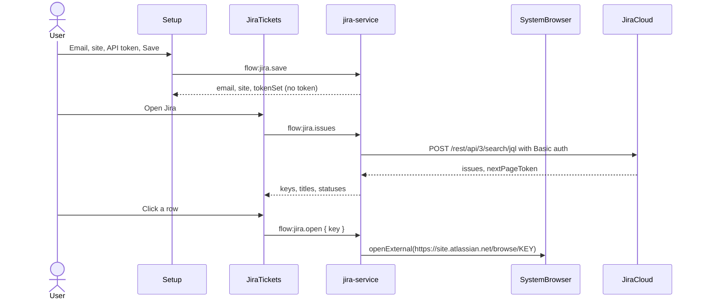
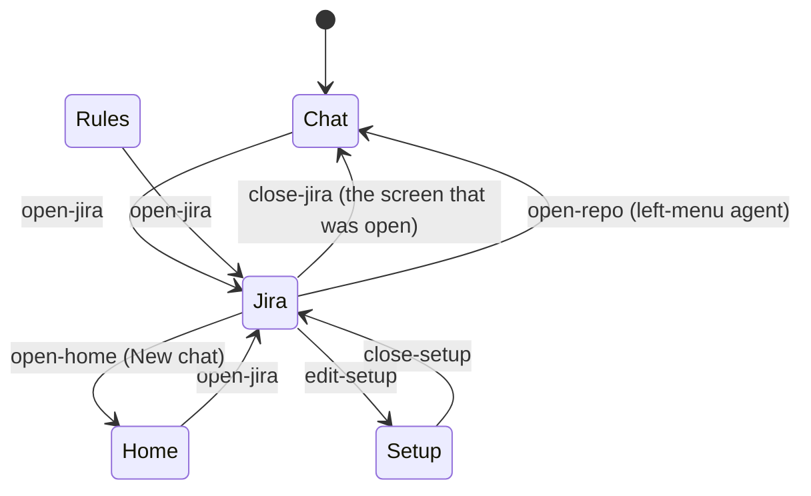
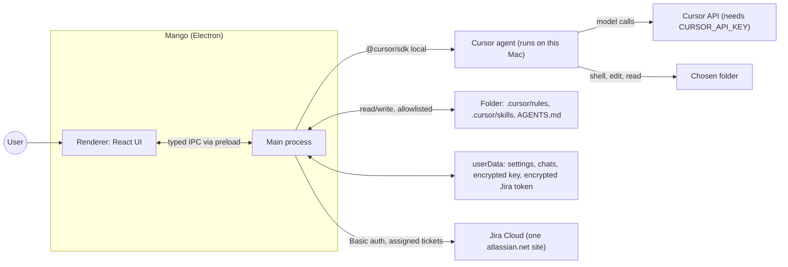

# Jira ticket pane

## Overview

Add a read-only Jira Cloud ticket list to Mango. A **Jira** control replaces the main pane with the issues assigned to you whose status category is not Done, newest update first. The chat underneath is untouched, so **Back** restores it, and clicking an agent in the left menu opens that chat and leaves the list.

Sign-in is an Atlassian API token, not OAuth. The user creates a token at id.atlassian.com and pastes three things into Setup: the Atlassian account email, the site address (`https://<site>.atlassian.net`), and the token. Main stores them encrypted with Electron `safeStorage` in `jira.bin`. The window learns the email, the site, and that a token is saved. It never learns the token.

This replaces the OAuth design in `~/.cursor/plans/jira_ticket_pane_717b6ba2.plan.md`. Atlassian 3LO wants an `https` callback the developer console will save, and it rejects `http://127.0.0.1`. An API token is what Atlassian documents for a script calling the Cloud REST API, and it needs no callback.

**Out of scope:** creating or editing tickets, comments, transitions, Jira Server or Data Center, giving the agent any Jira tool, caching tickets on disk, a generic "open any URL" command, OAuth or a loopback listener, and more than one saved site.

**Implements / relates to:** source plan `~/.cursor/plans/jira_ticket_pane_717b6ba2.plan.md`, revised after Valentin chose an API token on 2026-11-06. Builds on D-1 (main owns all authority), D-9 (`Result` envelope), D-10 (reducer, no state library). Adds decision **D-16** (written in the last step). No new dependency: global `fetch` is enough.

**Assumption:** one site. The token can be used on every Cloud site the account can open, but Mango stores one `https://<name>.atlassian.net` origin and sends the token only there. Switching sites is editing that address in Setup. A site menu would mean either guessing sites (the token API does not list them) or letting the window name extra hosts, which is the same edit.

**Assumption:** the hostname must be `<name>.atlassian.net`. A custom domain is rejected. The REST API for a token is on the atlassian.net host, and rejecting every other host means a bad address cannot receive the token.

## Pros / Cons

**Pros**

- No callback, no local port, and no browser step for sign-in. The developer console is not involved.
- The token, and every Jira request, stay in main. The renderer only sees ticket rows, the email, and the site, so the locked window and its CSP (`connect-src 'none'`) stay as they are.
- `shell.openExternal` is called only with `https://<site>.atlassian.net/browse/<KEY>`, built in main from the stored site and a key that matches a strict pattern. The renderer cannot pass a URL.
- No dependency. The service is a factory with injected `fetch`, `safeStorage`, and `openExternal`, so a check script can run the search against a fake Jira.

**Cons**

- An API token is not scoped. It can do whatever that Atlassian account can do. Mango only searches and opens browse URLs, but a copied token is a full credential until the user revokes it or it expires.
- The user creates the token by hand and types the site address. There is no consent screen and no site list from Atlassian.
- The live list still needs a real token and site, so that part stays a manual check.

## How It Works

Jira is another thing Mango can show in the main pane. When it is open, the pane lists your unfinished tickets. Closing it shows exactly what was there before. Main calls Jira with the saved email and token. The window never holds the token and never talks to Atlassian itself.

**API token** means a personal token from id.atlassian.com. **Basic auth** means the header `Authorization: Basic <base64 of email:token>`. **`jiraOpen`** is a flag in the renderer state that says the ticket pane is showing.

### Flow: save Jira in Setup

1. The user creates a token at id.atlassian.com, under Security, "Create and manage API tokens". They can set an expiry there. Mango cannot.
2. In Setup they enter the account email, the site (`https://acme.atlassian.net`), and the token, then click Save.
3. Main checks the site. It must be `https`, with no user name, no password, and no port, and the host must be one label plus `.atlassian.net`. A path is dropped, so `https://acme.atlassian.net/jira` is stored as `https://acme.atlassian.net`.
4. Main encrypts `{ email, site, token }` into `userData/jira.bin` and returns `{ email, site, tokenSet: true }`.
5. A later save can change the email or the site without pasting the token again. Pasting a new token replaces the old one. Remove writes an empty record over the file, so the old token is not left beside it.
6. Failure: a site that fails the check returns `invalid_input` and nothing is written. A save with no token, and none already stored, returns `not_ready`. If this Mac cannot encrypt, the save returns `io_error`.

### Flow: see the tickets

1. The user clicks Jira (left menu, or the chat header when the workspace has one repo). The reducer sets `jiraOpen`.
2. `screenOf` returns `"jira"`, so `App` renders `JiraTickets`. Setup still wins while it is open.
3. The pane calls `flow:jira.issues`. Main posts to `https://<site>.atlassian.net/rest/api/3/search/jql` with Basic auth and the fixed JQL. The body asks for 50 issues and the fields the row needs. `fields` has to be sent: this endpoint otherwise returns ids only.
4. The response is `{ issues, nextPageToken }`. `nextPageToken` is absent on the last page. The pane shows Load more only when it is present, and sends it back as `pageToken`.
5. A row click calls `flow:jira.open` with the issue key. Main builds the browse URL and opens the system browser.
6. Back dispatches `close-jira`. A left-menu agent dispatches `open-repo`, which also clears `jiraOpen`.
7. Failure: missing email, site, or token shows the not-set-up state and offers Setup. HTTP 401 or 403 shows the message and Setup. The saved token is kept, so the user can correct one field. A network error, HTTP 429, or HTTP 5xx shows the message and Retry.





**Before:** the main pane is Setup, Rules, New chat, or a chat. **After:** a fifth state, Jira, sits between Setup and Rules in `screenOf`. `view` and `instructionsOpen` do not change when it opens.

**Example:** two repos, `api` open, Rules closed. Click Jira: the pane lists `ABC-12  Fix login  In Progress  Bug  Alpha`. Click Back: `api` chat is back with its draft. Click Jira, then the `web` row: `web` opens and the list closes.

## Current State Analysis

**✅ Exists**

- `src/shared/ipc.ts`: `COMMANDS` catalog with Zod `input` and `output`, `ErrorCode`, `Result`, `failure`, `None`.
- `src/main/ipc.ts`: one loop registers every channel, checks `event.sender.id`, parses input, parses output, maps `SessionError` and `FilesError` to a `Result`. `run` ends with `assertNever`, so a new channel must get a `case`.
- `src/main/index.ts`: composition root, `safeStorage` passed to `createSettingsStore`.
- `src/main/settings-store.ts`: `SecretBox` type and the encrypted Cursor key in `secrets.bin`.
- `src/main/window.ts`: `will-navigate` and `setWindowOpenHandler` already refuse remote pages.
- `src/renderer/state.ts`: `AppState`, `reducer`, `screenOf`, `sidebarRows`, `open-repo` and `open-home`. `App.tsx` `openChat` already dispatches `open-repo` even for the chat on screen.
- `src/renderer/RepoSidebar.tsx` (New chat button), `Chat.tsx` header (`thread-head`), `Setup.tsx` (`.setup-field` sections, `.secret` rows, `.setup-notes`).
- `scripts/repos-check-resolve.mjs` and the `check:sidebar` pattern for renderer-state checks without Electron.
- ✅ `src/main/atomic-write.ts` and `src/main/jira-service.ts`: one shared `writeAtomic`, then the encrypted store, search, and open. `settings-store.ts` calls that same helper. COMPLETED in Step 2
- ✅ Jira helpers and IPC schemas: site check, issue key, status, issue row, and the five `flow:jira.*` commands. COMPLETED in Step 3
- ✅ Main wiring: `JiraError` mapping, `registerIpc` parameter, `createJiraService` in `index.ts`. COMPLETED in Step 3
- ✅ `jiraOpen`, `open-jira`, `close-jira`, `screenOf` `"jira"`, sidebar `active` fix, unseen handling. COMPLETED in Step 5
- ✅ Renderer checks in `scripts/jira-check.ts` (open, close, Setup, sidebar selection, unseen). COMPLETED in Step 5
- ✅ `JiraTickets.tsx` and its styles, plus the `jiraReady` / `siteLabel` check. COMPLETED in Step 6
- ✅ `JiraSetup.tsx` and the Setup section. COMPLETED in Step 7
- ✅ Jira buttons and `App` wiring. COMPLETED in Step 8
- ✅ D-16, architecture, IPC, and README text. COMPLETED in Step 9

**❌ Missing Components**

## Implementation Steps

### ✅ Step 1: Add the Jira helpers and contract types

Landed: `src/shared/jira.ts` (site check, issue key, email, JQL, page size, browse URL, `jiraReady`, `siteLabel`) and the status, issue, and issues-result schemas in `src/shared/ipc.ts`. The five `flow:jira.*` commands stay for Step 3.

- **Files:** `src/shared/jira.ts` (new), `src/shared/ipc.ts`
- **Change:** Put the pure checks in `shared/jira.ts` (no I/O, no dependency on `ipc.ts`). Add the status and issue schemas to the contract. The `COMMANDS` entries come in Step 3, so `npm run typecheck` still passes.

**Code**

`src/shared/jira.ts` (new file)

```ts
// Pure Jira checks shared by main and the check script. No I/O.

/** A Jira issue key such as ABC-12. The browse URL is built only from a key that matches. */
export const ISSUE_KEY = /^[A-Z][A-Z0-9_]{1,49}-[0-9]{1,9}$/;

/** Enough to reject an empty or space-filled address. Atlassian checks the real account. */
export const JIRA_EMAIL = /^[^\s@]+@[^\s@]+\.[^\s@]+$/;

/**
 * Assigned to the caller, not Done, newest update first.
 * Both filters are required: POST /rest/api/3/search/jql rejects a JQL with no filter clause.
 */
export const ASSIGNED_JQL =
  "assignee = currentUser() AND statusCategory != Done ORDER BY updated DESC";

export const JIRA_PAGE_SIZE = 50;

const SITE_HOST = /^[a-z0-9](?:[a-z0-9-]{0,61}[a-z0-9])?\.atlassian\.net$/;

/**
 * The https origin of a Jira Cloud site, or null.
 * Accepts `https://acme.atlassian.net` and `https://acme.atlassian.net/any/path`.
 * Rejects http, a port, user info, an IP, and any host that is not `<name>.atlassian.net`.
 */
export function jiraSiteOrigin(value: string): string | null {
  let url: URL;
  try {
    url = new URL(value.trim());
  } catch {
    return null;
  }
  if (url.protocol !== "https:") return null;
  if (url.username !== "" || url.password !== "") return null;
  if (url.port !== "") return null;
  if (!SITE_HOST.test(url.hostname)) return null;
  return url.origin;
}

/** The browse URL for one issue, or null when the site or the key is not acceptable. */
export function issueBrowseUrl(site: string, key: string): string | null {
  if (!ISSUE_KEY.test(key)) return null;
  const origin = jiraSiteOrigin(site);
  return origin === null ? null : `${origin}/browse/${key}`;
}

/** True when Setup has an email, a site, and a saved token. The pane loads tickets only then. */
export function jiraReady(
  status: {
    email: string | null;
    site: string | null;
    tokenSet: boolean;
  } | null,
): boolean {
  return (
    status?.tokenSet === true && status.email !== null && status.site !== null
  );
}

/** The site name shown in the pane header, such as `acme` from `https://acme.atlassian.net`. */
export function siteLabel(site: string | null): string {
  if (site === null) return "";
  try {
    return new URL(site).hostname.replace(/\.atlassian\.net$/, "");
  } catch {
    return "";
  }
}
```

`src/shared/ipc.ts` (modify: add the import at the top, after `import { z } from "zod";`)

```ts
import { ISSUE_KEY, JIRA_EMAIL } from "./jira.js";
```

`src/shared/ipc.ts` (modify: insert after `export type Skill = z.infer<typeof SkillSchema>;` and before `const None = z.object({}).strict();`)

```ts
export const IssueKeySchema = z.string().regex(ISSUE_KEY, "Unknown issue key");

export const JiraEmailSchema = z
  .string()
  .trim()
  .min(3)
  .max(200)
  .regex(JIRA_EMAIL, "Enter the Atlassian account email");

/** What the window may know. It never gets the token. `site` is the stored https origin. */
export const JiraStatusSchema = z.object({
  email: z.string().nullable(),
  site: z.string().nullable(),
  tokenSet: z.boolean(),
});
export type JiraStatus = z.infer<typeof JiraStatusSchema>;

export const JiraIssueSchema = z.object({
  key: IssueKeySchema,
  summary: z.string(),
  status: z.string(),
  type: z.string(),
  project: z.string(),
  updated: z.string(),
});
export type JiraIssue = z.infer<typeof JiraIssueSchema>;

export const JiraIssuesResultSchema = z.object({
  issues: z.array(JiraIssueSchema),
  nextPageToken: z.string().min(1).max(2_000).optional(),
});
export type JiraIssuesResult = z.infer<typeof JiraIssuesResultSchema>;
```

No separate test: these are schemas and pure functions. Step 4 exercises them, and `npm run typecheck` checks the types.

### ✅ Step 2: Add the Jira service

Landed: `src/main/atomic-write.ts` (`writeAtomic`), `settings-store.ts` now calls that helper, and `src/main/jira-service.ts` (encrypted `jira.bin`, search, and open).

Review findings fixed: 5 (`requireAccount` returns the narrowed account) and 6 (401, 403, and 404 go through `httpFailure`; one `unreadable` error).

- **Files:** `src/main/atomic-write.ts` (new), `src/main/settings-store.ts`, `src/main/jira-service.ts` (new)
- **Change:** Move `writeAtomic` out of `settings-store.ts` into `atomic-write.ts`. Both stores call that function. `jira-service.ts` does not define its own writer. The factory takes injected `secrets`, `fetch`, and `openExternal`. It owns `jira.bin`, the search, and the browse URL. It does not import `electron` and it never opens a listener.

**Code**

`src/main/atomic-write.ts` (new file)

```ts
// Temp file, mode 0600, then rename. Shared by settings-store and jira-service (D-6).
import { chmodSync, mkdirSync, renameSync, writeFileSync } from "node:fs";
import path from "node:path";

export function writeAtomic(file: string, data: string | Buffer): void {
  mkdirSync(path.dirname(file), { recursive: true });
  const tmp = `${file}.${process.pid}.tmp`;
  writeFileSync(tmp, data, { mode: 0o600 });
  chmodSync(tmp, 0o600);
  renameSync(tmp, file);
  chmodSync(file, 0o600);
}
```

`src/main/settings-store.ts` (modify: replace the file comment and the imports through the `ipc.js` import. Drop `chmodSync`, `mkdirSync`, and `writeFileSync` from the `node:fs` import. Add the `writeAtomic` import. Leave every later import as it is.)

```ts
// settings.json, chats/<folderId>.json, and the encrypted key.
// Writes go through writeAtomic in atomic-write.ts (temp file, mode 0600, then rename).
import { createHash } from "node:crypto";
import {
  existsSync,
  readFileSync,
  readdirSync,
  realpathSync,
  renameSync,
  statSync,
  type Dirent,
} from "node:fs";
import path from "node:path";
import { z } from "zod";
import { writeAtomic } from "./atomic-write.js";
import {
  MessageSchema,
  type AgentMode,
  type Message,
  type Settings,
  type Theme,
} from "../shared/ipc.js";
```

`src/main/settings-store.ts` (modify: delete the local `writeAtomic` that sits between `writeBytes` and `quarantine`. `writeJson` and `writeBytes` stay and call the imported function. `quarantine` is unchanged.)

```ts
function writeBytes(file: string, data: Buffer): void {
  writeAtomic(file, data);
}

function quarantine(file: string): void {
  try {
    renameSync(file, `${file}.${Date.now()}.corrupt`);
  } catch {
    // The next successful write replaces the file. Until then reads use the fallback.
  }
}
```

`src/main/jira-service.ts` (new file)

```ts
// Jira Cloud ticket list for the signed-in account. Main process only.
// jira.bin holds the email, the site origin, and the API token, encrypted with safeStorage.
// Requests use Basic auth against https://<site>.atlassian.net and nowhere else.
// The window never sees the token.
import { existsSync, readFileSync } from "node:fs";
import path from "node:path";
import { z } from "zod";
import {
  ASSIGNED_JQL,
  issueBrowseUrl,
  jiraSiteOrigin,
  JIRA_PAGE_SIZE,
  ISSUE_KEY,
} from "../shared/jira.js";
import { writeAtomic } from "./atomic-write.js";
import type {
  ErrorCode,
  JiraIssue,
  JiraIssuesResult,
  JiraStatus,
} from "../shared/ipc.js";
import type { SecretBox } from "./settings-store.js";

export class JiraError extends Error {
  readonly code: ErrorCode;
  readonly retryable: boolean;

  constructor(code: ErrorCode, message: string, retryable: boolean) {
    super(message);
    this.name = "JiraError";
    this.code = code;
    this.retryable = retryable;
  }
}

const ISSUE_FIELDS = ["summary", "status", "issuetype", "project", "updated"];
const REQUEST_TIMEOUT_MS = 20_000;

const JiraDataSchema = z.object({
  email: z.string().nullable(),
  site: z.string().nullable(),
  token: z.string().nullable(),
});
type JiraData = z.infer<typeof JiraDataSchema>;

const EMPTY_DATA: JiraData = { email: null, site: null, token: null };

const ApiIssueSchema = z.object({
  key: z.string(),
  fields: z.object({
    summary: z.string().nullish(),
    updated: z.string().nullish(),
    status: z.object({ name: z.string() }).nullish(),
    issuetype: z.object({ name: z.string() }).nullish(),
    project: z.object({ name: z.string() }).nullish(),
  }),
});

const SearchResponseSchema = z.object({
  issues: z.array(z.unknown()),
  nextPageToken: z.string().nullish(),
});

export type JiraService = {
  status(): JiraStatus;
  /** Saves the email and site. `token` replaces the stored token; omitted keeps the stored one. */
  saveAccount(input: {
    email: string;
    site: string;
    token?: string;
  }): JiraStatus;
  /** Removes the email, the site, and the token. */
  clear(): JiraStatus;
  issues(input: { pageToken?: string | undefined }): Promise<JiraIssuesResult>;
  open(key: string): Promise<void>;
};

export type JiraOptions = {
  userDataDir: string;
  secrets: SecretBox;
  openExternal(url: string): Promise<void>;
  fetch?: typeof globalThis.fetch;
};

/** Reads a `search/jql` response. Rows that do not parse, or whose key is odd, are skipped. */
export function parseSearchResponse(
  body: unknown,
): { issues: JiraIssue[]; nextPageToken: string | null } | null {
  const parsed = SearchResponseSchema.safeParse(body);
  if (!parsed.success) return null;
  const issues: JiraIssue[] = [];
  for (const raw of parsed.data.issues) {
    const row = ApiIssueSchema.safeParse(raw);
    if (!row.success || !ISSUE_KEY.test(row.data.key)) continue;
    const fields = row.data.fields;
    issues.push({
      key: row.data.key,
      summary: clip(fields.summary ?? "", 500),
      status: clip(fields.status?.name ?? "", 100),
      type: clip(fields.issuetype?.name ?? "", 100),
      project: clip(fields.project?.name ?? "", 200),
      updated: clip(fields.updated ?? "", 60),
    });
  }
  const next = parsed.data.nextPageToken;
  return {
    issues,
    nextPageToken:
      next === undefined || next === null || next === "" ? null : next,
  };
}

export function createJiraService(options: JiraOptions): JiraService {
  const file = path.join(options.userDataDir, "jira.bin");
  const doFetch = options.fetch ?? globalThis.fetch;
  let cache: JiraData | null = null;

  function load(): JiraData {
    if (cache === null) cache = readData();
    return cache;
  }

  function readData(): JiraData {
    if (!existsSync(file) || !options.secrets.isEncryptionAvailable())
      return EMPTY_DATA;
    try {
      const parsed = JiraDataSchema.safeParse(
        JSON.parse(
          options.secrets.decryptString(readFileSync(file)),
        ) as unknown,
      );
      if (!parsed.success) return EMPTY_DATA;
      if (
        parsed.data.site !== null &&
        jiraSiteOrigin(parsed.data.site) !== parsed.data.site
      )
        return EMPTY_DATA;
      return parsed.data;
    } catch {
      return EMPTY_DATA;
    }
  }

  function save(next: JiraData): void {
    if (!options.secrets.isEncryptionAvailable()) {
      throw new JiraError(
        "io_error",
        "This Mac cannot encrypt the Jira token right now.",
        false,
      );
    }
    try {
      writeAtomic(file, options.secrets.encryptString(JSON.stringify(next)));
    } catch {
      throw new JiraError(
        "io_error",
        "Could not save the Jira settings.",
        false,
      );
    }
    cache = next;
  }

  function status(): JiraStatus {
    const data = load();
    return {
      email: data.email,
      site: data.site,
      tokenSet: data.token !== null,
    };
  }

  function saveAccount(input: {
    email: string;
    site: string;
    token?: string;
  }): JiraStatus {
    const origin = jiraSiteOrigin(input.site);
    if (origin === null) {
      throw new JiraError(
        "invalid_input",
        "Use the site address, like https://your-site.atlassian.net.",
        false,
      );
    }
    const data = load();
    const token = input.token !== undefined ? input.token : data.token;
    if (token === null || token === "")
      throw new JiraError("not_ready", "Paste an API token.", false);
    save({ email: input.email, site: origin, token });
    return status();
  }

  function clear(): JiraStatus {
    if (!existsSync(file)) {
      cache = EMPTY_DATA;
      return status();
    }
    save(EMPTY_DATA);
    return status();
  }

  function requireAccount(): JiraData {
    const data = load();
    if (data.email === null || data.site === null || data.token === null) {
      throw new JiraError(
        "not_ready",
        "Add your Jira email, site, and API token in Setup.",
        false,
      );
    }
    return data;
  }

  async function send(url: string, init: RequestInit): Promise<Response> {
    try {
      return await doFetch(url, {
        ...init,
        signal: AbortSignal.timeout(REQUEST_TIMEOUT_MS),
      });
    } catch {
      throw new JiraError(
        "io_error",
        "Could not reach Jira. Check the connection and try again.",
        true,
      );
    }
  }

  async function readJson(response: Response): Promise<unknown> {
    try {
      return (await response.json()) as unknown;
    } catch {
      throw new JiraError(
        "io_error",
        "Jira sent an answer the app could not read.",
        true,
      );
    }
  }

  async function issues(input: {
    pageToken?: string | undefined;
  }): Promise<JiraIssuesResult> {
    const data = requireAccount();
    const url = `${data.site}/rest/api/3/search/jql`;
    const body = JSON.stringify({
      jql: ASSIGNED_JQL,
      fields: ISSUE_FIELDS,
      maxResults: JIRA_PAGE_SIZE,
      ...(input.pageToken !== undefined
        ? { nextPageToken: input.pageToken }
        : {}),
    });
    const response = await send(url, {
      method: "POST",
      headers: {
        Authorization: basicAuth(data.email as string, data.token as string),
        Accept: "application/json",
        "Content-Type": "application/json",
      },
      body,
    });
    if (response.status === 401) {
      throw new JiraError(
        "auth",
        "Jira rejected the email or the API token. Check them in Setup.",
        false,
      );
    }
    if (response.status === 403) {
      throw new JiraError(
        "auth",
        "Jira refused this search for that account.",
        false,
      );
    }
    if (response.status === 404) {
      throw new JiraError(
        "not_found",
        "That Jira site did not answer. Check the site address in Setup.",
        false,
      );
    }
    if (!response.ok) throw httpFailure(response.status);
    const page = parseSearchResponse(await readJson(response));
    if (page === null)
      throw new JiraError(
        "io_error",
        "Jira sent an answer the app could not read.",
        true,
      );
    return {
      issues: page.issues,
      ...(page.nextPageToken !== null
        ? { nextPageToken: page.nextPageToken }
        : {}),
    };
  }

  async function open(key: string): Promise<void> {
    const data = requireAccount();
    const url = issueBrowseUrl(data.site as string, key);
    if (url === null)
      throw new JiraError("invalid_input", "Unknown issue key.", false);
    try {
      await options.openExternal(url);
    } catch {
      throw new JiraError("io_error", "Could not open the browser.", true);
    }
  }

  return { status, saveAccount, clear, issues, open };
}

function basicAuth(email: string, token: string): string {
  return `Basic ${Buffer.from(`${email}:${token}`, "utf8").toString("base64")}`;
}

function httpFailure(status: number): JiraError {
  if (status === 429)
    return new JiraError(
      "io_error",
      "Jira is busy. Try again in a moment.",
      true,
    );
  if (status >= 500)
    return new JiraError(
      "io_error",
      `Jira had a problem (HTTP ${status}). Try again.`,
      true,
    );
  return new JiraError(
    "io_error",
    `Jira refused the request (HTTP ${status}).`,
    false,
  );
}

function clip(value: string, max: number): string {
  return value.length > max ? value.slice(0, max) : value;
}
```

Verification for this step is `npm run typecheck`. The behavior is exercised in Step 4.

### ✅ Step 3: Register the commands and wire the service in main

Landed: the five `flow:jira.*` commands in `src/shared/ipc.ts`, `JiraError` mapped to a `Result` in `src/main/ipc.ts`, and `createJiraService` in `src/main/index.ts`. Checks not run.

- **Files:** `src/shared/ipc.ts`, `src/main/ipc.ts`, `src/main/index.ts`
- **Change:** Add the five `flow:jira.*` commands, give `registerIpc` the service, map `JiraError` to a `Result`, and create the service in the composition root. These edits go together because the `assertNever` switch fails to compile if a channel has no `case`.

**Code**

`src/shared/ipc.ts` (modify: inside `COMMANDS`, after the `"flow:agentsmd.write"` entry and before `} as const;`)

```ts
  "flow:jira.status": { input: None, output: JiraStatusSchema },
  "flow:jira.save": {
    input: z
      .object({
        email: JiraEmailSchema,
        site: z.string().trim().min(1).max(200),
        token: z.string().trim().min(1).max(500).optional(),
      })
      .strict(),
    output: JiraStatusSchema,
  },
  "flow:jira.clear": { input: None, output: JiraStatusSchema },
  "flow:jira.issues": {
    input: z.object({ pageToken: z.string().min(1).max(2_000).optional() }).strict(),
    output: JiraIssuesResultSchema,
  },
  "flow:jira.open": {
    input: z.object({ key: IssueKeySchema }).strict(),
    output: None,
  },
```

`src/main/ipc.ts` (modify: imports)

Before

```ts
import type { RulesSkills } from "./rules-skills-service.js";
import { FilesError } from "./rules-skills-service.js";
```

After

```ts
import { JiraError, type JiraService } from "./jira-service.js";
import type { RulesSkills } from "./rules-skills-service.js";
import { FilesError } from "./rules-skills-service.js";
```

`src/main/ipc.ts` (modify: `registerIpc` signature, the `run` call, and the catch block)

Before

```ts
export function registerIpc(host: IpcHost, manager: SessionManager, files: RulesSkills): void {
```

After

```ts
export function registerIpc(host: IpcHost, manager: SessionManager, files: RulesSkills, jira: JiraService): void {
```

Before

```ts
const value = await run(channel, parsed.data, host, manager, files);
```

After

```ts
const value = await run(channel, parsed.data, host, manager, files, jira);
```

Before

```ts
if (error instanceof FilesError)
  return failure(error.code, error.message, error.retryable);
```

After

```ts
if (error instanceof FilesError)
  return failure(error.code, error.message, error.retryable);
if (error instanceof JiraError)
  return failure(error.code, error.message, error.retryable);
```

`src/main/ipc.ts` (modify: `run` signature)

Before

```ts
  manager: SessionManager,
  files: RulesSkills,
): Promise<OutputOf<C>> {
```

After

```ts
  manager: SessionManager,
  files: RulesSkills,
  jira: JiraService,
): Promise<OutputOf<C>> {
```

`src/main/ipc.ts` (modify: `run` switch, insert before `default:`)

```ts
    case "flow:jira.status":
      return jira.status() as OutputOf<C>;
    case "flow:jira.save": {
      const body = input as InputOf<"flow:jira.save">;
      return jira.saveAccount({
        email: body.email,
        site: body.site,
        ...(body.token !== undefined ? { token: body.token } : {}),
      }) as OutputOf<C>;
    }
    case "flow:jira.clear":
      return jira.clear() as OutputOf<C>;
    case "flow:jira.issues":
      return (await jira.issues(input as InputOf<"flow:jira.issues">)) as OutputOf<C>;
    case "flow:jira.open":
      await jira.open((input as InputOf<"flow:jira.open">).key);
      return {} as OutputOf<C>;
```

`src/main/index.ts` (modify: imports)

Before

```ts
import { app, BrowserWindow, nativeImage, safeStorage } from "electron";
```

After

```ts
import { app, BrowserWindow, nativeImage, safeStorage, shell } from "electron";
```

Before

```ts
import { publish, registerIpc, type IpcHost } from "./ipc.js";
```

After

```ts
import { publish, registerIpc, type IpcHost } from "./ipc.js";
import { createJiraService } from "./jira-service.js";
```

`src/main/index.ts` (modify: inside `start()`)

Before

```ts
const files = createRulesSkills();
```

After

```ts
const files = createRulesSkills();
const jira = createJiraService({
  userDataDir: app.getPath("userData"),
  secrets: safeStorage,
  // Only https://<site>.atlassian.net/browse/<KEY>, built in jira-service, reaches this function.
  openExternal: (url) => shell.openExternal(url),
});
```

Before

```ts
registerIpc(host, manager, files);
```

After

```ts
registerIpc(host, manager, files, jira);
```

Verification: `npm run typecheck`. The `switch` in `run` now covers every channel, so `assertNever` still type-checks.

### ✅ Step 4: Add `scripts/jira-check.ts` for the helpers and the service

Landed: `scripts/jira-check.ts` (helpers and service, no Electron) and `npm run check:jira` in `package.json`. Checks not run.

Review findings fixed: 2 (status and thrown-fetch table, unreadable `jira.bin`, encryption unavailable, `clear` with no file).

- **Files:** `scripts/jira-check.ts` (new), `package.json`
- **Change:** A check with no Electron and no network. It drives `createJiraService` with a fake `fetch`, a reversible fake `SecretBox`, and a recording `openExternal`.

**Code**

`scripts/jira-check.ts` (new file)

```ts
// Checks the Jira helpers and the Jira service. No Electron and no live Jira call.
//   node --disable-warning=ExperimentalWarning --experimental-strip-types --import ./scripts/repos-check-resolve.mjs scripts/jira-check.ts
import assert from "node:assert/strict";
import { mkdtempSync, readFileSync } from "node:fs";
import { tmpdir } from "node:os";
import path from "node:path";
import test from "node:test";
import {
  ASSIGNED_JQL,
  ISSUE_KEY,
  issueBrowseUrl,
  jiraSiteOrigin,
  JIRA_PAGE_SIZE,
} from "../src/shared/jira.ts";
import {
  createJiraService,
  JiraError,
  parseSearchResponse,
  type JiraService,
} from "../src/main/jira-service.ts";

type Call = {
  url: string;
  method: string;
  headers: Record<string, string>;
  body: string;
};
type Reply = { status: number; body: unknown };
type Handler = (call: Call) => Reply;

const box = {
  isEncryptionAvailable: () => true,
  encryptString: (text: string) =>
    Buffer.from(
      Buffer.from(text).toString("base64").split("").reverse().join(""),
    ),
  decryptString: (data: Buffer) =>
    Buffer.from(
      data.toString().split("").reverse().join(""),
      "base64",
    ).toString(),
};

const ISSUE_ROW = {
  id: "1",
  key: "ABC-1",
  fields: {
    summary: "Fix it",
    status: { name: "In Progress" },
    issuetype: { name: "Bug" },
    project: { name: "Alpha" },
    updated: "2026-11-06T10:00:00.000+0000",
  },
};

function searchOk(call: Call): Reply {
  const body = JSON.parse(call.body) as { nextPageToken?: string };
  return {
    status: 200,
    body: {
      issues: [ISSUE_ROW, { id: "2", key: "bad key", fields: {} }],
      ...(body.nextPageToken === undefined ? { nextPageToken: "next-1" } : {}),
    },
  };
}

function fakeFetch(handler: Handler, calls: Call[]): typeof globalThis.fetch {
  return (async (input: string | URL | Request, init?: RequestInit) => {
    const call: Call = {
      url: String(input),
      method: init?.method ?? "GET",
      headers: (init?.headers ?? {}) as Record<string, string>,
      body: typeof init?.body === "string" ? init.body : "",
    };
    calls.push(call);
    const reply = handler(call);
    return new Response(JSON.stringify(reply.body), {
      status: reply.status,
      headers: { "Content-Type": "application/json" },
    });
  }) as typeof globalThis.fetch;
}

function makeService(dir: string, handler: Handler) {
  const calls: Call[] = [];
  const opened: string[] = [];
  const service: JiraService = createJiraService({
    userDataDir: dir,
    secrets: box,
    fetch: fakeFetch(handler, calls),
    openExternal: async (url) => {
      opened.push(url);
    },
  });
  return { service, calls, opened };
}

function tempDir(): string {
  return mkdtempSync(path.join(tmpdir(), "jira-check-"));
}

function authHeader(email: string, token: string): string {
  return `Basic ${Buffer.from(`${email}:${token}`, "utf8").toString("base64")}`;
}

test("the JQL is bounded, assigned, not done, and newest first", () => {
  assert.equal(
    ASSIGNED_JQL,
    "assignee = currentUser() AND statusCategory != Done ORDER BY updated DESC",
  );
  assert.equal(ASSIGNED_JQL.includes("assignee = currentUser()"), true);
  assert.equal(ASSIGNED_JQL.includes("statusCategory != Done"), true);
});

test("issue keys and browse URLs are strict", () => {
  assert.ok(ISSUE_KEY.test("ABC-12"));
  assert.ok(ISSUE_KEY.test("A1_B-7"));
  for (const bad of [
    "abc-1",
    "ABC-",
    "ABC 1",
    "ABC-1/../x",
    "-1",
    "A-1",
    "ABC-1\n",
    "ABC-1234567890",
  ]) {
    assert.equal(ISSUE_KEY.test(bad), false, bad);
  }
  assert.equal(
    issueBrowseUrl("https://acme.atlassian.net", "ABC-12"),
    "https://acme.atlassian.net/browse/ABC-12",
  );
  assert.equal(
    issueBrowseUrl("https://acme.atlassian.net/jira/path", "ABC-12"),
    "https://acme.atlassian.net/browse/ABC-12",
  );
  assert.equal(issueBrowseUrl("http://acme.atlassian.net", "ABC-12"), null);
  assert.equal(issueBrowseUrl("https://evil.example", "ABC-12"), null);
  assert.equal(
    issueBrowseUrl("https://acme.atlassian.net", "ABC-12/../x"),
    null,
  );
});

test("a site is https and exactly one label under atlassian.net", () => {
  assert.equal(
    jiraSiteOrigin("https://acme.atlassian.net"),
    "https://acme.atlassian.net",
  );
  assert.equal(
    jiraSiteOrigin("  https://Acme.atlassian.net/jira  "),
    "https://acme.atlassian.net",
  );
  for (const bad of [
    "http://acme.atlassian.net",
    "https://acme.atlassian.net:8443",
    "https://user:pw@acme.atlassian.net",
    "https://acme.atlassian.net.evil.com",
    "https://evil.com",
    "https://127.0.0.1",
    "https://localhost",
    "javascript:alert(1)",
    "https://.atlassian.net",
    "not a url",
  ]) {
    assert.equal(jiraSiteOrigin(bad), null, bad);
  }
});

test("a search response keeps good rows and the next-page token", () => {
  const page = parseSearchResponse({
    issues: [ISSUE_ROW, { key: "x", fields: {} }, 5],
    nextPageToken: "n1",
  });
  assert.deepEqual(page, {
    issues: [
      {
        key: "ABC-1",
        summary: "Fix it",
        status: "In Progress",
        type: "Bug",
        project: "Alpha",
        updated: "2026-11-06T10:00:00.000+0000",
      },
    ],
    nextPageToken: "n1",
  });
  assert.equal(parseSearchResponse({ issues: [] })?.nextPageToken, null);
  assert.equal(parseSearchResponse("nope"), null);
});

test("save, search, a site change, open, and clear", async () => {
  const dir = tempDir();
  const { service, calls, opened } = makeService(dir, (call) => {
    if (call.url.endsWith("/rest/api/3/search/jql")) return searchOk(call);
    return { status: 404, body: {} };
  });

  await assert.rejects(
    () =>
      Promise.resolve().then(() =>
        service.saveAccount({
          email: "me@example.com",
          site: "https://acme.atlassian.net",
        }),
      ),
    (error) => error instanceof JiraError && error.code === "not_ready",
  );
  assert.throws(
    () =>
      service.saveAccount({
        email: "me@example.com",
        site: "https://evil.example",
        token: "jira-token-value",
      }),
    (error) => error instanceof JiraError && error.code === "invalid_input",
  );
  assert.equal(calls.length, 0);

  const saved = service.saveAccount({
    email: "me@example.com",
    site: "https://acme.atlassian.net/jira",
    token: "jira-token-value",
  });
  assert.deepEqual(saved, {
    email: "me@example.com",
    site: "https://acme.atlassian.net",
    tokenSet: true,
  });
  assert.equal(JSON.stringify(saved).includes("jira-token-value"), false);

  const disk = readFileSync(path.join(dir, "jira.bin")).toString();
  assert.equal(disk.includes("jira-token-value"), false);
  assert.equal(disk.includes("me@example.com"), false);

  const first = await service.issues({});
  assert.equal(first.issues.length, 1);
  assert.equal(first.nextPageToken, "next-1");
  const search = calls[0];
  assert.equal(search?.url, "https://acme.atlassian.net/rest/api/3/search/jql");
  assert.equal(search?.method, "POST");
  assert.equal(
    search?.headers.Authorization,
    authHeader("me@example.com", "jira-token-value"),
  );
  const searchBody = JSON.parse(search?.body ?? "{}") as {
    jql: string;
    maxResults: number;
    fields: string[];
    nextPageToken?: string;
  };
  assert.equal(searchBody.jql, ASSIGNED_JQL);
  assert.equal(searchBody.maxResults, JIRA_PAGE_SIZE);
  assert.deepEqual(searchBody.fields, [
    "summary",
    "status",
    "issuetype",
    "project",
    "updated",
  ]);
  assert.equal(searchBody.nextPageToken, undefined);

  await service.issues({ pageToken: "next-1" });
  const paged = JSON.parse(calls[1]?.body ?? "{}") as {
    nextPageToken?: string;
  };
  assert.equal(paged.nextPageToken, "next-1");

  service.saveAccount({
    email: "me@example.com",
    site: "https://other.atlassian.net",
  });
  await service.issues({});
  assert.equal(
    calls[2]?.url,
    "https://other.atlassian.net/rest/api/3/search/jql",
  );
  assert.equal(
    calls[2]?.headers.Authorization,
    authHeader("me@example.com", "jira-token-value"),
  );

  const again = makeService(dir, (call) =>
    call.url.endsWith("/rest/api/3/search/jql")
      ? searchOk(call)
      : { status: 404, body: {} },
  );
  assert.equal(again.service.status().tokenSet, true);
  assert.equal(again.service.status().site, "https://other.atlassian.net");

  await service.open("ABC-1");
  assert.equal(opened.at(-1), "https://other.atlassian.net/browse/ABC-1");
  await assert.rejects(
    () => service.open("ABC-1/../x"),
    (error) => error instanceof JiraError && error.code === "invalid_input",
  );

  const gone = service.clear();
  assert.deepEqual(gone, { email: null, site: null, tokenSet: false });
  await assert.rejects(
    () => service.issues({}),
    (error) => error instanceof JiraError && error.code === "not_ready",
  );
  await assert.rejects(
    () => service.open("ABC-1"),
    (error) => error instanceof JiraError && error.code === "not_ready",
  );
});

test("a rejected token stays saved and is not sent anywhere but the stored site", async () => {
  const dir = tempDir();
  const { service, calls } = makeService(dir, () => ({
    status: 401,
    body: {},
  }));
  service.saveAccount({
    email: "me@example.com",
    site: "https://acme.atlassian.net",
    token: "jira-token-value",
  });
  await assert.rejects(
    () => service.issues({}),
    (error) =>
      error instanceof JiraError &&
      error.code === "auth" &&
      /API token/.test(error.message),
  );
  assert.equal(service.status().tokenSet, true);
  assert.equal(calls.length, 1);
  assert.equal(
    calls[0]?.url,
    "https://acme.atlassian.net/rest/api/3/search/jql",
  );
});
```

`package.json` (modify: `scripts`, after `check:segments`)

Before

```json
    "check:segments": "node --disable-warning=ExperimentalWarning --experimental-strip-types scripts/segments-check.ts",
```

After

```json
    "check:segments": "node --disable-warning=ExperimentalWarning --experimental-strip-types scripts/segments-check.ts",
    "check:jira": "node --disable-warning=ExperimentalWarning --experimental-strip-types --import ./scripts/repos-check-resolve.mjs scripts/jira-check.ts",
```

Run: `npm run typecheck && npm run check:jira`.

### ✅ Step 5: Add `jiraOpen` to the renderer state and check it

Landed: `jiraOpen`, `open-jira`, `close-jira`, `screenOf` `"jira"`, sidebar active fix, and unseen handling in `src/renderer/state.ts`; renderer checks appended to `scripts/jira-check.ts`. Subagent code in `state.ts` kept. Checks not run.

- **Files:** `src/renderer/state.ts`, `scripts/jira-check.ts`
- **Change:** Add the `jiraOpen` flag, the `open-jira` and `close-jira` actions, a `"jira"` screen, and make `open-repo` and `open-home` clear the flag. While the list is open no repo row looks selected, and a reply that finishes in the chat underneath is marked unseen until the user returns.

**Code**

`src/renderer/state.ts` (modify: `AppState` type)

Before

```ts
  instructionsOpen: boolean;
  view: View;
  repos: RepoListItem[];
```

After

```ts
  instructionsOpen: boolean;
  /** The Jira ticket list replaces the main pane. `view` and `instructionsOpen` stay as they were. */
  jiraOpen: boolean;
  view: View;
  repos: RepoListItem[];
```

`src/renderer/state.ts` (modify: `sidebarRows`)

Before

```ts
const slice = state.chats[row.name];
const active = state.view.kind === "repo" && state.view.repo === row.name;
if (
  !active &&
  !row.hasHistory &&
  !isBusyState(row.state) &&
  slice?.unseen !== true &&
  slice?.banner == null
)
  continue;
```

After

```ts
const slice = state.chats[row.name];
const current = state.view.kind === "repo" && state.view.repo === row.name;
// While the Jira list is open no row looks selected, but the chat underneath keeps its row.
const active = current && !state.jiraOpen;
if (
  !current &&
  !row.hasHistory &&
  !isBusyState(row.state) &&
  slice?.unseen !== true &&
  slice?.banner == null
)
  continue;
```

`src/renderer/state.ts` (modify: `Action` union)

Before

```ts
  | { type: "open-instructions" }
  | { type: "close-instructions" }
```

After

```ts
  | { type: "open-instructions" }
  | { type: "close-instructions" }
  | { type: "open-jira" }
  | { type: "close-jira" }
```

`src/renderer/state.ts` (modify: `initialState`)

Before

```ts
  modelsError: null,
  instructionsOpen: false,
  view: { kind: "home" },
```

After

```ts
  modelsError: null,
  instructionsOpen: false,
  jiraOpen: false,
  view: { kind: "home" },
```

`src/renderer/state.ts` (modify: `reducer` cases `open-home` and `open-repo`, and add two cases after `close-instructions`)

Before

```ts
    case "close-instructions":
      return { ...state, instructionsOpen: false };
    case "open-home":
      return { ...state, view: { kind: "home" }, instructionsOpen: false };
    case "open-repo": {
      const current = state.chats[action.repo] ?? emptySlice();
      return {
        ...state,
        view: { kind: "repo", repo: action.repo },
        instructionsOpen: false,
        chats: { ...state.chats, [action.repo]: { ...current, unseen: false } },
      };
    }
```

After

```ts
    case "close-instructions":
      return { ...state, instructionsOpen: false };
    case "open-jira":
      return { ...state, jiraOpen: true };
    case "close-jira": {
      if (!state.jiraOpen) return state;
      const underneath = state.view.kind === "repo" ? state.view.repo : null;
      const slice = underneath === null ? undefined : state.chats[underneath];
      return {
        ...state,
        jiraOpen: false,
        chats: underneath !== null && slice !== undefined ? { ...state.chats, [underneath]: { ...slice, unseen: false } } : state.chats,
      };
    }
    case "open-home":
      return { ...state, view: { kind: "home" }, instructionsOpen: false, jiraOpen: false };
    case "open-repo": {
      const current = state.chats[action.repo] ?? emptySlice();
      return {
        ...state,
        view: { kind: "repo", repo: action.repo },
        instructionsOpen: false,
        jiraOpen: false,
        chats: { ...state.chats, [action.repo]: { ...current, unseen: false } },
      };
    }
```

`src/renderer/state.ts` (modify: `screenOf`)

Before

```ts
export function screenOf(state: AppState): "loading" | "setup" | "instructions" | "home" | "chat" {
  if (!state.booted || state.settings === null) return "loading";
  if (!state.settings.setupComplete || state.editing) return "setup";
  if (state.instructionsOpen && state.view.kind === "repo") return "instructions";
```

After

```ts
export function screenOf(state: AppState): "loading" | "setup" | "jira" | "instructions" | "home" | "chat" {
  if (!state.booted || state.settings === null) return "loading";
  if (!state.settings.setupComplete || state.editing) return "setup";
  if (state.jiraOpen) return "jira";
  if (state.instructionsOpen && state.view.kind === "repo") return "instructions";
```

`src/renderer/state.ts` (modify: `routeEvent`)

Before

```ts
const onScreen = state.view.kind === "repo" && state.view.repo === event.repo;
```

After

```ts
const onScreen =
  state.view.kind === "repo" &&
  state.view.repo === event.repo &&
  !state.jiraOpen;
```

`scripts/jira-check.ts` (modify: add the renderer imports after the `node:test` import)

```ts
import type {
  ChatStateName,
  RepoListItem,
  Settings,
} from "../src/shared/ipc.ts";
import {
  emptySlice,
  initialState,
  reducer,
  screenOf,
  sidebarRows,
  type AppState,
  type ChatSlice,
} from "../src/renderer/state.ts";
```

`scripts/jira-check.ts` (append at the end of the file)

```ts
function repo(
  name: string,
  hasHistory: boolean,
  state: ChatStateName = "ready",
): RepoListItem {
  return {
    name,
    state,
    pendingQuestion: state === "awaitingAnswer",
    hasHistory,
  };
}

function chat(patch: Partial<ChatSlice> = {}): ChatSlice {
  return { ...emptySlice(), loaded: true, chatState: "ready", ...patch };
}

const settings: Settings = {
  folder: "/tmp/ws",
  model: "composer",
  mode: "agent",
  theme: "system",
  keySet: true,
  folderMissing: false,
  setupComplete: true,
};

function app(patch: Partial<AppState> = {}): AppState {
  return {
    ...initialState,
    booted: true,
    settings,
    repos: [repo("api", true), repo("web", true)],
    view: { kind: "repo", repo: "api" },
    chats: { api: chat(), web: chat() },
    ...patch,
  };
}

test("opening and closing Jira leaves the chat on screen as it was", () => {
  const opened = reducer(app(), { type: "open-jira" });
  assert.equal(opened.jiraOpen, true);
  assert.deepEqual(opened.view, { kind: "repo", repo: "api" });
  assert.equal(screenOf(opened), "jira");
  const closed = reducer(opened, { type: "close-jira" });
  assert.equal(closed.jiraOpen, false);
  assert.equal(screenOf(closed), "chat");
  assert.deepEqual(closed.view, { kind: "repo", repo: "api" });
});

test("Back returns to Rules, New chat, or the chat, whichever was open", () => {
  const rules = app({ instructionsOpen: true });
  assert.equal(
    screenOf(
      reducer(reducer(rules, { type: "open-jira" }), { type: "close-jira" }),
    ),
    "instructions",
  );
  const home = app({ view: { kind: "home" } });
  assert.equal(screenOf(reducer(home, { type: "open-jira" })), "jira");
  assert.equal(
    screenOf(
      reducer(reducer(home, { type: "open-jira" }), { type: "close-jira" }),
    ),
    "home",
  );
});

test("a left-menu agent, even the chat underneath, and New chat leave the list", () => {
  const opened = reducer(app(), { type: "open-jira" });
  const sameChat = reducer(opened, { type: "open-repo", repo: "api" });
  assert.equal(sameChat.jiraOpen, false);
  assert.equal(screenOf(sameChat), "chat");
  const other = reducer(opened, { type: "open-repo", repo: "web" });
  assert.equal(other.jiraOpen, false);
  assert.deepEqual(other.view, { kind: "repo", repo: "web" });
  const home = reducer(opened, { type: "open-home" });
  assert.equal(home.jiraOpen, false);
  assert.equal(screenOf(home), "home");
});

test("Setup wins over the list, and closing Setup returns to the list", () => {
  const opened = reducer(app(), { type: "open-jira" });
  const editing = reducer(opened, { type: "edit-setup" });
  assert.equal(editing.jiraOpen, true);
  assert.equal(screenOf(editing), "setup");
  assert.equal(screenOf(reducer(editing, { type: "close-setup" })), "jira");
  const incomplete = app({
    jiraOpen: true,
    settings: { ...settings, setupComplete: false },
  });
  assert.equal(screenOf(incomplete), "setup");
});

test("while the list is open no repo row is selected, and the chat underneath keeps its row", () => {
  const quiet = app({
    repos: [repo("api", false), repo("web", true)],
    chats: { api: chat(), web: chat() },
  });
  assert.deepEqual(
    sidebarRows(quiet).map((row) => [row.name, row.active]),
    [
      ["api", true],
      ["web", false],
    ],
  );
  const opened = reducer(quiet, { type: "open-jira" });
  assert.deepEqual(
    sidebarRows(opened).map((row) => [row.name, row.active]),
    [
      ["api", false],
      ["web", false],
    ],
  );
});

test("a reply that finishes under the list is unseen until Back", () => {
  const opened = reducer(
    app({
      chats: {
        api: chat({ chatState: "streaming", activeRunId: "r1" }),
        web: chat(),
      },
    }),
    { type: "open-jira" },
  );
  const done = reducer(opened, {
    type: "event",
    event: {
      type: "chat.done",
      repo: "api",
      runId: "r1",
      messageId: "m1",
      stopReason: "end",
    },
  });
  assert.equal(done.chats.api?.unseen, true);
  const closed = reducer(done, { type: "close-jira" });
  assert.equal(closed.chats.api?.unseen, false);
  assert.equal(reducer(app(), { type: "close-jira" }).jiraOpen, false);
});
```

Run: `npm run typecheck && npm run check:jira && npm run check:sidebar`. `check:sidebar` must still pass because `jiraOpen` starts false.

### ✅ Step 6: Add the ticket pane and its styles

Landed: `src/renderer/JiraTickets.tsx`, ticket styles appended to `src/renderer/styles.css` (`.subagent-*` kept), and the `jiraReady` / `siteLabel` check in `scripts/jira-check.ts`. Checks not run.

Review findings fixed: 3 (selected style follows `aria-current="page"`), 4 (alert and status roles on the ticket pane), and 7 (ticket body uses early returns).

- **Files:** `src/renderer/JiraTickets.tsx` (new), `src/renderer/styles.css`, `scripts/jira-check.ts`
- **Change:** The pane loads `flow:jira.issues` when an email, a site, and a token are saved. It shows a not-set-up state, a loading state, an empty state, and a failed load. Retry and Load more cover the failure and the next page. A row opens the issue through `flow:jira.open`.

**Code**

`src/renderer/JiraTickets.tsx` (new file)

```tsx
import { useEffect, useState } from "react";
import type { JiraIssue, JiraStatus } from "../shared/ipc.js";
import { jiraReady, siteLabel } from "../shared/jira.js";

type Load =
  | { kind: "loading" }
  | { kind: "ready"; issues: JiraIssue[]; next: string | null }
  | { kind: "error"; message: string; retryable: boolean };

type JiraTicketsProps = {
  status: JiraStatus | null;
  onBack: () => void;
  onSetup: () => void;
};

export function JiraTickets({ status, onBack, onSetup }: JiraTicketsProps) {
  const [load, setLoad] = useState<Load>({ kind: "loading" });
  const [attempt, setAttempt] = useState(0);
  const [loadingMore, setLoadingMore] = useState(false);
  const [notice, setNotice] = useState<string | null>(null);
  const ready = jiraReady(status);

  useEffect(() => {
    if (!ready) return;
    let cancelled = false;
    setLoad({ kind: "loading" });
    setNotice(null);
    void window.flow.invoke("flow:jira.issues", {}).then((result) => {
      if (cancelled) return;
      if (!result.ok) {
        setLoad({
          kind: "error",
          message: result.error.message,
          retryable: result.error.retryable,
        });
        return;
      }
      setLoad({
        kind: "ready",
        issues: result.value.issues,
        next: result.value.nextPageToken ?? null,
      });
    });
    return () => {
      cancelled = true;
    };
  }, [ready, attempt]);

  async function loadMore(token: string): Promise<void> {
    setLoadingMore(true);
    setNotice(null);
    const result = await window.flow.invoke("flow:jira.issues", {
      pageToken: token,
    });
    setLoadingMore(false);
    if (!result.ok) {
      setNotice(result.error.message);
      return;
    }
    const page = result.value;
    setLoad((current) => {
      if (current.kind !== "ready") return current;
      const seen = new Set(current.issues.map((issue) => issue.key));
      return {
        kind: "ready",
        issues: [
          ...current.issues,
          ...page.issues.filter((issue) => !seen.has(issue.key)),
        ],
        next: page.nextPageToken ?? null,
      };
    });
  }

  async function openIssue(key: string): Promise<void> {
    setNotice(null);
    const result = await window.flow.invoke("flow:jira.open", { key });
    if (!result.ok) setNotice(result.error.message);
  }

  const label = siteLabel(status?.site ?? null);

  return (
    <section className="tickets" aria-label="Jira tickets">
      <div className="tickets-head">
        <button type="button" className="btn" onClick={onBack}>
          Back
        </button>
        <div className="titles">
          <h2>Jira</h2>
          <span className="meta">Assigned to you, not done</span>
        </div>
        <div className="spacer">
          {label !== "" ? <span className="meta">{label}</span> : null}
          {ready ? (
            <button
              type="button"
              className="btn"
              disabled={load.kind === "loading" || loadingMore}
              onClick={() => setAttempt((count) => count + 1)}
            >
              Refresh
            </button>
          ) : null}
          <button type="button" className="btn" onClick={onSetup}>
            Setup
          </button>
        </div>
      </div>
      {notice ? <p className="error tickets-notice">{notice}</p> : null}
      <div className="tickets-body">
        {status === null ? (
          <p className="tickets-empty">Loading…</p>
        ) : !ready ? (
          <div className="tickets-empty">
            <p>Jira is not set up.</p>
            <button type="button" className="btn primary" onClick={onSetup}>
              Open Setup
            </button>
          </div>
        ) : load.kind === "loading" ? (
          <p className="tickets-empty">Loading tickets…</p>
        ) : load.kind === "error" ? (
          <div className="tickets-empty">
            <p>{load.message}</p>
            {load.retryable ? (
              <button
                type="button"
                className="btn primary"
                onClick={() => setAttempt((count) => count + 1)}
              >
                Retry
              </button>
            ) : (
              <button type="button" className="btn primary" onClick={onSetup}>
                Open Setup
              </button>
            )}
          </div>
        ) : load.issues.length === 0 ? (
          <p className="tickets-empty">No open tickets are assigned to you.</p>
        ) : (
          <>
            <ul className="ticket-list">
              {load.issues.map((issue) => (
                <li key={issue.key}>
                  <button
                    type="button"
                    className="ticket"
                    title="Open in the browser"
                    onClick={() => void openIssue(issue.key)}
                  >
                    <span className="ticket-key">{issue.key}</span>
                    <span className="ticket-summary">{issue.summary}</span>
                    <span className="ticket-meta">
                      {issue.status !== "" ? (
                        <span className="ticket-chip">{issue.status}</span>
                      ) : null}
                      {issue.type !== "" ? (
                        <span className="ticket-chip">{issue.type}</span>
                      ) : null}
                      {issue.project !== "" ? (
                        <span className="ticket-chip">{issue.project}</span>
                      ) : null}
                    </span>
                  </button>
                </li>
              ))}
            </ul>
            {load.next !== null ? (
              <p className="actions">
                <button
                  type="button"
                  className="btn"
                  disabled={loadingMore}
                  onClick={() => void loadMore(load.next ?? "")}
                >
                  {loadingMore ? "Loading…" : "Load more"}
                </button>
              </p>
            ) : null}
          </>
        )}
      </div>
    </section>
  );
}
```

`src/renderer/styles.css` (modify: append at the end of the file)

```css
.btn[aria-pressed="true"] {
  background: var(--soft);
  border-color: var(--accent);
  color: var(--accent);
}
.tickets {
  flex: 1;
  min-width: 0;
  min-height: 0;
  display: flex;
  flex-direction: column;
}
.tickets-head {
  display: flex;
  align-items: center;
  gap: 12px;
  padding: 12px 16px;
  border-bottom: 1px solid var(--line);
}
.tickets-head h2 {
  margin: 0;
  font-size: 16px;
}
.tickets-head .titles {
  display: flex;
  flex-direction: column;
  gap: 1px;
  min-width: 0;
}
.tickets-head .spacer {
  margin-left: auto;
  display: flex;
  gap: 8px;
  align-items: center;
  flex-wrap: wrap;
  justify-content: flex-end;
}
.tickets-notice {
  margin: 0;
  padding: 8px 16px 0;
}
.tickets-body {
  flex: 1;
  min-height: 0;
  overflow: auto;
  padding: 12px 16px 24px;
}
.tickets-empty {
  margin: 48px auto;
  max-width: 420px;
  text-align: center;
  color: var(--muted);
}
.tickets-empty p {
  margin: 0 0 12px;
}
.ticket-list {
  list-style: none;
  margin: 0;
  padding: 0;
  display: flex;
  flex-direction: column;
  gap: 6px;
}
.ticket {
  width: 100%;
  text-align: left;
  display: grid;
  grid-template-columns: auto minmax(0, 1fr);
  gap: 2px 12px;
  padding: 10px 12px;
  border: 1px solid var(--line);
  background: var(--panel);
  border-radius: 10px;
}
.ticket:hover {
  border-color: var(--accent);
}
.ticket-key {
  font-weight: 650;
  color: var(--accent);
  white-space: nowrap;
}
.ticket-summary {
  min-width: 0;
  overflow: hidden;
  text-overflow: ellipsis;
  white-space: nowrap;
}
.ticket-meta {
  grid-column: 2;
  display: flex;
  gap: 6px;
  flex-wrap: wrap;
  color: var(--muted);
  font-size: 12px;
}
.ticket-chip {
  border: 1px solid var(--line);
  border-radius: 999px;
  padding: 0 8px;
}
.setup-notes code {
  font-size: 12px;
  user-select: all;
}
```

`scripts/jira-check.ts` (modify the helper import from Step 4)

Before

```ts
import {
  ASSIGNED_JQL,
  ISSUE_KEY,
  issueBrowseUrl,
  jiraSiteOrigin,
  JIRA_PAGE_SIZE,
} from "../src/shared/jira.ts";
```

After

```ts
import {
  ASSIGNED_JQL,
  ISSUE_KEY,
  issueBrowseUrl,
  jiraReady,
  jiraSiteOrigin,
  JIRA_PAGE_SIZE,
  siteLabel,
} from "../src/shared/jira.ts";
```

`scripts/jira-check.ts` (append)

```ts
test("the pane is ready only when email, site, and token are all saved", () => {
  assert.equal(jiraReady(null), false);
  assert.equal(
    jiraReady({
      email: "me@example.com",
      site: "https://acme.atlassian.net",
      tokenSet: false,
    }),
    false,
  );
  assert.equal(
    jiraReady({
      email: null,
      site: "https://acme.atlassian.net",
      tokenSet: true,
    }),
    false,
  );
  assert.equal(
    jiraReady({ email: "me@example.com", site: null, tokenSet: true }),
    false,
  );
  assert.equal(
    jiraReady({
      email: "me@example.com",
      site: "https://acme.atlassian.net",
      tokenSet: true,
    }),
    true,
  );
  assert.equal(siteLabel("https://acme.atlassian.net"), "acme");
  assert.equal(siteLabel(null), "");
});
```

Run: `npm run typecheck && npm run check:jira`.

### ✅ Step 7: Add the Jira section to Setup

Landed: `src/renderer/JiraSetup.tsx` (email, site, password token with Token saved, Replace, and Remove) and the section in `src/renderer/Setup.tsx` after Mode, with `backLabel`. Checks not run.

Review findings fixed: 4 (alert role on the Setup error).

- **Files:** `src/renderer/JiraSetup.tsx` (new), `src/renderer/Setup.tsx`
- **Change:** A section with the email, the site, and the token. The token is a password field: once saved it shows "Token saved", Replace, and Remove, and it is never shown again. The Back button label can change, because with Jira open it returns to the list.

**Code**

`src/renderer/JiraSetup.tsx` (new file)

```tsx
import { useEffect, useState } from "react";
import type { JiraStatus } from "../shared/ipc.js";

export type JiraSetupProps = {
  status: JiraStatus | null;
  message: string | null;
  onSave: (input: {
    email: string;
    site: string;
    token?: string;
  }) => Promise<boolean>;
  onClear: () => Promise<boolean>;
};

export function JiraSetup({
  status,
  message,
  onSave,
  onClear,
  pending,
}: JiraSetupProps & { pending: boolean }) {
  const [email, setEmail] = useState(status?.email ?? "");
  const [site, setSite] = useState(status?.site ?? "");
  const [token, setToken] = useState("");
  const [replacing, setReplacing] = useState(false);
  const tokenSet = status?.tokenSet === true;
  const showToken = !tokenSet || replacing;
  const busy = pending || status === null;

  useEffect(() => {
    setEmail(status?.email ?? "");
    setSite(status?.site ?? "");
  }, [status?.email, status?.site]);

  async function save(): Promise<void> {
    const next: { email: string; site: string; token?: string } = {
      email: email.trim(),
      site: site.trim(),
    };
    if (showToken) {
      if (token.trim() === "") return;
      next.token = token.trim();
    }
    const ok = await onSave(next);
    if (!ok) return;
    setToken("");
    setReplacing(false);
  }

  return (
    <section className="setup-field">
      <label>Jira (optional)</label>
      <p className="meta">
        A read-only list of your open tickets. Create an API token, then paste
        your Atlassian email, the site, and the token.
      </p>
      <div className="setup-notes">
        <p>
          Create a token at{" "}
          <code>
            https://id.atlassian.com/manage-profile/security/api-tokens
          </code>
        </p>
        <p>
          The token can do everything that account can do in Jira. Mango only
          reads the tickets assigned to you and opens them in the browser. You
          can set an expiry when you create the token.
        </p>
        <p>
          The token stays on this Mac. The app shows that it is saved, and never
          the token itself.
        </p>
      </div>

      <label htmlFor="jira-email">Atlassian email</label>
      <input
        id="jira-email"
        type="text"
        autoComplete="off"
        spellCheck={false}
        value={email}
        placeholder="you@example.com"
        onChange={(event) => setEmail(event.target.value)}
      />

      <label htmlFor="jira-site">Site</label>
      <input
        id="jira-site"
        type="text"
        autoComplete="off"
        spellCheck={false}
        value={site}
        placeholder="https://your-site.atlassian.net"
        onChange={(event) => setSite(event.target.value)}
      />

      <label htmlFor="jira-token">API token</label>
      {showToken ? (
        <div className="secret">
          <input
            id="jira-token"
            type="password"
            autoComplete="off"
            spellCheck={false}
            value={token}
            placeholder={tokenSet ? "Paste a new token" : "Paste the API token"}
            onChange={(event) => setToken(event.target.value)}
          />
          <button
            type="button"
            className="btn primary"
            disabled={
              busy ||
              email.trim() === "" ||
              site.trim() === "" ||
              token.trim() === ""
            }
            onClick={() => void save()}
          >
            Save
          </button>
          {tokenSet ? (
            <button
              type="button"
              className="btn"
              disabled={busy}
              onClick={() => {
                setToken("");
                setReplacing(false);
              }}
            >
              Cancel
            </button>
          ) : null}
        </div>
      ) : (
        <div className="secret">
          <span className="key-state">Token saved</span>
          <button
            type="button"
            className="btn"
            disabled={busy || email.trim() === "" || site.trim() === ""}
            onClick={() => void save()}
          >
            Save
          </button>
          <button
            type="button"
            className="btn"
            disabled={busy}
            onClick={() => setReplacing(true)}
          >
            Replace
          </button>
          <button
            type="button"
            className="btn danger"
            disabled={busy}
            onClick={() => void onClear()}
          >
            Remove
          </button>
        </div>
      )}
      {message ? <p className="error">{message}</p> : null}
    </section>
  );
}
```

`src/renderer/Setup.tsx` (modify: imports)

Before

```tsx
import { Bot } from "./Bot.js";
import type { ModelChoice } from "./state.js";
```

After

```tsx
import { Bot } from "./Bot.js";
import { JiraSetup, type JiraSetupProps } from "./JiraSetup.js";
import type { ModelChoice } from "./state.js";
```

`src/renderer/Setup.tsx` (modify: `SetupProps` and the function signature)

Before

```tsx
  onMode: (mode: AgentMode) => void;
  onBack: (() => void) | null;
};

export function Setup({ settings, models, modelsError, pending, repos, locked, onSaveKey, onClearKey, onPickFolder, onModel, onTheme, onMode, onBack }: SetupProps) {
```

After

```tsx
  onMode: (mode: AgentMode) => void;
  onBack: (() => void) | null;
  backLabel: string;
  jira: JiraSetupProps;
};

export function Setup({ settings, models, modelsError, pending, repos, locked, onSaveKey, onClearKey, onPickFolder, onModel, onTheme, onMode, onBack, backLabel, jira }: SetupProps) {
```

`src/renderer/Setup.tsx` (modify: after the Mode section, replace the Back block)

Before

```tsx
<section className="setup-field">
  <label>Mode</label>
  <ModeSwitch
    mode={settings.mode}
    disabled={pending || locked}
    onMode={onMode}
  />
</section>;

{
  onBack ? (
    <p className="actions">
      <button type="button" className="btn" onClick={onBack}>
        Back to chat
      </button>
    </p>
  ) : null;
}
```

After

```tsx
        <section className="setup-field">
          <label>Mode</label>
          <ModeSwitch mode={settings.mode} disabled={pending || locked} onMode={onMode} />
        </section>

        <JiraSetup {...jira} pending={pending} />

        {onBack ? (
          <p className="actions">
            <button type="button" className="btn" onClick={onBack}>
              {backLabel}
            </button>
          </p>
        ) : null}
```

Verification: `npm run typecheck` also checks the renderer project, and `Setup` now requires `backLabel` and `jira`. It fails until Step 8 passes them from `App.tsx`, so apply Steps 7 and 8 together, then run the typecheck.

### ✅ Step 8: Add the Jira buttons and wire `App`

Landed: Jira button under New chat in `src/renderer/RepoSidebar.tsx` (`aria-pressed` while the list is open) and in the `src/renderer/Chat.tsx` header when `onJira` is set (`SubagentCard` kept). The plan's header snippet had stray semicolons that are not valid JSX; the button was inserted before Rules without them. `src/renderer/App.tsx` loads `flow:jira.status`, passes save and clear into Setup, and renders `JiraTickets` when the screen is `jira`. Checks not run.

Review findings fixed: 1 (a failed status call shows the error and an empty account), 3 (Jira button uses `aria-current`), 8 (opening or closing Jira does not refetch models), and 9 (`hasSidebar`, and `jiraMessage` clears when Setup closes).

- **Files:** `src/renderer/RepoSidebar.tsx`, `src/renderer/Chat.tsx`, `src/renderer/App.tsx`
- **Change:** A Jira button under New chat when the workspace has several repos, the same button in the chat header when it has one, the Jira status state and handlers in `App`, and the new screen in the render tree.

**Code**

`src/renderer/RepoSidebar.tsx` (modify: props and signature)

Before

```tsx
type RepoSidebarProps = {
  rows: SidebarRow[];
  pending: boolean;
  onOpen: (name: string) => void;
  onNew: () => void;
  onRemove: (name: string) => void;
};

export function RepoSidebar({ rows, pending, onOpen, onNew, onRemove }: RepoSidebarProps) {
```

After

```tsx
type RepoSidebarProps = {
  rows: SidebarRow[];
  pending: boolean;
  jiraActive: boolean;
  onOpen: (name: string) => void;
  onNew: () => void;
  onJira: () => void;
  onRemove: (name: string) => void;
};

export function RepoSidebar({ rows, pending, jiraActive, onOpen, onNew, onJira, onRemove }: RepoSidebarProps) {
```

`src/renderer/RepoSidebar.tsx` (modify: under the New chat button)

Before

```tsx
      <button type="button" className="btn" onClick={onNew}>
        New chat
      </button>
      <ul className="repo-list">
```

After

```tsx
      <button type="button" className="btn" onClick={onNew}>
        New chat
      </button>
      <button type="button" className="btn" aria-pressed={jiraActive} onClick={onJira}>
        Jira
      </button>
      <ul className="repo-list">
```

`src/renderer/Chat.tsx` (modify: `ChatProps`)

Before

```tsx
  onInstructions: () => void;
  onDismiss: () => void;
```

After

```tsx
  onInstructions: () => void;
  /** Null when the left menu already has the Jira button. */
  onJira: (() => void) | null;
  onDismiss: () => void;
```

`src/renderer/Chat.tsx` (modify: header, before the Rules button)

Before

```tsx
<button type="button" className="btn" onClick={props.onInstructions}>
  Rules
</button>
```

After

```tsx
{
  props.onJira ? (
    <button type="button" className="btn" onClick={props.onJira}>
      Jira
    </button>
  ) : null;
}
<button type="button" className="btn" onClick={props.onInstructions}>
  Rules
</button>;
```

`src/renderer/App.tsx` (modify: imports)

Before

```tsx
import {
  BUSY_CAP_MESSAGE,
  MAX_BUSY_REPOS,
  busyRepoMessage,
  type AgentMode,
  type Answers,
  type ChatStateName,
  type FlowEvent,
  type Settings,
  type Theme,
} from "../shared/ipc.js";
import { parseMention } from "../shared/mention.js";
import { Chat } from "./Chat.js";
import { Instructions } from "./Instructions.js";
import { NewChat } from "./NewChat.js";
```

After

```tsx
import {
  BUSY_CAP_MESSAGE,
  MAX_BUSY_REPOS,
  busyRepoMessage,
  type AgentMode,
  type Answers,
  type ChatStateName,
  type FlowEvent,
  type JiraStatus,
  type Result,
  type Settings,
  type Theme,
} from "../shared/ipc.js";
import { parseMention } from "../shared/mention.js";
import { Chat } from "./Chat.js";
import { Instructions } from "./Instructions.js";
import type { JiraSetupProps } from "./JiraSetup.js";
import { JiraTickets } from "./JiraTickets.js";
import { NewChat } from "./NewChat.js";
```

`src/renderer/App.tsx` (modify: state, after `const [modelEpoch, setModelEpoch] = useState(0);`)

```tsx
const [jira, setJira] = useState<JiraStatus | null>(null);
const [jiraMessage, setJiraMessage] = useState<string | null>(null);
```

`src/renderer/App.tsx` (modify: effects, add after the `[state.settings?.theme]` effect)

```tsx
useEffect(() => {
  let cancelled = false;
  void window.flow.invoke("flow:jira.status", {}).then((result) => {
    if (!cancelled && result.ok) setJira(result.value);
  });
  return () => {
    cancelled = true;
  };
}, []);
```

`src/renderer/App.tsx` (modify: functions, add before `async function pickFolder()`)

```tsx
async function jiraUpdate(
  run: () => Promise<Result<JiraStatus>>,
): Promise<boolean> {
  setJiraMessage(null);
  const result = await run();
  if (!result.ok) {
    setJiraMessage(result.error.message);
    return false;
  }
  setJira(result.value);
  return true;
}
```

`src/renderer/App.tsx` (modify: `chatPane`, add the prop after `onInstructions`)

Before

```tsx
        onInstructions={() => dispatch({ type: "open-instructions" })}
        onDismiss={() => dispatch({ type: "dismiss-banner", repo: repoName })}
```

After

```tsx
        onInstructions={() => dispatch({ type: "open-instructions" })}
        onJira={state.repos.length > 1 ? null : () => dispatch({ type: "open-jira" })}
        onDismiss={() => dispatch({ type: "dismiss-banner", repo: repoName })}
```

`src/renderer/App.tsx` (modify: before `return (` of `App`, after the `home` constant)

```tsx
const jiraSetup: JiraSetupProps = {
  status: jira,
  message: jiraMessage,
  onSave: (input) =>
    jiraUpdate(() => window.flow.invoke("flow:jira.save", input)),
  onClear: () => jiraUpdate(() => window.flow.invoke("flow:jira.clear", {})),
};
const jiraPane = (
  <JiraTickets
    status={jira}
    onBack={() => dispatch({ type: "close-jira" })}
    onSetup={() => dispatch({ type: "edit-setup" })}
  />
);
```

`src/renderer/App.tsx` (modify: `<Setup ... />` props)

Before

```tsx
            onBack={settings.setupComplete ? () => dispatch({ type: "close-setup" }) : null}
          />
```

After

```tsx
            onBack={settings.setupComplete ? () => dispatch({ type: "close-setup" }) : null}
            backLabel={state.jiraOpen ? "Back to tickets" : "Back to chat"}
            jira={jiraSetup}
          />
```

`src/renderer/App.tsx` (modify: render tree after Setup)

Before

```tsx
          <RepoSidebar
            rows={sidebarRows(state)}
            pending={pending}
            onOpen={(name) => void openChat(name)}
            onNew={() => dispatch({ type: "open-home" })}
            onRemove={(name) => void resetChat(name)}
          />
          {screen === "home" ? home : screen === "instructions" && repo !== null ? instructionsPane(repo) : repo !== null ? chatPane(repo, settings) : null}
        </div>
      ) : screen === "instructions" && repo !== null ? (
        instructionsPane(repo)
      ) : repo !== null ? (
```

After

```tsx
          <RepoSidebar
            rows={sidebarRows(state)}
            pending={pending}
            jiraActive={state.jiraOpen}
            onOpen={(name) => void openChat(name)}
            onNew={() => dispatch({ type: "open-home" })}
            onJira={() => dispatch({ type: "open-jira" })}
            onRemove={(name) => void resetChat(name)}
          />
          {screen === "jira"
            ? jiraPane
            : screen === "home"
              ? home
              : screen === "instructions" && repo !== null
                ? instructionsPane(repo)
                : repo !== null
                  ? chatPane(repo, settings)
                  : null}
        </div>
      ) : screen === "jira" ? (
        jiraPane
      ) : screen === "instructions" && repo !== null ? (
        instructionsPane(repo)
      ) : repo !== null ? (
```

`flow:jira.save` input makes `token` optional. `exactOptionalPropertyTypes` means the object passed to `invoke` must omit `token` rather than set it to `undefined`. `JiraSetup` already builds `next` that way. The `onSave` parameter type on `JiraSetupProps` matches `InputOf<"flow:jira.save">`.

Run: `npm run typecheck && npm run check:jira && npm run check:sidebar`. Then `npm start` for the manual pass in the Testing Checklist.

### ✅ Step 9: Update Documentation (always the last step)

Landed: D-16 and Q-7, plus the Jira text in `docs/architecture.md`, `docs/ipc-contract.md`, `README.md`, and `docs/README.md`. The folder layout kept the existing `task.ts` and `SubagentCard.tsx` lines beside the Jira files.

See "Documentation Update" below.

## Edge Cases

- **A site that is not `https://<name>.atlassian.net`.** `jiraSiteOrigin` returns null. Save returns `invalid_input` and does not write. `http`, a port, user info, an IP, `localhost`, and a lookalike host such as `acme.atlassian.net.evil.com` all fail. A path on a good host is dropped, and the origin is stored.
- **The token is sent only to the stored origin.** Search posts to `https://<site>.atlassian.net/rest/api/3/search/jql`. Open builds `https://<site>.atlassian.net/browse/<KEY>`. No other host is contacted. A 401 does not clear the token, so a typo can be fixed without pasting it again.
- **No token yet.** Save without a token, and with none stored, returns `not_ready` ("Paste an API token."). The pane shows "Jira is not set up" until email, site, and token are all present.
- **Changing the site keeps the token.** A second save omits `token`. The next search uses the new origin with the same Basic header. Replacing the token sends `token` and overwrites it.
- **Remove.** `flow:jira.clear` encrypts an empty record over `jira.bin`. The previous ciphertext is replaced. Status becomes email null, site null, `tokenSet` false.
- **`safeStorage` unavailable.** Save and clear throw `io_error` "This Mac cannot encrypt the Jira token right now." A `jira.bin` that cannot be decrypted, or whose site fails the check, reads as empty.
- **HTTP 401.** `auth`, not retryable: "Jira rejected the email or the API token." The pane offers Setup. The token stays saved.
- **HTTP 403.** `auth`: "Jira refused this search for that account." Same Setup path.
- **HTTP 404.** `not_found`: "That Jira site did not answer. Check the site address in Setup."
- **Network down, HTTP 5xx, or HTTP 429.** `io_error` with `retryable: true`. The pane shows the message and Retry.
- **More than 50 issues.** Jira returns `nextPageToken` and omits it on the last page. Load more sends that token back and drops duplicate keys.
- **A row with a bad key.** `parseSearchResponse` skips it. `flow:jira.open` is parsed by `IssueKeySchema`, and `issueBrowseUrl` checks again before `openExternal`.
- **JQL with no filter.** The saved query includes `assignee = currentUser()` and `statusCategory != Done`, because `/rest/api/3/search/jql` rejects an unbounded query. `fields` is always sent, because the default is ids only.
- **Clicking the chat that is already open underneath** dispatches `open-repo`, so the list closes. This is intended.
- **Remove or Reset chat on the chat underneath while the list is open.** `shouldLeaveAfterReset` still reads `view`, so the window goes to New chat and the list closes. The chat the user would return to is gone.
- **Rules has unsaved edits when the user opens Jira.** `Instructions` unmounts and the edits are lost without the Back prompt, the same as New chat today.
- **A reply finishes in the chat underneath.** `routeEvent` treats it as off screen while `jiraOpen`, so the row shows "new". `open-repo` and `close-jira` clear it.
- **Setup is open while the list is open.** Setup wins in `screenOf`. `edit-setup` does not clear `jiraOpen`, so closing Setup returns to the list, and the button reads "Back to tickets".
- **Jira errors and the Cursor banner.** `bannerFor("auth", …)` says "Key rejected" for the Cursor key. Jira errors are shown inside the Jira pane and the Setup section only, never through `bannerFor`.
- **The token expires.** Atlassian enforces the expiry the user set when they created the token. The next search returns 401. The user creates a new token and uses Replace.
- **Values the user supplies.** The plan has no placeholders in code. At run time the user pastes a real email, site, and token. The checks use fake values only.

## Testing Checklist

- [x] `npm run typecheck` passes (main and renderer projects)
- [x] `npm run check:jira` passes
- [x] `npm run check:sidebar` still passes (`jiraOpen` defaults to false)
- [x] `npm run check:repos`, `check:segments`, `check:plan`, `check:tools`, `check:mentions`, and `check:questions` still pass
- [ ] Manual, needs a real API token from `https://id.atlassian.com/manage-profile/security/api-tokens`:
  - [ ] Setup shows the token URL. Save is disabled until email, site, and token are filled. After a save the token field shows "Token saved" with Replace and Remove
  - [ ] A site of `http://…`, `https://evil.example`, or `https://acme.atlassian.net.evil.com` shows the site message and does not save
  - [ ] Jira lists only unfinished issues assigned to you, newest update first, with key, summary, status, type, and project
  - [ ] Clicking a row opens `https://<site>.atlassian.net/browse/<KEY>` in the system browser, and the Mango window does not navigate
  - [ ] Two repos: Jira button under New chat looks selected while the list is open, and no repo row does. Back restores the chat with its draft
  - [ ] Jira, then a left-menu agent (including the one that was open): the chat opens and the list closes
  - [ ] One repo: the Jira button is in the chat header, and Back returns to the chat
  - [ ] Rules open, then Jira, then Back: Rules is back
  - [ ] Setup from the list, then "Back to tickets": the list is back
  - [ ] Changing the site and clicking Save, without Replace, searches the new site
  - [ ] A wrong token shows the rejection and the token stays "Token saved"
  - [ ] Remove shows the not-set-up pane
  - [ ] Inspect `~/Library/Application Support/Mango/jira.bin`: not readable text, mode `0600`
  - [ ] DevTools in the window: no token in any `flow:jira.*` response

## Files to Modify

- ✅ `src/shared/jira.ts` (new)
- ✅ `src/shared/ipc.ts` (schemas in Step 1; five `flow:jira.*` commands in Step 3)
- ✅ `src/main/atomic-write.ts` (new)
- ✅ `src/main/settings-store.ts`
- ✅ `src/main/jira-service.ts` (new)
- ✅ `src/main/ipc.ts`
- ✅ `src/main/index.ts`
- ✅ `src/renderer/state.ts`
- ✅ `src/renderer/JiraTickets.tsx` (new)
- ✅ `src/renderer/JiraSetup.tsx` (new)
- ✅ `src/renderer/Setup.tsx`
- ✅ `src/renderer/RepoSidebar.tsx`
- ✅ `src/renderer/Chat.tsx`
- ✅ `src/renderer/App.tsx`
- ✅ `src/renderer/styles.css`
- ✅ `scripts/jira-check.ts` (new in Step 4; renderer checks in Step 5; `jiraReady` / `siteLabel` check in Step 6)
- ✅ `package.json`
- ✅ `README.md`
- ✅ `docs/README.md`
- ✅ `docs/architecture.md`
- ✅ `docs/ipc-contract.md`
- ✅ `docs/decisions.md`

## Implementation Order

1. Step 1 (helpers and contract types)
2. Step 2 (shared `writeAtomic`, then the service)
3. Step 3 (commands, IPC, composition root)
4. Step 4 (service check and `check:jira`)
5. Step 5 (renderer state and its checks)
6. Step 6 (ticket pane, shared `jiraReady` / `siteLabel`, styles)
7. Steps 7 and 8 together (Setup section, buttons, `App` wiring), then typecheck
8. Step 9 (Update Documentation, always last)

## Documentation Update

### Step 9: Update Documentation (always the last step)

**Affected documents**

| Document               | What changes                                                                                                                    | Status |
| ---------------------- | ------------------------------------------------------------------------------------------------------------------------------- | ------ |
| `docs/decisions.md`    | Add D-16 (Jira through an API token) and answer Q-7                                                                             | done   |
| `docs/architecture.md` | Context diagram, module diagram and table, data ownership, security boundaries, renderer structure, folder layout, out of scope | done   |
| `docs/ipc-contract.md` | Five `flow:jira.*` commands, and a rule that the token never leaves main                                                        | done   |
| `README.md`            | A Jira paragraph, and `check:jira` in Checks                                                                                    | done   |
| `docs/README.md`       | Status paragraph and the check list                                                                                             | done   |

**Edits**

`docs/decisions.md` (insert after the D-15 block, before `## Open questions`)

```markdown
### D-16: Jira tickets are read with an API token, in main (accepted)

A Jira control shows the issues assigned to the user whose status category is not Done. The user creates an API token at id.atlassian.com and pastes the Atlassian email, the site (`https://<name>.atlassian.net`), and the token into Setup. Main stores all three in `userData/jira.bin`, encrypted with `safeStorage`. Search is `POST https://<site>.atlassian.net/rest/api/3/search/jql` with Basic auth (`email:token`), 50 per page, followed only by Jira's `nextPageToken`. The query is `assignee = currentUser() AND statusCategory != Done ORDER BY updated DESC`. A row opens in the system browser through `flow:jira.open`, which builds `https://<site>.atlassian.net/browse/<KEY>` in main. The token is sent only to that stored origin. No dependency is added.
**Reason:** Valentin, 2026-11-06. Atlassian 3LO needs an `https` callback, and the developer console rejects `http://127.0.0.1`, so a loopback sign-in cannot be registered. An API token is what Atlassian documents for a script calling the Cloud REST API.
**Rejected:** OAuth 3LO with a loopback callback (the console will not save `http://127.0.0.1:47821/callback`); OAuth with a public relay or a tunnel (a host to run, and the code would leave the Mac); a Mango-owned OAuth client (a secret cannot be kept in a desktop app); loading Jira in the window (the window loads no remote URL); a generic "open any URL" command (D-14 still wants one, and this is narrower); giving the agent Jira tools (out of scope); caching tickets on disk.
**Accepted trade-off:** the token is not scoped. It can do whatever the account can do, until the user revokes it or the expiry they set is reached. Mango only searches and opens browse URLs.
**Still open:** the live search needs a real token and site. It is a manual check, not part of `npm run check:jira`.
```

`docs/decisions.md` (add a row to the Open questions table)

```markdown
| Q-7 | How does Mango sign in to Jira if localhost OAuth callbacks are rejected? | **Answered (Valentin, 2026-11-06):** an API token, email, and one site address. See D-16 | none |
```

`docs/architecture.md` (section "Context": replace the diagram)

````markdown

````

````

`docs/architecture.md` (section "Main-process modules": add this node after the `Index --> Files` line, and this row after `rules-skills-service.ts`)
```markdown
    Index --> Jira["jira-service.ts: Jira token, assigned tickets"]
    Ipc --> Jira
````

```markdown
| `jira-service.ts` | `jira.bin` (encrypted email, site origin, API token), the ticket search, the browse URL | Import `electron` (it gets `safeStorage` and `openExternal` as arguments), return the token, call any host but the stored `https://<name>.atlassian.net` |
| `atomic-write.ts` | The temp-file write used by `settings-store.ts` and `jira-service.ts` | Open a file in place, or write a mode other than `0600` |
```

`docs/architecture.md` (section "Main-process modules": append this sentence to the paragraph that starts "Main is built in one place")

```markdown
`settings-store.ts` and `jira-service.ts` both call `writeAtomic` from `atomic-write.ts` (temp file, mode `0600`, then rename). Neither module keeps its own copy.
```

`docs/architecture.md` (section "Data ownership": add a row after "Cursor API key")

```markdown
| Jira email, site, API token | `jira-service` | `userData/jira.bin`, encrypted with `safeStorage`, mode `0600` | Email, site origin, and "token is set". Never the token |
```

`docs/architecture.md` (section "Security boundaries": add a bullet after the "Preload exposes only…" bullet)

```markdown
- Jira: every request is made in main, so the page CSP (`connect-src 'none'`) is unchanged. The API token is stored like the Cursor key and never appears in an IPC result, a log, or `settings.json`. Search and `shell.openExternal` use only the stored origin, and that origin must be `https://<name>.atlassian.net` with no port and no user info (D-16). The token is not scoped: it is a full account credential, and Mango only uses it to search and to open a browse URL.
```

`docs/architecture.md` (section "Renderer structure": change the sentence "After load, the window shows one of three screens:" to "After load, the window shows one of these screens:" and add a bullet after **Left menu**)

```markdown
- **Jira tickets** (`JiraTickets.tsx`): a pane that replaces the chat, New chat, or Rules while `jiraOpen` is set. The flag is separate from `view`, so Back (`close-jira`) restores whatever was open, and `open-repo` or `open-home` also clear it. It lists the assigned, not-done issues of the one saved site, with Load more, Retry, and a not-set-up state that links to Setup. A row opens the issue in the system browser. The Jira button is under New chat in the left menu, or in the chat header when the workspace has one repo. Setup has a Jira section (`JiraSetup.tsx`) for the email, the site, and the API token. While the list is open no repo row looks selected.
```

`docs/architecture.md` (section "Folder layout": replace the `main/`, `shared/`, `renderer/`, and `scripts/` lines)

```text
  main/       index.ts, window.ts, ipc.ts, session-manager.ts, chat-session.ts,
              agent-service.ts, tool-summary.ts, prompt.ts,
              rules-skills-service.ts, settings-store.ts, atomic-write.ts, jira-service.ts
  shared/     ipc.ts, jira.ts, questions.ts, mention.ts, plan-markdown.ts (exports isCreatePlan only)
  renderer/   main.tsx, App.tsx, state.ts, segments.ts, Setup.tsx, Chat.tsx, NewChat.tsx,
              MentionComposer.tsx, RepoSidebar.tsx, QuestionForm.tsx, PlanCard.tsx,
              ToolStrip.tsx, Markdown.tsx, markdown-config.ts, MermaidBlock.tsx,
              mermaid-config.ts, mermaid-render.ts, dark-mode.ts,
              Instructions.tsx, RulesEditor.tsx, SkillsEditor.tsx, JiraTickets.tsx,
              JiraSetup.tsx, Bot.tsx, global.d.ts, styles.css
scripts/      phase0-spike.ts, phase2-files-check.mjs, phase3-questions-check.ts,
              mention-check.ts, repos-check.ts, sidebar-check.ts, plan-check.ts,
              segments-check.ts, tool-summary-check.ts, jira-check.ts,
              packaged-sdk-check.mjs, after-pack.cjs
```

`docs/architecture.md` (section "Out of scope": replace the sentence)

```markdown
Windows and Linux, signing and auto-update, the cloud runtime, several chats per repo, an orchestrator, a database, user-level `~/.cursor` editing, and GitHub integration. Jira is read-only and is one Cloud site: no creating or editing tickets, no comments, no Jira Server or Data Center, no OAuth, and no Jira tools for the agent. At most 7 repo agents run at once.
```

`docs/ipc-contract.md` (section "Rules": replace the last bullet)

```markdown
- No command returns the API key, the `agentId`, the Jira API token, or a path outside the chosen folder. `flow:jira.status` and `flow:jira.save` return the email, the site origin, and `tokenSet`.
- A Jira failure uses the same `ErrorCode` values. The window shows it inside the Jira pane or Setup, not in the Cursor key banner.
```

`docs/ipc-contract.md` (section "Commands": add rows after `flow:skills.delete`)

```markdown
| `flow:jira.status` | none | `{ email, site, tokenSet }` | `email` and `site` are null until saved. `site` is an origin such as `https://acme.atlassian.net`. `tokenSet` is a boolean. The token is never returned |
| `flow:jira.save` | `{ email, site, token? }` | status | `email` is trimmed, 3 to 200 characters, and must contain `@`. `site` is trimmed, 1 to 200 characters, then checked: `https`, host `<name>.atlassian.net`, no port, no user info. A path is dropped. `token`, when present, is trimmed, then 1 to 500 characters. Omitted `token` keeps the stored one. `not_ready` when no token is stored and none was sent. `invalid_input` for a bad site. `io_error` when this Mac cannot encrypt |
| `flow:jira.clear` | none | status | Writes an empty record over `jira.bin`. Email, site, and token are gone |
| `flow:jira.issues` | `{ pageToken? }` | `{ issues: { key, summary, status, type, project, updated }[], nextPageToken? }` | Issues assigned to the account whose status category is not Done, newest update first, 50 per page. `pageToken` is Jira's opaque `nextPageToken`, sent back only to turn the page. `not_ready` when email, site, or token is missing. `auth` on HTTP 401 or 403, and the saved token is kept. `not_found` on HTTP 404 |
| `flow:jira.open` | `{ key }` | `{}` | `key` must match `^[A-Z][A-Z0-9_]{1,49}-[0-9]{1,9}$`. Main opens `https://<site>.atlassian.net/browse/<key>` in the system browser. The window cannot pass a URL |
```

`README.md` (insert after the paragraph that starts "The chat has an Agent or Plan control.")

```markdown
Jira is optional. In Setup, paste your Atlassian account email, the site address (`https://<your-site>.atlassian.net`), and an API token from `https://id.atlassian.com/manage-profile/security/api-tokens`. The token is encrypted with `safeStorage` and never shown again. It is not scoped: it can do what that account can do, and Mango only uses it to list the tickets assigned to you that are not Done. The Jira button opens that list in place of the chat (under New chat in the left menu, or in the chat header when the workspace has one repo). Back, or a left-menu agent, returns to the chat. A row opens the issue in your browser.
```

`README.md` (section "Checks": add `npm run check:jira` to the command list after `npm run check:tools`, and append this sentence to the last paragraph)

```markdown
`check:jira` covers the site check, the issue key, the search request (Basic auth, the JQL, and the page token), and the renderer state that opens and closes the ticket list. The live list needs a real API token and is checked by hand.
```

`docs/README.md` (section "Status": insert "an optional read-only Jira ticket list," after "rules and skills editing,", add `npm run check:jira` to the passing list, and append this sentence)

```markdown
The Jira token store and the ticket search are checked by `npm run check:jira` (`scripts/jira-check.ts`) against a fake Jira. The live list is a manual check.
```

**Not affected**

- `docs/session-and-questions.md`: Jira does not touch the chat state machine, runs, or questions. The ticket list is a view, and the open chat keeps its state while it is shown.
- `docs/phase0-spike.md`: no SDK or spike result changes.

**Open questions**

- Open question: whether a Jira Cloud site the user reaches through a custom domain still answers on `<name>.atlassian.net`. The plan accepts only that host. (owner: Valentin, at the manual pass)
  **Answered (Valentin, 2026-11-06):** keep the plan. Save only `https://<name>.atlassian.net`. The custom-domain check stays a manual pass.
- Open question: `docs/architecture.md` says modules receive their dependencies as arguments. `jira-service.ts` has its own atomic writer, a copy of the one in `settings-store.ts`. Exporting one shared helper is a possible cleanup. (owner: Valentin)
  **Answered (Valentin, 2026-11-06):** do not copy the writer. `settings-store.ts` and `jira-service.ts` share `writeAtomic` from `src/main/atomic-write.ts`. Step 2 was rewritten on 2026-11-06 to do that.
