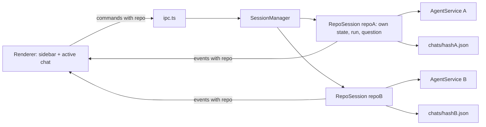

# Multi-repo parallel chats

## Decisions already made

- One chat per repo. Agents run in parallel across repos, never two in the same repo (branch safety).
- Repos are the chosen folder's direct subfolders that contain `.git`. If the chosen folder is itself a repo, it is the only repo.
- Assumption: if no repo is found, the chosen folder is treated as a single repo (today's behavior, so non-git folders keep working).
- Assumption: existing chat history is kept. A repo's chat file is `chats/<sha256(realpath)>.json`, the same key as today's `folderId`.

## How you pick a repo: `@repo`

- A **New chat** screen (the home of a multi-repo workspace) has a composer with `@` autocomplete over the workspace's repos.
- Typing `@` (at the start of a word) opens a popup of repo names, filtered as you type. Up/Down moves, Tab or Enter accepts, Esc closes. The accepted mention is inserted as `@api `.
- On send, the first `@name` that exactly matches a repo is the target. It is removed from the text the agent receives. The repo's chat opens and the agent starts in that repo's folder.
  - If that repo already has a chat (history), the message continues it (one chat per repo).
  - If that repo's agent is already running: the send is blocked with "api already has a running agent. Open it or stop it first." (one agent per repo, for branch safety).
  - No `@repo` while no repo chat is open: the send is blocked with a hint "Pick a repo with @". Two different `@repo` mentions: blocked, "One repo per message".
- Once a repo chat is open, its composer is locked to that repo. There is no `@` there and no way to retarget it.
- A slim list of repo chats (running or with history) with status dots sits on the side, plus a **New chat** button back to the home screen. Agents in other repos keep running while you look at one.
- Single-repo workspace (the folder is itself a repo, or no repos found): there is no home screen and no `@`. It opens straight into that one chat, as today.
- Mention parsing is renderer sugar. Main still receives `repo` as a validated name and re-checks it, so a bad name never reaches an agent.

## Design

The renderer sends a repo name (a direct-child directory name, or `.` for the root repo), never a path. Main resolves it against the discovered repo list and refuses unknown names (process-boundary rule: validate every input).

## Main process

- [src/main/settings-store.ts](src/main/settings-store.ts): `folder` stays as the workspace root. Add `listRepos(root)` and make `readChat(repoPath)` / `writeChat(repoPath, chat)` take the repo path. Repos are re-scanned on each call (cheap, so new clones show up).
- [src/main/chat-session.ts](src/main/chat-session.ts): keep the existing per-chat logic (state, run, pending question, generation) as a `RepoSession` bound to one repo path. It is a near-move of the current code; `send`, `stop`, `ask`, `answer`, `skip`, `reset`, `history`, `state` use that repo's chat file and its own `AgentService`.
- Add a `SessionManager` (same file or `session-manager.ts`):
  - `Map<repoName, RepoSession>`, created lazily; each gets its own `createAgentService` with an `ask` closure bound to that session, so the `ask_user_question` tool routes to the right repo.
  - One agent per repo is enforced here: `send` on a busy repo returns `conflict` (existing `isBusy` check), and the UI also disables it.
  - Global operations (`save` folder/model, `setKey`, `clearKey`) refuse with `conflict` if any repo is busy. Changing the folder or key disposes all sessions.
  - `shutdown` stops every session in parallel under the existing 3 s cap.
  - `repos()` returns `{ name, path, state, hasPendingQuestion }[]` for the sidebar.
- [src/main/rules-skills-service.ts](src/main/rules-skills-service.ts): replace `options.folder()` with a `repo path` first argument on list/read/write/delete/readAgents/writeAgents. The shared `dirty` map is already keyed by real path, so `instructionsPending` becomes per repo for free.
- [src/main/index.ts](src/main/index.ts): build the manager instead of one session; `before-quit` calls `manager.shutdown()`.
- [src/main/ipc.ts](src/main/ipc.ts): resolve `input.repo` through the manager before dispatch.

## Contract ([src/shared/ipc.ts](src/shared/ipc.ts))

- Add `repo: RepoName` to inputs of `flow:chat.send|stop|history|reset|state`, `flow:question.answer|skip`, `flow:rules.*`, `flow:skills.*`, `flow:agentsmd.*`.
- Add `flow:repos.list` -> `{ repos: [{ name, state, pendingQuestion }] }`.
- `SettingsSchema`: `folder` is documented as "workspace folder"; no breaking change for stored `settings.json`.
- Add `repo` to every event in `EventSchema` (`chat.state`, `chat.delta`, `chat.tool`, `chat.done`, `chat.error`, `question.asked`, `question.closed`). The existing `runId` stays for stale-event filtering inside a repo.
- The preload needs no change (it only forwards `COMMANDS` and `EVENT_CHANNEL`).

## Renderer

- [src/renderer/state.ts](src/renderer/state.ts): split `AppState` into global fields (`settings`, `models`, `editing`, `instructionsOpen`, `activeRepo`, `repos`) and `chats: Record<repo, ChatSlice>`. `ChatSlice` holds the current per-chat fields (`items`, `chatState`, `activeRunId`, `sealedRunId`, `liveAgentId`, `draft`, `notice`, `banner`, `lastUserText`, `instructionsPending`, `pendingQuestionId`). Move the current reducer body into `chatReducer(slice, action)`; the top reducer routes by `repo` (events by `event.repo`, user actions by `activeRepo`).
- [src/renderer/App.tsx](src/renderer/App.tsx): the `hold` / `pendingEvents` / `viewToken` refs become per repo (a `Map`), so a send in repo A does not buffer or drop events for repo B. On `chat.done`/`chat.error`, reload history for that repo only. Switching repos loads that repo's history and state if it is not loaded yet.
- New `RepoSidebar.tsx`: lists repo chats (running or with history) with a status dot (idle, running, waiting for an answer, error) and marks a background chat that finished or asked a question. Clicking opens that chat; nothing is stopped. A **New chat** button opens the home screen.
- New `NewChat.tsx` (home screen) and `MentionComposer.tsx`: the `@repo` composer with the autocomplete popup. Pure helpers `parseMention(text, repos)` and `mentionQuery(text, caret)` live in `src/shared/mention.ts` so `scripts/` can test them without React.
- `AppState` gets `view: "home" | { repo }` instead of an always-set active repo. Sending from home sets `view` to the target repo and dispatches the normal `sending` / `run-started` flow for that slice.
- [src/renderer/Chat.tsx](src/renderer/Chat.tsx): header shows the locked repo name; per-chat `busy` gating stays. "Reset chat" resets only that repo. Model select / Setup are disabled while any repo is busy.
- [src/renderer/Instructions.tsx](src/renderer/Instructions.tsx), `RulesEditor.tsx`, `SkillsEditor.tsx`: pass `repo` (the active one) in every call.
- [src/renderer/Setup.tsx](src/renderer/Setup.tsx): rename "Folder" to "Workspace folder", show the detected repos, and update the warning that agents can edit files in these repos.
- [src/renderer/styles.css](src/renderer/styles.css): sidebar layout and status dots.

## Edge cases

- A repo folder disappears while idle: it drops from the list; its chat file stays. While busy: the run fails through the normal error path.
- The same repo reached through a symlink: resolve with `realpath` before keying sessions.
- Many repos running at once: no cap in this change; each agent is a separate SDK process. Open question: add a global concurrency cap if it gets heavy.
- Key rejected (`auth`) in one repo: disposes that repo's agent; the banner is shown in that chat, and the setup screen is reachable once no repo is busy.

## Out of scope

- Several chats per repo, git worktrees, a concurrency cap, recursive repo scan, any merge or branch handling, `@file` mentions, and retargeting an open chat to another repo.

## Verification

- `npm run typecheck`.
- Update [scripts/phase2-files-check.mjs](scripts/phase2-files-check.mjs) to the new `RulesSkills` signature and run it; run `npm run check:questions`.
- Add a small main-process check: two repo sessions run at once, a second `send` in the same repo gets `conflict`, and a question in repo A is answered without touching repo B.
- Add `scripts/mention-check.ts` for `parseMention` / `mentionQuery`: exact match, prefix filter, no match, two repos, mention mid-sentence, `@` inside an email address (must not trigger).
- Manual run with a folder holding two repos: type `@` and see the popup, start both agents with `@a ...` and `@b ...`, switch between them, try `@a` again while it runs (blocked), answer a question in the background chat, quit while both are running.

## Docs

- Replace D-5 and Q-1 in [docs/decisions.md](docs/decisions.md) with "one chat per repo, workspace with many repos".
- Update [docs/architecture.md](docs/architecture.md), [docs/session-and-questions.md](docs/session-and-questions.md), and [docs/ipc-contract.md](docs/ipc-contract.md) (repo field, new command, events, per-repo `RepoSession`).
