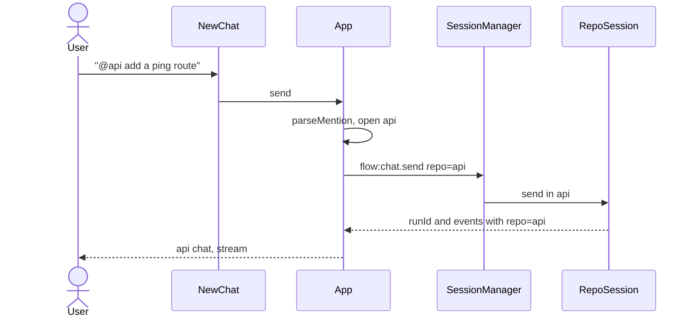

# Multi-repo parallel chats

Source sketch: `.cursor/plans/multi-repo_parallel_chats_afc56e47.plan.md`. This file is the one to execute. Do not edit the sketch while implementing.

## Overview

Mango today runs one agent in one chosen folder. This plan makes that folder a workspace. The workspace's git repos each get one chat, and agents in different repos run at the same time. The window gains a home screen where `@repo` picks the chat, a sidebar of chats that are running or already have history, and per-repo transcript state so looking at one repo does not pause the others.

**Out of scope:** several chats per repo, git worktrees, a recursive repo scan, merge or branch handling, `@file` mentions, and retargeting an open chat to another repo.

**Implements / relates to:** replaces D-5 and the answer to Q-1 in `docs/decisions.md`. Extends `docs/architecture.md`, `docs/session-and-questions.md`, and `docs/ipc-contract.md`.

**Assumptions**

- A direct child counts as a repo when it contains `.git` (file or directory). Names starting with `.` are skipped.
- If the workspace folder is itself a git repo, it is the only repo and its name is `.`. Child repos are not listed.
- If the workspace has no child repos, it is one repo named `.`. That is today's behavior, so a normal folder keeps working.
- Chat files stay `chats/<sha256(realpath)>.json`. A chat saved for the workspace path is not copied onto a child repo.
- The renderer sends a repo name, never a path. Main resolves the name against the scanned list and refuses any other name.
- At most 7 repo agents may be busy at once. Busy is `streaming`, `awaitingAnswer`, or `stopping`. A send that would start an 8th busy repo returns `conflict` with "Seven agents are already running. Stop one before starting another." A second send in a repo that is already busy keeps that repo's own message. Saved transcripts do not count toward the cap.
- `flow:repos.list` includes `hasHistory`, so the sidebar can list chats with history without the renderer reading files.
- The in-chat button is labeled **Reset chat**. **New chat** is the home screen only.
- `npm run typecheck` stays red from Step 2 until Step 11, because `repo` becomes required on the contract while callers are updated in later steps. Do not make `repo` optional to turn the typecheck green early.

## Pros / Cons

**Pros**

- Two repos can run at once, which is the reason for the change.
- One agent per repo keeps that repo on one branch. A second send in a busy repo is refused.
- Mention parsing is a pure function with a script check. Main still checks the repo name.
- Existing chat files stay valid for the same real path.

**Cons**

- The renderer holds one transcript per repo, so a long session uses more memory.
- At most 7 repo agents run at once. The 8th send is refused.
- A workspace that used to be one non-git folder, and now contains repos, will not show the old workspace-level transcript on those repos.

## How It Works

A workspace is the folder chosen in setup. A repo is either that folder (name `.`) or one of its direct child directories that contains `.git`. Each repo has its own chat file, its own agent, and its own state (`ready`, `streaming`, `awaitingAnswer`, `stopping`, or `needsSetup`). Agents in different repos run together. A second send in a repo that is already running is refused, in the window and again in main.

Opening a chat loads its history and does not create an agent. The agent is created on the first send in that repo. Rules and skills are read and written in that repo's folder. Changing the workspace folder, the model, or the key is refused while any repo is running, and changing the folder or the key disposes every session.

### Flow: start a chat from home

1. The user types in the home composer. `@` at the start of a word opens a list of repo names.
2. On send, the first `@name` that exactly matches a repo is the target. That mention is removed from the text. The repo's chat opens and main starts the agent with `cwd` set to that repo's path.
3. If the repo is already running, the send is blocked and nothing is sent. If the text has no repo mention, or two different ones, the send is blocked and the composer keeps the draft.



**Example:** repos `api` and `web`. Input `@api add a ping route` opens the `api` chat and the agent receives `add a ping route`. `@web` in the same message is refused with "One repo per message."

### Flow: two repos at once

1. The user starts `api`, then goes home and starts `web`.
2. Each repo has its own `RepoSession` and its own `AgentService`. Events carry `repo`, and the window stores them on that repo's slice even while another chat is on screen.
3. A second send in `api` returns `conflict`. Quit disposes every session, racing a single 3 second cap.

### Flow: one-repo workspace

1. Setup saved a folder that is itself a git repo, or a folder with no child repos.
2. The window opens straight into that chat. There is no home screen and no `@` picker.
3. The header shows the folder's name. Reset clears only that chat.

## Current State Analysis

**✅ Exists**

- One `ChatSession` in `src/main/chat-session.ts`: state, run, pending question, generation, and the `ask` bridge in `src/main/index.ts`.
- One `AgentService` per process (`src/main/agent-service.ts`). `cwd` is the saved folder.
- Chat file key `sha256(realpath)` in `src/main/settings-store.ts` (`readChat()` / `writeChat()` take no path).
- Rules and skills bound to `options.folder()` in `src/main/rules-skills-service.ts`. The dirty map is already keyed by real path.
- IPC catalog in `src/shared/ipc.ts`. Preload forwards `COMMANDS` and `EVENT_CHANNEL` and does not name individual commands (`src/preload/index.ts`, `src/preload/bridge.ts`).
- One renderer reducer and one event buffer in `src/renderer/state.ts` and `src/renderer/App.tsx`.
- Checks: `npm run typecheck`, `npm run check:questions`, `node --experimental-strip-types scripts/phase2-files-check.mjs`.
- `repo` on command inputs and events, and `flow:repos.list`. COMPLETED in Step 2
- `listRepos`, and chat reads and writes addressed by repo path. COMPLETED in Step 3
- Rules and skills methods that take a repo path. COMPLETED in Step 4
- `RepoSession` plus `SessionManager` with one agent per repo. COMPLETED in Step 5 and Step 6
- `scripts/mention-check.ts` and `scripts/repos-check.ts`. COMPLETED in Step 6 (`mention-check.ts` landed in Step 1)
- Per-repo renderer slices, the sidebar, the home screen, and `@` parsing. COMPLETED in Step 11

**❌ Missing Components**

None.

## Implementation Steps

### ✅ Step 1: Mention parsing

Landed `src/shared/mention.ts`, `scripts/mention-check.ts`, and `check:mentions` in `package.json`. `npm run check:mentions` not run.

- **Files:** `src/shared/mention.ts`, `scripts/mention-check.ts`, `package.json`
- **Change:** Add the pure helpers the home composer and its check script share. `@` counts only at the start of the text or after whitespace, so an email address is not a mention.

**Code**

`src/shared/mention.ts` (new file)
```ts
// Pure @repo parsing. No I/O. The renderer and scripts/mention-check.ts both use this.

const MENTION = /(^|\s)@([^\s@]+)/g;
const OPEN_QUERY = /(^|\s)@([^\s@]*)$/;

export type MentionHit = { name: string; start: number; end: number };

export type ParsedMention =
  | { ok: true; repo: string; text: string }
  | { ok: false; reason: "none" | "many" };

export function findMentions(text: string): MentionHit[] {
  const hits: MentionHit[] = [];
  MENTION.lastIndex = 0;
  let match: RegExpExecArray | null = MENTION.exec(text);
  while (match !== null) {
    const lead = match[1] ?? "";
    const name = match[2] ?? "";
    const start = match.index + lead.length;
    hits.push({ name, start, end: start + 1 + name.length });
    match = MENTION.exec(text);
  }
  return hits;
}

export function parseMention(text: string, repos: readonly string[]): ParsedMention {
  const known = new Set(repos);
  const matched = findMentions(text).filter((hit) => known.has(hit.name));
  const names = [...new Set(matched.map((hit) => hit.name))];
  if (names.length === 0) return { ok: false, reason: "none" };
  if (names.length > 1) return { ok: false, reason: "many" };
  const repo = names[0];
  const hit = matched[0];
  if (repo === undefined || hit === undefined) return { ok: false, reason: "none" };
  const next = `${text.slice(0, hit.start)}${text.slice(hit.end)}`.replace(/[ \t]{2,}/g, " ").trim();
  return { ok: true, repo, text: next };
}

export function mentionQuery(text: string, caret: number): { start: number; query: string } | null {
  const before = text.slice(0, Math.max(0, caret));
  const match = OPEN_QUERY.exec(before);
  if (match === null) return null;
  const query = match[2] ?? "";
  return { start: before.length - query.length - 1, query };
}

export function filterRepoNames(repos: readonly string[], query: string): string[] {
  const needle = query.toLowerCase();
  return repos.filter((name) => name !== "." && name.toLowerCase().startsWith(needle));
}
```

`scripts/mention-check.ts` (new file)
```ts
// Checks @repo parsing. No network and no Electron.
//   node --experimental-strip-types scripts/mention-check.ts
import assert from "node:assert/strict";
import test from "node:test";
import { filterRepoNames, mentionQuery, parseMention } from "../src/shared/mention.ts";

const repos = ["api", "web"];

test("an exact mention is removed and the rest is the prompt", () => {
  assert.deepEqual(parseMention("@api add a ping route", repos), {
    ok: true,
    repo: "api",
    text: "add a ping route",
  });
});

test("a mention in the middle of a sentence matches", () => {
  assert.deepEqual(parseMention("please @web check the logs", repos), {
    ok: true,
    repo: "web",
    text: "please check the logs",
  });
});

test("no mention, a prefix, and the wrong case do not match", () => {
  assert.deepEqual(parseMention("hello", repos), { ok: false, reason: "none" });
  assert.deepEqual(parseMention("@ap hello", repos), { ok: false, reason: "none" });
  assert.deepEqual(parseMention("@API hello", repos), { ok: false, reason: "none" });
});

test("two different repos are refused", () => {
  assert.deepEqual(parseMention("@api and @web", repos), { ok: false, reason: "many" });
});

test("the same repo named twice is one target", () => {
  const parsed = parseMention("@api then @api again", repos);
  assert.equal(parsed.ok, true);
  if (!parsed.ok) return;
  assert.equal(parsed.repo, "api");
  assert.equal(parsed.text, "then @api again");
});

test("an email address is not a mention", () => {
  assert.deepEqual(parseMention("mail user@api.com", repos), { ok: false, reason: "none" });
  assert.equal(mentionQuery("mail user@api.com", "mail user@api.com".length), null);
});

test("the open query follows the caret", () => {
  const text = "see @ap";
  assert.deepEqual(mentionQuery(text, text.length), { start: 4, query: "ap" });
  assert.equal(mentionQuery("@api ", 5), null);
  assert.deepEqual(mentionQuery("@", 1), { start: 0, query: "" });
});

test("the popup filters by prefix and hides the root repo name", () => {
  assert.deepEqual(filterRepoNames(["api", "web", "."], "a"), ["api"]);
  assert.deepEqual(filterRepoNames(["api", "web"], ""), ["api", "web"]);
});
```

`package.json` (add to `scripts`, after `check:questions`)
```json
"check:mentions": "node --disable-warning=ExperimentalWarning --experimental-strip-types scripts/mention-check.ts"
```

Run `npm run check:mentions` after this step. It does not need the later steps.

### ✅ Step 2: IPC contract

Landed `RepoNameSchema`, `flow:repos.list`, required `repo` on chat, question, rules, skills, and AGENTS.md commands, and `repo` on every event. Callers left for later steps. `npm run typecheck` not run.

- **Files:** `src/shared/ipc.ts`
- **Change:** Require a repo name on every chat, question, rules, skills, and `AGENTS.md` command. Add `flow:repos.list`. Add `repo` to every event. `settings.json` fields do not change. `folder` is the workspace folder.

**Code**

`src/shared/ipc.ts` (add after `ChatStateSchema`)
```ts
/** A direct child directory name, or "." when the workspace folder is the only repo. */
export const RepoNameSchema = z
  .string()
  .min(1)
  .max(255)
  .refine(
    (name) => name === "." || (name !== ".." && !name.includes("/") && !name.includes("\\") && !name.includes("\0")),
    "Unknown repo",
  );
export type RepoName = z.infer<typeof RepoNameSchema>;

export const RepoListItemSchema = z.object({
  name: RepoNameSchema,
  state: ChatStateSchema,
  pendingQuestion: z.boolean(),
  hasHistory: z.boolean(),
});
export type RepoListItem = z.infer<typeof RepoListItemSchema>;
```

`src/shared/ipc.ts` (replace the `folder` line inside `SettingsSchema`)
```ts
  /** Workspace folder. Repos are its child git directories, or this folder when it is the only repo. */
  folder: z.string().nullable(),
```

`src/shared/ipc.ts` (replace the command entries from `flow:chat.send` through `flow:agentsmd.write`)
```ts
  "flow:repos.list": {
    input: None,
    output: z.object({ repos: z.array(RepoListItemSchema) }),
  },
  "flow:chat.send": {
    input: z.object({ repo: RepoNameSchema, text: z.string().trim().min(1).max(50_000) }).strict(),
    output: SendResultSchema,
  },
  "flow:chat.stop": { input: z.object({ repo: RepoNameSchema }).strict(), output: None },
  "flow:chat.history": {
    input: z.object({ repo: RepoNameSchema }).strict(),
    output: z.object({ messages: z.array(MessageSchema) }),
  },
  "flow:chat.reset": { input: z.object({ repo: RepoNameSchema }).strict(), output: None },
  "flow:chat.state": {
    input: z.object({ repo: RepoNameSchema }).strict(),
    output: z.object({
      state: ChatStateSchema,
      runId: z.string().min(1).optional(),
      instructionsPending: z.boolean(),
      pendingQuestion: PendingQuestionSchema.optional(),
    }),
  },
  "flow:question.answer": {
    input: z
      .object({ repo: RepoNameSchema, questionId: z.string().min(1).max(80), answers: AnswersSchema })
      .strict(),
    output: None,
  },
  "flow:question.skip": {
    input: z.object({ repo: RepoNameSchema, questionId: z.string().min(1).max(80) }).strict(),
    output: None,
  },
  "flow:rules.list": { input: z.object({ repo: RepoNameSchema }).strict(), output: z.array(RuleSummarySchema) },
  "flow:rules.read": { input: z.object({ repo: RepoNameSchema, name: NameSchema }).strict(), output: RuleSchema },
  "flow:rules.write": {
    input: RuleSchema.extend({ repo: RepoNameSchema }).strict(),
    output: RuleSchema,
  },
  "flow:rules.delete": { input: z.object({ repo: RepoNameSchema, name: NameSchema }).strict(), output: None },
  "flow:skills.list": { input: z.object({ repo: RepoNameSchema }).strict(), output: z.array(SkillSummarySchema) },
  "flow:skills.read": { input: z.object({ repo: RepoNameSchema, name: NameSchema }).strict(), output: SkillSchema },
  "flow:skills.write": {
    input: SkillSchema.extend({ repo: RepoNameSchema }).strict(),
    output: SkillSchema,
  },
  "flow:skills.delete": { input: z.object({ repo: RepoNameSchema, name: NameSchema }).strict(), output: None },
  "flow:agentsmd.read": { input: z.object({ repo: RepoNameSchema }).strict(), output: z.object({ body: z.string() }) },
  "flow:agentsmd.write": {
    input: z.object({ repo: RepoNameSchema, body: z.string().max(200_000) }).strict(),
    output: z.object({ body: z.string() }),
  },
```

`src/shared/ipc.ts` (add `repo: RepoNameSchema` as the first field of every object inside `EventSchema`, including `chat.state`, `chat.delta`, `chat.tool`, `chat.done`, `chat.error`, `question.asked`, and `question.closed`)

`flow:chat.send` example of the same edit on an event:
```ts
  z.object({ type: z.literal("chat.delta"), repo: RepoNameSchema, runId: RunId, messageId: z.string().min(1), text: z.string() }),
```

Do the same `repo: RepoNameSchema` insertion on the other six event objects. Leave the rest of each object as it is.

No test in this step. `scripts/mention-check.ts` does not import these schemas. The contract is exercised by `scripts/repos-check.ts` in Step 6 and by `npm run typecheck` after Step 11.

### ✅ Step 3: Settings store

Landed `listRepos`, `chatPath`, and path-addressed `readChat` / `writeChat` in `src/main/settings-store.ts`. Callers still use the old signatures.

- **Files:** `src/main/settings-store.ts`
- **Change:** Scan repos on each call. Read and write a chat by the repo's real path, using the same hash as today's `folderId`.

**Code**

`src/main/settings-store.ts` (add `readdirSync` and `Dirent` to the `node:fs` import)

`src/main/settings-store.ts` (replace the `SettingsStore` type's chat methods and add `listRepos`)
```ts
export type RepoRecord = { name: string; path: string };

export type SettingsStore = {
  view(): Settings;
  save(partial: { folder?: string; model?: string; theme?: Theme }): Settings;
  setKey(key: string): void;
  clearKey(): void;
  readKey(): string | null;
  listRepos(root: string): RepoRecord[];
  readChat(repoPath: string): ChatFile;
  writeChat(repoPath: string, chat: ChatFile): void;
};
```

`src/main/settings-store.ts` (replace `chatFile`, `readChat`, and `writeChat`, and add `listRepos` to the returned object)
```ts
  function listRepos(root: string): RepoRecord[] {
    let resolved: string;
    try {
      resolved = realpathSync(root);
    } catch {
      return [];
    }
    if (!isDirectory(resolved)) return [];
    if (hasGit(resolved)) return [{ name: ".", path: resolved }];
    let entries: Dirent[];
    try {
      entries = readdirSync(resolved, { withFileTypes: true });
    } catch {
      return [{ name: ".", path: resolved }];
    }
    const found: RepoRecord[] = [];
    const seen = new Set<string>();
    for (const entry of entries) {
      if (entry.name.startsWith(".") || entry.name === ".." || entry.name.includes("/") || entry.name.includes("\\")) continue;
      const child = path.join(resolved, entry.name);
      let real: string;
      try {
        real = realpathSync(child);
      } catch {
        continue;
      }
      if (!isDirectory(real) || !hasGit(real) || seen.has(real)) continue;
      seen.add(real);
      found.push({ name: entry.name, path: real });
    }
    found.sort((left, right) => left.name.localeCompare(right.name));
    if (found.length === 0) return [{ name: ".", path: resolved }];
    return found;
  }

  function chatPath(repoPath: string): string | null {
    let resolved: string;
    try {
      resolved = realpathSync(repoPath);
    } catch {
      return null;
    }
    if (!isDirectory(resolved)) return null;
    return path.join(chatsDir, `${folderId(resolved)}.json`);
  }

  function readChat(repoPath: string): ChatFile {
    const file = chatPath(repoPath);
    if (file === null) return EMPTY_CHAT;
    return readJson(file, ChatFileSchema, EMPTY_CHAT);
  }

  function writeChat(repoPath: string, chat: ChatFile): void {
    const file = chatPath(repoPath);
    if (file === null) throw new Error("Choose a folder before saving the chat.");
    writeJson(file, chat);
  }
```

Return `listRepos` from the factory object. Add this helper next to `isDirectory`:
```ts
function hasGit(dir: string): boolean {
  try {
    statSync(path.join(dir, ".git"));
    return true;
  } catch {
    return false;
  }
}
```

`scripts/repos-check.ts` in Step 6 covers `listRepos`. No separate test file in this step.

### ✅ Step 4: Rules and skills take a repo path

Landed repo-path arguments on every `RulesSkills` read and write, and updated `scripts/phase2-files-check.mjs` call sites. `node --experimental-strip-types scripts/phase2-files-check.mjs` not run. Existing test assertion data was kept.

- **Files:** `src/main/rules-skills-service.ts`, `scripts/phase2-files-check.mjs`
- **Change:** Drop `options.folder()`. Every read and write takes the repo path first. `seenDirty` and `clearDirty` already take a path and stay as they are.

**Code**

`src/main/rules-skills-service.ts` (replace the `RulesSkills` type and the factory signature)
```ts
export type RulesSkills = {
  listRules(repoPath: string): RuleSummary[];
  readRule(repoPath: string, name: string): Rule;
  writeRule(repoPath: string, rule: Rule): Rule;
  deleteRule(repoPath: string, name: string): void;
  listSkills(repoPath: string): SkillSummary[];
  readSkill(repoPath: string, name: string): Skill;
  writeSkill(repoPath: string, skill: Skill): Skill;
  deleteSkill(repoPath: string, name: string): void;
  readAgents(repoPath: string): { body: string };
  writeAgents(repoPath: string, body: string): { body: string };
  seenDirty(folder: string): number;
  clearDirty(folder: string, seen: number): void;
};

export function createRulesSkills(): RulesSkills {
```

Inside each method below, replace `const root = projectRoot(options.folder());` with `const root = projectRoot(repoPath);`. `writeAgents` must call `return readAgents(repoPath);` instead of `return readAgents();`.

`listRules` (the rest of the function stays as it is):
```ts
  function listRules(repoPath: string): RuleSummary[] {
    const root = projectRoot(repoPath);
```

Apply that parameter and `projectRoot(repoPath)` change to `readRule(repoPath, name)`, `writeRule(repoPath, rule)`, `deleteRule(repoPath, name)`, `listSkills(repoPath)`, `readSkill(repoPath, name)`, `writeSkill(repoPath, skill)`, `deleteSkill(repoPath, name)`, `readAgents(repoPath)`, and `writeAgents(repoPath, body)`.

`scripts/phase2-files-check.mjs` (every test): replace `createRulesSkills({ folder: () => root })` with `createRulesSkills()`, and pass `root` as the first argument of `listRules`, `readRule`, `writeRule`, `deleteRule`, `listSkills`, `readSkill`, `writeSkill`, `deleteSkill`, `readAgents`, and `writeAgents`. Leave `seenDirty(root)` and `clearDirty(root, seen)` as they are.

First test, the call shape:
```js
    const files = createRulesSkills();
    const rule = files.writeRule(root, {
      name: "pirate",
      description: "Speak like a pirate",
      alwaysApply: true,
      globs: "",
      body: "Always answer in pirate speak.",
    });
    assert.deepEqual(
      files.listRules(root).map((item) => item.name),
      ["pirate"],
    );
    const skill = files.writeSkill(root, {
      name: "pirate-voice",
      description: "Voice",
      body: "Use pirate speak for every answer.",
    });
    assert.equal(files.readSkill(root, "pirate-voice").body, "Use pirate speak for every answer.");
    const agents = files.writeAgents(root, "Project notes.\n");
    assert.equal(files.readAgents(root).body, "Project notes.");
    files.deleteRule(root, "pirate");
    assert.equal(files.listRules(root).length, 0);
    assert.throws(() => files.readRule(root, "pirate"), (error) => error.code === "not_found");
    files.deleteSkill(root, "pirate-voice");
```

The dirty test keeps `files.seenDirty(root)` and `files.clearDirty(root, seen)`, and changes `files.writeRule(rule)` to `files.writeRule(root, rule)`. The name, symlink, and rules-symlink tests change `files.listRules()`, `files.readRule(name)`, `files.writeRule(rule)`, and `files.readAgents()` the same way.

Run `node --experimental-strip-types scripts/phase2-files-check.mjs` after this step.

### ✅ Step 5: RepoSession

Landed `createRepoSession` in `src/main/chat-session.ts`. The emit wrapper stamps `repo` onto events that omit it (`EventWithoutRepo`), because `FlowEvent` already requires `repo`; `emitState` passes that partial object through the wrapper. Dropped unused `Settings` and `Theme` imports with `view`, `save`, `setKey`, `clearKey`, and `listModels`. Checks not run.

- **Files:** `src/main/chat-session.ts`
- **Change:** Bind the current session logic to one repo path. Global folder, key, and model operations move to `SessionManager` in Step 6. Events go out through a wrapper that sets `repo`.

**Code**

Add `statSync` to a new import from `node:fs`.

Replace the `ChatSession` type and `createChatSession` with:
```ts
type OmitKey<T, K extends PropertyKey> = T extends unknown ? Omit<T, K> : never;
type EventWithoutRepo = OmitKey<FlowEvent, "repo">;

export type RepoSession = {
  name(): string;
  path(): string;
  isBusy(): boolean;
  reset(): Promise<void>;
  send(text: string): Promise<{ runId: string; userMessageId: string; agentMessageId: string; restored: boolean }>;
  stop(): Promise<void>;
  ask(request: AskRequest): Promise<string>;
  answer(questionId: string, answers: Answers): void;
  skip(questionId: string): void;
  history(): { messages: Message[] };
  state(): { state: ChatStateName; runId?: string; instructionsPending: boolean; pendingQuestion?: PendingQuestion };
  dispose(): Promise<void>;
  shutdown(): Promise<void>;
  isShuttingDown(): boolean;
};

export function createRepoSession(options: {
  repoName: string;
  repoPath: string;
  store: SettingsStore;
  agents: AgentService;
  files: Pick<RulesSkills, "seenDirty" | "clearDirty">;
  emit: (event: FlowEvent) => void;
}): RepoSession {
  const { repoName, repoPath, store, agents, files } = options;
  const emit = (event: EventWithoutRepo): void => {
    options.emit({ ...event, repo: repoName } as FlowEvent);
  };
```

Delete `view`, `save`, `setKey`, `clearKey`, and `listModels` from this factory. Keep `refreshIdle`, `emitState`, `isBusy`, `ask`, `answer`, `skip`, `finish`, `closePending`, `handleStream`, `persistTool`, `settle`, and `isStale`.

`history` and `instructionsPending`:
```ts
  function history(): { messages: Message[] } {
    return { messages: store.readChat(repoPath).messages };
  }

  function instructionsPending(): boolean {
    return files.seenDirty(repoPath) !== 0;
  }
```

`reset`:
```ts
  async function reset(): Promise<void> {
    if (shuttingDown) throw new SessionError("not_ready", "The app is closing", false);
    if (isBusy()) throw new SessionError("conflict", "Wait for the current message to finish", false);
    if (repoGone()) throw new SessionError("not_ready", "That folder is missing.", false);
    closePending();
    await agents.dispose();
    try {
      store.writeChat(repoPath, { agentId: null, messages: [] });
    } catch (error) {
      throw new SessionError("io_error", errorText(error), false);
    }
    refreshIdle();
    emitState();
  }
```

In `send`, keep the current body and apply these replacements:

- The busy error message is `repoName === "." ? "A message is already running" : `${repoName} already has a running agent. Open it or stop it first.``
- After the setup check, if `repoGone()` then set `state = "needsSetup"`, `emitState()`, and throw `not_ready` with "That folder is missing."
- `store.readChat()` becomes `store.readChat(repoPath)`.
- `store.writeChat(value)` becomes `store.writeChat(repoPath, value)`.
- `files.seenDirty(current.folder)` becomes `files.seenDirty(repoPath)`.
- `files.clearDirty(current.folder, seenInstructions)` becomes `files.clearDirty(repoPath, seenInstructions)`.
- `cwd: current.folder` becomes `cwd: repoPath`.

In `ask`, `finish`, `persistTool`, and `settle`, replace every `store.readChat()` with `store.readChat(repoPath)` and every `store.writeChat(value)` with `store.writeChat(repoPath, value)`. Leave the rest of those functions as they are. `emit(...)` already receives `repo` from the wrapper.

Replace `shutdown` and the returned object:
```ts
  function repoGone(): boolean {
    try {
      return !statSync(repoPath).isDirectory();
    } catch {
      return true;
    }
  }

  async function dispose(): Promise<void> {
    if (run && !run.settled) {
      run.abandoned = true;
      run.settled = true;
    }
    closePending();
    await agents.dispose();
  }

  async function shutdown(): Promise<void> {
    if (shuttingDown) return;
    shuttingDown = true;
    await dispose();
  }

  return {
    name: () => repoName,
    path: () => repoPath,
    isBusy,
    reset,
    send,
    stop,
    ask,
    answer,
    skip,
    history,
    state: stateValue,
    dispose,
    shutdown,
    isShuttingDown: () => shuttingDown,
  };
}
```

`stateValue` stays, using the updated `instructionsPending`. The 3 second cap moves to the manager in Step 6 so one cap covers every repo.

### ✅ Step 6: SessionManager and the concurrency check

Landed `src/main/session-manager.ts`, `scripts/repos-check.ts`, and `check:repos`. The cap of 7 and the eighth-repo refusal message match the plan. `gitRepo` uses `mkdirSync(..., { recursive: true })` so child repos in the two-repo and eighth-repo tests exist. That test's `beginSend` returns `Promise<void>`. Gate resolvers are `() => resolvePromise()` so they match `() => void`. `npm run check:repos` passes via `scripts/repos-check-resolve.mjs`.

`npm run check:repos` keeps `--disable-warning=ExperimentalWarning` and `--experimental-strip-types`, and loads `scripts/repos-check-resolve.mjs`, which resolves a relative `.js` specifier to the sibling `.ts` file when that file exists.

- **Files:** `src/main/session-manager.ts`, `scripts/repos-check.ts`, `package.json`
- **Change:** Own the repo map, create one `AgentService` per repo on first send, refuse a second send in a busy repo, refuse a send that would make an 8th repo busy, and refuse folder, model, and key changes while any repo is busy. The cap is 7. Count sessions whose `isBusy()` is true. Check it in `send` after `sessionFor` and before `session.send`. If that session is not busy and the count is already 7, throw `SessionError("conflict", "Seven agents are already running. Stop one before starting another.", false)`.

**Code**

`src/main/session-manager.ts` (new file)
```ts
import { QuestionRejected, QUESTION_CANCELLED, type Answers, type AskUser } from "../shared/questions.js";
import type { ChatStateName, FlowEvent, Message, PendingQuestion, RepoListItem, Settings, Theme } from "../shared/ipc.js";
import { AgentCallError, type AgentService } from "./agent-service.js";
import { createRepoSession, SessionError, type RepoSession } from "./chat-session.js";
import type { RulesSkills } from "./rules-skills-service.js";
import type { RepoRecord, SettingsStore } from "./settings-store.js";

export type SessionManager = {
  view(): Settings;
  save(partial: { folder?: string; model?: string; theme?: Theme }): Promise<Settings>;
  setKey(key: string): Promise<void>;
  clearKey(): Promise<void>;
  listModels(): Promise<{ id: string; label: string }[]>;
  repos(): RepoListItem[];
  send(repo: string, text: string): Promise<{ runId: string; userMessageId: string; agentMessageId: string; restored: boolean }>;
  stop(repo: string): Promise<void>;
  reset(repo: string): Promise<void>;
  history(repo: string): { messages: Message[] };
  state(repo: string): { state: ChatStateName; runId?: string; instructionsPending: boolean; pendingQuestion?: PendingQuestion };
  answer(repo: string, questionId: string, answers: Answers): void;
  skip(repo: string, questionId: string): void;
  repoPath(repo: string): string;
  shutdown(): Promise<void>;
  isShuttingDown(): boolean;
};

export function createSessionManager(options: {
  store: SettingsStore;
  files: Pick<RulesSkills, "seenDirty" | "clearDirty">;
  emit: (event: FlowEvent) => void;
  listModels(apiKey: string): Promise<{ id: string; label: string }[]>;
  createAgents(ask: AskUser): AgentService;
}): SessionManager {
  const { store, files, emit } = options;
  const sessions = new Map<string, RepoSession>();
  let shuttingDown = false;

  function anyBusy(): boolean {
    return busyCount() > 0;
  }

  function busyCount(): number {
    let count = 0;
    for (const session of sessions.values()) {
      if (session.isBusy()) count += 1;
    }
    return count;
  }

  function resolve(name: string): RepoRecord {
    const current = store.view();
    if (current.folder === null) throw new SessionError("not_ready", "Choose a folder first", false);
    if (current.folderMissing) throw new SessionError("not_ready", "That folder is missing.", false);
    const found = store.listRepos(current.folder).find((repo) => repo.name === name);
    if (found === undefined) throw new SessionError("not_found", "Unknown repo", false);
    return found;
  }

  async function sessionFor(name: string): Promise<RepoSession> {
    const repo = resolve(name);
    const current = sessions.get(repo.name);
    if (current && current.path() === repo.path) return current;
    if (current) {
      sessions.delete(repo.name);
      await current.dispose();
    }
    const bridge: { ask: AskUser | null } = { ask: null };
    const agents = options.createAgents((request) => {
      const ask = bridge.ask;
      if (ask === null) return Promise.reject(new QuestionRejected("cancelled", QUESTION_CANCELLED));
      return ask(request);
    });
    const session = createRepoSession({
      repoName: repo.name,
      repoPath: repo.path,
      store,
      agents,
      files,
      emit,
    });
    bridge.ask = (request) => session.ask(request);
    sessions.set(repo.name, session);
    return session;
  }

  function existing(name: string): RepoSession | null {
    const repo = resolve(name);
    const current = sessions.get(repo.name);
    if (current === undefined || current.path() !== repo.path) return null;
    return current;
  }

  async function disposeAll(): Promise<void> {
    const closing = [...sessions.values()];
    sessions.clear();
    await Promise.all(closing.map((session) => session.dispose()));
  }

  function view(): Settings {
    return store.view();
  }

  async function save(partial: { folder?: string; model?: string; theme?: Theme }): Promise<Settings> {
    if ((partial.folder !== undefined || partial.model !== undefined) && anyBusy()) {
      throw new SessionError("conflict", "Wait for every running agent to finish", false);
    }
    const previous = store.view().folder;
    let next: Settings;
    try {
      next = store.save(partial);
    } catch (error) {
      throw new SessionError("io_error", errorText(error), false);
    }
    if (next.folder !== previous) await disposeAll();
    return next;
  }

  async function setKey(key: string): Promise<void> {
    if (anyBusy()) throw new SessionError("conflict", "Wait for every running agent to finish", false);
    try {
      store.setKey(key);
    } catch (error) {
      throw new SessionError("io_error", errorText(error), false);
    }
    await disposeAll();
  }

  async function clearKey(): Promise<void> {
    if (anyBusy()) throw new SessionError("conflict", "Wait for every running agent to finish", false);
    store.clearKey();
    await disposeAll();
  }

  async function listModels(): Promise<{ id: string; label: string }[]> {
    const key = store.readKey();
    if (key === null) throw new SessionError("auth", "Save a Cursor key first", false);
    try {
      return await options.listModels(key);
    } catch (error) {
      if (error instanceof SessionError) throw error;
      if (error instanceof AgentCallError) throw new SessionError(error.code, error.message, error.retryable);
      throw new SessionError("agent_error", errorText(error), false);
    }
  }

  function repos(): RepoListItem[] {
    const current = store.view();
    if (current.folder === null || current.folderMissing) return [];
    return store.listRepos(current.folder).map((repo) => {
      const session = sessions.get(repo.name);
      const live = session && session.path() === repo.path ? session.state() : null;
      return {
        name: repo.name,
        state: live?.state ?? (current.setupComplete ? "ready" : "needsSetup"),
        pendingQuestion: live?.pendingQuestion !== undefined,
        hasHistory: store.readChat(repo.path).messages.length > 0,
      };
    });
  }

  function history(name: string): { messages: Message[] } {
    const session = existing(name);
    if (session) return session.history();
    return { messages: store.readChat(resolve(name).path).messages };
  }

  function state(name: string): { state: ChatStateName; runId?: string; instructionsPending: boolean; pendingQuestion?: PendingQuestion } {
    const session = existing(name);
    if (session) return session.state();
    const repo = resolve(name);
    const current = store.view();
    return {
      state: current.setupComplete ? "ready" : "needsSetup",
      instructionsPending: files.seenDirty(repo.path) !== 0,
    };
  }

  async function send(name: string, text: string) {
    if (shuttingDown) throw new SessionError("not_ready", "The app is closing", false);
    const session = await sessionFor(name);
    if (!session.isBusy() && busyCount() >= 7) {
      throw new SessionError("conflict", "Seven agents are already running. Stop one before starting another.", false);
    }
    return session.send(text);
  }

  async function stop(name: string): Promise<void> {
    const session = existing(name);
    if (session === null) throw new SessionError("not_ready", "Nothing is running", false);
    await session.stop();
  }

  async function reset(name: string): Promise<void> {
    const session = existing(name);
    if (session) {
      await session.reset();
      return;
    }
    const repo = resolve(name);
    try {
      store.writeChat(repo.path, { agentId: null, messages: [] });
    } catch (error) {
      throw new SessionError("io_error", errorText(error), false);
    }
  }

  function answer(name: string, questionId: string, answers: Answers): void {
    const session = existing(name);
    if (session === null) throw new SessionError("not_found", "That question is closed", false);
    session.answer(questionId, answers);
  }

  function skip(name: string, questionId: string): void {
    const session = existing(name);
    if (session === null) throw new SessionError("not_found", "That question is closed", false);
    session.skip(questionId);
  }

  async function shutdown(): Promise<void> {
    if (shuttingDown) return;
    shuttingDown = true;
    const closing = [...sessions.values()].map((session) => session.shutdown());
    await Promise.race([Promise.all(closing), new Promise<void>((resolvePromise) => setTimeout(resolvePromise, 3_000))]);
  }

  return {
    view,
    save,
    setKey,
    clearKey,
    listModels,
    repos,
    send,
    stop,
    reset,
    history,
    state,
    answer,
    skip,
    repoPath: (name) => resolve(name).path,
    shutdown,
    isShuttingDown: () => shuttingDown,
  };
}

function errorText(error: unknown): string {
  if (error instanceof Error && error.message.trim() !== "") return error.message.slice(0, 400);
  return "Something went wrong";
}
```

`scripts/repos-check.ts` (new file)
```ts
// Checks repo discovery, two sessions at once, and the cap of 7. No Electron and no SDK.
//   node --experimental-strip-types scripts/repos-check.ts
import assert from "node:assert/strict";
import { mkdtempSync, mkdirSync, realpathSync, rmSync, symlinkSync } from "node:fs";
import { tmpdir } from "node:os";
import path from "node:path";
import test from "node:test";
import type { FlowEvent } from "../src/shared/ipc.ts";
import type { AskUser } from "../src/shared/questions.ts";
import type { AgentService } from "../src/main/agent-service.ts";
import { SessionError } from "../src/main/chat-session.ts";
import { createSessionManager } from "../src/main/session-manager.ts";
import { createSettingsStore, type SecretBox } from "../src/main/settings-store.ts";

const secrets: SecretBox = {
  isEncryptionAvailable: () => true,
  encryptString: (plain) => Buffer.from(plain),
  decryptString: (encrypted) => encrypted.toString(),
};

function workspace(): string {
  return mkdtempSync(path.join(tmpdir(), "flowfe-repos-"));
}

function gitRepo(dir: string): void {
  mkdirSync(path.join(dir, ".git"), { recursive: true });
}

test("a git workspace is the only repo", () => {
  const root = workspace();
  try {
    gitRepo(root);
    mkdirSync(path.join(root, "child"));
    gitRepo(path.join(root, "child"));
    const store = createSettingsStore({ userDataDir: path.join(root, "data"), secrets });
    assert.deepEqual(store.listRepos(root), [{ name: ".", path: realpathSync(root) }]);
  } finally {
    rmSync(root, { recursive: true, force: true });
  }
});

test("child git directories are repos, and a folder with none is itself", () => {
  const root = workspace();
  try {
    const store = createSettingsStore({ userDataDir: path.join(root, "data"), secrets });
    assert.deepEqual(store.listRepos(root).map((repo) => repo.name), ["."]);
    mkdirSync(path.join(root, "web"));
    gitRepo(path.join(root, "web"));
    mkdirSync(path.join(root, "api"));
    gitRepo(path.join(root, "api"));
    mkdirSync(path.join(root, ".hidden"));
    gitRepo(path.join(root, ".hidden"));
    assert.deepEqual(store.listRepos(root).map((repo) => repo.name), ["api", "web"]);
  } finally {
    rmSync(root, { recursive: true, force: true });
  }
});

test("a symlink to a repo is not a second repo", () => {
  const root = workspace();
  try {
    mkdirSync(path.join(root, "api"));
    gitRepo(path.join(root, "api"));
    symlinkSync(path.join(root, "api"), path.join(root, "alias"));
    const store = createSettingsStore({ userDataDir: path.join(root, "data"), secrets });
    const repos = store.listRepos(root);
    assert.equal(repos.length, 1);
    assert.equal(repos[0]?.path, realpathSync(path.join(root, "api")));
  } finally {
    rmSync(root, { recursive: true, force: true });
  }
});

test("two repos run, the same repo conflicts, and a question stays in its repo", async () => {
  const root = workspace();
  try {
    gitRepo(path.join(root, "api"));
    gitRepo(path.join(root, "web"));
    const store = createSettingsStore({ userDataDir: path.join(root, "data"), secrets });
    store.save({ folder: root, model: "composer" });
    store.setKey("test-key");
    const gates: { resolve: () => void }[] = [];
    let asked = false;
    const seen: string[] = [];
    const events: FlowEvent[] = [];
    const manager = createSessionManager({
      store,
      files: { seenDirty: () => 0, clearDirty: () => undefined },
      emit: (event) => events.push(event),
      listModels: async () => [],
      createAgents(ask: AskUser): AgentService {
        return {
          prepare() {},
          async listModels() {
            return [];
          },
          async ensure() {
            return { agentId: "agent-1", restored: false };
          },
          async beginSend() {
            if (!asked) {
              asked = true;
              const result = await ask({
                questions: [{ id: "q", prompt: "Pick", options: [{ id: "yes", label: "Yes" }] }],
              });
              seen.push(result);
            }
            await new Promise<void>((resolvePromise) => gates.push({ resolve: () => resolvePromise() }));
          },
          async cancel() {},
          async dispose() {},
        };
      },
    });
    const first = manager.send("api", "hello");
    const pending = await waitFor(() => manager.state("api").pendingQuestion);
    assert.equal(pending.questions[0]?.id, "q");
    assert.equal(manager.state("web").pendingQuestion, undefined);
    await assert.rejects(manager.send("api", "again"), (error: unknown) => error instanceof SessionError && error.code === "conflict");
    const second = manager.send("web", "other");
    await waitFor(() => (gates.length >= 1 ? true : null));
    manager.answer("api", pending.questionId, { q: { selected: ["yes"] } });
    await waitFor(() => (gates.length >= 2 ? true : null));
    gates.forEach((gate) => gate.resolve());
    await first;
    await second;
    assert.equal(seen.length, 1);
    assert.match(seen[0] ?? "", /yes/);
    assert.equal(store.readChat(path.join(root, "web")).messages.some((message) => message.role === "question"), false);
    assert.equal(store.readChat(path.join(root, "api")).messages.some((message) => message.role === "question"), true);
    assert.equal(events.some((event) => event.repo === "web" && event.type === "question.asked"), false);
  } finally {
    rmSync(root, { recursive: true, force: true });
  }
});

test("an eighth busy repo is refused", async () => {
  const root = workspace();
  try {
    const names = ["a", "b", "c", "d", "e", "f", "g", "h"];
    for (const name of names) gitRepo(path.join(root, name));
    const store = createSettingsStore({ userDataDir: path.join(root, "data"), secrets });
    store.save({ folder: root, model: "composer" });
    store.setKey("test-key");
    const manager = createSessionManager({
      store,
      files: { seenDirty: () => 0, clearDirty: () => undefined },
      emit: () => undefined,
      listModels: async () => [],
      createAgents(): AgentService {
        return {
          prepare() {},
          async listModels() {
            return [];
          },
          async ensure() {
            return { agentId: "agent-1", restored: false };
          },
          beginSend() {
            return new Promise<void>(() => undefined);
          },
          async cancel() {},
          async dispose() {},
        };
      },
    });
    for (const name of names.slice(0, 7)) void manager.send(name, "hello");
    await waitFor(() => (names.slice(0, 7).every((name) => manager.state(name).state === "streaming") ? true : null));
    await assert.rejects(manager.send("h", "too many"), (error: unknown) => {
      return error instanceof SessionError && error.code === "conflict" && error.message === "Seven agents are already running. Stop one before starting another.";
    });
  } finally {
    rmSync(root, { recursive: true, force: true });
  }
});

async function waitFor<T>(read: () => T | null | undefined): Promise<T> {
  const started = Date.now();
  for (;;) {
    const value = read();
    if (value !== null && value !== undefined) return value;
    if (Date.now() - started > 2_000) throw new Error("timed out waiting for the session");
    await new Promise((resolvePromise) => setTimeout(resolvePromise, 10));
  }
}

```

`package.json` (add to `scripts`)
```json
"check:repos": "node --disable-warning=ExperimentalWarning --experimental-strip-types scripts/repos-check.ts"
```

Run `npm run check:repos` after this step.

### ✅ Step 7: Wire main

Landed `SessionManager` dispatch in `src/main/ipc.ts` and `createSessionManager` in `src/main/index.ts`. `createChatSession`, the `askBridge`, and the rules `folder` callback are gone. Checks not run.

- **Files:** `src/main/ipc.ts`, `src/main/index.ts`
- **Change:** Dispatch `input.repo` through the manager. Build one manager instead of one session. Quit still calls `shutdown()`.

**Code**

`src/main/ipc.ts` (replace the `ChatSession` import)
```ts
import type { SessionManager } from "./session-manager.js";
import { SessionError } from "./chat-session.js";
```

`registerIpc` and `run` take `manager: SessionManager` instead of `session: ChatSession`.

`src/main/ipc.ts` (replace the chat, question, and file cases inside `run`)
```ts
    case "flow:settings.get":
      return manager.view() as OutputOf<C>;
    case "flow:settings.save":
      return manager.save(saveInput(input as InputOf<"flow:settings.save">)) as Promise<OutputOf<C>>;
    case "flow:key.set":
      await manager.setKey((input as InputOf<"flow:key.set">).key);
      return {} as OutputOf<C>;
    case "flow:key.clear":
      await manager.clearKey();
      return {} as OutputOf<C>;
    case "flow:folder.pick":
      return pickFolder(host) as Promise<OutputOf<C>>;
    case "flow:models.list":
      return { models: await manager.listModels() } as OutputOf<C>;
    case "flow:repos.list":
      return { repos: manager.repos() } as OutputOf<C>;
    case "flow:chat.send": {
      const body = input as InputOf<"flow:chat.send">;
      return manager.send(body.repo, body.text) as Promise<OutputOf<C>>;
    }
    case "flow:chat.stop":
      await manager.stop((input as InputOf<"flow:chat.stop">).repo);
      return {} as OutputOf<C>;
    case "flow:chat.history":
      return manager.history((input as InputOf<"flow:chat.history">).repo) as OutputOf<C>;
    case "flow:chat.reset":
      await manager.reset((input as InputOf<"flow:chat.reset">).repo);
      return {} as OutputOf<C>;
    case "flow:chat.state":
      return manager.state((input as InputOf<"flow:chat.state">).repo) as OutputOf<C>;
    case "flow:question.answer": {
      const body = input as InputOf<"flow:question.answer">;
      manager.answer(body.repo, body.questionId, body.answers);
      return {} as OutputOf<C>;
    }
    case "flow:question.skip": {
      const body = input as InputOf<"flow:question.skip">;
      manager.skip(body.repo, body.questionId);
      return {} as OutputOf<C>;
    }
    case "flow:rules.list":
      return files.listRules(manager.repoPath((input as InputOf<"flow:rules.list">).repo)) as OutputOf<C>;
    case "flow:rules.read": {
      const body = input as InputOf<"flow:rules.read">;
      return files.readRule(manager.repoPath(body.repo), body.name) as OutputOf<C>;
    }
    case "flow:rules.write": {
      const body = input as InputOf<"flow:rules.write">;
      return files.writeRule(manager.repoPath(body.repo), {
        name: body.name,
        description: body.description,
        alwaysApply: body.alwaysApply,
        globs: body.globs,
        body: body.body,
      }) as OutputOf<C>;
    }
    case "flow:rules.delete": {
      const body = input as InputOf<"flow:rules.delete">;
      files.deleteRule(manager.repoPath(body.repo), body.name);
      return {} as OutputOf<C>;
    }
    case "flow:skills.list":
      return files.listSkills(manager.repoPath((input as InputOf<"flow:skills.list">).repo)) as OutputOf<C>;
    case "flow:skills.read": {
      const body = input as InputOf<"flow:skills.read">;
      return files.readSkill(manager.repoPath(body.repo), body.name) as OutputOf<C>;
    }
    case "flow:skills.write": {
      const body = input as InputOf<"flow:skills.write">;
      return files.writeSkill(manager.repoPath(body.repo), {
        name: body.name,
        description: body.description,
        body: body.body,
      }) as OutputOf<C>;
    }
    case "flow:skills.delete": {
      const body = input as InputOf<"flow:skills.delete">;
      files.deleteSkill(manager.repoPath(body.repo), body.name);
      return {} as OutputOf<C>;
    }
    case "flow:agentsmd.read":
      return files.readAgents(manager.repoPath((input as InputOf<"flow:agentsmd.read">).repo)) as OutputOf<C>;
    case "flow:agentsmd.write": {
      const body = input as InputOf<"flow:agentsmd.write">;
      return files.writeAgents(manager.repoPath(body.repo), body.body) as OutputOf<C>;
    }
```

`src/main/index.ts` (replace the session construction inside `start`)
```ts
  const store = createSettingsStore({ userDataDir: app.getPath("userData"), secrets: safeStorage });
  const files = createRulesSkills();
  const models = createAgentService({
    ask() {
      return Promise.reject(new QuestionRejected("cancelled", QUESTION_CANCELLED));
    },
  });
  const manager = createSessionManager({
    store,
    files,
    emit: (event) => publish(host, event),
    listModels: (key) => models.listModels(key),
    createAgents: (ask) => createAgentService({ ask }),
  });
  registerIpc(host, manager, files);
  attach(createMainWindow(distDir));
  app.on("activate", () => {
    if (host.window === null) attach(createMainWindow(distDir));
  });
  app.on("before-quit", (event) => {
    if (manager.isShuttingDown()) return;
    event.preventDefault();
    void manager.shutdown().finally(() => app.quit());
  });
```

Add imports for `createSessionManager` from `./session-manager.js`. Remove the `askBridge` block and the `createChatSession` import. Keep the `QuestionRejected` import.

The preload is unchanged. No new test here. `npm run check:repos` still covers the manager.

### ✅ Step 8: Renderer state

Landed per-repo `chats` slices, `routeEvent`, and the new reducer actions in `src/renderer/state.ts`. Checks not run.

- **Files:** `src/renderer/state.ts`
- **Change:** Keep global settings on `AppState`. Move the transcript into `chats[repo]`. Route events by `event.repo`.

**Code**

`src/renderer/state.ts` (add these types and replace `AppState`, `Action`, `initialState`, `reducer`, and `screenOf`)
```ts
import type { Answers, ChatStateName, FlowEvent, Message, PendingQuestion, Question, RepoListItem, Settings } from "../shared/ipc.js";

export type ChatSlice = {
  loaded: boolean;
  items: Item[];
  chatState: ChatStateName;
  activeRunId: string | null;
  sealedRunId: string | null;
  liveAgentId: string | null;
  draft: string;
  notice: string | null;
  banner: Banner | null;
  lastUserText: string | null;
  instructionsPending: boolean;
  pendingQuestionId: string | null;
  unseen: boolean;
};

export type View = { kind: "home" } | { kind: "repo"; repo: string };

export type AppState = {
  booted: boolean;
  editing: boolean;
  settings: Settings | null;
  banner: Banner | null;
  models: ModelChoice[];
  modelsError: string | null;
  instructionsOpen: boolean;
  view: View;
  repos: RepoListItem[];
  chats: Record<string, ChatSlice>;
  homeDraft: string;
  homeNotice: string | null;
};

export function emptySlice(): ChatSlice {
  return {
    loaded: false,
    items: [],
    chatState: "needsSetup",
    activeRunId: null,
    sealedRunId: null,
    liveAgentId: null,
    draft: "",
    notice: null,
    banner: null,
    lastUserText: null,
    instructionsPending: false,
    pendingQuestionId: null,
    unseen: false,
  };
}

export function isBusyState(state: ChatStateName): boolean {
  return state === "streaming" || state === "stopping" || state === "awaitingAnswer";
}

export function anyBusy(state: AppState): boolean {
  if (state.repos.some((row) => isBusyState(row.state))) return true;
  return Object.values(state.chats).some((slice) => isBusyState(slice.chatState));
}
```

`Action` cases the reducer must handle:

- `boot`: settings, repos, view, and an optional first repo payload (`repo`, `messages`, `chatState`, `runId`, `instructionsPending`, `pendingQuestion`). Sets `booted`, clears chats, and if `repo` is set writes one loaded slice with `toItems`.
- `boot-failed`: settings that are not complete, `booted: true`, `repos: []`, `view: { kind: "home" }`.
- `settings`: store settings and repos. If `settings.folder` changed, clear `chats`, close instructions, and set `view` to the only repo or to home.
- `models`, `models-error` (auth also sets the top-level banner via `bannerFor`), `edit-setup`, `close-setup`.
- `open-instructions` only when `view.kind === "repo"`. `close-instructions`. `open-home` sets `view` to home and closes instructions.
- `open-repo`: set `view`, close instructions, and set that slice's `unseen` to false.
- `repo-loaded`: write the slice with `loaded: true`, `toItems`, and the same live-run fields the old `loaded` case set. Update that repo's row `state`, `pendingQuestion`, and `hasHistory`.
- `home-draft`, `home-notice`.
- `draft`, `sending`, `banner`, `reset-chat`, `run-started`, `send-failed`, `history`, `instructions-pending`, `dismiss-banner`, `question-settled`: each carries `repo` and updates only `chats[repo]`. Use the current reducer bodies, reading and writing the slice instead of `AppState`. `sending` also clears `homeDraft` and `homeNotice`. `run-started` sets that row's `state` to `streaming` and `hasHistory` to true. `reset-chat` sets `hasHistory` to false.
- `event`: call `routeEvent(state, action.event)` below.

`src/renderer/state.ts` (event routing used by the `event` case)
```ts
function routeEvent(state: AppState, event: FlowEvent): AppState {
  const known = state.repos.some((row) => row.name === event.repo) || state.chats[event.repo] !== undefined;
  if (!known) return state;
  const current = state.chats[event.repo] ?? emptySlice();
  let slice = applyEvent(current, event);
  const onScreen = state.view.kind === "repo" && state.view.repo === event.repo;
  if (!onScreen && (event.type === "chat.done" || event.type === "chat.error" || event.type === "question.asked")) {
    slice = { ...slice, unseen: true };
  }
  const repos = state.repos.map((row) => (row.name === event.repo ? rowAfterEvent(row, event) : row));
  return { ...state, repos, chats: { ...state.chats, [event.repo]: slice } };
}

function rowAfterEvent(row: RepoListItem, event: FlowEvent): RepoListItem {
  if (event.type === "chat.state") {
    return { ...row, state: event.state, pendingQuestion: event.state === "awaitingAnswer" };
  }
  if (event.type === "question.asked") {
    return { ...row, state: "awaitingAnswer", pendingQuestion: true, hasHistory: true };
  }
  if (event.type === "chat.done" || event.type === "chat.error") {
    return { ...row, state: "ready", pendingQuestion: false, hasHistory: true };
  }
  if (event.type === "chat.delta" || event.type === "chat.tool") {
    return { ...row, hasHistory: true };
  }
  return row;
}
```

`screenOf`:
```ts
export function screenOf(state: AppState): "loading" | "setup" | "instructions" | "home" | "chat" {
  if (!state.booted || state.settings === null) return "loading";
  if (!state.settings.setupComplete || state.editing) return "setup";
  if (state.instructionsOpen && state.view.kind === "repo") return "instructions";
  if (state.view.kind === "home") return "home";
  return "chat";
}
```

Change `applyEvent` so its first argument is `ChatSlice`. Its body stays. It already uses only slice fields (`items`, `chatState`, `activeRunId`, `sealedRunId`, `liveAgentId`, `pendingQuestionId`, `banner`). `bannerFor` and `toItems` stay exported.

`initialState` uses `emptySlice` fields at the top level replaced by `view: { kind: "home" }`, `repos: []`, `chats: {}`, `homeDraft: ""`, `homeNotice: null`, `banner: null`, `booted: false`.

No new test runner for the reducer. Step 11's manual check covers it. `npm run typecheck` is the check, and it passes only after Step 11.

### ✅ Step 9: Home, mentions, and the sidebar

Landed `MentionComposer`, `NewChat`, and `RepoSidebar`, and appended the home and sidebar styles. The shell rule is `.app > .shell` so the existing editor `.shell` grid is unchanged. Tab or Enter chooses the narrowed match.

- **Files:** `src/renderer/MentionComposer.tsx`, `src/renderer/NewChat.tsx`, `src/renderer/RepoSidebar.tsx`, `src/renderer/styles.css`
- **Change:** Add the home composer with an `@` popup, and the list of chats that are running or have history.

**Code**

`src/renderer/MentionComposer.tsx` (new file)
```tsx
import { useState } from "react";
import { filterRepoNames, mentionQuery } from "../shared/mention.js";

type MentionComposerProps = {
  id: string;
  value: string;
  repos: readonly string[];
  disabled: boolean;
  placeholder: string;
  onChange: (value: string) => void;
  onSend: () => void;
};

export function MentionComposer({ id, value, repos, disabled, placeholder, onChange, onSend }: MentionComposerProps) {
  const [caret, setCaret] = useState(0);
  const [open, setOpen] = useState(false);
  const [selected, setSelected] = useState(0);
  const query = open ? mentionQuery(value, caret) : null;
  const matches = query === null ? [] : filterRepoNames(repos, query.query);
  const shown = open && query !== null && matches.length > 0;

  function choose(name: string): void {
    if (query === null) return;
    const next = `${value.slice(0, query.start)}@${name} ${value.slice(caret)}`;
    onChange(next);
    setOpen(false);
  }

  return (
    <div className="mention">
      {shown ? (
        <ul className="mention-list" role="listbox">
          {matches.map((name, index) => (
            <li key={name}>
              <button
                type="button"
                role="option"
                aria-selected={index === selected}
                className={index === selected ? "mention-hit active" : "mention-hit"}
                onMouseDown={(event) => {
                  event.preventDefault();
                  choose(name);
                }}
              >
                @{name}
              </button>
            </li>
          ))}
        </ul>
      ) : null}
      <textarea
        id={id}
        rows={2}
        placeholder={placeholder}
        value={value}
        disabled={disabled}
        onChange={(event) => {
          onChange(event.target.value);
          setCaret(event.target.selectionStart ?? event.target.value.length);
          setOpen(true);
          setSelected(0);
        }}
        onKeyUp={(event) => setCaret((event.target as HTMLTextAreaElement).selectionStart ?? 0)}
        onClick={(event) => {
          setCaret(event.currentTarget.selectionStart ?? 0);
          setOpen(true);
        }}
        onKeyDown={(event) => {
          if (shown && event.key === "ArrowDown") {
            event.preventDefault();
            setSelected((index) => (index + 1) % matches.length);
            return;
          }
          if (shown && event.key === "ArrowUp") {
            event.preventDefault();
            setSelected((index) => (index - 1 + matches.length) % matches.length);
            return;
          }
          if (shown && (event.key === "Tab" || event.key === "Enter") && matches[selected] !== undefined) {
            event.preventDefault();
            choose(matches[selected]);
            return;
          }
          if (event.key === "Escape") {
            setOpen(false);
            return;
          }
          if (event.key === "Enter" && !event.shiftKey) {
            event.preventDefault();
            if (!disabled) onSend();
          }
        }}
        onBlur={() => setOpen(false)}
      />
    </div>
  );
}
```

`src/renderer/NewChat.tsx` (new file)
```tsx
import { MentionComposer } from "./MentionComposer.js";

type NewChatProps = {
  repos: readonly string[];
  draft: string;
  notice: string | null;
  pending: boolean;
  onDraft: (draft: string) => void;
  onSend: () => void;
};

export function NewChat({ repos, draft, notice, pending, onDraft, onSend }: NewChatProps) {
  return (
    <section className="home">
      <div className="titles">
        <h2>New chat</h2>
        <p className="lead">Type @ and a repo name. The agent runs in that repo.</p>
      </div>
      {notice ? <p className="notice">{notice}</p> : null}
      <form
        className="composer"
        onSubmit={(event) => {
          event.preventDefault();
          if (!pending) onSend();
        }}
      >
        <label className="sr" htmlFor="home-draft">
          Message
        </label>
        <MentionComposer
          id="home-draft"
          value={draft}
          repos={repos}
          disabled={pending}
          placeholder="Message a repo with @api"
          onChange={onDraft}
          onSend={onSend}
        />
        <button type="submit" className="btn primary" disabled={pending || draft.trim() === ""}>
          Send
        </button>
      </form>
    </section>
  );
}
```

`src/renderer/RepoSidebar.tsx` (new file)
```tsx
export type SidebarRow = {
  name: string;
  status: "idle" | "running" | "waiting" | "error";
  unseen: boolean;
  active: boolean;
};

type RepoSidebarProps = {
  rows: SidebarRow[];
  onOpen: (name: string) => void;
  onNew: () => void;
};

export function RepoSidebar({ rows, onOpen, onNew }: RepoSidebarProps) {
  return (
    <aside className="sidebar">
      <button type="button" className="btn" onClick={onNew}>
        New chat
      </button>
      <ul className="repo-list">
        {rows.map((row) => (
          <li key={row.name}>
            <button type="button" className={row.active ? "repo-row active" : "repo-row"} onClick={() => onOpen(row.name)}>
              <span className={`dot ${row.status}`} />
              <span>{row.name}</span>
              {row.unseen ? <span className="unseen">new</span> : null}
            </button>
          </li>
        ))}
      </ul>
    </aside>
  );
}
```

`src/renderer/styles.css` (append)
```css
.app > .shell { flex: 1; display: flex; min-height: 0; min-width: 0; }
.sidebar {
  width: 196px;
  flex: none;
  border-right: 1px solid var(--line);
  display: flex;
  flex-direction: column;
  gap: 6px;
  padding: 8px;
  overflow: auto;
}
.repo-list { list-style: none; margin: 0; padding: 0; display: flex; flex-direction: column; gap: 4px; }
.repo-row, .mention-hit {
  width: 100%;
  text-align: left;
  border: 1px solid transparent;
  background: transparent;
  border-radius: 8px;
  padding: 6px 8px;
  display: flex;
  gap: 8px;
  align-items: center;
}
.repo-row.active, .mention-hit.active { background: var(--soft); border-color: var(--line); }
.dot { width: 8px; height: 8px; border-radius: 50%; background: var(--muted); flex: none; }
.dot.running { background: var(--info); }
.dot.waiting { background: var(--warn); }
.dot.error { background: var(--danger); }
.dot.idle { background: var(--ok); }
.unseen { margin-left: auto; color: var(--accent); font-size: 11px; }
.home { flex: 1; min-width: 0; display: flex; flex-direction: column; justify-content: flex-end; }
.mention { position: relative; flex: 1; }
.mention textarea { width: 100%; }
.mention-list {
  position: absolute;
  left: 0;
  right: 0;
  bottom: calc(100% + 4px);
  margin: 0;
  padding: 4px;
  list-style: none;
  background: var(--panel);
  border: 1px solid var(--line);
  border-radius: 8px;
  box-shadow: var(--shadow);
}
.shell > .chat, .shell > .editor, .shell > .home { flex: 1; min-width: 0; }
```

The mention check from Step 1 covers `mentionQuery` and `filterRepoNames`. The popup keys are checked manually in Step 11.

### ✅ Step 10: App wiring

Landed per-repo holds, boot, `loadRepo`, `sendRepo`, and `sendHome` (including the seven-agent notice) in `App.tsx`. Settings and key saves pass `repos`. A failed history or state call on the one-repo boot still sets `repo`, with messages `[]` and chat state `needsSetup`. A failed `repos.list` boots home with `repos: []`. Successful folder pick drops held events and bumps load tokens; a failed pick replays them. Reset bumps that repo's load token. `send-failed` does not refresh `instructions-pending`. Checks not run.

- **Files:** `src/renderer/App.tsx`
- **Change:** Buffer events per repo. Load one repo's history when it is opened. A multi-repo workspace starts on the home screen. A single repo skips it.

**Code**

Keep the theme effect, `saveSettings`, `saveKey`, `clearKey`, `BannerView`, and `bannerFrom`.

Replace the boot effect. It holds every event until `flow:settings.get` and `flow:repos.list` return. If there is one repo, it then loads that repo with `flow:chat.history` and `flow:chat.state` and dispatches `boot` with that payload and `view: { kind: "repo", repo }`. If there are several, it dispatches `boot` with `view: { kind: "home" }` and no chat payload. Then it releases the hold and dispatches queued events. A failed settings call dispatches `boot-failed`.

Add a ref `holds: Map<string, { hold: boolean; events: FlowEvent[] }>` and `loadTokens: Map<string, number>`, plus `stateRef` updated every render.

`dispatchEvent(event)` dispatches `{ type: "event", event }` and, for `chat.done` or `chat.error`, reloads history for `event.repo` only when `loadTokens` for that repo is unchanged.

`src/renderer/App.tsx` (`loadRepo`, `sendRepo`, and `sendHome`)
```tsx
  async function loadRepo(repo: string): Promise<ChatStateName | null> {
    const token = (loadTokens.current.get(repo) ?? 0) + 1;
    loadTokens.current.set(repo, token);
    const box = bucket(repo);
    box.hold = true;
    const [history, chat] = await Promise.all([
      window.flow.invoke("flow:chat.history", { repo }),
      window.flow.invoke("flow:chat.state", { repo }),
    ]);
    if (loadTokens.current.get(repo) !== token) return null;
    const queued = box.events.splice(0);
    box.hold = false;
    if (!history.ok || !chat.ok) {
      for (const event of queued) dispatchEvent(event);
      return null;
    }
    dispatch({
      type: "repo-loaded",
      repo,
      messages: history.value.messages,
      chatState: chat.value.state,
      ...(chat.value.runId ? { runId: chat.value.runId } : {}),
      instructionsPending: chat.value.instructionsPending,
      ...(chat.value.pendingQuestion ? { pendingQuestion: chat.value.pendingQuestion } : {}),
    });
    for (const event of queued) dispatchEvent(event);
    return chat.value.state;
  }

  async function sendRepo(repo: string, text: string): Promise<void> {
    const box = bucket(repo);
    box.hold = true;
    dispatch({ type: "sending", repo, text });
    setPending(true);
    const result = await window.flow.invoke("flow:chat.send", { repo, text });
    if (!result.ok) {
      const [history, chat] = await Promise.all([
        window.flow.invoke("flow:chat.history", { repo }),
        window.flow.invoke("flow:chat.state", { repo }),
      ]);
      const queued = box.events.splice(0);
      box.hold = false;
      setPending(false);
      const messages = history.ok ? history.value.messages : [];
      dispatch({
        type: "send-failed",
        repo,
        messages,
        chatState: chat.ok ? chat.value.state : "ready",
        banner: bannerFrom(result.error),
      });
      if (!messages.some((message) => message.role === "user" && message.text === text)) {
        dispatch({ type: "draft", repo, draft: text });
      }
      for (const event of queued) dispatchEvent(event);
      return;
    }
    const queued = box.events.splice(0);
    box.hold = false;
    setPending(false);
    dispatch({
      type: "run-started",
      repo,
      runId: result.value.runId,
      userMessageId: result.value.userMessageId,
      agentMessageId: result.value.agentMessageId,
      text,
      restored: result.value.restored,
    });
    for (const event of queued) dispatchEvent(event);
  }

  async function sendHome(): Promise<void> {
    const text = stateRef.current.homeDraft;
    const names = stateRef.current.repos.map((row) => row.name);
    const parsed = parseMention(text, names);
    if (!parsed.ok) {
      dispatch({ type: "home-notice", notice: parsed.reason === "many" ? "One repo per message." : "Pick a repo with @." });
      return;
    }
    if (parsed.text === "") {
      dispatch({ type: "home-notice", notice: "Write a message after the repo name." });
      return;
    }
    const row = stateRef.current.repos.find((item) => item.name === parsed.repo);
    const slice = stateRef.current.chats[parsed.repo];
    const busy = isBusyState(row?.state ?? "ready") || (slice !== undefined && isBusyState(slice.chatState));
    const blocked = `${parsed.repo} already has a running agent. Open it or stop it first.`;
    if (busy) {
      dispatch({ type: "home-notice", notice: blocked });
      return;
    }
    const running = new Set<string>();
    for (const item of stateRef.current.repos) {
      if (isBusyState(item.state)) running.add(item.name);
    }
    for (const [name, chat] of Object.entries(stateRef.current.chats)) {
      if (isBusyState(chat.chatState)) running.add(name);
    }
    if (running.size >= 7) {
      dispatch({ type: "home-notice", notice: "Seven agents are already running. Stop one before starting another." });
      return;
    }
    if (slice?.loaded !== true) {
      const loaded = await loadRepo(parsed.repo);
      if (loaded !== null && isBusyState(loaded)) {
        dispatch({ type: "home-notice", notice: blocked });
        return;
      }
    }
    dispatch({ type: "open-repo", repo: parsed.repo });
    await sendRepo(parsed.repo, parsed.text);
  }
```

`bucket(repo)` returns the hold record for that repo, creating `{ hold: false, events: [] }` the first time. `openChat(repo)` calls `loadRepo` when the slice is not `loaded`, then dispatches `open-repo`.

`pickFolder` holds all events, saves the folder, lists repos, dispatches `settings` with the new repos, drops the queued events, and calls `loadRepo` when the list has one repo.

`answer`, `skip`, `reset`, and `stop` pass the open repo. `refreshInstructions` calls `flow:chat.state` with that repo.

Render, when setup is complete and there is more than one repo, a `.shell` containing `RepoSidebar` and either `NewChat`, `Instructions`, or `Chat`. The sidebar rows are repos where `hasHistory` is true or the state is busy or the slice has `unseen` or a banner. Status is `waiting` for `awaitingAnswer`, `running` for `streaming` or `stopping`, `error` when the slice has a banner, otherwise `idle`. One repo renders `Chat` or `Instructions` without the sidebar and without `NewChat`.

`Chat` receives `repoName`, `workspaceBusy={anyBusy(state)}`, the active slice's items, draft, banner, and the handlers bound to that repo. `Instructions` receives `repo`. `Setup` receives `repos={state.repos}` and `locked={anyBusy(state)}`.

Import `parseMention` from `../shared/mention.js`, `anyBusy` and `isBusyState` from `./state.js`, and the three new components.

### ✅ Step 11: Chat, instructions, and setup

Landed `repoName` and `workspaceBusy` on Chat, `repo` on the rules, skills, and AGENTS editors, and `repos` plus `locked` on Setup. Reset chat replaces the in-chat New chat label.

- **Files:** `src/renderer/Chat.tsx`, `src/renderer/Instructions.tsx`, `src/renderer/RulesEditor.tsx`, `src/renderer/SkillsEditor.tsx`, `src/renderer/Setup.tsx`
- **Change:** Show the locked repo. Pass `repo` on every file and chat call. Disable model and setup changes while any repo is busy. Rename the folder field to the workspace.

**Code**

`src/renderer/Chat.tsx` (props): replace `folder: string` with `repoName: string` and add `workspaceBusy: boolean`. Keep `folder` as well so a `.` repo can show the workspace folder's last path segment. Header:
```tsx
          <span className="meta" title={props.repoName === "." ? props.folder : props.repoName}>
            {props.repoName === "." ? folderName(props.folder) : props.repoName}
          </span>
```

Disable the model `<select>` when `props.workspaceBusy` is true as well as `busy`. Disable the Setup button when `props.workspaceBusy` is true. Change the reset button label and the dialog title from "New chat" to "Reset chat", and the dialog sentence to "This clears the conversation for this repo. The next message starts a new agent." Change the empty-state sentence to "Messages start here. The agent works in this repo."

`src/renderer/Instructions.tsx`: add `repo: string` to `InstructionsProps` and pass `repo={repo}` to `RulesEditor`, `SkillsEditor`, and `AgentsEditor`.

`AgentsEditor` takes `repo: string` and uses it in both invokes:
```tsx
    void window.flow.invoke("flow:agentsmd.read", { repo }).then((result) => {
```
```tsx
    const result = await window.flow.invoke("flow:agentsmd.write", { repo, body });
```
Add `repo` to that effect's dependency array.

`src/renderer/RulesEditor.tsx`: add `repo: string` to the props. Each invoke gains `repo`:
```tsx
    const listed = await window.flow.invoke("flow:rules.list", { repo });
    const result = await window.flow.invoke("flow:rules.read", { repo, name });
    const result = await window.flow.invoke("flow:rules.write", {
      repo,
      name,
      description: draft.description,
      alwaysApply: draft.alwaysApply,
      globs: draft.globs,
      body: draft.body,
    });
    const result = await window.flow.invoke("flow:rules.delete", { repo, name: selected });
```
Add `repo` to the load effect's dependency list.

`src/renderer/SkillsEditor.tsx`: the same `repo` prop and the same four edits for `flow:skills.list`, `flow:skills.read`, `flow:skills.write`, and `flow:skills.delete`.

`src/renderer/Setup.tsx`: add `repos: { name: string }[]` and `locked: boolean` to `SetupProps`. Disable the key buttons, the folder button, and the model `<select>` when `locked` is true. Replace the folder block:
```tsx
        <label>Workspace folder</label>
        <div className="secret">
          <button type="button" className="btn" disabled={pending || locked} onClick={() => void onPickFolder()}>
            Choose folder
          </button>
          <span className="path" title={settings.folder ?? undefined}>
            {settings.folder ?? "No folder yet"}
          </span>
        </div>
        {repos.length > 0 ? (
          <p className="meta">{repos.map((repo) => (repo.name === "." ? "This folder" : repo.name)).join(", ")}</p>
        ) : null}
        <p className="warn">The agent can run shell commands and edit files in these repos without asking you first.</p>
        <p className="warn">Rules and skills from the repo you message are loaded. The agent may also see other instruction sources.</p>
```

After this step, run:

```bash
npm run typecheck
npm run check:questions
npm run check:mentions
npm run check:repos
node --experimental-strip-types scripts/phase2-files-check.mjs
```

Then `npm start` and, with a folder that contains two git repos: type `@` and confirm the list, start both agents, switch between them, send `@` again to the running one and confirm the notice, answer a question in the chat that is not on screen, and quit while both are running. With a folder that is itself one repo, confirm there is no home screen.

### ✅ Step 12: Update Documentation (always the last step)

Landed the decision, architecture, session, IPC, README, docs README, and package description edits, including the cap of 7 busy repo agents. The context diagram Folder label stays "Chosen folder": the plan names that change and does not give the new label. `npm run check:repos` passes via `scripts/repos-check-resolve.mjs`.

See **Documentation Update** below. Apply those edits and no others.

## Edge Cases

- A repo directory disappears while idle: the next `listRepos` omits it. Its chat file stays. A send to the old name returns `not_found` ("Unknown repo").
- A repo disappears while its agent is running: the run fails through the existing error path when the SDK or a chat write fails.
- Two directory names that realpath to the same repo: `listRepos` keeps one, the first name after sorting.
- Hidden directories are not repos.
- The workspace folder itself being a git repo hides its children. One chat, named `.` in IPC, shown as the folder name in the header.
- `user@api.com` does not open the popup and does not select a repo.
- `@api` with no text after it is refused in the window with "Write a message after the repo name."
- Key rejected in one repo disposes that repo's agent only (`settle` already does this on `auth`). The banner is on that chat. Setup stays closed until no repo is busy.
- Changing the workspace folder disposes every session and drops buffered events from the old repos.
- An 8th busy repo is refused with "Seven agents are already running. Stop one before starting another." Each running agent is still its own SDK process.

## Testing Checklist

- [x] `npm run check:mentions` passes after Step 1
- [x] `node --experimental-strip-types scripts/phase2-files-check.mjs` passes after Step 4
- [x] `npm run check:repos` passes after Step 6
- [x] `npm run typecheck` and `npm run check:questions` pass after Step 11
- [ ] Two git repos in one workspace: `@` list, both agents running, switch chats, second `@api` blocked, a background question can be answered, quit while both run
- [ ] An 8th busy repo is refused, in the window and in main, with "Seven agents are already running. Stop one before starting another."
- [ ] A workspace that is itself one git repo opens one chat and shows no home screen
- [ ] A folder with no `.git` anywhere still opens one chat
- [ ] Reset chat clears one repo and leaves the other transcript in place
- [ ] Model and Setup stay disabled while any repo is streaming

The manual two-repo Electron pass is still unverified.

## Files to Modify

- ✅ `src/shared/mention.ts`
- ✅ `scripts/mention-check.ts`
- ✅ `package.json`
- ✅ `src/shared/ipc.ts`
- ✅ `src/main/settings-store.ts`
- ✅ `src/main/rules-skills-service.ts`
- ✅ `scripts/phase2-files-check.mjs`
- ✅ `src/main/chat-session.ts`
- ✅ `src/main/session-manager.ts`
- ✅ `scripts/repos-check.ts`
- ✅ `src/main/ipc.ts`
- ✅ `src/main/index.ts`
- ✅ `src/renderer/state.ts`
- ✅ `src/renderer/MentionComposer.tsx`
- ✅ `src/renderer/NewChat.tsx`
- ✅ `src/renderer/RepoSidebar.tsx`
- ✅ `src/renderer/styles.css`
- ✅ `src/renderer/App.tsx`
- ✅ `src/renderer/Chat.tsx`
- ✅ `src/renderer/Instructions.tsx`
- ✅ `src/renderer/RulesEditor.tsx`
- ✅ `src/renderer/SkillsEditor.tsx`
- ✅ `src/renderer/Setup.tsx`
- ✅ `docs/decisions.md`
- ✅ `docs/architecture.md`
- ✅ `docs/session-and-questions.md`
- ✅ `docs/ipc-contract.md`
- ✅ `README.md`
- ✅ `docs/README.md`

## Implementation Order

1. Step 1 (mention parsing). Check: `npm run check:mentions`.
2. Step 2 (IPC contract).
3. Step 3 (settings store).
4. Step 4 (rules and skills). Check: `scripts/phase2-files-check.mjs`.
5. Step 5 (RepoSession).
6. Step 6 (SessionManager). Check: `npm run check:repos`.
7. Step 7 (main wiring).
8. Step 8 (renderer state).
9. Step 9 (home, mentions, sidebar).
10. Step 10 (App wiring).
11. Step 11 (chat, instructions, setup). Check: `npm run typecheck`, `npm run check:questions`, and the manual two-repo run.
12. Step 12 (Update Documentation, always last).

## Documentation Update

### ✅ Step 12: Update Documentation (always the last step)

Landed the decision, architecture, session, IPC, README, docs README, and package description edits, including the cap of 7 busy repo agents. The context diagram Folder label stays "Chosen folder": the plan names that change and does not give the new label. `npm run check:repos` passes via `scripts/repos-check-resolve.mjs`.

**Affected documents**

| Document | What changes | Status |
|----------|--------------|--------|
| `docs/decisions.md` | Replace D-5 and Q-1 with one chat per repo. Adjust the D-6 reason line. | done |
| `docs/architecture.md` | Workspace, `SessionManager`, one agent per repo, folder layout, out of scope. | done |
| `docs/session-and-questions.md` | Per-repo state, home screen, global busy rules. | done |
| `docs/ipc-contract.md` | `repo` on commands and events, `flow:repos.list`. | done |
| `README.md` | Workspace wording and the new checks. | done |
| `docs/README.md` | Opening description and the status line for the new checks. | done |

**Edits**

`docs/decisions.md` (replace section D-5)
```markdown
### D-5: One chat per repo (accepted)

The saved folder is a workspace. Each git repo in it has one chat file, `chats/<sha256 of the repo real path>.json`, and one agent. Agents in different repos run at the same time. A second agent in the same repo is refused. "Reset chat" drops that repo's `agentId` and messages. The home screen picks a repo with `@name`. A workspace that is itself one repo, or that contains no repos, has one chat and no home screen.
**Reason:** Valentin, 2026-11-06. One agent per repo keeps that repo on one branch. Parallel repos are the point of the workspace.
**Rejected:** several chats per repo (needs a list and a separate `agentId` for each); one agent for the whole workspace (cannot run two repos at once).
```

`docs/decisions.md` (D-6 reason sentence)
```markdown
**Reason:** one conversation per repo and a small message list. A database adds a dependency and a native build for no query need.
```

`docs/decisions.md` (Q-1 row)
```markdown
| Q-1 | One chat per folder, or several? | **Answered (Valentin, 2026-11-06):** one chat per repo inside a workspace folder. Several repos run at once. See D-5 | none |
```

`docs/architecture.md` (replace the opening paragraph, the context diagram's Folder node label, and the main-process diagram's Session node)
```markdown
Mango is two processes. The Electron **main** process owns everything with authority: the API key, the workspace folder, the repo files, one agent per repo, and each repo's pending question. The **renderer** is a React view with no Node access. It sends validated commands and paints events. Main is the source of truth; the renderer holds nothing that cannot be rebuilt by asking main.
```

```markdown
    Index --> Manager["session-manager.ts: one RepoSession per repo"]
    Ipc --> Manager
    Manager --> Session["chat-session.ts: one repo's state, run, question"]
    Session --> Agent
```

Add a row to the module table:
```markdown
| `session-manager.ts` | The repo map, lazy `AgentService` per repo, global busy checks, shutdown | Call the SDK itself |
```

Change the `chat-session.ts` row's Owns cell to "One repo's state machine, current run, and pending question".

Replace the chat data row and the sentence under the table:
```markdown
| Chat messages and `agentId` | `settings-store` | `userData/chats/<repoId>.json` | Messages, yes; `agentId`, no |
```

```markdown
`repoId` is a hash of the repo's real path. One repo has one chat. The workspace folder is `settings.folder`. Changing it disposes every session and switches to the new workspace's chats. It does not delete the old files.
```

Replace the folder-layout `src/main` and `src/shared` and `src/renderer` and `scripts` lines:
```markdown
  main/       index.ts, window.ts, ipc.ts, session-manager.ts, chat-session.ts,
              agent-service.ts, prompt.ts, rules-skills-service.ts, settings-store.ts
  shared/     ipc.ts, questions.ts, mention.ts
  renderer/   main.tsx, App.tsx, state.ts, Setup.tsx, Chat.tsx, NewChat.tsx,
              MentionComposer.tsx, RepoSidebar.tsx, QuestionForm.tsx,
              Instructions.tsx, RulesEditor.tsx, SkillsEditor.tsx, Bot.tsx,
              global.d.ts, styles.css
scripts/      phase0-spike.ts, phase2-files-check.mjs, phase3-questions-check.ts,
              mention-check.ts, repos-check.ts, packaged-sdk-check.mjs, after-pack.cjs
```

Replace the out-of-scope sentence's "several agents" phrase:
```markdown
Windows and Linux, signing and auto-update, the cloud runtime, several chats per repo, an orchestrator, a database, user-level `~/.cursor` editing, and GitHub integration. At most 7 repo agents run at once.
```

`docs/session-and-questions.md` (replace the opening paragraph and the New chat paragraph)
```markdown
One chat per repo. `session-manager` owns the map of repos. Each `RepoSession` owns one state, one current run, and at most one pending question. The renderer mirrors that state per repo; it never decides it. A workspace with several repos shows a home screen. The user picks a repo by typing `@name`. A workspace with one repo opens that chat directly.
```

```markdown
**Reset chat** (`chat.reset` with `repo`) asks for confirmation, then disposes that repo's agent and writes `agentId: null` with an empty message list for that repo. Other repos keep running. Rules and skills files are left as they are. A missing repo path returns `not_ready` with "That folder is missing." Saving a different workspace folder, saving a new key, or clearing the key disposes every repo agent and cancels every pending question, and is refused with `conflict` while any repo is `streaming`, `awaitingAnswer`, or `stopping`. Saving the model is refused the same way. Theme can still be saved.
```

Add this section after the state table:
```markdown
## Several repos

Each repo runs the state machine above on its own. `flow:chat.send` for a repo that is not busy starts that repo's agent with `cwd` set to the repo path. A second send in that repo returns `conflict`. A send that would make an 8th repo busy returns `conflict` with "Seven agents are already running. Stop one before starting another." Events include `repo`, and the window applies them to that repo's transcript even when another chat is on screen. `flow:repos.list` returns each repo's name, state, whether a question is open, and whether its chat file has messages. The sidebar shows repos that are running or that have history.
```

`docs/ipc-contract.md` (add after the rule about `runId`)
```markdown
- Commands that touch a chat, a question, rules, skills, or `AGENTS.md` take `repo`. `repo` is `.` when the workspace folder is the only repo, otherwise a direct child directory name. Main resolves it against the scanned repo list. An unknown name returns `not_found`. No command returns a repo path.
```

Add this row to the command table, and add `repo` to the input cells of `flow:chat.send`, `flow:chat.stop`, `flow:chat.history`, `flow:chat.state`, `flow:chat.reset`, `flow:question.answer`, `flow:question.skip`, every `flow:rules.*` and `flow:skills.*` command, and both `flow:agentsmd.*` commands:
```markdown
| `flow:repos.list` | none | `{ repos: { name, state, pendingQuestion, hasHistory }[] }` | `hasHistory` is true when that repo's chat file has any message. `pendingQuestion` is true while a form is open in that repo |
```

Change the `flow:chat.send` notes so `conflict` is "that repo is not `ready`", and change the `flow:chat.reset` notes to "Reset chat: drops `agentId` and messages for this repo".

In the events section, say every event includes `repo` as well as `runId`. The renderer applies an event to that repo's slice, and still drops a non-`chat.state` event whose `runId` is not that slice's active run.

`README.md` (replace the opening paragraph and add checks)
```markdown
A local Mac app that chats with Cursor agents in a workspace folder you pick. Each git repo in that folder has its own chat, and agents in different repos can run at the same time. You can edit the open repo's rules and skills in the app. The agent can ask you questions as a form.
```

```markdown
npm run typecheck
npm run check:questions
npm run check:mentions
npm run check:repos
```

Add one sentence under Checks: `check:mentions` covers `@repo` parsing. `check:repos` covers repo discovery and two sessions at once. File-path checks stay in `scripts/phase2-files-check.mjs`.

`package.json` `description`:
```json
"description": "Mango is a local Mac app that chats with Cursor agents, one per repo, in a workspace folder.",
```

`docs/README.md` (replace the first paragraph)
```markdown
Mango is a small Electron + React Mac app that runs local Cursor agents (`@cursor/sdk`, local runtime) in a workspace folder the user picks. Each git repo has one chat. The user edits the open repo's rules and skills in the app and chats with that repo's agent. The agent can ask the user questions as forms.
```

In Status, add that `npm run check:mentions` and `npm run check:repos` pass along with `npm run typecheck` and `npm run check:questions`.

**Not affected**

- `docs/phase0-spike.md`: historical spike notes. This plan does not change what Phase 0 measured.
- `docs/decisions.md` D-1 through D-4 and D-7 through D-12: the key, the file allowlist, questions, resume, and the result envelope stay as they are. D-5, the D-6 reason line, and Q-1 are the decision edits.

**Open questions**

- Open question: should there be a global cap on how many repo agents run at once? **Answered (Valentin, 2026-11-06):** yes. The cap is 7 busy repo agents at once. Saved transcripts do not count. The 8th send is refused.

## Review fixes

Skipped unmentionable repo names, stopped a vanished running repo without a rescan, kept each sidebar row aligned with its chat slice, shared the busy cap and its messages, refreshed the repo list on home and after `not_found`, and covered the mention, sidebar, and concurrency checks.

Second pass landed. `RepoSession.name()` and `isShuttingDown()` are gone, and `stop`, `answer`, and `skip` use `sessions.get`.

parseMention no longer collapses indentation in the message body.
