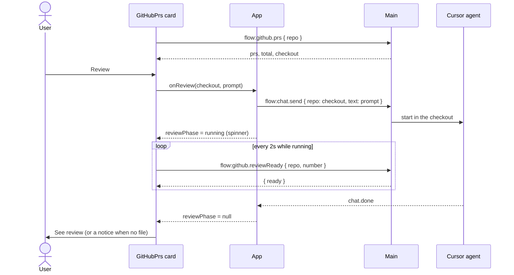

# Review button on pull request cards

## Overview

A pull request card you have not approved gets a **Review** button. One click sends the message `review pr https://github.com/<owner>/<repo>/pull/<number>` to the Cursor agent of the workspace repo that is that GitHub repo, without leaving the Pull requests pane. While that run is in flight the card shows a spinner. As soon as `pr-reviews/<number>.md` exists in the checkout, the card shows a **See review** link that opens it (the link that today is called **Review notes**).

This plan expands `~/.cursor/plans/pr_card_review_491651a1.plan.md` into steps with code. Each step leaves the project type-checking.

**Changes from the draft plan** (each one has a reason):
- No `flow:github.checkout` command. The card needs the workspace repo name before the user clicks, so it can hide Review for a repo with no local checkout. `flow:github.prs` returns it as `checkout` instead, so there is one fewer command and one fewer round trip.
- The spinner is derived from the chat state the app already keeps (`ChatSlice.chatState` plus `lastUserText`), not from a second copy of the run in the card. That is why it survives leaving the pane and coming back, and why the card needs no event listener of its own.

**Out of scope:**
- Writing to GitHub. Mango sends a chat message only. The `pr-review` skill itself says it never posts to GitHub.
- A new agent, a new chat, or a second chat per repo (D-5: one chat per repo). The review runs in that repo's chat and shows up there.
- Showing the review inside the card or rendering the markdown. **See review** opens the file in the system app, as `flow:github.openReview` does now.
- A Review button on the Projects board.
- Changing the `pr-review` skill, or installing it.
- A live run against real GitHub. That stays a manual check.

**Implements / relates to:** D-1 (main owns authority; the window sends only names and numbers), D-5 (one chat per repo), D-9 (`Result` envelope), D-10 (reducer, no state library), D-13 (Agent or Plan mode), D-17 (GitHub read-only). Adds decision **D-18** and open question **Q-8** (written in the last step). No new dependency.

**Assumption:** the user has the `pr-review` skill where the agent can load it (`~/.cursor/skills/pr-review/`) and `gh` signed in. If the skill is missing, the agent still gets the text `review pr <url>` and may answer in the chat without saving a file. The card then shows no link, and says so when the run ends (Step 5). See Q-8.

**Assumption:** the run uses the Agent or Plan mode chosen in Setup. In Plan mode the agent cannot write `pr-reviews/<number>.md`, so no link appears. The end-of-run notice names that.

## Pros / Cons

**Pros**
- Reuses the whole chat path (`flow:chat.send`, the 7-agent cap, the busy message, events, history). No new run machinery in main.
- The window still sends no URL and no path: the prompt is built from a name that passes `isRepoFullName`, and the file is opened by main from `{ repo, number }`.
- The spinner state has one source (the chat slice), so it cannot disagree with the sidebar or the chat.
- `reviewReady` reads the disk only. Polling every 2 seconds costs no GitHub request and no token use.

**Cons**
- The review lives in the repo's single chat. A user who is chatting in that repo has to wait, or stop that run, before Review works (the existing "already has a running agent" message).
- Detecting "this card is the one running" compares the last user message text to the prompt. A user who types the exact same text into that chat gets the same spinner. That is acceptable: it is the same request.
- The Review button needs a local checkout whose `origin` is that GitHub repo. A repo with no checkout in the workspace folder has no button.

## How It Works

The Pull requests pane already lists open PRs per picked repo and shows **Review notes** when `pr-reviews/<number>.md` exists. This change adds a Review button next to it. The button starts the agent through the same call the chat box uses. Everything after that is read from state the app already has: while that repo's chat is running the exact review message, the card shows a spinner. A cheap disk check every 2 seconds tells the card when the file is saved.

### Flow: start a review
1. `flow:github.prs` returns each PR plus `checkout`, the workspace repo name (`.` or a child folder) whose `origin` is this repo, or `null`.
2. The card shows **Review** when `approvedByYou` is false, `checkout` is not null, and no review of this PR is running.
3. Click: the pane calls `onReview(checkout, "review pr <url>")`. `App` refuses with the existing messages when that repo is busy or 7 repos are busy. Otherwise it calls `sendRepo`, which dispatches `sending`, so that repo's slice becomes `streaming` with `lastUserText` set. The card re-renders with a spinner.
4. A failed send returns its error text. The pane shows it in the existing notice line. No draft is put in the chat box.

### Flow: finish
1. While any card is running, the pane calls `flow:github.reviewReady { repo, number }` every 2 seconds. When it returns `ready: true`, the card shows **See review** (no refetch of the PR list).
2. When the run ends (`chatState` leaves `streaming`/`stopping`/`awaitingAnswer`), the card's spinner goes away on its own. The pane checks once more. If the file still is not there, it shows a notice: the run ended without saving the file, and Plan mode cannot write files.
3. If the agent asks a question, the card shows **Answer in the chat** instead of the spinner. It opens that repo's chat through `openChat`.

### Flow: leave and come back
1. Leaving the pane unmounts it, but the run continues in main and `App` keeps applying events.
2. On return, the pane asks `App` to load that repo's chat if its list row says it is busy and the slice is not loaded (`onWatch`). Once loaded, `lastUserText` is the last user message, so the spinner returns.



**Example:** the workspace folder has `mango/` whose origin is `git@github.com:octo/hello.git`. The pane for `octo/hello` shows PR #5 not approved by you. `prs` returns `checkout: "mango"`. Click Review: `chat.send { repo: "mango", text: "review pr https://github.com/octo/hello/pull/5" }`. The card spins. The agent writes `mango/pr-reviews/5.md`. Within 2 seconds the card shows **See review**. The run ends and the spinner goes.

## Current State Analysis

**✅ Exists**
- `src/renderer/GitHubPrs.tsx`: PR cards, per-repo cache, `notice` line, **Review notes** link calling `flow:github.openReview`.
- `src/main/pr-review-file.ts`: `localRepoPath`, `existingReviewFile`, `isSavedReviewPath`. `src/main/index.ts` already wires `reviewFile` and `openPath` into `createGithubService`.
- `src/main/github-service.ts`: `prs()` sets `hasReview`; `openReview()`; `GithubError`; `GithubOptions.reviewFile`.
- `src/shared/ipc.ts`: `GithubPrSchema` (`approvedByYou`, `hasReview`), `GithubPrsResultSchema`, `flow:github.openReview`, `RepoNameSchema`, `RepoFullNameSchema`.
- `src/shared/github.ts`: `itemUrl`, `isRepoFullName`.
- `src/renderer/App.tsx`: `sendRepo`, `loadRepo`, `openChat`, `busyRepoNames`, the busy messages, `stateRef`, and the `GitHubPrs` pane render.
- `src/renderer/state.ts`: `ChatSlice.chatState`, `lastUserText`, `isBusyState`; the `sending` action sets both.
- `src/renderer/styles.css`: `@keyframes spin`, `.gh-review-link`, `.ticket-chip`, `.btn`.
- `scripts/github-check.ts`: fakes for `fetch`, `safeStorage`, temp dirs, `isError`, `chat()`, `app()`.

**❌ Missing Components**
- `reviewPrompt(repo, number)` in `src/shared/github.ts`.
- `localRepoName` in `src/main/pr-review-file.ts`.
- `checkout` on `GithubPrsResult`; the `flow:github.reviewReady` command; `localRepoName` option and `reviewReady()` on the GitHub service; handler case; `index.ts` wiring.
- `reviewPhase` helper in `src/renderer/state.ts`.
- `sendRepo` returning its failure; `startReview` and `watchRepo` in `App.tsx`; new props on `GitHubPrs`.
- Review button, spinner, **See review**, **Answer in the chat**, polling, and the end-of-run notice in `GitHubPrs.tsx`.
- Spinner and button styles.
- Docs: `flow:github.openReview` and `flow:github.reviewReady` rows, the PR row fields, D-18, Q-8.

## Implementation Steps

### Step 1: Shared prompt builder and checkout-name lookup
- **Files:** `src/shared/github.ts`, `src/main/pr-review-file.ts`, `scripts/github-check.ts`
- **Change:** One pure function that builds the review message from a clean repo name and number, and one that finds the workspace repo name for a GitHub repo. Both are pure and tested.

**Code**

`src/shared/github.ts` (modify: add after `itemUrl`)
```ts
/** The message a Review button sends to the repo's agent, or null when the repo or the number is not acceptable. */
export function reviewPrompt(repo: string, number: number): string | null {
  const url = itemUrl(repo, "pr", number);
  return url === null ? null : `review pr ${url}`;
}
```

`src/main/pr-review-file.ts` (modify: add after `localRepoPath`)
```ts
/** The workspace repo name (`.` or a child folder) whose origin is `fullName`, or null. */
export function localRepoName(fullName: string, repos: readonly { name: string; path: string }[]): string | null {
  for (const repo of repos) {
    if (originFullName(repo.path) === fullName) return repo.name;
  }
  return null;
}
```

`scripts/github-check.ts` (modify imports)

Before
```ts
import {
  existingReviewFile,
  githubFullNameFromRemote,
  localRepoPath,
  originFullName,
} from "../src/main/pr-review-file.ts";
```

After
```ts
import {
  existingReviewFile,
  githubFullNameFromRemote,
  localRepoName,
  localRepoPath,
  originFullName,
} from "../src/main/pr-review-file.ts";
```

Before
```ts
  relativeTime,
  reviewLabel,
  reviewState,
  shortRepoName,
} from "../src/shared/github.ts";
```

After
```ts
  relativeTime,
  reviewLabel,
  reviewPrompt,
  reviewState,
  shortRepoName,
} from "../src/shared/github.ts";
```

`scripts/github-check.ts` (new test, after the test named "an item URL is built from a clean repo and a positive number")
```ts
test("the Review button sends review pr <url>, only for a clean repo and number", () => {
  assert.equal(reviewPrompt("octo/hello", 12), "review pr https://github.com/octo/hello/pull/12");
  assert.equal(reviewPrompt("octo/..", 12), null);
  assert.equal(reviewPrompt("evil.example/x?y", 12), null);
  assert.equal(reviewPrompt("octo/hello", 0), null);
  assert.equal(reviewPrompt("octo/hello", 1.5), null);
});
```

`scripts/github-check.ts` (modify the test "the review file is pr-reviews/<number>.md in the checkout whose origin matches", right after the line `assert.equal(localRepoPath("octo/missing", [{ path: match }]), null);`)
```ts
  assert.equal(
    localRepoName("octo/hello", [
      { name: "other", path: other },
      { name: "hello", path: match },
    ]),
    "hello",
  );
  assert.equal(localRepoName("octo/missing", [{ name: "hello", path: match }]), null);
  assert.equal(localRepoName("octo/hello", []), null);
```

Verify: `npm run typecheck && npm run check:github`

### Step 2: `checkout` on the PR list and the `reviewReady` command
- **Files:** `src/shared/ipc.ts`, `src/main/github-service.ts`, `src/main/ipc.ts`, `src/main/index.ts`, `scripts/github-check.ts`
- **Change:** `flow:github.prs` also returns the workspace repo name. A new `flow:github.reviewReady` says whether the review file exists, from disk only. The `switch` in `ipc.ts` ends in `assertNever`, so the contract, service, handler, and wiring must change in the same step.

**Code**

`src/shared/ipc.ts` (modify `GithubPrsResultSchema`)

Before
```ts
export const GithubPrsResultSchema = z.object({
  prs: z.array(GithubPrSchema),
  /** Open pull requests in the repo. More than `prs.length` when GitHub has more than one page. */
  total: z.number().int().min(0),
});
```

After
```ts
export const GithubPrsResultSchema = z.object({
  prs: z.array(GithubPrSchema),
  /** Open pull requests in the repo. More than `prs.length` when GitHub has more than one page. */
  total: z.number().int().min(0),
  /** The workspace repo name (`.` or a child folder) whose origin is this repo. Null when the workspace has no such checkout. */
  checkout: RepoNameSchema.nullable(),
});
```

`src/shared/ipc.ts` (modify `COMMANDS`: add after `"flow:github.openReview"`)
```ts
  "flow:github.reviewReady": {
    input: z
      .object({
        repo: RepoFullNameSchema,
        number: z.number().int().min(1).max(999_999_999),
      })
      .strict(),
    output: z.object({ ready: z.boolean() }),
  },
```

`src/main/github-service.ts` (modify the `GithubService` type: add after `openReview`)
```ts
  /** True when pr-reviews/<number>.md is a saved review in the local checkout. Reads the disk only, never GitHub. */
  reviewReady(input: { repo: string; number: number }): { ready: boolean };
```

`src/main/github-service.ts` (modify `GithubOptions`: add after `reviewFile`)
```ts
  /** The workspace repo name whose origin is `repo`, or null when the workspace has no such checkout. */
  localRepoName?(repo: string): string | null;
```

`src/main/github-service.ts` (modify the return of `prs()`)

Before
```ts
    return {
      total: page.total,
      prs: page.prs.map((pr) => ({
        ...pr,
        hasReview: savedReview(options.reviewFile?.(input.repo, pr.number) ?? null, pr.number),
      })),
    };
```

After
```ts
    return {
      total: page.total,
      checkout: options.localRepoName?.(input.repo) ?? null,
      prs: page.prs.map((pr) => ({
        ...pr,
        hasReview: savedReview(options.reviewFile?.(input.repo, pr.number) ?? null, pr.number),
      })),
    };
```

`src/main/github-service.ts` (new function inside `createGithubService`, after `openReview`)
```ts
  function reviewReady(input: { repo: string; number: number }): { ready: boolean } {
    if (!isRepoFullName(input.repo) || !load().selectedRepos.includes(input.repo)) {
      throw new GithubError("invalid_input", "Pick that repository in Setup first.", false);
    }
    return { ready: savedReview(options.reviewFile?.(input.repo, input.number) ?? null, input.number) };
  }
```

`src/main/github-service.ts` (modify the returned object at the end of `createGithubService`)

Before
```ts
    open,
    openReview,
    openTokenPage,
  };
```

After
```ts
    open,
    openReview,
    reviewReady,
    openTokenPage,
  };
```

`src/main/ipc.ts` (modify `run`: add after the `flow:github.openReview` case)
```ts
    case "flow:github.reviewReady":
      return github.reviewReady(input as InputOf<"flow:github.reviewReady">) as OutputOf<C>;
```

`src/main/index.ts` (modify imports and the `createGithubService` call)

Before
```ts
import { existingReviewFile, localRepoPath } from "./pr-review-file.js";
```

After
```ts
import { existingReviewFile, localRepoName, localRepoPath } from "./pr-review-file.js";
```

Before
```ts
    // reviewFile only returns <checkout>/pr-reviews/<number>.md. openPath receives that path.
    reviewFile: (repo, number) => {
      const current = store.view();
      if (current.folder === null || current.folderMissing) return null;
      const checkout = localRepoPath(repo, store.listRepos(current.folder));
      if (checkout === null) return null;
      return existingReviewFile(checkout, number);
    },
```

After
```ts
    // reviewFile only returns <checkout>/pr-reviews/<number>.md. openPath receives that path.
    reviewFile: (repo, number) => {
      const checkout = localRepoPath(repo, workspaceRepos());
      if (checkout === null) return null;
      return existingReviewFile(checkout, number);
    },
    // Only the repo name (`.` or a child folder) leaves main. The window never gets a path.
    localRepoName: (repo) => localRepoName(repo, workspaceRepos()),
```

`src/main/index.ts` (modify `start()`: add right after `const files = createRulesSkills();`)
```ts
  const workspaceRepos = () => {
    const current = store.view();
    if (current.folder === null || current.folderMissing) return [];
    return store.listRepos(current.folder);
  };
```

`scripts/github-check.ts` (new test, after the test "a saved pr-reviews/<number>.md is marked on the card and opened")
```ts
test("a card knows its workspace checkout, and whether the review file is saved yet", async () => {
  const notes = path.join(tempDir(), "checkout", "pr-reviews", "5.md");
  let saved = false;
  const service = createGithubService({
    userDataDir: tempDir(),
    secrets: box,
    fetch: fakeFetch((call) => viewerOr(call, () => ({ status: 200, body: PR_BODY })), []),
    openExternal: async () => {},
    localRepoName: (repo) => (repo === "octo/hello" ? "hello" : null),
    reviewFile: (_repo, number) => (number === 5 && saved ? notes : null),
  });
  await service.saveRepoToken({ token: REPO_TOKEN });
  service.selectRepos({ repos: ["octo/hello", "octo/lonely"] });

  assert.equal((await service.prs({ repo: "octo/hello" })).checkout, "hello");
  assert.equal((await service.prs({ repo: "octo/lonely" })).checkout, null);

  assert.deepEqual(service.reviewReady({ repo: "octo/hello", number: 5 }), { ready: false });
  saved = true;
  assert.deepEqual(service.reviewReady({ repo: "octo/hello", number: 5 }), { ready: true });
  assert.deepEqual(service.reviewReady({ repo: "octo/hello", number: 6 }), { ready: false });
  assert.throws(() => service.reviewReady({ repo: "octo/other", number: 5 }), isError("invalid_input"));
  assert.throws(() => service.reviewReady({ repo: "octo/..", number: 5 }), isError("invalid_input"));

  const bare = await repoService(() => ({ status: 200, body: PR_BODY }));
  bare.service.selectRepos({ repos: ["octo/hello"] });
  assert.equal((await bare.service.prs({ repo: "octo/hello" })).checkout, null);
  assert.deepEqual(bare.service.reviewReady({ repo: "octo/hello", number: 5 }), { ready: false });
});
```

`scripts/github-check.ts` (modify the test "the GitHub commands refuse input the window should never send": add after the `openReview` assertions)
```ts
  const reviewReady = COMMANDS["flow:github.reviewReady"].input;
  assert.equal(reviewReady.safeParse({ repo: "octo/hello", number: 69 }).success, true);
  assert.equal(reviewReady.safeParse({ repo: "octo/hello", number: 0 }).success, false);
  assert.equal(reviewReady.safeParse({ repo: "octo/..", number: 69 }).success, false);
  assert.equal(reviewReady.safeParse({ repo: "octo/hello", number: 69, file: "/tmp/x.md" }).success, false);
```

Verify: `npm run typecheck && npm run check:github`

### Step 3: `reviewPhase`, the one place that says a card is reviewing
- **Files:** `src/renderer/state.ts`, `scripts/github-check.ts`
- **Change:** A pure helper over a chat slice. It returns `"running"` while that repo's chat runs exactly the review message, `"asking"` while the agent waits for an answer, otherwise `null`. The card and its tests share it.

**Code**

`src/renderer/state.ts` (modify: add after `isBusyState`)
```ts
export type ReviewPhase = "running" | "asking";

/**
 * Whether a repo's chat is running exactly `prompt` right now. A Review card uses this for its spinner,
 * so the card and the sidebar read the same slice. `stopping` still counts as running.
 */
export function reviewPhase(slice: ChatSlice | undefined, prompt: string): ReviewPhase | null {
  if (slice === undefined || slice.lastUserText !== prompt) return null;
  if (slice.chatState === "awaitingAnswer") return "asking";
  if (slice.chatState === "streaming" || slice.chatState === "stopping") return "running";
  return null;
}
```

`scripts/github-check.ts` (modify the import from `../src/renderer/state.ts`)

Before
```ts
import {
  emptySlice,
  initialState,
  reducer,
  screenOf,
  sidebarRows,
  type AppState,
  type ChatSlice,
} from "../src/renderer/state.ts";
```

After
```ts
import {
  emptySlice,
  initialState,
  reducer,
  reviewPhase,
  screenOf,
  sidebarRows,
  type AppState,
  type ChatSlice,
} from "../src/renderer/state.ts";
```

`scripts/github-check.ts` (new test, at the end of the file)
```ts
test("a card is reviewing while its checkout runs that exact review message", () => {
  const prompt = "review pr https://github.com/octo/hello/pull/5";
  assert.equal(reviewPhase(undefined, prompt), null);
  assert.equal(reviewPhase(chat({ chatState: "streaming", lastUserText: prompt }), prompt), "running");
  assert.equal(reviewPhase(chat({ chatState: "stopping", lastUserText: prompt }), prompt), "running");
  assert.equal(reviewPhase(chat({ chatState: "awaitingAnswer", lastUserText: prompt }), prompt), "asking");
  assert.equal(reviewPhase(chat({ chatState: "ready", lastUserText: prompt }), prompt), null);
  assert.equal(reviewPhase(chat({ chatState: "needsSetup", lastUserText: prompt }), prompt), null);
  assert.equal(reviewPhase(chat({ chatState: "streaming", lastUserText: "fix the build" }), prompt), null);
  assert.equal(
    reviewPhase(
      chat({ chatState: "streaming", lastUserText: "review pr https://github.com/octo/hello/pull/6" }),
      prompt,
    ),
    null,
  );

  const sent = reducer(app(), { type: "sending", repo: "api", text: prompt });
  assert.equal(reviewPhase(sent.chats.api, prompt), "running");
  assert.equal(reviewPhase(sent.chats.web, prompt), null);
  const done = reducer(
    reducer(sent, { type: "event", event: { type: "chat.state", repo: "api", runId: "session", state: "ready" } }),
    { type: "close-github-prs" },
  );
  assert.equal(reviewPhase(done.chats.api, prompt), null);
});
```

Verify: `npm run typecheck && npm run check:github`

### Step 4: `App` starts the review and keeps the chat loaded
- **Files:** `src/renderer/App.tsx`
- **Change:** `sendRepo` returns its failure and can skip restoring a draft. `startReview` applies the same busy checks as New chat, then sends. `watchRepo` loads a busy repo's chat so the spinner survives leaving the pane. Both are passed to `GitHubPrs`.

**Code**

`src/renderer/App.tsx` (modify the imports)

Before
```tsx
  type Answers,
  type ChatStateName,
  type FlowEvent,
```

After
```tsx
  type Answers,
  type ChatStateName,
  type Failure,
  type FlowEvent,
```

Before
```tsx
import { anyBusy, bannerFor, busyRepoNames, canRetry, emptySlice, initialState, isBusyState, reducer, screenOf, shouldLeaveAfterReset, sidebarRows, type Banner, type PaneKey } from "./state.js";
```

After
```tsx
import { anyBusy, bannerFor, busyRepoNames, canRetry, emptySlice, initialState, isBusyState, reducer, reviewPhase, screenOf, shouldLeaveAfterReset, sidebarRows, type Banner, type PaneKey } from "./state.js";
```

`src/renderer/App.tsx` (modify `sendRepo`: new signature, the failure branch, and the two returns)

Before
```tsx
  async function sendRepo(repo: string, text: string): Promise<void> {
    const box = bucket(repo);
```

After
```tsx
  /** Resolves to the failure, or null when the run started. `restoreDraft: false` keeps the failed text out of the chat box. */
  async function sendRepo(repo: string, text: string, options: { restoreDraft?: boolean } = {}): Promise<Failure | null> {
    const box = bucket(repo);
```

Before
```tsx
      if (!messages.some((message) => message.role === "user" && message.text === text)) {
        dispatch({ type: "draft", repo, draft: text });
      }
      replayHold(queued);
      return;
    }
```

After
```tsx
      if (options.restoreDraft !== false && !messages.some((message) => message.role === "user" && message.text === text)) {
        dispatch({ type: "draft", repo, draft: text });
      }
      replayHold(queued);
      return result.error;
    }
```

Before
```tsx
      text,
      restored: result.value.restored,
    });
    replayHold(queued);
  }
```

After
```tsx
      text,
      restored: result.value.restored,
    });
    replayHold(queued);
    return null;
  }

  /** The Review button on a pull request card. Resolves to an error text, or null when the run started. */
  async function startReview(repo: string, text: string): Promise<string | null> {
    const running = busyRepoNames(stateRef.current);
    if (running.includes(repo)) return busyRepoMessage(repo);
    if (running.length >= MAX_BUSY_REPOS) return BUSY_CAP_MESSAGE;
    if (stateRef.current.chats[repo]?.loaded !== true) {
      const loaded = await loadRepo(repo);
      if (loaded !== null && isBusyState(loaded)) return busyRepoMessage(repo);
    }
    const failure = await sendRepo(repo, text, { restoreDraft: false });
    return failure === null ? null : failure.message;
  }

  /** The pull request pane shows a spinner from that repo's chat, so a repo already running needs its chat loaded. */
  function watchRepo(repo: string): void {
    const row = stateRef.current.repos.find((item) => item.name === repo);
    if (row === undefined || !isBusyState(row.state)) return;
    if (stateRef.current.chats[repo]?.loaded === true) return;
    void loadRepo(repo);
  }
```

`src/renderer/App.tsx` (modify the `githubPrsPane` constant)

Before
```tsx
  const githubPrsPane = (
    <GitHubPrs
      status={github}
      onBack={() => dispatch({ type: "close-github-prs" })}
      onSetup={() => dispatch({ type: "edit-setup" })}
    />
  );
```

After
```tsx
  const githubPrsPane = (
    <GitHubPrs
      status={github}
      onBack={() => dispatch({ type: "close-github-prs" })}
      onSetup={() => dispatch({ type: "edit-setup" })}
      reviewPhase={(checkout, prompt) => reviewPhase(state.chats[checkout], prompt)}
      onReview={startReview}
      onOpenChat={(checkout) => void openChat(checkout)}
      onWatch={watchRepo}
    />
  );
```

The three existing callers (`await sendRepo(parsed.repo, parsed.text)`, `void sendRepo(repo, slice.lastUserText)`, `void sendRepo(repoName, text)`) keep working: the new return value is ignored there and `restoreDraft` defaults to restoring.

Verify: do not run `npm run typecheck` yet. `GitHubPrs` does not accept the four new props until Step 5, so Steps 4 and 5 are applied together and checked once, at the end of Step 5.

### Step 5: Review button, spinner, See review, and notice on the card
- **Files:** `src/renderer/GitHubPrs.tsx`
- **Change:** `Load` keeps `checkout`. The pane renders the new actions, polls `reviewReady` while any review runs, remembers saved numbers so the link appears without a refetch, and shows a notice when a run ends with no file.

**Code**

`src/renderer/GitHubPrs.tsx` (modify the imports and add the helpers; replaces the first block of the file down to `prLoad`)

Before
```tsx
import { useEffect, useRef, useState } from "react";
import {
  ciLabel,
  prsReady,
  relativeTime,
  reviewLabel,
  shortRepoName,
} from "../shared/github.js";
import type { GithubPr, GithubPrsResult, GithubStatus, Result } from "../shared/ipc.js";

type Load =
  | { kind: "loading" }
  | { kind: "ready"; prs: GithubPr[]; total: number }
  | { kind: "error"; message: string; retryable: boolean };

type GitHubPrsProps = {
  status: GithubStatus | null;
  onBack: () => void;
  onSetup: () => void;
};

function prLoad(result: Result<GithubPrsResult>): Load {
  return result.ok
    ? { kind: "ready", prs: result.value.prs, total: result.value.total }
    : { kind: "error", message: result.error.message, retryable: result.error.retryable };
}
```

After
```tsx
import { useEffect, useRef, useState } from "react";
import {
  ciLabel,
  prsReady,
  relativeTime,
  reviewLabel,
  reviewPrompt,
  shortRepoName,
} from "../shared/github.js";
import type { GithubPr, GithubPrsResult, GithubStatus, Result } from "../shared/ipc.js";
import type { ReviewPhase } from "./state.js";

const REVIEW_POLL_MS = 2_000;

type Load =
  | { kind: "loading" }
  | { kind: "ready"; prs: GithubPr[]; total: number; checkout: string | null }
  | { kind: "error"; message: string; retryable: boolean };

type GitHubPrsProps = {
  status: GithubStatus | null;
  onBack: () => void;
  onSetup: () => void;
  /** Whether that workspace repo is running exactly this review message right now. */
  reviewPhase: (checkout: string, prompt: string) => ReviewPhase | null;
  /** Sends the review message to that workspace repo's agent. Resolves to an error text, or null when the run started. */
  onReview: (checkout: string, text: string) => Promise<string | null>;
  /** Opens that workspace repo's chat. */
  onOpenChat: (checkout: string) => void;
  /** Called when a tab shows a checkout, so a run already in progress there can be picked up. */
  onWatch: (checkout: string) => void;
};

type RunningReview = { repo: string; number: number };

function prLoad(result: Result<GithubPrsResult>): Load {
  return result.ok
    ? { kind: "ready", prs: result.value.prs, total: result.value.total, checkout: result.value.checkout }
    : { kind: "error", message: result.error.message, retryable: result.error.retryable };
}

function noteKey(repo: string, number: number): string {
  return `${repo}#${number}`;
}
```

`src/renderer/GitHubPrs.tsx` (modify the component signature)

Before
```tsx
export function GitHubPrs({ status, onBack, onSetup }: GitHubPrsProps) {
```

After
```tsx
export function GitHubPrs({ status, onBack, onSetup, reviewPhase, onReview, onOpenChat, onWatch }: GitHubPrsProps) {
```

`src/renderer/GitHubPrs.tsx` (modify the state block: add after `const flights = useRef(...)`)
```tsx
  const [saved, setSaved] = useState<ReadonlySet<string>>(() => new Set());
  const wasRunning = useRef(new Map<string, RunningReview>());
```

`src/renderer/GitHubPrs.tsx` (modify: add after `const current = active === null ? undefined : loads[active];`)
```tsx
  const activeCheckout = current?.kind === "ready" ? current.checkout : null;

  // Every review that is running now, over every loaded tab.
  const running: RunningReview[] = [];
  for (const repo of repos) {
    const load = loads[repo];
    if (load?.kind !== "ready" || load.checkout === null) continue;
    for (const pr of load.prs) {
      const prompt = reviewPrompt(repo, pr.number);
      if (prompt !== null && reviewPhase(load.checkout, prompt) !== null) running.push({ repo, number: pr.number });
    }
  }
  const runningKey = running.map((item) => noteKey(item.repo, item.number)).join(",");
```

`src/renderer/GitHubPrs.tsx` (new functions and effects, after the existing `useEffect` that loads PRs and before `openPr`)
```tsx
  useEffect(() => {
    if (activeCheckout !== null) onWatch(activeCheckout);
  }, [activeCheckout]);

  function markSaved(repo: string, number: number): void {
    setSaved((all) => {
      const key = noteKey(repo, number);
      if (all.has(key)) return all;
      return new Set(all).add(key);
    });
  }

  async function checkSaved(repo: string, number: number): Promise<boolean> {
    const result = await window.flow.invoke("flow:github.reviewReady", { repo, number });
    const ready = result.ok && result.value.ready;
    if (ready) markSaved(repo, number);
    return ready;
  }

  // While a review runs, look for its file every 2 seconds. This reads the disk in main, not GitHub.
  useEffect(() => {
    if (running.length === 0) return;
    const poll = (): void => {
      for (const item of running) void checkSaved(item.repo, item.number);
    };
    poll();
    const timer = window.setInterval(poll, REVIEW_POLL_MS);
    return () => window.clearInterval(timer);
  }, [runningKey]);

  // A review that stopped running: look once more, and say so when there is still no file.
  // A tab that is reloading or failed keeps its entry, so a refresh is not mistaken for the end of a run.
  useEffect(() => {
    const now = new Map(running.map((item) => [noteKey(item.repo, item.number), item] as const));
    for (const [key, item] of [...wasRunning.current]) {
      if (now.has(key) || loads[item.repo]?.kind !== "ready") continue;
      wasRunning.current.delete(key);
      void checkSaved(item.repo, item.number).then((ready) => {
        if (ready) return;
        setNotice(
          `The review of #${item.number} ended without pr-reviews/${item.number}.md. The agent cannot save a file in Plan mode.`,
        );
      });
    }
    for (const [key, item] of now) wasRunning.current.set(key, item);
  }, [runningKey, loads]);

  async function startReview(checkout: string, repo: string, number: number): Promise<void> {
    const prompt = reviewPrompt(repo, number);
    if (prompt === null) return;
    setNotice(null);
    const failure = await onReview(checkout, prompt);
    if (failure !== null) setNotice(failure);
  }
```

`src/renderer/GitHubPrs.tsx` (modify the card list in `panel()`: replaces the whole `current.prs.map(...)` block)

Before
```tsx
          {current.prs.map((pr) => (
            <li key={pr.number}>
              <div className={pr.approvedByYou ? "gh-pr approved-by-you" : "gh-pr"}>
                <button
                  type="button"
                  className="gh-pr-open"
                  title={pr.approvedByYou ? "You approved this. Open in the browser" : "Open in the browser"}
                  onClick={() => void openPr(repo, pr.number)}
                >
                  <span className="gh-pr-title">
                    <span className="ticket-key">#{pr.number}</span> {pr.title}
                  </span>
                  <span className="ticket-meta">
                    {pr.author !== "" ? <span>{pr.author}</span> : null}
                    <span>
                      {pr.headRefName} → {pr.baseRefName}
                    </span>
                    {pr.isDraft ? <span className="ticket-chip">Draft</span> : null}
                    {pr.approvedByYou ? <span className="ticket-chip gh-review-approved">You approved</span> : null}
                    {pr.review !== null ? (
                      <span className={`ticket-chip gh-review-${pr.review}`}>{reviewLabel(pr.review)}</span>
                    ) : null}
                    {pr.ci !== null ? (
                      <span className={`ticket-chip gh-ci-${pr.ci}`}>{ciLabel(pr.ci)}</span>
                    ) : null}
                    {pr.updatedAt !== "" ? <span>{relativeTime(pr.updatedAt)}</span> : null}
                  </span>
                </button>
                {pr.hasReview ? (
                  <button
                    type="button"
                    className="ticket-chip gh-review-link"
                    title={`Open pr-reviews/${pr.number}.md`}
                    onClick={() => void openReview(repo, pr.number)}
                  >
                    Review notes
                  </button>
                ) : null}
              </div>
            </li>
          ))}
```

After
```tsx
          {current.prs.map((pr) => {
            const checkout = current.checkout;
            const prompt = reviewPrompt(repo, pr.number);
            const phase = checkout === null || prompt === null ? null : reviewPhase(checkout, prompt);
            const hasNotes = pr.hasReview || saved.has(noteKey(repo, pr.number));
            const canReview = !pr.approvedByYou && checkout !== null && prompt !== null && phase === null;
            return (
              <li key={pr.number}>
                <div className={pr.approvedByYou ? "gh-pr approved-by-you" : "gh-pr"}>
                  <button
                    type="button"
                    className="gh-pr-open"
                    title={pr.approvedByYou ? "You approved this. Open in the browser" : "Open in the browser"}
                    onClick={() => void openPr(repo, pr.number)}
                  >
                    <span className="gh-pr-title">
                      <span className="ticket-key">#{pr.number}</span> {pr.title}
                    </span>
                    <span className="ticket-meta">
                      {pr.author !== "" ? <span>{pr.author}</span> : null}
                      <span>
                        {pr.headRefName} → {pr.baseRefName}
                      </span>
                      {pr.isDraft ? <span className="ticket-chip">Draft</span> : null}
                      {pr.approvedByYou ? <span className="ticket-chip gh-review-approved">You approved</span> : null}
                      {pr.review !== null ? (
                        <span className={`ticket-chip gh-review-${pr.review}`}>{reviewLabel(pr.review)}</span>
                      ) : null}
                      {pr.ci !== null ? (
                        <span className={`ticket-chip gh-ci-${pr.ci}`}>{ciLabel(pr.ci)}</span>
                      ) : null}
                      {pr.updatedAt !== "" ? <span>{relativeTime(pr.updatedAt)}</span> : null}
                    </span>
                  </button>
                  <div className="gh-pr-actions">
                    {phase === "running" ? (
                      <span className="gh-review-busy" role="status">
                        <span className="gh-spinner" aria-hidden="true" />
                        Reviewing…
                      </span>
                    ) : null}
                    {phase === "asking" && checkout !== null ? (
                      <button
                        type="button"
                        className="ticket-chip gh-review-link"
                        title="The agent is waiting for an answer"
                        onClick={() => onOpenChat(checkout)}
                      >
                        Answer in the chat
                      </button>
                    ) : null}
                    {hasNotes ? (
                      <button
                        type="button"
                        className="ticket-chip gh-review-link"
                        title={`Open pr-reviews/${pr.number}.md`}
                        onClick={() => void openReview(repo, pr.number)}
                      >
                        See review
                      </button>
                    ) : null}
                    {canReview ? (
                      <button
                        type="button"
                        className="btn gh-review-start"
                        title="Ask this repo's agent to review the pull request"
                        onClick={() => void startReview(checkout, repo, pr.number)}
                      >
                        Review
                      </button>
                    ) : null}
                  </div>
                </div>
              </li>
            );
          })}
```
`scripts/github-check.ts`: the renderer has no test runner, so this step is covered by Step 3's `reviewPhase` test, Step 2's service test, and the manual check in the Testing Checklist.

Verify: `npm run typecheck` (this also type-checks Step 4's new props)

### Step 6: Spinner and button styles
- **Files:** `src/renderer/styles.css`
- **Change:** Lay the card's actions out in a row, size the Review button like the other chips, draw a spinner with the existing `spin` keyframes, and stop the motion for users who ask for reduced motion.

**Code**

`src/renderer/styles.css` (modify: add right after the `.gh-review-link { ... }` rule)
```css
.gh-pr-actions {
  flex: none;
  display: flex;
  align-items: center;
  gap: 8px;
}
.gh-review-start {
  font-size: 12px;
  padding: 2px 10px;
}
.gh-review-busy {
  display: inline-flex;
  align-items: center;
  gap: 6px;
  color: var(--muted);
  font-size: 12px;
}
.gh-spinner {
  width: 12px;
  height: 12px;
  border: 2px solid var(--line);
  border-top-color: var(--accent);
  border-radius: 50%;
  animation: spin .8s linear infinite;
}
@media (prefers-reduced-motion: reduce) {
  .gh-spinner { animation: none; border-color: var(--accent); }
}
```

Verify: `npm run typecheck`, then `npm run build`

### Step 7: Update Documentation (always the last step)

See "Documentation Update" below.

## Edge Cases
- **No local checkout for that GitHub repo:** `checkout` is `null`, no Review button. The card still shows **See review** if a file is somehow present (it cannot be: the file is looked up in the checkout, so `hasReview` is false too).
- **The checkout is busy** (the user is chatting there, or another review is running): `startReview` returns the existing text, "`<repo>` already has a running agent. Open it or stop it first.", shown in the notice line.
- **Seven repos busy:** `startReview` returns the existing cap message.
- **Key missing, setup not complete, folder missing:** `flow:chat.send` returns `not_ready`/`auth`. The text appears in the notice line, and `sendRepo` also puts its usual banner on that repo's chat. No draft is put in the chat box (`restoreDraft: false`).
- **Plan mode, or the `pr-review` skill is not loaded:** the run ends with no `pr-reviews/<number>.md`. The pane shows "The review of #N ended without pr-reviews/N.md. The agent cannot save a file in Plan mode." This text also covers a skill that was not loaded; see Q-8.
- **The user stops the run in the chat:** `chatState` leaves `stopping`, the spinner goes, one last `reviewReady` runs, and the same notice shows if no file exists.
- **The agent asks a question:** `chatState` is `awaitingAnswer`, the card shows **Answer in the chat**, polling continues. The answer happens in the chat.
- **A file already exists and the user clicks Review again:** **See review** stays visible during the run and still opens the old file until the agent overwrites it. Accepted: the file is replaced in place.
- **The PR was approved in the meantime:** the next refresh sets `approvedByYou`, and Review disappears. A running review keeps its spinner.
- **Refresh while a review runs:** the tab goes to `loading`. `wasRunning` keeps that tab's entries until it is `ready` again, so the refresh is not read as the end of the run. After the reload `reviewPhase` returns the same answer.
- **The PR leaves the open list while its review runs** (merged or closed, then Refresh): the entry drops out of `running`, and the pane checks once and may show the "ended without" notice. Accepted; the run itself is not affected.
- **Leave the pane and return:** `onWatch` loads that repo's chat when its row is busy. Until that load finishes the card has no spinner.
- **Window reload:** `App` boot loads a single repo only. `onWatch` does the same for the repos in the pane.
- **Symlinked or foreign review file:** `reviewReady` uses the same `existingReviewFile` check as `hasReview` (regular file inside the checkout, `pr-reviews/<number>.md`).
- **Polling cost:** each poll lists the workspace repos (`store.listRepos`) and reads `.git/config`, once per running card every 2 seconds. Reviews are few (at most 7 repos run at once). No GitHub request.
- **Placeholders for the user:** none. Open question Q-8 (does the SDK agent load `~/.cursor/skills/pr-review`?) needs a manual run.

## Testing Checklist
- [ ] `npm run typecheck` passes
- [ ] `npm run check:github` passes (new: `reviewPrompt`, `localRepoName`, `checkout`, `reviewReady`, command schemas, `reviewPhase`)
- [ ] `npm run check:repos`, `npm run check:sidebar` still pass (the `state.ts` change is additive)
- [ ] `npm run build` succeeds
- [ ] Manual: a not-approved PR in a repo with a local checkout shows **Review**. An approved PR does not. A repo with no checkout has none
- [ ] Manual: click Review. The card shows the spinner at once, the sidebar shows that repo running, and the chat shows the user message `review pr https://github.com/<owner>/<repo>/pull/<n>`
- [ ] Manual: when the agent saves `pr-reviews/<n>.md`, **See review** appears within about 2 seconds and opens the file. The spinner goes when the run ends
- [ ] Manual: go Back to the chat during the run and return to Pull requests. The spinner is still there
- [ ] Manual: click Review while that repo's chat is already running. The notice says the repo has a running agent
- [ ] Manual: stop the run from the chat. The spinner goes and the "ended without" notice shows
- [ ] Manual: in Plan mode, run a review. The notice mentions Plan mode
- [ ] Manual: Refresh during a run. No false "ended" notice
- [ ] Manual: with `prefers-reduced-motion`, the spinner is a still ring with the text "Reviewing…"

## Files to Modify
- [ ] `src/shared/github.ts`
- [ ] `src/shared/ipc.ts`
- [ ] `src/main/pr-review-file.ts`
- [ ] `src/main/github-service.ts`
- [ ] `src/main/ipc.ts`
- [ ] `src/main/index.ts`
- [ ] `src/renderer/state.ts`
- [ ] `src/renderer/App.tsx`
- [ ] `src/renderer/GitHubPrs.tsx`
- [ ] `src/renderer/styles.css`
- [ ] `scripts/github-check.ts`
- [ ] `docs/ipc-contract.md`
- [ ] `docs/architecture.md`
- [ ] `docs/decisions.md`
- [ ] `README.md`

## Implementation Order
1. Step 1 (shared prompt builder, `localRepoName`)
2. Step 2 (`checkout`, `reviewReady`, wiring in main; the contract and the handler must land together)
3. Step 3 (`reviewPhase`)
4. Steps 4 and 5 together (`App` props and `GitHubPrs`; typecheck after both)
5. Step 6 (styles)
6. Step 7 (Update Documentation, always last)

## Documentation Update

### Step 7: Update Documentation (always the last step)

**Affected documents**

| Document | What changes | Status |
|----------|--------------|--------|
| `docs/ipc-contract.md` | Fix the `flow:github.prs` row (it lacks `approvedByYou` and `hasReview` today, and gains `checkout`). Add rows for `flow:github.openReview` (shipped, never documented) and `flow:github.reviewReady` | todo |
| `docs/architecture.md` | The Pull requests pane paragraph gains the Review button, the spinner, and the See review link. The `github-service.ts` row names the checkout lookup. The security bullet says the window sends `{ repo, number }` for review commands, never a path | todo |
| `docs/decisions.md` | New D-18 and Q-8 | todo |
| `README.md` | The GitHub paragraph mentions the Review button | todo |
| `docs/README.md` | The sentence listing app features and checks mentions the Review button and the new checks in `check:github` | todo |

**Edits**

`docs/ipc-contract.md` (replace the `flow:github.prs` row)
```markdown
| `flow:github.prs` | `{ repo }` | `{ prs: { number, title, author, headRefName, baseRefName, isDraft, updatedAt, review, approvedByYou, ci, hasReview }[], total, checkout }` | One GraphQL call: the 50 most recently updated open pull requests of a picked repo. `review` is `approved`, `changes`, `required`, or null. `approvedByYou` is true when the signed-in user's latest review is an approval. `ci` is `passing`, `failing`, `pending`, or null. `hasReview` is true when the local checkout has `pr-reviews/<number>.md`. `checkout` is the workspace repo name (`.` or a child folder) whose `origin` is this repo, or null when the workspace has no such checkout; it is the `repo` the window passes to `flow:chat.send` for a Review. `invalid_input` for a repo that is not picked. `not_found` when the token cannot see the repo. `auth` for a rejected token or a missing scope |
```

`docs/ipc-contract.md` (add after the `flow:github.open` row)
```markdown
| `flow:github.openReview` | `{ repo, number }` | `{}` | Main opens the checkout's `pr-reviews/<number>.md` with the system app. The file must be a regular file inside the checkout (a symlink that leaves it is refused). `invalid_input` for a repo that is not picked. `not_found` when there is no saved review. The window cannot pass a path |
| `flow:github.reviewReady` | `{ repo, number }` | `{ ready }` | `ready` is true when `pr-reviews/<number>.md` is saved in the checkout, by the same check as `hasReview`. It reads the disk only and makes no GitHub request, so the card can poll it every 2 seconds while a review runs. `invalid_input` for a repo that is not picked |
```

`docs/architecture.md` (append to the "GitHub Pull requests" paragraph, after "each row opens the PR in the system browser.")
```markdown
 A card for a PR you have not approved has a **Review** button when `flow:github.prs` returned a `checkout` for that repo. The button calls `App.startReview`, which applies the same busy checks as New chat and then `sendRepo(checkout, "review pr <url>")`. The prompt is built by `reviewPrompt` from a name that passes `isRepoFullName`. The pane stays open. While `reviewPhase(slice, prompt)` is `running` (that repo's chat is `streaming` or `stopping` and its `lastUserText` is that prompt) the card shows a spinner, and while it is `asking` it shows **Answer in the chat**. The pane polls `flow:github.reviewReady` every 2 seconds while a review runs, and shows **See review** (`flow:github.openReview`) as soon as the file exists. When a run ends without the file, the pane says so.
```

`docs/architecture.md` (modify the `github-service.ts` row: replace "the item URL, the token-page table" with)
```markdown
the item URL, the token-page table, the workspace checkout name for a picked repo (through a callback from `index.ts`), and whether `pr-reviews/<number>.md` is saved
```

`docs/architecture.md` (append to the GitHub security bullet, after "never a URL.")
```markdown
 For a review the window sends `{ repo, number }` (`flow:github.openReview`, `flow:github.reviewReady`) or ordinary chat text through `flow:chat.send`, never a path. Main resolves the checkout and the file. Mango still writes nothing to GitHub; the agent runs the `pr-review` skill, which does not post either.
```

`docs/decisions.md` (add after D-17, before `## Open questions`)
```markdown
### D-18: A pull request card starts a review as an ordinary chat message (accepted)

A card for a pull request the user has not approved has a **Review** button, shown only when the workspace has a checkout whose `origin` is that repo. The button sends `review pr https://github.com/<owner>/<repo>/pull/<n>` to that repo's one chat through the same path as the chat box (`flow:chat.send`), so the 7-agent cap, the busy message, Agent or Plan mode, events, and history all apply. The card shows a spinner while that repo's chat is running exactly that message, read from the chat slice, not from a second run record. `flow:github.reviewReady` reports whether `pr-reviews/<n>.md` is saved, from disk only, and the card shows **See review** when it is. `flow:github.prs` returns `checkout` (the workspace repo name) so the card can decide before the click.
**Reason:** Valentin, 2026-11-06. The review is the user's own `pr-review` skill, which already saves `pr-reviews/<n>.md`. Sending its trigger phrase as a chat message adds no run machinery, no GitHub write, and no new boundary, and a review is visible in the chat like any other run.
**Rejected:** a new IPC command that starts a run (a second path past the busy and cap checks, for no gain); a separate agent or a second chat per repo (D-5); the card keeping its own run state from events (it would disagree with the sidebar after leaving the pane); polling GitHub or re-listing PRs to find the file (a token request every 2 seconds); showing the markdown in the card (the file opens in the system app, like **Review notes** did); a separate `flow:github.checkout` command (an extra round trip, and the card could not hide Review before the click).
**Accepted trade-off:** a review waits while that repo's chat is busy, and a user who types the exact review message into that chat gets the same spinner. In Plan mode the agent cannot save the file, so the card shows no link and the pane says so.
**Still open:** Q-8. A live run is a manual check.
```

`docs/decisions.md` (add a row to the Open questions table, after Q-7)
```markdown
| Q-8 | Does the SDK agent load the user-level `pr-review` skill from `~/.cursor/skills/pr-review/`, so `review pr <url>` writes `pr-reviews/<n>.md`? | **Open.** Setup says the repo's own rules and skills are loaded and the agent "may also see other instruction sources" (D-3, D-11). Check with one real run. If it is not loaded, copy the skill into the repo's `.cursor/skills/` or add it from Mango's Skills editor | Valentin |
```

`README.md` (append to the GitHub paragraph, after "...or in the chat header when the workspace has one repo.")
```markdown
 On the Pull requests pane, a PR you have not approved has a **Review** button when the workspace has a checkout of that repo. It sends `review pr <url>` to that repo's agent, shows a spinner while it runs, and shows **See review** when `pr-reviews/<number>.md` is saved (it needs your `pr-review` skill, and Agent mode, because Plan mode cannot write the file).
```

`docs/README.md` (modify the sentence about the GitHub section in the feature list: replace "optional read-only GitHub Pull requests and Projects sections (each behind its own token)" with)
```markdown
optional read-only GitHub Pull requests and Projects sections (each behind its own token, with a Review button on a pull request card that starts that repo's agent and links the saved review)
```

**Not affected**
- `docs/session-and-questions.md`: the chat state machine, the question flow, and `flow:chat.send` are unchanged. The Review button calls the existing command with ordinary text.

**Open questions**
- Open question: does the SDK agent see `~/.cursor/skills/pr-review`? Recorded as Q-8 (owner: Valentin).
- Open question: should a review that ends without a file also put a banner on that repo's chat, not only a notice on the card? Left as the card notice only (owner: Valentin).
