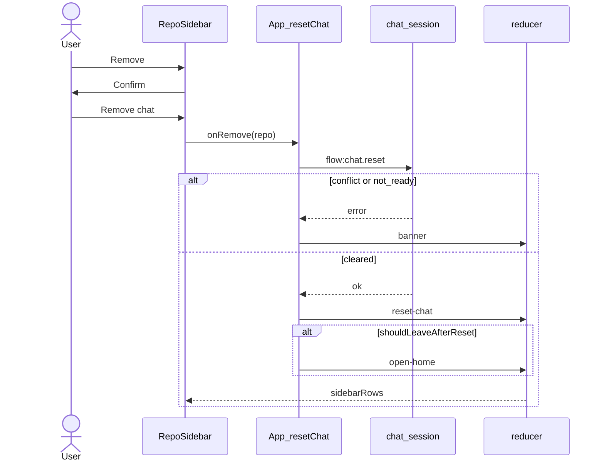

# Remove chats from the left menu

## Overview

The left menu (`RepoSidebar`) gets a Remove button on each chat. Remove asks for confirmation, then calls the existing `flow:chat.reset` for that repo. The conversation is cleared, the row leaves the list, and if that repo was on screen in a workspace with several repos the window returns to New chat.

**Out of scope:** a new IPC command, hiding a row while keeping its transcript, deleting rules or skills, a remove control on the one-repo window (that window has no left menu), and a second confirm when Rules has unsaved edits.

**Implements / relates to:** the accepted sidebar-remove choice (clear the conversation, same as Reset chat, and return to New chat when that chat is open). D-5 stays: one chat per repo, and a one-repo workspace has no home screen.

**Assumption:** the header Reset chat uses the same clear and the same leave rule. In a workspace with several repos, Reset chat on the open repo also returns to New chat and the row drops. In a one-repo workspace, Reset chat stays on the empty thread and does not change the view. Changing the view to home there would make `currentRepo()` null while the window still shows that chat, so answer, skip, and stop would stop working.

**Assumption:** the row button says Remove. The dialog title is "Remove chat". The repo name in the dialog is the sidebar name, including `"."` when the workspace folder is the only git repo inside a larger list.

**Assumption:** a missing workspace folder still puts the folder banner back on reset. That row stays, because the list keeps a repo that has a banner. This matches Reset chat today.

## Pros / Cons

**Pros**
- Main already clears one repo's agent and transcript. The window only adds the button, the confirm, and when to leave the chat.
- Other repos keep running. A busy repo cannot be removed from the list.
- The list rule and the leave rule are pure functions, so a check script can cover them without Electron.

**Cons**
- Header Reset chat in a multi-repo workspace no longer stays on the empty thread. It goes to New chat.
- Remove while Rules is open discards unsaved rule edits without the Back prompt. New chat already does that.
- A chat whose folder is missing stays in the list after Remove, with the folder banner.

## How It Works

Remove clears one repo's chat and takes it off the left menu. The left menu is the sidebar shown when the workspace has more than one repo. A row is a repo that is running, waiting, has history, has an unseen reply, has an error banner, or is the chat on screen. After a successful clear, history and the unseen flag are gone. If that repo is the open one and the workspace has several repos, the view becomes home (New chat) and Rules closes. A failed clear shows that repo's banner and leaves the view alone.

### Flow: remove a chat from the left menu

1. The user clicks Remove on a row. The button is disabled while that row is running or waiting, and while a command is in flight.
2. The dialog asks them to confirm. Cancel closes the dialog. Remove chat calls `onRemove(name)`.
3. `resetChat(repo)` drops held events for that repo, bumps its load token, and calls `flow:chat.reset`.
4. Main disposes that repo's agent and writes `agentId: null` with an empty message list. A busy repo returns `conflict` with "Wait for the current message to finish". A missing folder returns `not_ready` with "That folder is missing."
5. On failure the window sets that repo's banner and does not change the view. The row stays.
6. On success the reducer handles `reset-chat`: empty items, `hasHistory: false`, `unseen: false`. If `shouldLeaveAfterReset` is true, it then handles `open-home`.
7. The left menu reads `sidebarRows`. The cleared repo is omitted unless it is still the open chat, still busy, still unseen, or still has a banner.



**Before:** Reset chat is only in the chat header. After it, the open repo stays in the left menu because it is the active row, even though `hasHistory` is false. A background chat with `unseen: true` would also stay, because `reset-chat` copies `unseen` from the old slice.

**After:** Remove on `api` while `web` is open clears `api` and the list becomes `web` only. Remove on the open repo, or Reset chat on that repo, returns to New chat and that row is gone. A one-repo workspace still shows the empty thread.

**Example:** repos `api` (history, idle) and `web` (history, idle), view `api`. Confirm Remove on `api`. After success, view is home, `sidebarRows` names are `["web"]`, and `api` has no messages. Remove on `web` from that home screen leaves the view on home.

## Current State Analysis

**✅ Exists**
- `sidebarRows` and `shouldLeaveAfterReset` are exported from `state.ts` (Step 1). `reset-chat` sets `unseen: false` (Step 1). `scripts/sidebar-check.ts` and `npm run check:sidebar` cover which rows remain after a clear (Step 1). `App` uses those exports: `resetChat(repo)` leaves for home only when `shouldLeaveAfterReset` is true, and `RepoSidebar` confirms Remove (Step 2).
- `flow:chat.reset` takes `{ repo }` and returns `{}`. `chat-session.ts` `reset` refuses a busy repo with `conflict` and a missing folder with `not_ready`, then writes an empty chat. `session-manager.ts` routes the command to that repo. No preload change is required.
- The header Reset chat dialog in `Chat.tsx` confirms, then calls `onReset`. The button is disabled while that chat is busy or a command is in flight.
- `App.tsx` `resetChat(repo)` dispatches `reset-chat`, then `open-home` when `shouldLeaveAfterReset` is true (Step 2).
- `reducer` `reset-chat` empties the slice and sets `hasHistory: false` through `placeSlice`. `open-home` sets `view` to home and `instructionsOpen` to false.
- `sidebarRows` in `state.ts` lists a repo when it is active, has history, is busy, has `unseen`, or has a banner. Status is `waiting` for `awaitingAnswer`, `running` for `streaming` or `stopping`, `error` when the slice has a banner, otherwise `idle`. `App` no longer keeps a local copy (Step 2).
- The left menu renders only when `state.repos.length > 1` (`App.tsx`). One repo shows `Chat` or `Instructions` with no sidebar. `currentRepo()` is null when `view.kind` is not `"repo"`.
- Dialog and danger styles exist: `.dialog-back`, `.dialog`, `.actions`, `.btn.danger`.
- Check scripts run with `node:test`. Scripts that import app files with `.js` specifiers use `scripts/repos-check-resolve.mjs`. `src/renderer/state.ts` is one of those files.

**❌ Missing Components**
- None. Documentation Update (Step 3) describes Remove, the leave rule, and `check:sidebar`.

## Implementation Steps

### ✅ Step 1: List rule, leave rule, and clear the unseen flag
- **Files:** `src/renderer/state.ts`, `scripts/sidebar-check.ts`, `package.json`
- **Change:** Move the left-menu list into `sidebarRows`, add `shouldLeaveAfterReset`, and set `unseen: false` on `reset-chat` so a cleared chat drops once it is not the open one. The check script locks those three behaviors. `App` still has its own copy of the list until Step 2.

**Code**

`src/renderer/state.ts` (insert after `isBusyState`)
```ts
export type SidebarRow = {
  name: string;
  status: "idle" | "running" | "waiting" | "error";
  unseen: boolean;
  active: boolean;
};

export function sidebarRows(state: AppState): SidebarRow[] {
  const rows: SidebarRow[] = [];
  for (const row of state.repos) {
    const slice = state.chats[row.name];
    const active = state.view.kind === "repo" && state.view.repo === row.name;
    if (!active && !row.hasHistory && !isBusyState(row.state) && slice?.unseen !== true && slice?.banner == null) continue;
    let status: SidebarRow["status"] = "idle";
    if (row.state === "awaitingAnswer") status = "waiting";
    else if (row.state === "streaming" || row.state === "stopping") status = "running";
    else if (slice?.banner != null) status = "error";
    rows.push({
      name: row.name,
      status,
      unseen: slice?.unseen === true,
      active,
    });
  }
  return rows;
}

export function shouldLeaveAfterReset(state: AppState, repo: string): boolean {
  return state.repos.length > 1 && state.view.kind === "repo" && state.view.repo === repo;
}
```

`src/renderer/state.ts` (replace the `reset-chat` case)
```ts
    case "reset-chat": {
      const current = state.chats[action.repo] ?? emptySlice();
      const slice: ChatSlice = {
        ...current,
        items: [],
        draft: "",
        notice: null,
        banner: state.settings?.folderMissing ? folderBanner() : null,
        chatState: state.settings?.setupComplete ? "ready" : "needsSetup",
        activeRunId: null,
        sealedRunId: null,
        liveAgentId: null,
        lastUserText: null,
        pendingQuestionId: null,
        unseen: false,
      };
      return placeSlice(state, action.repo, slice, { hasHistory: false });
    }
```

`scripts/sidebar-check.ts` (new file)
```ts
// Checks which left-menu rows remain after a chat is cleared. No Electron and no SDK.
//   node --disable-warning=ExperimentalWarning --experimental-strip-types --import ./scripts/repos-check-resolve.mjs scripts/sidebar-check.ts
import assert from "node:assert/strict";
import test from "node:test";
import type { ChatStateName, RepoListItem, Settings } from "../src/shared/ipc.ts";
import { emptySlice, initialState, reducer, shouldLeaveAfterReset, sidebarRows, type AppState, type ChatSlice } from "../src/renderer/state.ts";

function repo(name: string, hasHistory: boolean, state: ChatStateName = "ready"): RepoListItem {
  return { name, state, pendingQuestion: state === "awaitingAnswer", hasHistory };
}

function chat(patch: Partial<ChatSlice> = {}): ChatSlice {
  return { ...emptySlice(), loaded: true, chatState: "ready", ...patch };
}

function app(repos: RepoListItem[], view: AppState["view"], chats: AppState["chats"] = {}): AppState {
  return { ...initialState, booted: true, repos, view, chats };
}

function cleared(state: AppState, repoName: string): AppState {
  const next = reducer(state, { type: "reset-chat", repo: repoName });
  if (shouldLeaveAfterReset(state, repoName)) return reducer(next, { type: "open-home" });
  return next;
}

const settings: Settings = {
  folder: "/tmp/ws",
  model: "composer",
  mode: "agent",
  theme: "system",
  keySet: true,
  folderMissing: false,
  setupComplete: true,
};

test("history, the open chat, a busy repo, an unseen reply, and a banner are listed", () => {
  const state = app(
    [repo("api", true), repo("web", false), repo("worker", false, "streaming"), repo("wait", false, "awaitingAnswer"), repo("quiet", false)],
    { kind: "repo", repo: "web" },
    {
      worker: chat({ chatState: "streaming" }),
      wait: chat({ chatState: "awaitingAnswer" }),
      quiet: chat({ unseen: true }),
      bad: chat({ banner: { title: "Agent error", body: "nope", retryable: true, setup: false } }),
    },
  );
  const withBanner = app(
    [...state.repos, repo("bad", false)],
    state.view,
    state.chats,
  );
  assert.deepEqual(
    sidebarRows(withBanner).map((row) => [row.name, row.status, row.active, row.unseen]),
    [
      ["api", "idle", false, false],
      ["web", "idle", true, false],
      ["worker", "running", false, false],
      ["wait", "waiting", false, false],
      ["quiet", "idle", false, true],
      ["bad", "error", false, false],
    ],
  );
});

test("an idle repo with no history, no banner, and no unseen reply is omitted", () => {
  const state = app([repo("api", false), repo("web", true)], { kind: "home" });
  assert.deepEqual(sidebarRows(state).map((row) => row.name), ["web"]);
});

test("stopping is shown as running", () => {
  const state = app([repo("api", false, "stopping")], { kind: "home" }, { api: chat({ chatState: "stopping" }) });
  assert.equal(sidebarRows(state)[0]?.status, "running");
});

test("clearing a background chat drops it and leaves the open chat", () => {
  const state = app(
    [repo("api", true), repo("web", true)],
    { kind: "repo", repo: "web" },
    { api: chat({ unseen: true }), web: chat() },
  );
  const next = cleared(state, "api");
  assert.equal(shouldLeaveAfterReset(state, "api"), false);
  assert.deepEqual(sidebarRows(next).map((row) => row.name), ["web"]);
  assert.equal(next.view.kind, "repo");
  assert.equal(next.chats.api?.unseen, false);
  assert.equal(next.repos.find((row) => row.name === "api")?.hasHistory, false);
});

test("clearing the open chat in a multi-repo workspace returns home and drops the row", () => {
  const state = app(
    [repo("api", true), repo("web", true)],
    { kind: "repo", repo: "api" },
    { api: chat(), web: chat() },
  );
  const openRules = { ...state, instructionsOpen: true };
  const next = cleared(openRules, "api");
  assert.equal(shouldLeaveAfterReset(openRules, "api"), true);
  assert.deepEqual(next.view, { kind: "home" });
  assert.equal(next.instructionsOpen, false);
  assert.deepEqual(sidebarRows(next).map((row) => row.name), ["web"]);
});

test("a one-repo workspace stays on that chat after a clear", () => {
  const state = app([repo(".", true)], { kind: "repo", repo: "." }, { ".": chat() });
  const next = cleared(state, ".");
  assert.equal(shouldLeaveAfterReset(state, "."), false);
  assert.deepEqual(next.view, { kind: "repo", repo: "." });
  assert.equal(sidebarRows(next)[0]?.active, true);
});

test("a missing folder keeps the row because the folder banner comes back", () => {
  const state = app([repo("api", true), repo("web", true)], { kind: "home" }, { api: chat({ unseen: true }) });
  const missing = reducer({ ...state, settings: { ...settings, folderMissing: true } }, { type: "reset-chat", repo: "api" });
  assert.equal(missing.chats.api?.banner?.title, "Folder missing");
  assert.deepEqual(sidebarRows(missing).map((row) => row.name), ["api", "web"]);
  assert.equal(sidebarRows(missing)[0]?.status, "error");
});
```

`package.json` (add to `scripts`, after `check:repos`)
```json
    "check:sidebar": "node --disable-warning=ExperimentalWarning --experimental-strip-types --import ./scripts/repos-check-resolve.mjs scripts/sidebar-check.ts",
```

The `bad` repo is added in the first test through `withBanner` because its slice exists only when the repo is also in `repos`. Run `npm run check:sidebar`. `npm run typecheck` still passes with `App`'s local list in place.

### ✅ Step 2: Remove button, confirm, and leave the open chat
- **Files:** `src/renderer/RepoSidebar.tsx`, `src/renderer/App.tsx`, `src/renderer/styles.css`
- **Change:** Each row is an open button plus a Remove button. Confirm, then `resetChat(repo)`. After a successful clear, leave only when `shouldLeaveAfterReset` is true. Delete `App`'s local `sidebarRows`; the export from Step 1 replaces it.

There is no React component runner in this repo. This step is checked by `npm run typecheck`. The list and leave behavior is checked by `npm run check:sidebar` from Step 1. The button and dialog are checked by the manual steps in the Testing Checklist.

**Code**

`src/renderer/RepoSidebar.tsx` (replace the file)
```tsx
import { useState } from "react";
import type { SidebarRow } from "./state.js";

type RepoSidebarProps = {
  rows: SidebarRow[];
  pending: boolean;
  onOpen: (name: string) => void;
  onNew: () => void;
  onRemove: (name: string) => void;
};

export function RepoSidebar({ rows, pending, onOpen, onNew, onRemove }: RepoSidebarProps) {
  const [confirmName, setConfirmName] = useState<string | null>(null);
  const confirming = rows.find((row) => row.name === confirmName) ?? null;
  const confirmBlocked = confirming === null || confirming.status === "running" || confirming.status === "waiting" || pending;

  return (
    <aside className="sidebar">
      <button type="button" className="btn" onClick={onNew}>
        New chat
      </button>
      <ul className="repo-list">
        {rows.map((row) => {
          const blocked = row.status === "running" || row.status === "waiting" || pending;
          return (
            <li key={row.name} className="repo-item">
              <button
                type="button"
                className={row.active ? "repo-row active" : "repo-row"}
                aria-current={row.active ? "page" : undefined}
                onClick={() => onOpen(row.name)}
              >
                <span className={`dot ${row.status}`} />
                <span className="sr">{statusText(row.status)}</span>
                <span className="repo-name">{row.name}</span>
                {row.unseen ? <span className="unseen">new</span> : null}
              </button>
              <button
                type="button"
                className="btn repo-remove"
                aria-label={`Remove ${row.name}`}
                disabled={blocked}
                onClick={() => setConfirmName(row.name)}
              >
                Remove
              </button>
            </li>
          );
        })}
      </ul>
      {confirming ? (
        <div className="dialog-back">
          <div className="dialog" role="dialog" aria-labelledby="remove-title">
            <h2 id="remove-title">Remove chat</h2>
            <p>This clears the conversation for {confirming.name} and takes it off the list. The next message starts a new agent.</p>
            <div className="actions">
              <button type="button" className="btn" onClick={() => setConfirmName(null)}>
                Cancel
              </button>
              <button
                type="button"
                className="btn danger"
                disabled={confirmBlocked}
                onClick={() => {
                  const name = confirming.name;
                  setConfirmName(null);
                  onRemove(name);
                }}
              >
                Remove chat
              </button>
            </div>
          </div>
        </div>
      ) : null}
    </aside>
  );
}

function statusText(status: SidebarRow["status"]): string {
  if (status === "running") return "Running";
  if (status === "waiting") return "Waiting";
  if (status === "error") return "Error";
  return "Idle";
}
```

`src/renderer/App.tsx` (replace the `RepoSidebar` and `state` imports)
```tsx
import { RepoSidebar } from "./RepoSidebar.js";
import { anyBusy, bannerFor, busyRepoNames, canRetry, emptySlice, initialState, isBusyState, reducer, screenOf, shouldLeaveAfterReset, sidebarRows, type Banner } from "./state.js";
```

`src/renderer/App.tsx` (replace `resetChat`)
```tsx
  async function resetChat(repo: string): Promise<void> {
    const box = holds.current.get(repo);
    if (box !== undefined) {
      box.hold = false;
      box.events.splice(0);
    }
    loadTokens.current.set(repo, (loadTokens.current.get(repo) ?? 0) + 1);
    setPending(true);
    const result = await window.flow.invoke("flow:chat.reset", { repo });
    setPending(false);
    if (!result.ok) {
      dispatch({ type: "banner", repo, banner: bannerFrom(result.error) });
      return;
    }
    const leave = shouldLeaveAfterReset(stateRef.current, repo);
    dispatch({ type: "reset-chat", repo });
    if (leave) dispatch({ type: "open-home" });
  }
```

`stateRef` is updated during render, not inside `dispatch`. Read `shouldLeaveAfterReset` before the two dispatches. Both dispatches run in order in the same event.

`src/renderer/App.tsx` (delete the local `sidebarRows` function, and change the chat header callback)

Before
```tsx
        onReset={() => void resetChat()}
```

After
```tsx
        onReset={() => void resetChat(repoName)}
```

`src/renderer/App.tsx` (replace the `RepoSidebar` element)
```tsx
          <RepoSidebar
            rows={sidebarRows(state)}
            pending={pending}
            onOpen={(name) => void openChat(name)}
            onNew={() => dispatch({ type: "open-home" })}
            onRemove={(name) => void resetChat(name)}
          />
```

`src/renderer/styles.css` (insert after the `.repo-list` rule)
```css
.repo-item { display: flex; align-items: center; gap: 4px; }
.repo-row { flex: 1; min-width: 0; width: auto; }
.repo-name { min-width: 0; overflow: hidden; text-overflow: ellipsis; white-space: nowrap; }
.repo-remove { flex: none; padding: 4px 8px; }
```

`.repo-row, .mention-hit` still sets `width: 100%`. The later `.repo-row` rule overrides that for the sidebar only, so mention hits stay full width. `.unseen` keeps `margin-left: auto` inside the open button.

### ✅ Step 3: Update Documentation (always the last step)
- **Files:** `docs/architecture.md`, `docs/session-and-questions.md`, `docs/README.md`, `README.md`
- **Change:** Describe Remove and the leave rule. The replacement text is in the Documentation Update section. Apply that section once. Do not apply it again from here.

**Code**

```markdown
Apply the fenced replacements in the Documentation Update section below. They are the only documentation edits.
```

## Edge Cases
- A row with status `running` or `waiting` (`streaming`, `stopping`, or `awaitingAnswer`) has Remove disabled. If the repo becomes busy after the dialog opens, the dialog's Remove chat button disables too. Main still returns `conflict` if a clear is attempted. The banner is set on that repo and the view does not change.
- Remove on a row that is not the open chat does not change `view`. The open transcript stays put.
- Remove or header Reset on the open chat, including while Rules is showing, dispatches `open-home` only when `repos.length > 1`. Rules closes because `open-home` sets `instructionsOpen` to false. Unsaved rule edits are dropped without the Back prompt, the same as New chat.
- A one-repo workspace has no left menu. Header Reset clears the transcript and stays on that chat because `shouldLeaveAfterReset` is false. The `repos.length === 1` render fallback is not used as a substitute for the view.
- `reset-chat` sets `unseen: false`. A background chat that had a "new" badge drops after a successful clear.
- `reset-chat` sets the folder banner when `settings.folderMissing` is true. `sidebarRows` keeps that row with status `error`. Remove does not hide a missing-folder warning.
- A failed clear (`not_ready`, "That folder is missing.", or `io_error`) sets the banner and does not dispatch `reset-chat` or `open-home`.
- The confirm dialog closes if that row disappears from `rows` before confirm, because `confirming` becomes null.
- Held events for the cleared repo are dropped and its load token is bumped, same as Reset chat today, so a late history load cannot refill the cleared slice.
- Other repos' agents, transcripts, and rows are unchanged. Rules and skills files are unchanged.

## Testing Checklist
- [ ] `npm run typecheck` passes
- [x] `npm run check:sidebar` passes
- [ ] With two repos that have history, Remove on the one that is not open clears it, the row disappears, and the open chat stays
- [ ] Remove on the open chat returns to New chat, and that row is gone
- [ ] Cancel on the dialog leaves the chat and the list unchanged
- [ ] Remove is disabled while that repo is running or waiting, and the dialog's confirm button disables if it becomes busy
- [ ] Header Reset chat in that workspace also returns to New chat
- [ ] A workspace with one repo has no Remove button, and Reset chat stays on the empty thread
- [ ] A failed reset shows the banner and keeps the row

## Files to Modify
- [x] `src/renderer/state.ts`
- [x] `scripts/sidebar-check.ts`
- [x] `package.json`
- [x] `src/renderer/RepoSidebar.tsx`
- [x] `src/renderer/App.tsx`
- [x] `src/renderer/styles.css`
- [x] `docs/architecture.md`
- [x] `docs/session-and-questions.md`
- [x] `docs/README.md`
- [x] `README.md`

## Implementation Order
1. Step 1
2. Step 2
3. Step 3 (Update Documentation, always last)

## Documentation Update

### ✅ Step 3: Update Documentation (always the last step)

**Affected documents**

| Document | What changes | Status |
|----------|--------------|--------|
| `docs/architecture.md` | Add the left menu to the renderer screens. Add `sidebar-check.ts` to the folder layout. | done |
| `docs/session-and-questions.md` | Reset chat and the sidebar sentence mention Remove and returning to New chat. | done |
| `docs/README.md` | Status line lists `check:sidebar`. | done |
| `README.md` | One sentence on Remove, and `check:sidebar` in the checks list. | done |
| `docs/ipc-contract.md` | No change, because Remove calls the existing `flow:chat.reset`. Input, output, and errors stay the same. | n/a |
| `docs/decisions.md` | No change, because D-5 already says Reset chat drops that repo's `agentId` and messages, and a one-repo workspace has no home screen. This plan does not add a second chat per repo and does not send the one-repo window home. | n/a |

**Edits**

`docs/architecture.md` (section "Renderer structure", insert after the Chat bullet)
```markdown
- **Left menu** (`RepoSidebar.tsx`): shown when the workspace has more than one repo. It lists repos that are running, waiting, have history, have an unseen reply, have an error banner, or are the open chat. Remove asks for confirmation, then calls `chat.reset` for that repo. A running or waiting repo cannot be removed. When the removed repo is the one on screen, the window returns to New chat. Header Reset chat uses that same leave. A workspace with one repo has no left menu; Reset chat stays on the empty thread.
```

`docs/architecture.md` (section "Renderer structure", replace the last sentence of the Chat bullet)
```markdown
A question card, the banner, a mode control, a model picker, the theme switch, Reset chat, and a Rules button are also in the screen. Reset chat asks for confirmation, then calls `chat.reset`. In a workspace with several repos that also returns to New chat.
```

`docs/architecture.md` (section "Folder layout", replace the `scripts/` lines)
```markdown
scripts/      phase0-spike.ts, phase2-files-check.mjs, phase3-questions-check.ts,
              mention-check.ts, repos-check.ts, sidebar-check.ts, plan-check.ts,
              segments-check.ts, tool-summary-check.ts, packaged-sdk-check.mjs,
              after-pack.cjs
```

`docs/session-and-questions.md` (replace the Reset chat paragraph)
```markdown
**Reset chat** (`chat.reset` with `repo`) asks for confirmation, then disposes that repo's agent and writes `agentId: null` with an empty message list for that repo. The chat header and, when several repos are listed, Remove on the left menu both do this. Removing the repo that is on screen returns the window to New chat. A workspace with one repo stays on the empty thread. Other repos keep running. Rules and skills files are left as they are. A missing repo path returns `not_ready` with "That folder is missing." Saving a different workspace folder, saving a new key, or clearing the key disposes every repo agent and cancels every pending question, and is refused with `conflict` while any repo is `streaming`, `awaitingAnswer`, or `stopping`. Saving the model or the mode is refused the same way. Theme can still be saved. The mode on a send is the mode stored at the start of that send.
```

`docs/session-and-questions.md` (section "Several repos", replace that section's paragraph)
```markdown
Each repo runs the state machine above on its own. `flow:chat.send` for a repo that is not busy starts that repo's agent with `cwd` set to the repo path. A second send in that repo returns `conflict`. A send that would make an 8th repo busy returns `conflict` with "Seven agents are already running. Stop one before starting another." Events include `repo`, and the window applies them to that repo's transcript even when another chat is on screen. `flow:repos.list` returns each repo's name, state, whether a question is open, and whether its chat file has messages. The sidebar shows repos that are running, waiting, or that have history, an unseen reply, or an error banner, and the open chat. Remove clears that repo's chat and drops the row unless a banner remains.
```

`docs/README.md` (section "Status", replace the paragraph)
```markdown
The app in the repo has system, light, and dark themes, an Agent or Plan mode (Agent by default), a rendered plan card when Plan mode writes a plan, error banners, New chat, a left menu that can remove a chat, a model picker, rules and skills editing, question forms, and an unsigned local `.app`. `npm start` builds and opens the window. `npm run dist` writes `release/mac-arm64/Mango.app` and checks the unpacked SDK package. `npm run typecheck`, `npm run check:questions`, `npm run check:mentions`, `npm run check:repos`, `npm run check:sidebar`, `npm run check:plan`, `npm run check:segments`, and `npm run check:tools` pass. Question parsing is checked by `npm run check:questions` (`scripts/phase3-questions-check.ts`). Markdown rendering and the diagram helpers are checked by `npm run check:plan` (`scripts/plan-check.ts`). The order of a run's text, tool calls, and cards is checked by `npm run check:segments`, and the one-line tool summary by `npm run check:tools`. Which left-menu rows remain after a clear is checked by `npm run check:sidebar` (`scripts/sidebar-check.ts`). A wait of several minutes inside a question tool is still unmeasured. The file-service checks live in `scripts/phase2-files-check.mjs`.
```

`README.md` (insert after the first paragraph)
```markdown
When the workspace has several repos, the left menu lists the chats that are running or already have history. Remove clears that chat and takes it off the list. If that chat is the one on screen, the window returns to New chat.
```

`README.md` (section "Checks", replace the command block)
```bash
npm run typecheck
npm run check:questions
npm run check:mentions
npm run check:repos
npm run check:sidebar
npm run check:plan
npm run check:segments
npm run check:tools
```

`README.md` (section "Checks", replace the paragraph that starts with `` `check:mentions` ``)
```markdown
`check:mentions` covers `@repo` parsing. `check:repos` covers repo discovery, two sessions at once, and the text offset saved on each tool line and question. `check:sidebar` covers which left-menu rows remain after a chat is cleared, including the return to New chat when several repos are open. `check:plan` covers markdown rendering, diagram helpers, and the `createPlan` name match. `check:segments` covers how a run's text, tool calls, and cards are put in order. `check:tools` covers the one-line tool summary. `check:repos` uses `scripts/repos-check-resolve.mjs` so Node can load the app's `.js` specifiers. File-path checks stay in `scripts/phase2-files-check.mjs`.
```

**Open questions**
- None.
