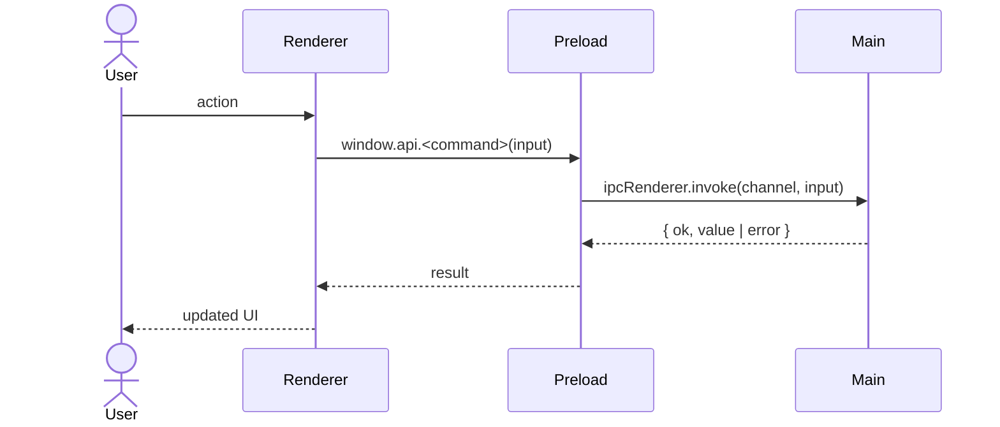

# <Plan title>

## Overview

<What will be implemented, in 2–4 sentences.>

**Out of scope:** <list>

**Implements / relates to:** <issue, doc section, or decision in `docs/decisions.md`>

## Pros / Cons

**Pros**
- <benefit>

**Cons**
- <downside accepted>

## How It Works

<2–3 sentence summary in plain words: what it does and why it exists.>

### Flow: <name>
1. <Who or what triggers it>
2. <What happens next>
3. <What comes out, and what happens on failure>



**Example:** <sample input → resulting output or state>

## Current State Analysis

**✅ Exists**
- <what is already in place, with file paths>

**❌ Missing Components**
- <what this plan adds>

## Implementation Steps

### Step 1: <name>
- **Files:** `path/to/file.ts`
- **Change:** <what changes and why>

**Code**

`path/to/file.ts` (new file, or: modify function `name`, after `<anchor>`)
```ts
<actual, complete code for this step>
```

`path/to/test_or_check_file.ts`
```ts
<actual test code for this step>
```

### Step 2: <name>
- **Files:** `path/to/other_file.tsx`
- **Change:** <what changes and why>

**Code**

`path/to/other_file.tsx`

Before
```tsx
<existing code, only when the change is not obvious>
```

After
```tsx
<new code>
```

### Step 3: Update Documentation (always the last step)

See "Documentation Update" below. Renumber this step so it follows the last code step.

## Edge Cases
- <special scenario and how it is handled>
- <`<PLACEHOLDER>` values the user must supply>

## Testing Checklist
- [ ] `npm run typecheck` passes
- [ ] <behavior to verify after implementation>

## Files to Modify
- [ ] `path/to/file.ts`
- [ ] `path/to/other_file.tsx`
- [ ] `docs/architecture.md`

## Implementation Order
1. Step 1
2. Step 2
3. Step 3 (Update Documentation, always last)

## Documentation Update

### Step 3: Update Documentation (always the last step)

**Affected documents**

| Document | What changes | Status |
|----------|--------------|--------|
| `docs/architecture.md` | <e.g. add component X and its dependency on Y> | todo |
| `docs/ipc-contract.md` | <e.g. document channel `x:y`: input, output, errors> | todo |

**Edits**

`docs/architecture.md` (section "<name>")
```markdown
<the actual new or replaced text and diagram>
```

**Not affected**
- `docs/decisions.md`: <one-line reason>
- `README.md`: <one-line reason>

**Open questions**
- Open question: <gap or conflict found> (owner: <name>)
