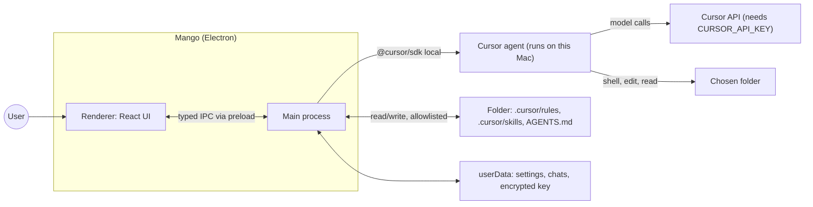
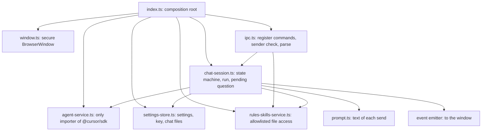

# Architecture

Mango is two processes. The Electron **main** process owns everything with authority: the API key, the folder, the files, the agent, and the pending question. The **renderer** is a React view with no Node access. It sends validated commands and paints events. Main is the source of truth; the renderer holds nothing that cannot be rebuilt by asking main.

## Context



"Local" means the agent runs on this Mac against the folder. The model is still served by Cursor, so a key is required. This is an assumption from the plan, not offline inference.

## Main-process modules

Main is built in one place, `src/main/index.ts` (the composition root). Each module is a factory that receives what it needs as arguments. A module does not import `electron` or another module's concrete instance, except `index.ts`, `window.ts`, and `ipc.ts`. This keeps modules testable with fakes and keeps the SDK in one file.



| Module | Owns | Never does |
|--------|------|------------|
| `window.ts` | Window and its security settings | Business logic |
| `ipc.ts` | Command registration, sender check, `input.parse`, result envelope | Call the SDK or touch files directly |
| `settings-store.ts` | `settings.json`, chat files, the encrypted key (via an injected `safeStorage`) | Return the key to the renderer |
| `rules-skills-service.ts` | Reading and writing rules, skills, `AGENTS.md` inside the allowlist | Touch any path outside it |
| `agent-service.ts` | `Agent.create`, `Agent.resume`, `send`, stream mapping, cancel, dispose | Know about IPC or the UI |
| `chat-session.ts` | The session state machine, the current run, the pending question | Call Electron APIs |
| `prompt.ts` | The text of each send: project-wins line, ask-tool line, optional transcript | Call the SDK, IPC, or the filesystem |

`chat-session.ts` is the one place that coordinates; the others are leaves. `ipc.ts` calls the session for settings, the key, the chat, and questions, and calls `rules-skills-service` for files. It does not call the settings store itself. `agent-service.ts` translates SDK messages into Mango's own event type (`delta`, `tool` with status `running`, `ok`, or `error`, `done`, `error`), so a beta SDK change stays inside that file (the sibling project's spikes S1 to S3 used SDK 1.2.0, which is pinned).

## Data ownership

| Data | Owner | Stored in | Seen by renderer |
|------|-------|-----------|------------------|
| Cursor API key | `settings-store` | `userData/secrets.bin`, encrypted with `safeStorage`, mode `0600` | Only "is set" |
| Settings (folder, model, theme) | `settings-store` | `userData/settings.json` | Yes. Theme is `system` (the default), `light`, or `dark` |
| Chat messages and `agentId` | `settings-store` | `userData/chats/<folderId>.json` | Messages, yes; `agentId`, no |
| Rules, skills, `AGENTS.md` | `rules-skills-service` | The user's folder (`.cursor/`), shared with Cursor IDE | Yes, through commands |
| Current run and pending question | `chat-session` | Memory in main | Through events and `chat.state` |

`userData` is Electron's path for this app, `~/Library/Application Support/Mango`. On the first launch, if that directory is missing and `~/Library/Application Support/flowfe` exists, main renames the old directory to `Mango`. Clearing the key renames `secrets.bin` aside (`secrets.bin.<time>.cleared`) instead of deleting it in place. A settings or chat file that does not parse is renamed aside (`*.corrupt`) and the empty value is used.

`folderId` is the SHA-256 hex of the folder's real path. One folder has one chat. Changing the folder switches to that folder's chat; it does not delete the old one.

## Patterns used

1. **Main as source of truth.** On start the renderer calls `settings.get`, `chat.history`, and `chat.state`, then subscribes to events. A reload loses nothing main still holds.
2. **Composition root with dependency injection.** Factories take their dependencies as arguments. A caller can pass a fake instead of Electron or the SDK. The repo has no unit-test suite yet; the checks are `npm run typecheck`, `npm run check:questions`, and `scripts/phase2-files-check.mjs`.
3. **Anti-corruption layer around the SDK.** Only `agent-service.ts` imports `@cursor/sdk`. Everything else sees Mango's own event type.
4. **Command catalog plus one event stream.** Requests use `invoke`; streaming uses one event channel. See [ipc-contract.md](ipc-contract.md).
5. **State machine for the chat.** One explicit state replaces scattered booleans. See [session-and-questions.md](session-and-questions.md).
6. **Correlation map for questions.** A pending-promise map keyed by question id bridges the agent's tool call and the user's form answer.
7. **Allowlist gateway for files.** All file access goes through `rules-skills-service`. It resolves real paths and allows only `<folder>/.cursor/rules`, `<folder>/.cursor/skills`, and `<folder>/AGENTS.md`.
8. **Snapshot on use.** Rules and skills are read when the agent is created. An edit applies to the next message by creating a new agent. A running run keeps what it started with. Resume is for a restart where the files did not change. Changing the model does not create a new agent: the next send passes the new model id. Changing the folder or the key disposes the current agent.
9. **Atomic JSON persistence with one writer.** Main serializes writes; each write goes to a temp file in the same directory, then renames over the target.

## Security boundaries

- Window: `contextIsolation: true`, `nodeIntegration: false`, `sandbox: true`, `webSecurity: true`. No remote URL; `window.open`, navigation, and webviews are refused; all permission requests are denied. These match the sibling project's window. This window also sets a minimum size and a background color.
- Preload exposes only the command catalog and one event subscription. It exposes no raw `ipcRenderer`.
- Every handler checks that the sender is the app's own window, then parses with the command's Zod `input`, then acts. Events are sent only to that window.
- The key never leaves main. It is not in logs, in IPC results, or in the agent's prompt. The SDK takes `apiKey` as an explicit option (checked in the 1.2.0 typings), and `agent-service.ts` always passes it. Without it the SDK falls back to `CURSOR_API_KEY` and then to a stored `Cursor.auth.login()` key, which could silently use a different account than the one the user entered.
- File allowlist: the folder is resolved with `realpath`. Allowed targets are `<folder>/.cursor/rules/*.mdc`, `<folder>/.cursor/skills/<name>/SKILL.md`, and `<folder>/AGENTS.md`. A name must match `^[a-z0-9][a-z0-9-_]{0,63}$` (1 to 64 characters). A file that is a symlink is refused. A directory symlink for `.cursor`, `rules`, or `skills` is followed only when its real path stays inside the folder. A skill folder that is itself a symlink is refused on read and delete. A path that resolves outside the folder is refused before any read or write.
- The agent runs shell and edit tools **without approval** in headless local mode (Mango spike S3). The setup screen says the agent can run shell commands and edit files without asking first. There is no read-only toggle in v1 (D-12). `settingSources: ["project"]` loads the folder's own hooks, MCP servers, and skills. The app does not write `~/.cursor`. Each send starts with a line that project instructions win over user-level ones, then a line that tells the agent to call `ask_user_question` (D-11). Under the folder button, setup says the agent may also see other instruction sources, because the Phase 0 log still loaded 23 skills from outside an empty folder.

## Renderer structure

No global state library. One reducer in `renderer/state.ts`. After load, the window shows one of three screens:

- **Setup**: key, folder, model, and theme, until all of key, folder, and model exist. Chat can open it again; once setup is complete it has Back to chat.
- **Chat**: the reducer fed by `chat.history` plus the event stream. It renders text, tool lines, the question card, the banner, a model picker, the theme switch, New chat, and a Rules button. New chat asks for confirmation, then calls `chat.reset`.
- **Rules and skills** (`Instructions.tsx`): tabs for rules, skills, and `AGENTS.md`. Rules and skills are a list on the left and a form on the right, with load / edit / save, a dirty flag, and the note that a saved change applies to the next message. `AGENTS.md` is one body field. Leaving the screen with unsaved edits asks for confirmation.

`QuestionForm` takes the question as props and calls back with an answer or a skip. It checks the answer with `shared/questions.ts` before that callback. It does not know about the SDK.

## Folder layout

```text
src/
  main/       index.ts, window.ts, ipc.ts, chat-session.ts, agent-service.ts,
              prompt.ts, rules-skills-service.ts, settings-store.ts
  preload/    index.ts, bridge.ts
  shared/     ipc.ts, questions.ts
  renderer/   main.tsx, App.tsx, state.ts, Setup.tsx, Chat.tsx, QuestionForm.tsx,
              Instructions.tsx, RulesEditor.tsx, SkillsEditor.tsx, Bot.tsx,
              global.d.ts, styles.css
docs/         this folder
scripts/      phase0-spike.ts, phase2-files-check.mjs, phase3-questions-check.ts,
              packaged-sdk-check.mjs, after-pack.cjs
```

`shared/` holds schemas, types, and question parsing: no I/O. `ipc.ts` is the command and event catalog. `questions.ts` is the ask-tool schema, answer checks, and the JSON returned to the agent. Main, preload, and renderer all import `shared/`.

## Packaging

An unsigned local `.app` via `electron-builder` (`dir` target, macOS arm64 only, `identity: null`). `npm run dist` writes `release/mac-arm64/Mango.app`. `@cursor/sdk-darwin-*` is listed in `asarUnpack` because the SDK locates `bin/rg`, `bin/cursorsandbox`, and `vendor/**/binding.node` by walking up from the main script and spawning those files; they cannot run from inside `app.asar`. `scripts/after-pack.cjs` sets the executable bit on those unpacked `bin` files. `scripts/packaged-sdk-check.mjs` checks the unpacked tree, loads the tree-sitter `.node` files with the packaged binary, runs `rg --version`, and requires the `.app` to stay up for a few seconds (that startup imports `@cursor/sdk`). A full agent turn inside the packaged app is not part of the check, because that needs a key and a folder.

## Out of scope

Windows and Linux, signing and auto-update, the cloud runtime, several agents, an orchestrator, a database, user-level `~/.cursor` editing, and GitHub integration.
