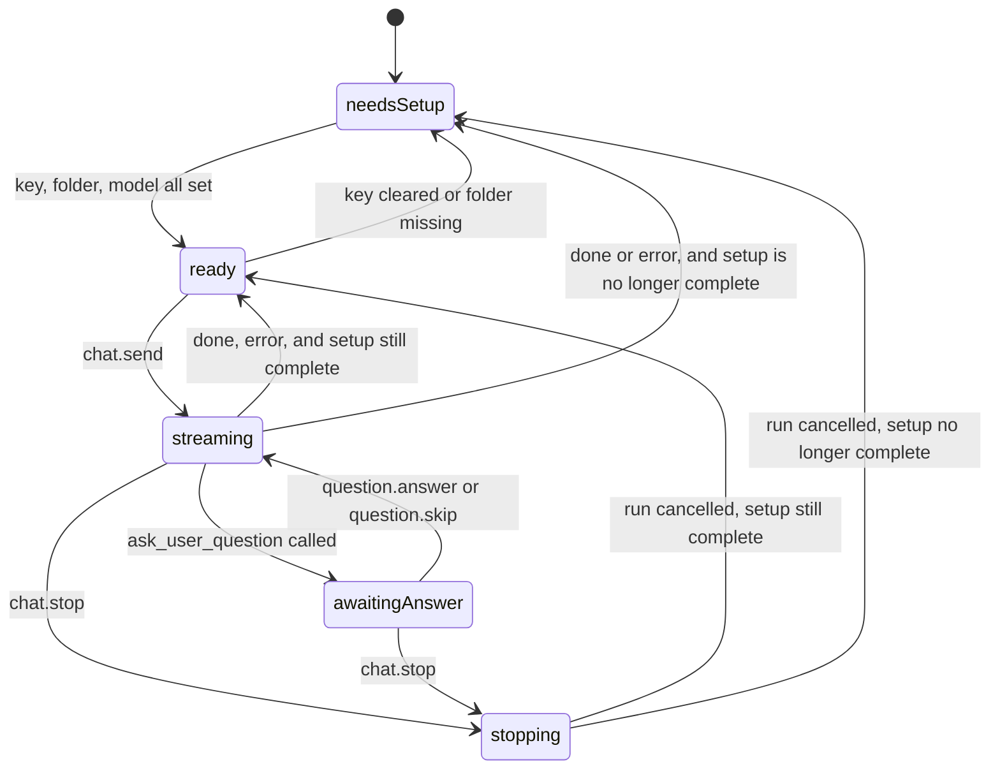
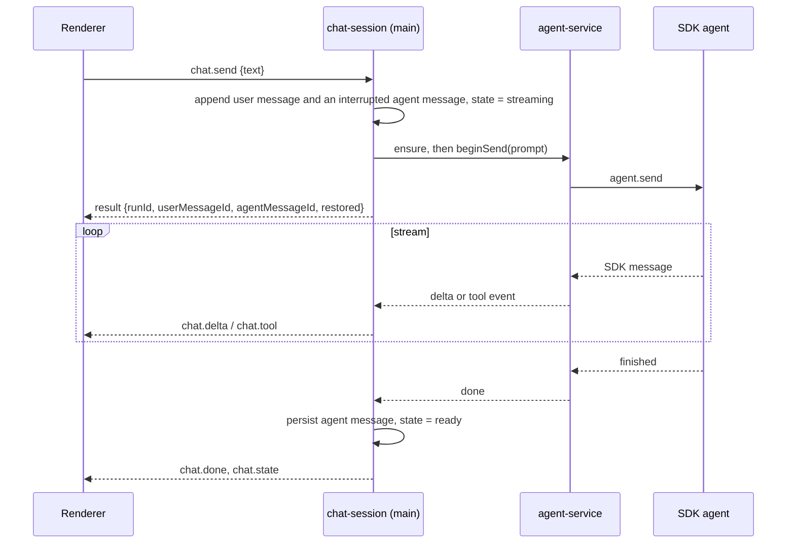
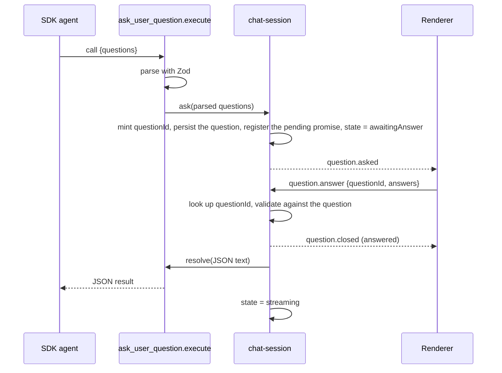

# Chat session, questions, and recovery

One chat per repo. `session-manager` owns the map of repos. Each `RepoSession` owns one state, one current run, and at most one pending question. The renderer mirrors that state per repo; it never decides it. A workspace with several repos shows a home screen. The user picks a repo by typing `@name`. A workspace with one repo opens that chat directly.

## State machine

| State | Composer | Stop | Allowed commands that change state |
|-------|----------|------|------------------------------------|
| `needsSetup` | Hidden | Hidden | `settings.save`, `key.set`, `key.clear`, `chat.reset` when the folder is still on disk |
| `ready` | Enabled | Hidden | `chat.send`, `chat.reset`, `settings.save`, `key.set`, `key.clear` |
| `streaming` | Disabled | Shown | `chat.stop`. Theme can still be saved |
| `awaitingAnswer` | Disabled | Shown | `question.answer`, `question.skip`, `chat.stop`. Theme can still be saved |
| `stopping` | Disabled | Disabled | none that change the run; theme can still be saved. The run ends on its own |

A command sent in the wrong state returns `not_ready` or `conflict`. Changing the folder, the model, the mode, or the key, and resetting the chat, return `conflict` while the state is `streaming`, `awaitingAnswer`, or `stopping`. `folder.pick` only opens the dialog; saving the chosen folder is what checks the state.

**Reset chat** (`chat.reset` with `repo`) asks for confirmation, then disposes that repo's agent and writes `agentId: null` with an empty message list for that repo. The chat header and, when several repos are listed, Remove on the left menu both do this. Removing the repo that is on screen returns the window to New chat. A workspace with one repo stays on the empty thread. Other repos keep running. Rules and skills files are left as they are. A missing repo path returns `not_ready` with "That folder is missing." Saving a different workspace folder, saving a new key, or clearing the key disposes every repo agent and cancels every pending question, and is refused with `conflict` while any repo is `streaming`, `awaitingAnswer`, or `stopping`. Saving the model or the mode is refused the same way. Theme can still be saved. The mode on a send is the mode stored at the start of that send.

## Several repos

Each repo runs the state machine above on its own. `flow:chat.send` for a repo that is not busy starts that repo's agent with `cwd` set to the repo path. A second send in that repo returns `conflict`. A send that would make an 8th repo busy returns `conflict` with "Seven agents are already running. Stop one before starting another." Events include `repo`, and the window applies them to that repo's transcript even when another chat is on screen. `flow:repos.list` returns each repo's name, state, whether a question is open, and whether its chat file has messages. The sidebar shows repos that are running, waiting, or that have history, an unseen reply, or an error banner, and the open chat. Remove clears that repo's chat and drops the row unless a banner remains.

## One run, step by step

Messages are persisted when they complete, not on every delta, with one exception: the agent message is written once at the start with `status: "interrupted"` and empty text, and rewritten with the streamed text on `done`, Stop, or an error. Tool lines are written when they finish. Each tool line and each question carries `offset`, the length of the run's text when it first appeared, so the saved chat can show text, tool calls, questions, and plans in order. Chats saved before this have no `offset`; their tool lines and cards show first, then the text. The `ask_user_question` call has no tool line, because the question card is its display. A Task call is saved with its description, model, and last activity, and the thread shows it as a subagent card. Activity updates while it is still running stay in memory until the call finishes. If the process dies mid-stream, that file is what remains: the agent message marked `interrupted`, without text that was only in memory. On quit, main rejects a pending question, marks the run settled without rewriting the message, and disposes the agent. Dispose waits at most 3 seconds, then the app quits.

## Question flow

The agent asks through a custom tool `ask_user_question` registered in `Agent.create({ local: { customTools } })`. Its schema copies Cursor's AskQuestion: `questions[{ id, prompt, options[{ id, label }], allow_multiple }]`.

**Checked in the SDK 1.2.0 typings:** `customTools` exists on the agent and per send. `execute(args, { toolCallId })` may return a Promise. Custom tools are exposed to the model through an MCP server named `custom-user-tools` and need no approval. Their `inputSchema` is plain JSON Schema, so `execute` parses `args` with Zod itself. If a `tools` allowlist is ever set, it must include `"mcp"`, or the custom tool disappears. `toolCallId` is stored with the pending question for logs. The same tool is passed on `Agent.create`, `Agent.resume`, and every `send`, because the callback has to run in this process. A per-send `customTools` replaces the agent-level map for that run, so the send passes the tool again rather than relying on the stored agent.

**Measured (Phase 0, 2026-11-05):** the agent calls `ask_user_question` when told, the arguments parse, and a 5 second wait returns its token in the reply. Native `askQuestion` did not appear, and that run finished with `NO_ASK_TOOL`. A wait of several minutes was not measured. The choice is D-4 in [decisions.md](decisions.md).

Rules:

- **One pending question at a time.** A second call while one is pending is rejected with an error result to the agent ("a question is already open").
- **Correlation by id.** `question.answer` for an unknown or already-closed id returns `not_found`. A double click cannot answer twice.
- **Validation.** The answer must include every question on the form and no other id. Every `selected` id must be an option of that question; a single-choice question takes at most one id; `other` is trimmed and at most 2 000 characters. At least one selected id or a non-empty `other` is required. An invalid answer returns `invalid_input` and the question stays open. The form runs the same check before it sends.
- **Skip.** `question.skip` resolves the tool with `{ skipped: true }` so the agent can continue or ask differently. It does not reject the tool.
- **Cancel.** `chat.stop`, a run error, app quit, and a folder or key change reject the pending promise, emit `question.closed` with `cancelled`, and clear the map.
- **Reload.** The pending promise lives in main. After a window reload the renderer calls `chat.state`, gets `pendingQuestion`, and shows the same form. It does not survive an app restart, because the run does not either.
- **Result to the agent:** `{ [questionId]: { selected: [optionId], other?: string } }` as JSON text.

## Rules and skills edits

The SDK reads `<folder>/.cursor` and `AGENTS.md` when an agent is created or resumed (`settingSources: ["project"]`; Mango spike S3). So:

- An edit while `ready` sets `instructionsPending` on `chat.state`. The next `chat.send` creates a new agent so it reads the files again, then clears the flag. Resume is not used after an edit: the Phase 0 spike changed the rule and the resumed agent still followed the old one. The prompt still includes the last 20 text messages, each clipped to 8 000 characters, and `chat.send`'s `restored` flag stays false so the chat does not show the restart note.
- An edit while `streaming` still saves the file. The running run keeps what it started with. The editor says a saved change applies to the next message. Once the flag is set, the chat shows "Saved rules and skills apply to the next message."
- Saving the same bytes again does not set the flag. A write during the create is kept: the flag stays set if another save landed after the snapshot, and the following message creates again.
- `Agent.resume(agentId, options)` accepts `Partial<AgentOptions>` (typings), so `settingSources` and `apiKey` are passed again on every resume. The Phase 0 spike passed both, then changed the rule file. The resumed reply kept the old ending, so an edit uses `Agent.create` and the stored transcript, as in recovery below.

Every send is built in `prompt.ts` and is not written into the user's files. The text is two fixed lines, then an optional transcript, then the user's message. The first line says that a project instruction wins over a user-level one. The second tells the agent to call `ask_user_question` and wait, instead of asking for the choice in chat. Mango does not use the SDK's `systemPrompt` option, because that replaces the SDK's own system prompt. The transcript is the last 20 user and agent messages with non-empty text. Tool and question messages are left out. Each included message is clipped to 8 000 characters. It is added after a failed resume, and after a rules or skills edit. A resumed agent with unchanged files gets the two lines and the new message only.

## Restart and recovery

Mango spike S8 (2026-11-04) killed a process mid-run. `Agent.list` still showed the agent as `running`, and `Agent.resume` failed with "already has active run". So an in-flight run cannot be assumed recoverable, and `agentId` alone does not restore a conversation after a crash.

On startup, per folder:

1. Load `chats/<folderId>.json`. Any agent message still `interrupted` stays marked as such and the UI shows "Interrupted when the app closed".
2. If the last run was in flight, do not call `Agent.resume` immediately.
3. On the first `chat.send`, try `Agent.resume(agentId)` with a 10 second timeout, unless a rules or skills edit is waiting. An edit skips resume and creates a new agent.
   - **Resumed:** continue with the same SDK-side context. `restored` is false, so the window does not show the history note.
   - **Failed or timed out:** call `Agent.create` and prepend a transcript of the last 20 user and agent messages (text only, each clipped to 8 000 characters) to the prompt, so the conversation continues. The UI shows a one-line note "Context restored from history".
4. If the last run ended normally, resume works as in the plan; the same fallback applies if it fails.

"Restart keeps the conversation" in the plan means the messages and the ability to continue, not that SDK-side state is guaranteed.

## Errors

| Cause | State after | What the user sees |
|-------|-------------|--------------------|
| Key missing or rejected | `ready` if a key is still stored, `needsSetup` if it is missing | Banner title "Key rejected", with a Setup button. A missing key on send is `not_ready` ("Finish setup first") and the window is already on Setup |
| Folder missing | `needsSetup` | Banner title "Folder missing" on the setup screen: "The chosen folder is gone. Pick it again." |
| SDK error mid-run | `ready` if setup is still complete | Banner title "Agent error", body is the safe message, and Retry, which re-sends the last user text |
| Stop | `ready` if setup is still complete | The agent message is marked `stopped` |
| App quit mid-run | on next start, `ready` | Message marked `interrupted`. Text that had not been written yet is absent |
